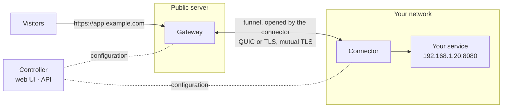

# rpmgr — Reverse Proxy Manager

**Publish the services on your private network on the internet, securely, from one web UI.**

rpmgr makes services that run behind NAT, CGNAT or a firewall reachable from the internet: a NAS,
a dashboard, an internal API, a game server. An agent in your network dials out to a public server
you own, and that server passes the traffic through. You need no port forwarding, no
public IP address at home and no inbound firewall rule.

> [!NOTE]
> v0.2.0 is rpmgr's second release ([Releases](https://github.com/felix-homelab/rpmgr/releases)):
> the minimum viable product of its first phase, now with signed updates over the air. Try it out,
> expect rough edges, and [report what you find](https://github.com/felix-homelab/rpmgr/issues).

## Why rpmgr

- **Nothing to open at home.** Connectors only dial out, on port 443. They work behind NAT, CGNAT
  and strict firewalls, and through an HTTP or SOCKS5 proxy where only a proxy leads out.
- **HTTPS without effort.** Gateways obtain and renew certificates from Let's Encrypt, or any other
  ACME CA, for every hostname you publish.
- **Any protocol.** Websites and APIs over HTTP/1.1, HTTP/2, WebSocket and gRPC; raw TCP and UDP
  ports; TLS passed through to your service still encrypted.
- **One place to manage it all.** A web UI, a command line and an API for routes, connectors,
  gateways, domains, certificates, access rules, members and the audit log.
- **Changes you can trust.** Preview a route before you save it and watch every gateway and
  connector apply it. A change never interrupts the routes it does not touch, and an agent that
  rejects a change keeps running its last good configuration.
- **Secure by default.** No default password and no shared secret: every gateway and connector has
  its own short-lived certificate, and every link between them is mutual TLS 1.3. A file on each
  connector host decides what that connector may reach, whatever the server tells it.
- **One binary.** `rpmgr` is a single static binary for every role, for Linux on amd64, arm64,
  armv7 and riscv64: from a cloud server to a Raspberry Pi.

## How it works



| Part | What it does | Where it runs |
|---|---|---|
| **Gateway** | Takes the public traffic on ports 80 and 443, and on the TCP and UDP ports you publish, and passes it to the connectors | A server with a public IP address, such as a small VPS |
| **Connector** | Dials out to the gateways and forwards each connection to your service | A Linux host in your private network that can reach the service |
| **Controller** | Web UI, API, accounts, certificates and configuration; tells the gateways and connectors what to do | Usually on the gateway's server: the **all-in-one** runs controller, gateway and a connector for the server's own services in one process |

Visitor traffic goes from the gateway to the connector and on to your service; it never passes
through the controller. If the controller is down, every tunnel keeps running on its last
configuration ([02](docs/02-architecture.md)).

## Features

What v0.2.0 brings; the full catalogue, with what comes later, is in [05](docs/05-features.md).

**Publishing services**

- `http` routes by hostname and path prefix, to HTTP, h2c or HTTPS services; HTTPS services are
  verified, against your own CA if you have one, or, for a self-signed certificate, by the key it
  shows now, or by your explicit choice not at all.
- `tcp` and `udp` routes on public ports from a port pool, `tcp_udp` routes that serve one port
  number with both, such as DNS, and `tls_passthrough` routes chosen by the TLS server name.
- Redirects from HTTP to HTTPS, HSTS, request and response headers, `Forwarded` and
  `X-Forwarded-*` headers, and the PROXY protocol towards the service.
- Switch a route off and on with one click, or put an `http` route in maintenance, so that visitors
  see a "Down for maintenance" page with your message; the other routes carry on undisturbed.
- Visitors get a page, not a bare error, for a name no route serves and for a service that is
  down.

**Certificates and domains**

- Certificates from Let's Encrypt or another ACME CA, renewed automatically, or your own uploaded
  ones.
- Hostnames only under domains your organisation has proved are its own, by a DNS TXT record or an
  HTTP token.

**Access control**

- Access policies with IP allow and deny lists, and basic auth with argon2id-hashed passwords.
  Tightening a policy also ends the open connections it no longer allows.

**Gateways and connectors**

- Enroll a connector with one command and a token from the web UI.
- Up to four gateways per gateway group, with a tunnel from each connector to each of them; drain
  a gateway for maintenance.
- A route's targets on several connectors, by priority and weight: when the best one fails, the
  next one takes over.
- QUIC by default, and TLS with HTTP/2 over TCP where UDP is blocked, chosen automatically.
- Ephemeral connectors that remove themselves, and decommissioning with immediate effect.

**Accounts and teams**

- Local accounts with an authenticator app (TOTP) and recovery codes, and a renewed sign-in before
  sensitive changes.
- The roles Owner, Admin, Operator and Viewer; invitations and password resets by one-time link,
  or by e-mail when a mail relay is configured.
- Personal API tokens for the command line and scripts.
- Administrators recover a member's access: a password-reset link, or the removal of a lost
  authenticator.

**Operations**

- An overview with the health of every part, the traffic of the last 24 hours and what needs
  attention; traffic per route; a light and a dark theme.
- A tamper-evident audit log of every change, sign-in and token use.
- Prometheus metrics, health endpoints and OpenTelemetry traces.
- Online backups, restore, key rotation and a YAML export of every resource.

**Updates**

- Signed updates over the air for gateways and connectors: roll a release out from
  **Settings → Updates** to a few test agents first, then to a share of the agents, then to all.
  An agent whose update fails goes back to its previous version, and the rollout pauses.
- The controller verifies every release against rpmgr's release keys and keeps it in its own
  mirror, so agents download only from the controller. Without access to GitHub, upload a
  release's signed files instead.
- A connector-only build, less than a third of the full build's size, for every Linux architecture
  and for Windows and macOS.

## Requirements

- **A public server** for the gateway, or the all-in-one: Linux with a public IP address and the
  ports 80/tcp, 443/tcp and 443/udp open, plus the port ranges you publish for `tcp` and `udp`
  routes ([10](docs/10-operations.md#ports)).
- **Connector hosts** need no open port: they reach the gateways and the controller on port 443,
  over UDP and TCP, or over TCP alone.
- **A domain name** whose DNS records you can set, for the web UI (such as `panel.example.com`) and
  the hostnames you publish.
- **Linux** with kernel 5.10 or later and systemd 249 or later: Debian 12+, Ubuntu 22.04+, RHEL,
  Rocky and Alma Linux 9+, or Raspberry Pi OS. The install scripts need `curl` or `wget`, and
  OpenSSL 3.
- **Architectures:** amd64 and arm64 for every role; armv7 and riscv64 for connectors, and best
  effort for the other roles ([05](docs/05-features.md#platform-support)).

The connector-only build also runs on Windows (amd64) and macOS (amd64, arm64), started by hand;
installing it there as a service is planned ([13](docs/13-roadmap.md#phase-2--production)).

## Quick start

This sets up an all-in-one on a public server, connects a machine at home, and publishes a web app
of that network, `192.168.1.20:8080`, as `https://app.example.com`. Use your own names and
addresses instead.

### 1. Point the names at the server

At your DNS provider, create A (and AAAA) records for `panel.example.com`, the web UI, and
`app.example.com`, the app, with the server's public IP address. The certificates need them, so
create them first.

### 2. Install rpmgr on the server

```sh
curl -fsSLO https://github.com/felix-homelab/rpmgr/releases/latest/download/install.sh
sudo sh install.sh
```

The script downloads the release, checks its signatures before it installs anything, and installs
the `rpmgr` binary, the system user `rpmgr` and its directories. Then it offers to run
`rpmgr setup`.

### 3. Set the server up as an all-in-one

Let the script run `rpmgr setup`, choose the role **all-in-one** and enter the public URL
`https://panel.example.com`. Setup shows its plan and asks before it changes anything. Then it
writes the configuration, creates the database and the internal CA, installs and starts the
service `rpmgr-all-in-one`, and waits until it is ready. The same without questions:

```sh
sudo rpmgr setup --role all-in-one --public-url https://panel.example.com \
  --acme-email you@example.com --yes
```

Services on the server itself, such as containers next to rpmgr, go through the all-in-one's own
connector, which reaches only the targets you allow, for example with `--allow-target
127.0.0.1:8080`, or later with `sudo rpmgr policy allow-target 127.0.0.1:8080`.

At the end, setup prints a one-time link, `https://panel.example.com/setup#…`. To try rpmgr out
without using up Let's Encrypt's rate limits, add `--acme-directory staging`; browsers do not
trust its certificates.

### 4. Create your account

Open the link within 7 days and create the first account. It becomes the Owner of your
organisation and the Instance Admin, who administers the whole installation. On your **Account**
page, add an authenticator app. If the link is lost before the account exists,
`sudo rpmgr user reset-password` prints a new one.

### 5. Claim your domain

A route can only use hostnames under a domain your organisation has proved is its own. Under
**Security → Domains & certificates**, choose **Claim a domain**, enter `example.com` and tick
**Also every name below it**; without it, the claim covers `example.com` alone. Then prove the
domain with the DNS TXT record the page shows and **Check now**, or, as the Instance Admin, choose
**Mark as trusted** to skip the proof.

### 6. Connect a machine at home

Under **Network → Connectors**, choose **Enroll a connector**. Enter `192.168.1.20:8080` as a target
the connector may reach, and choose **Create the token**. On the machine at home, run the command
the dialog shows; it looks like this:

```sh
curl -fsSLO 'https://panel.example.com/install.sh' && sudo sh install.sh \
  --controller 'https://panel.example.com' --ca-pin 'sha256:…' \
  --allow-target '192.168.1.20:8080'
```

When the installer asks for it, paste the token from the dialog. The token is shown only once, is
never part of a command line, and by default enrolls one connector within an hour. The connector
appears under its host's name.

The targets you entered go into the connector's local policy, `/etc/rpmgr/policy.yaml`, and the
connector reaches nothing else. To allow another target later, run
`sudo rpmgr policy allow-target 192.168.1.30:80` on that machine. A target may also be a subnet or
a port range, such as `192.168.1.0/24` (all ports) or `192.168.1.30:8000-8099`, and
`sudo rpmgr policy deny-target 192.168.1.30:8022` takes a port out again.

### 7. Publish the app

Under **Network → Routes**, choose **Create a route**: an `http` route for the hostname
`app.example.com` on the gateway group `default`. Then **Add a target**: the connector, host
`192.168.1.20`, port `8080`, protocol HTTP. The gateway obtains a certificate for the name, and
`https://app.example.com` serves your app.

For `tcp` and `udp` routes, first give the gateway group a port pool under **Network → Gateways**,
and open those ports in the server's firewall.

## Other setups

- **Separate servers.** The controller can run on its own host, with gateways on others; the
  controller can even stay in a private network and be reached through a gateway. Add a gateway
  under **Network → Gateways**, make its enrollment token, and run
  `sudo rpmgr setup --role gateway` on its server
  ([02](docs/02-architecture.md#deployment-topologies)).
- **Several gateways.** Up to four gateways in a gateway group serve the same routes; further
  groups serve other regions.
- **Restricted networks.** Connectors fall back to TCP when UDP is blocked, and reach the gateways
  through an HTTP CONNECT or SOCKS5 proxy: `rpmgr setup --role connector --proxy <url>`.
- **Containers.** Signed multi-arch images at `ghcr.io/felix-homelab/rpmgr` run as a non-root user,
  with the role as the command, such as `docker run … ghcr.io/felix-homelab/rpmgr gateway`
  ([10](docs/10-operations.md#install-paths)).
- **No internet access for the controller.** `rpmgr release import` gives the controller the
  release files that the install scripts download from it ([16](docs/16-cli.md)).

## Command line

The `rpmgr` binary is also the command line for everything the web UI manages. Make a personal API
token on your **Account** page; the page shows the `rpmgr login` command that goes with it:

```sh
rpmgr login --controller https://panel.example.com --org <org ID>   # asks for the token
rpmgr list route
rpmgr create route --name app --group default --http --hostname app.example.com
rpmgr create route-target --route app --connector home-server \
  --address 192.168.1.20:8080 --upstream http
rpmgr disable route app
```

Results come as a table, or with `-o yaml` or `-o json` for scripts. Secrets are never taken from
the command line: tokens and passwords come from a file, an environment variable or a prompt. Every
command and flag is in [16](docs/16-cli.md).

## Security

- **No default credentials.** The first account is made through a one-time link; accounts can add
  an authenticator app, and sensitive changes ask you to sign in again.
- **An identity for every agent.** Each gateway and connector holds its own key and a short-lived
  certificate from rpmgr's internal CA, renewed automatically and revocable at once.
- **Mutual TLS 1.3 between all parts.** Connectors only dial out, and on every connection between
  the controller, gateways and connectors both ends prove who they are.
- **The host has the last word.** A connector's local policy, a root-owned file on its host, limits
  the services it reaches, even if the controller is compromised. The all-in-one's own connector
  shares the controller's process, so there its policy limits what routes reach, not a compromised
  controller ([ADR-0019](docs/adr/0019-all-in-one-runs-a-connector.md)).
- **Signed configuration.** Agents accept only configuration the controller has signed, and keep
  their last good copy.
- **Secrets encrypted at rest.** Keys and passwords in the database are encrypted with a key kept
  outside it, and logs leave them out.
- **Verifiable releases.** Releases are signed and built reproducibly, with an SBOM and build
  provenance; the install scripts verify the signatures before they install anything.

The threat model and every mechanism are in [04](docs/04-security.md). Please report
vulnerabilities privately, as [SECURITY.md](SECURITY.md) describes.

## Running rpmgr

**Health.** The overview in the web UI shows what needs attention. On a gateway or connector host,
`rpmgr status` shows its identity, certificate expiry, configuration and readiness;
`rpmgr diag transport` tests the tunnel to each gateway over QUIC and TCP, and `rpmgr diag clock`
checks the host's clock. Every role serves `/healthz`, `/readyz` and Prometheus metrics on
localhost ([10](docs/10-operations.md#observability)), and the runbooks cover common problems
([10](docs/10-operations.md#runbooks)).

**Backups.** On the controller's host:

```sh
sudo rpmgr backup --out /root/rpmgr-backup.tar
```

The backup holds the database, the revocation log and the audit checkpoints, and is written while
the controller runs. The key that encrypts the secrets in the database is not part of it: back it
up separately and keep it apart. `rpmgr restore` brings a backup back
([10](docs/10-operations.md#backup-and-restore)).

**Upgrades.** Back up first, then upgrade the controller, then the gateways, then the connectors.
Gateways and connectors installed with the install scripts update over the air, in a rollout you
start under **Settings → Updates**. Controllers and all-in-ones, and hosts installed before
v0.2.0, are upgraded by hand: on each host, run the new release's `install.sh` with `--upgrade`,
which replaces the binary and installs the updater, and `--restart`, which restarts the rpmgr
services that run and checks that they stay up:

```sh
curl -fsSLO https://github.com/felix-homelab/rpmgr/releases/latest/download/install.sh
sudo sh install.sh --upgrade --restart
```

Without `--restart`, the script names each service that still runs the previous binary and the
command that restarts it.

A controller works with agents of its own minor version and of the one before
([10](docs/10-operations.md#upgrades-and-version-skew)).

## Roadmap

The first phase is complete with v0.1.0, and v0.2.0 starts the second one with signed updates
over the air. The rest of it brings DNS records managed in Cloudflare, wildcard certificates
through DNS-01, single sign-on and passkeys, private services between connectors, health checks
and passive health for targets, rate and bandwidth limits, restarts without interrupting
visitors, Windows and macOS connectors installed as services, and PostgreSQL with several
controllers. Virtual networks, HTTP/3, a Helm chart and a Terraform provider follow after that
([13](docs/13-roadmap.md)).

## Documentation

| Document | Read it to |
|---|---|
| [User guide](docs/guide/README.md) | Install, set up, use, upgrade and troubleshoot rpmgr: every task in the web UI and on the command line |
| [Quick start](docs/guide/quick-start.md) | Go from a fresh server to a first published service, step by step |
| [Command-line reference](docs/guide/reference/cli.md) | Look up every command and its flags |
| [Web UI](docs/guide/web-ui/README.md) | Find your way through every page of the web UI |
| [05 — Features](docs/05-features.md) | See every feature, the release phase it comes in, and the supported platforms |
| [04 — Security](docs/04-security.md) | Understand the threat model, identities, roles and what protects you |
| [CHANGELOG](CHANGELOG.md) | See what changed in each release |
| [All documents](docs/README.md) | Read the whole design: architecture, connections, data model, API, operations, testing and decisions |

## Building from source

You need Node of the version in `web/.nvmrc` for the web UI, and Go of the version `go.mod` pins:

```sh
npm --prefix web ci && npm --prefix web run build   # the web UI, embedded from internal/webui/ui
CGO_ENABLED=0 go build -trimpath -o rpmgr ./cmd/rpmgr
```

A binary built without the web UI serves a placeholder page instead. A build from source has the
release root keys compiled in, but reports the version `dev`: a controller serves its agents only
the signed release of its own version, so the controller's install script and `/dl/` mirror need
a released binary ([04](docs/04-security.md#release-signing)).

## Contributing and support

- **Questions, bugs and ideas:** [GitHub issues](https://github.com/felix-homelab/rpmgr/issues).
- **Security vulnerabilities:** privately, never in a public issue ([SECURITY.md](SECURITY.md)).
- **Contributions:** welcome, under the rules in [CONTRIBUTING.md](CONTRIBUTING.md); the design
  documents are introduced in [docs](docs/README.md).

rpmgr is a personal open-source project with one maintainer
([D26, D27](docs/14-open-decisions.md#project-and-process)).

## License

rpmgr, code and documentation, is licensed under the [Apache License 2.0](LICENSE)
([D1](docs/14-open-decisions.md#product-and-project)). Contributions are accepted under the same
license with a Developer Certificate of Origin sign-off
([CONTRIBUTING](CONTRIBUTING.md#license-sign-off-and-third-party-code)).
