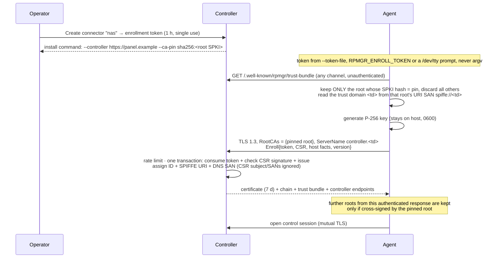
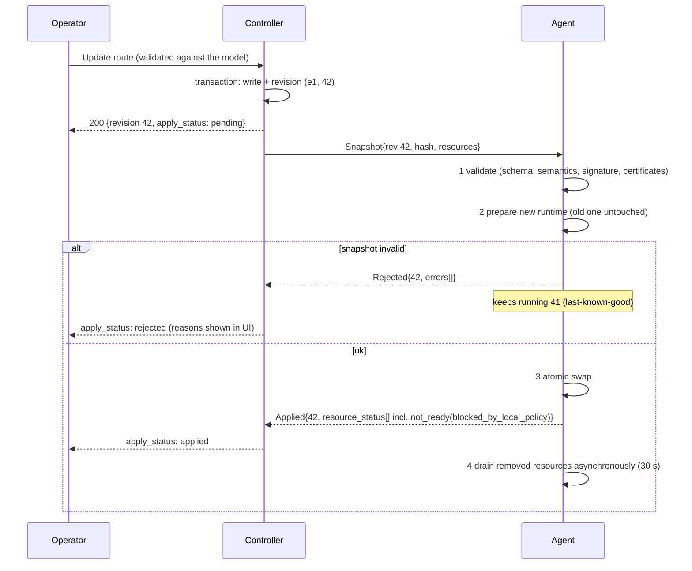
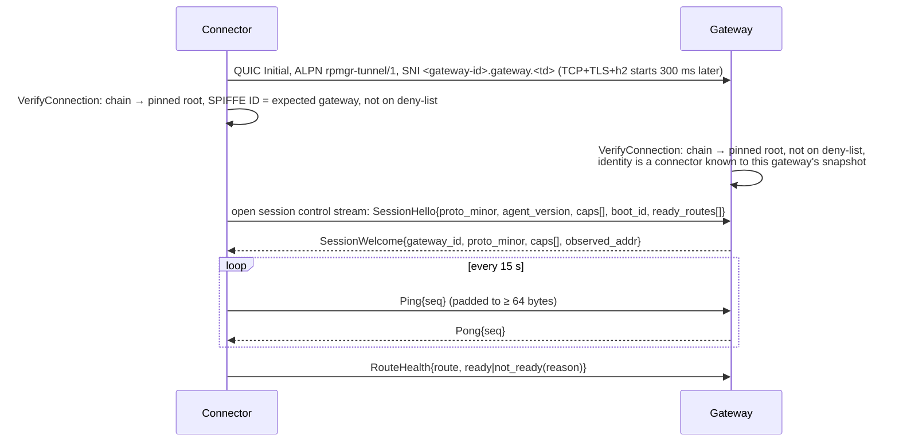
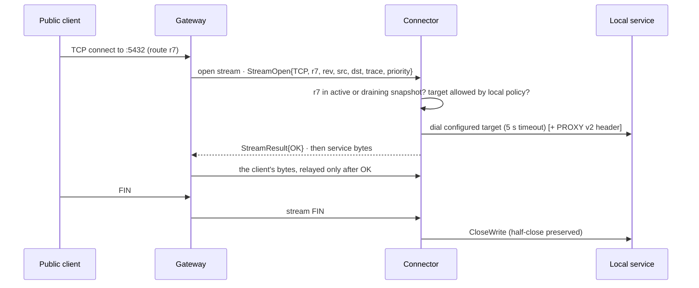
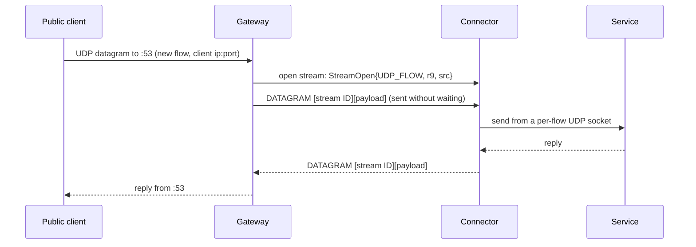
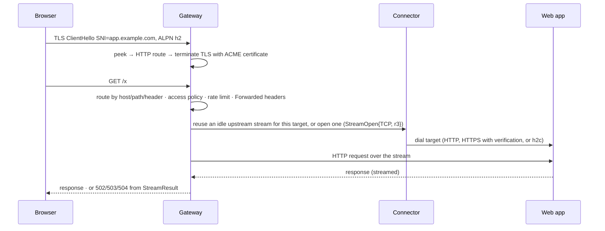
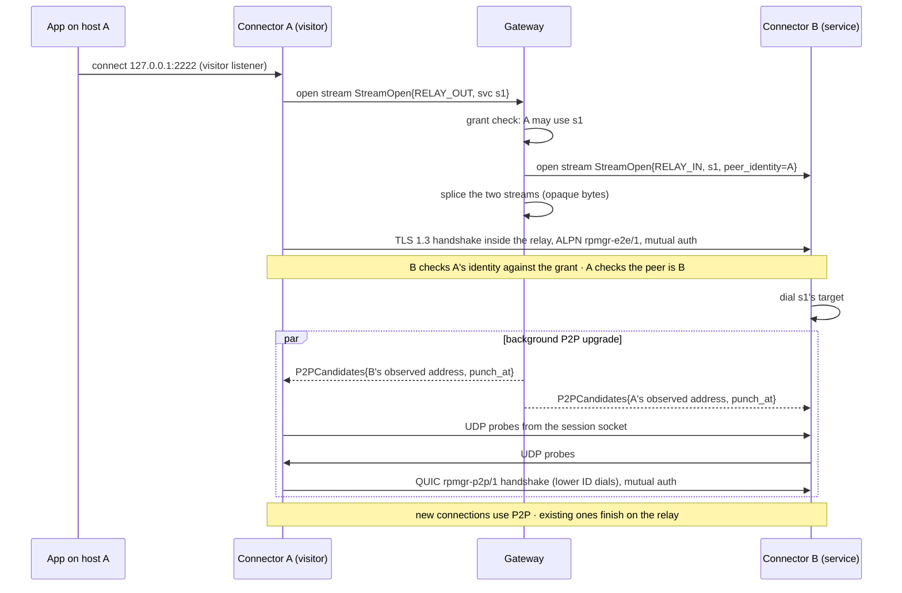

# 03 — Connections: fast and secure

> Status: Phase 1 is implemented. Tags: [F] fact · [R] recommendation · [T] target · [V] verify
> at implementation ([README](README.md#how-to-read-these-documents)). Library facts were checked
> against **quic-go v0.61.0**, **hashicorp/yamux v0.1.1**, **grpc-go v1.67.1**, **golang.org/x/net
> v0.57.0**; the HTTP/2 facts of the TCP transport were re-checked at **Go 1.27.1** by spike S2 and
> cite that version. Every **[V]** item is tracked in [13-roadmap.md](13-roadmap.md): load-bearing
> ones as [Phase 0 spikes](13-roadmap.md#phase-0--spikes) (`[V S1]`…), the rest in the [verification
> backlog](13-roadmap.md#verification-backlog).
>
> **This document is the single source of truth for connection and protocol values**: timeouts,
> keepalives, backoff, sizes and limits. Security lifetimes and cryptographic parameters (certificates,
> tokens, sessions, step-up, password hashing) are owned by [04-security.md](04-security.md). Other
> documents reference these values instead of restating them.

## Overview

| Connection | From → to | Transport | Authentication | Lifetime |
|---|---|---|---|---|
| **Enrollment** | Agent → Controller | HTTPS, TLS 1.3 | Server: pinned rpmgr root CA. Client: enrollment token | Once per agent |
| **Control session** | Agent → Controller | HTTP/2 over TLS 1.3, gRPC (grpc-go) | Mutual TLS, per-agent certificate | Long-lived |
| **Data session** | Connector → Gateway | QUIC (`rpmgr-tunnel/1`), or TLS + reverse HTTP/2 (`rpmgr-tunnel-h2/1`), optionally wrapped in WSS | Mutual TLS, per-agent certificate | Long-lived |
| **End-to-end session** | Connector ↔ Connector, inside a relayed stream | TLS 1.3 (`rpmgr-e2e/1`) | Mutual TLS | One per private-service connection |
| **P2P session** | Connector ↔ Connector, direct | QUIC (`rpmgr-p2p/1`) | Mutual TLS | Long-lived per peer pair |
| **Public ingress** | Public client → Gateway | TCP, UDP, TLS passthrough, HTTP/1.1, HTTP/2, HTTP/3 (Phase 3) | Route's access policy | Per request/connection |

Design goals, in priority order:

1. **Secure.** Every connection between rpmgr components is TLS 1.3 with mutual authentication and
   per-component identities. No shared secrets, no timestamp tokens, no `InsecureSkipVerify`
   (its exceptions concern HTTPS upstreams a user marks unverified or pins by key, not rpmgr's own
   sessions: [ADR-0017](adr/0017-upstream-tls-verification-modes.md),
   [ADR-0018](adr/0018-pin-the-key-a-target-presents.md)).
2. **Correct under change.** Configuration changes are validated, applied atomically, acknowledged,
   and never disturb unchanged tunnels.
3. **Fast.** No extra round trip per user connection; no cross-stream head-of-line blocking on the
   default transport; UDP carried as datagrams, not inside a TCP stream.

## Properties common to all rpmgr-internal sessions

- **TLS 1.3 only** (`MinVersion = MaxVersion = tls.VersionTLS13`). Key exchange uses the Go
  `crypto/tls` defaults, which enable the hybrid post-quantum groups X25519MLKEM768,
  SecP256r1MLKEM768 and SecP384r1MLKEM1024, X25519MLKEM768 first
  [F Go 1.27.1 `crypto/tls/defaults.go:23-42`]; a client sends an X25519MLKEM768 key share with an
  X25519 share next to it ([S3](spikes/S3.md)).
- **Certificates chain to the installation's pinned root CA**, never to the system trust store.
  Every certificate carries a SPIFFE URI SAN (the identity) and a DNS SAN derived from it
  (`<id>.connector.<td>`, `<id>.gateway.<td>`, `controller.<td>`). The TLS client always sets
  `ServerName` to the **expected peer's** DNS name — Go's TLS client refuses to handshake without
  one unless verification is disabled [F Go 1.27.1 `crypto/tls/handshake_client.go:47`] — and
  `tls.Config.VerifyConnection` additionally checks the SPIFFE ID against the deny-list and the
  agent's snapshot ([04](04-security.md#pki-and-identity)). `InsecureSkipVerify` is never used
  for these sessions.
- **0-RTT is disabled** (no `Allow0RTT`, no `ListenEarly`/`DialEarly`), because 0-RTT data can be
  replayed. TLS session resumption is allowed: Go runs `VerifyConnection` on resumed TLS 1.3
  connections on both sides [F Go 1.27.1 `crypto/tls/handshake_client_tls13.go:595-604`]
  [F Go 1.27.1 `crypto/tls/handshake_server_tls13.go:1033-1042`], so a revoked identity is refused
  on resumption too ([S7](spikes/S7.md)). `VerifyPeerCertificate` is not called on resumed
  connections [F Go 1.27.1 `crypto/tls/common.go:675-678`], so every rpmgr check lives in
  `VerifyConnection`. Session-ticket key rotation is defined in
  [04](04-security.md#leaf-certificates).
- **No renegotiation.** `tls.Config.Renegotiation` is never set: it would disable exported keying
  material [F Go 1.27.1 `crypto/tls/conn.go:1643-1649`], which binds CSRs to their connection
  ([04](04-security.md#flow)).
- **No application-layer secrets on the wire.** After the TLS handshake, the peer identity is
  known; no message carries a password, token or signature for authentication.
- **Every stream has exactly one writer goroutine** behind a bounded queue. Every request has a
  deadline and is cancellable, so no stream can block or race another.

## Enrollment

An agent needs a certificate before it can open any session. It gets one by enrolling once.



What the token grants decides the identity, never the request: a connector token creates a
connector named after the host (`nas`, then `nas-2` if the name is taken in the org), with the
token's labels and ephemeral flag; a gateway token enrolls the gateway it is bound to, which an
Admin created first; a re-enrollment token keeps its connector's identity and replaces only the key. The
`/.well-known/rpmgr/trust-bundle` download is served by the controller's web server as PEM.

The unauthenticated bundle download is only a convenience: the pin selects exactly one root, so an
attacker who adds roots to the bundle (for example a TLS-intercepting proxy) gains nothing. If the
`Enroll` response is lost, the agent retries with the same CSR; the controller returns the same
certificate for the same token and public key for 10 minutes, so a lost response does not burn the
single-use token. Token format, lifetimes and re-enrollment rules are in
[04-security.md](04-security.md#enrollment).

## Control session

### Transport

- **grpc-go** at both ends ([ADR-0016](adr/0016-connectrpc-public-api-grpc-go-agents.md)): agents
  use a grpc-go client, the controller grpc-go's own HTTP/2 server. One TCP connection per agent,
  SNI `controller.<trust-domain>`, ALPN `h2`.
- The controller's TCP/443 listener reads the ClientHello like a gateway
  ([Port 443 multiplexing](#port-443-multiplexing)) and hands the agent names `controller.<td>` and
  `reauth.controller.<td>` to the grpc-go server; every other name, and a ClientHello without a
  name, goes to its `net/http` server, where browsers, the CLI and scripts use ConnectRPC over
  HTTP/2 or HTTP/1.1 ([07](07-api.md#overview)). A connection that does not start with a
  ClientHello within the peek limits is closed without an answer.
- A request to the `net/http` server whose `Host`, without port and final dot, names another host
  than its connection's SNI gets **421**, and an HTTP/1.1 connection then closes, so a browser
  that reuses an HTTP/2 connection for another name the certificate covers, such as a wildcard
  certificate's, asks again on a connection of its own. A connection without SNI, such as one to an
  IP address, is served whatever its `Host`; a TLS-terminating proxy in front of the controller
  sends the public URL's name as SNI, or none ([D92](14-open-decisions.md#engineering)).
- **Endpoints and failover.** An agent knows its controller endpoints in order: from enrollment,
  then from every snapshot, and after a restart from its stored snapshot, which `rpmgr status`,
  `rpmgr leave` and `rpmgr diag clock` use as well ([16](16-cli.md)). Enrollment and snapshots name
  the controller endpoints of the instance settings, or the public URL alone while they list none
  ([10](10-operations.md#runtime-settings-ui--settings)); a change is a new revision, so it reaches
  a connected agent with its next snapshot, and its next connection attempt uses it. A connector
  adds its data sessions as the last one ([Control sessions through a data
  session](#control-sessions-through-a-data-session)). It tries them in that order; a failed
  connection, a `Drain` or `Goodbye{shutdown}` moves it to the next endpoint, and after a whole
  round failed, or after a session ended, it waits the reconnect backoff, at least a Goodbye's
  `retry_after`. `Goodbye{revoked}` stops the agent, which must be enrolled again. The agent
  compares `Welcome.server_time` with its own clock and warns above 30 s ([Failure
  modes](#failure-modes)).
- **Who may call what.** One table lists every method of the agent protocol, and a method missing
  from it is refused, so a new method is unreachable until it is listed:
  - `Enrollment.Enroll` at `controller.<td>`, with or without a client certificate (an enrolling
    agent has none yet);
  - every `Control` method at `controller.<td>`, with a client certificate of a connector or a
    gateway;
  - `Reauth.Reauth` only at `reauth.controller.<td>`, whose verifier admits expired certificates, so
    an expired certificate never reaches `Control`.
- Spike S4 tested ConnectRPC for this session and applied the pre-agreed rule
  ([S4](spikes/S4.md)): with connect-go, a cancelled or expired call did not end a stream the agent
  waits on, and a read-limit error on an open stream blocked; with grpc-go, both sides end within
  about 1 ms.
- [F] grpc-go's server closes clients that ping more often than its enforcement policy's `MinTime`,
  which defaults to 5 minutes [F grpc v1.84.0 `internal/transport/defaults.go:40`]. Agents ping
  every 20 s, so the controller sets `MinTime` to 10 s (see the timeout table). grpc-go raises a
  client ping interval below 10 s to 10 s [F grpc v1.84.0 `dialoptions.go:576-578`].
- The control session uses **no compression**: both stacks check the sender's message limit
  against the compressed size, so without compression the 4 MiB limit ([Framing](#framing)) counts
  message bytes on both sides (S4).

### Service sketch

The protocol is defined in `proto/rpmgr/agent/v1` (`control.proto`, `enrollment.proto`,
`snapshot.proto`); abridged:

```protobuf
// SNI controller.<td>, mutual TLS. The peer's identity comes from its certificate, never from a
// message.
service Control {
  rpc Session(stream AgentMessage) returns (stream ControllerMessage); // one per agent
  rpc Renew(RenewRequest) returns (RenewResponse);         // CSR bound to the connection
  rpc FetchResource(FetchResourceRequest) returns (FetchResourceResponse); // items by hash
  rpc Leave(LeaveRequest) returns (LeaveResponse);         // revoke the caller's identity
}
// SNI controller.<td> without a client certificate: the only method reachable so.
service Enrollment {
  rpc Enroll(EnrollRequest) returns (EnrollResponse);
}
// SNI reauth.controller.<td>: client certificates expired at most the grace period ago
// (04-security.md, Leaf certificates).
service Reauth {
  rpc Reauth(ReauthRequest) returns (ReauthResponse);
}

message AgentMessage {
  oneof msg {
    Hello hello = 1;          // last_applied + hash, capabilities, version, boot_id, clock,
                              // deny-list digest
    Applied applied = 2;      // revision applied, resources not ready
    Rejected rejected = 3;    // revision rejected, structured errors; LKG kept
    Status status = 4;        // readiness changes, route counters, data sessions (gateways),
                              // update state (ota)
    OpResult op_result = 5;   // result of an operation that needs no stream
  }
}

message ControllerMessage {
  reserved 3;                       // Open, for imperative operations (Phase 2)
  oneof msg {
    Welcome welcome = 1;            // session_epoch, db_epoch, server_time, min_agent_version,
                                    // config-signing certificates
    Signed snapshot = 2;            // a Snapshot: revision, agent, controller endpoints, resources,
                                    // release offer (ota)
    Drain drain = 4;                // reconnect elsewhere before the deadline
    Goodbye goodbye = 5;            // superseded, revoked, upgrade_required, shutdown, overloaded
    Signed deny_list = 6;           // a DenyList; applied unconditionally, never shrinks early
    AcmeChallenge acme_challenge = 7; // gateways: add | remove, acknowledged with OpResult
    ProbeTarget probe_target = 8;   // connectors: read a target's certificate, OpResult has it
  }
}

// Signed is a message as the exact bytes the config-signing key signed (R14).
message Signed { bytes payload = 1; bytes signature = 2; string key_id = 3; }
```

- **Hello** carries `last_applied` revision and hash, capability strings, binary and protocol
  version, `boot_id`, the agent's clock, and a digest of its deny-list (the controller resends the
  list on a mismatch). It carries no agent ID: the controller takes the identity from the client
  certificate. **Welcome** carries the controller's time, the `session_epoch` assigned to this
  session, the current `db_epoch`, `min_agent_version`, and the certificates of the config-signing
  keys, the next key included, so the agent can verify snapshots across a key rotation.
- **Signed messages.** Snapshots and deny-lists travel as `Signed{payload, signature, key_id}`: the
  agent verifies and persists exactly the signed bytes, so nothing is re-encoded, and a snapshot's
  hash is the SHA-256 of its payload. A snapshot names the agent it was compiled for; an agent
  refuses one for another identity. The signing key's certificate must chain to the pinned root
  with the config-signing URI; `key_id` names the key ([04](04-security.md#ca-hierarchy)).
- **Imperative operations** (Phase 2: live logs and diagnostics; Phase 3: the shell; the field
  number of `Open` is reserved): the controller sends
  `Open{op_id, kind, ticket, deadline}`; the agent opens an `Attach` stream on the **same HTTP/2
  connection** presenting the single-use ticket. No new TCP or TLS handshake. Every operation has a
  deadline; unanswered operations fail with `DEADLINE_EXCEEDED` instead of blocking forever.
- **Large items** (certificate chains, function bundles) are referenced by content hash inside the
  snapshot and fetched with `FetchResource`, so snapshots stay small and unchanged resources are not
  re-sent. An agent can fetch only an item that one of its own snapshots names with that hash, among
  those the controller keeps ([06](06-data-model.md#system)); anything else is `NOT_FOUND`, whether
  it exists or not. A gateway gets a route certificate, chain and key together, only for the
  hostnames of its group's http routes whose TLS mode names it, an uploaded certificate of the
  route's org or the org's ACME ones, and only those hostnames the certificate covers.
- **Leaving.** `Leave` lets an agent revoke its own identity; the controller revokes it,
  decommissions the connector or gateway as an admin's decommission does, pushes the deny-list and
  audits it with the agent as the actor. Only after that answer does `rpmgr leave` remove the
  identity, the stored snapshot and the deny-list from the host; without it, nothing is removed.
  An all-in-one's built-in gateway and connector, which the API does not decommission either, are
  refused with `FAILED_PRECONDITION`.
- **ACME challenges** (HTTP-01 and TLS-ALPN-01 for route certificates, D41): the controller sends
  `AcmeChallenge{op_id, add, type, identifier, token, key_authorization}` to **every gateway that
  serves the name** and lets the CA validate only after each of them acknowledged with
  `OpResult{op_id}` within the deadline (see the timeout table); otherwise the order fails without a
  validation request and is retried later. Gateways keep challenges in memory only, never in the
  snapshot or on disk, and answer the CA from them; `AcmeChallenge{remove}` follows when the
  authorization is finished ([04](04-security.md#controller-certificates), [S6](spikes/S6.md)).
  The gateways of a name are the enabled gateways of every group with an enabled http route whose
  hostname is the name or the wildcard one label up. A gateway answers HTTP-01 on port 80 for
  every name and TLS-ALPN-01 on port 443 for a ClientHello with ALPN `acme-tls/1`, before any
  route of the name; it keeps at most 1 000 challenges and refuses identifiers that are not DNS
  names. An agent that answers no challenges, such as a connector, refuses them in its `OpResult`.
- **Target certificate probe** ([ADR-0018](adr/0018-pin-the-key-a-target-presents.md)): for a
  user who pins an HTTPS target's key, the controller sends
  `ProbeTarget{op_id, host_port | unix_path, server_name}` to a connector that announced
  `probe.target`. The connector dials the target under its local policy, as a stream would,
  completes a TLS handshake that checks nothing, sends nothing else and closes the connection.
  It answers `OpResult{op_id, certificate}` with the leaf it was shown, or with why it could not:
  the local policy, an unreachable target, or no TLS. The probe runs apart from the control
  session, within the time and the number at once of the timeout table. A disabled or
  decommissioned connector is not asked. Only the replica that holds the connector's control
  session can send it; another one answers that the connector has no session there, and so does
  the replica when the session ends before the connector answers.
- **Revocations travel separately from snapshots.** `DenyListUpdate` carries the full current set
  (deltas above 1 MiB) and is applied unconditionally, merged by union; an entry is removed only
  after the covered certificate's `NotAfter`. An agent that rejects a snapshot still receives every
  revocation ([04](04-security.md#revocation)). The controller sends the list after `Welcome` when
  the digest in `Hello` differs from its own, and to every session when the list changes. The
  digest is the SHA-256 over the distinct entries, sorted, each written as `1 serial <serial>` or
  `2 identity <SPIFFE ID>` and a newline, followed by `key <key_id>` and a newline for the key that
  signed the list (for the agent, its newest stored list); an empty list has an empty digest, and
  expiry times are not part of it. After a key rotation every agent therefore receives the list
  signed by the new key.

### Configuration reconciliation

rpmgr uses **desired-state reconciliation**, modelled on Envoy's xDS: the controller declares what
each agent should run; the agent converges and reports
([ADR-0007](adr/0007-desired-state-reconciliation.md)). There is **no polling**: on (re)connect the
agent states what it has, and the controller sends a snapshot only if it differs.



Rules:

1. **Validate before touching anything.** Schema, semantic checks, the snapshot signature, each
   resource's hash against its content, and certificate parsing are evaluated against the whole
   snapshot first.
2. **Prepare, then swap.** New listeners and handlers are built next to the running ones. The swap
   is one atomic pointer exchange of the route table.
3. **Unchanged resources are never touched.** Every resource carries a content hash, the SHA-256 of
   its deterministic encoding; equal hashes mean the running instance is kept, including its open
   connections.
4. **Acknowledge at the swap, then drain.** `Applied` is sent immediately after the swap. Removed
   resources stop accepting new connections at the swap and keep existing ones for the route drain
   period (see the timeout table), or on a disabled gateway for the gateway drain period
   ([Multiple gateways](#multiple-gateways)). They drain in the background, so draining never
   delays the acknowledgement.
   A route whose **access policy was tightened**, or whose agent was revoked, closes affected
   connections **immediately**, also those being admitted while the rules change: a connection or
   request is checked under the lock the change takes, and an http request again once its basic
   auth has passed, so the change either finds it or refuses it. Requests still running on an http
   transport that a change of upstream protocol or TLS settings replaced stay under the route's
   rules of every later snapshot.
5. **Two kinds of error, handled differently.**
   - *Invalid snapshots* (malformed, semantically invalid, bad signature, unparsable certificate)
     are rejected **whole**: `Rejected`, last-known-good stays. The controller must issue a new
     revision; an invalid snapshot is a controller bug or an incompatibility, never a host setting.
   - *Resource-level problems* are reported **per resource** in `Applied.resource_status`, and the
     rest of the snapshot is applied. This covers environmental errors (port in use, upstream
     unreachable, DNS failure), which are retried
     ([Timeouts, keepalive and backoff](#timeouts-keepalive-and-backoff)), and targets **blocked by
     the connector's local policy**: a route none of whose targets the policy allows is
     `not_ready(blocked_by_local_policy: <ip:port>)` until the host's policy changes. One occupied
     port or one disallowed target must not block unrelated changes.
   - When the host's local policy file changes (`rpmgr policy …` triggers a reload; the connector
     also watches the file), the connector re-evaluates the current snapshot, reports the new
     readiness and resets the open connections to targets the policy no longer allows. No new
     revision is needed ([04](04-security.md#connector-local-policy)).
6. **Last-known-good is persisted.** Agents store the newest applied snapshot on disk, as it was
   signed by the controller's configuration-signing key, and verify it like a new one when loading
   it after a restart, before any session; a copy that does not verify is not run. An agent can
   therefore restart while the controller is unreachable. The config-signing certificates of every
   `Welcome` replace the stored ones, so a copy signed by the next key still verifies
   ([10](10-operations.md#filesystem-layout)).
7. **"Saved" and "applied" are different states.** The API returns the revision immediately and
   tracks `apply_status` per agent (`pending`, `applied`, `rejected`, `apply_timeout`); callers may
   wait for it ([07](07-api.md#writes-and-apply-status)). Success is never reported before the
   agent has applied the change. A snapshot that the agent has neither applied nor rejected within
   the apply acknowledgement time (see the timeout table) is `apply_timeout`.
8. **Snapshots are full, resources are hashed.** [R] v1 sends the complete snapshot for an agent;
   large resources are references. A delta protocol is only worth adding if snapshots routinely
   exceed the control message limit (4 MiB, see [Framing](#framing)).
9. **When a snapshot is sent.** The controller compiles an agent's snapshot when its session starts,
   at every new revision and when the config-signing key changes; the snapshot names its signing
   key, so the agent then keeps a copy signed by the new key. The controller looks for new
   revisions at the revision check interval (see the timeout table), so a revision that another
   process wrote, such as an admin command, reaches the agents too. A snapshot whose hash equals
   the one the agent named in `Hello`, or the one it was sent last, is not sent again. `Applied`
   and `Rejected` count only for a snapshot that the same session was sent; of a rejection the
   controller keeps at most 32 reasons of at most 512 bytes each. The last 5 snapshots sent to
   each agent are kept for support ([06](06-data-model.md#desired-vs-observed-state)).
10. **What an agent gets.** A gateway gets every enabled `tcp` route of its gateway group that has
    a port and a connector that serves it: the port, the idle timeout and the connectors that
    serve the route (enabled connectors with an enabled target on it), and the same connectors as
    entries, one per connector and priority of its targets, with their weight
    ([Multiple gateways](#multiple-gateways)); the gateway opens streams only to those. A route no
    connector serves is left out, so no gateway holds its port
    ([D78](14-open-decisions.md#engineering)); the same holds for `udp` and `tcp_udp` routes. A
    `tcp_udp` route comes as one resource, with its port, both idle timeouts and its connectors. A
    connector gets every enabled route with an enabled target on it: its targets, by priority,
    and the effective transport policy, the route's, else the connector's, else the instance
    default ([Transport selection](#transport-selection)). A gateway also gets the HTTP tokens of
    its org's pending HTTP domain claims ([15](15-dns.md#domain-verification)), each under the
    claim's ID. A disabled or decommissioned agent gets an empty snapshot. Each route resource's ID
    is the route's ID; the other route types follow.
11. **Readiness is reported.** `Applied` names the resources that are not ready, with a reason and
    a detail. After that an agent sends a `Status` with each change, such as a connector whose
    local policy was reloaded, and at the start of every session a complete one, which names
    every resource that is not ready, so that a change made while there was no session is not
    lost. An agent that is sent the snapshot it already runs answers `Applied` again, with the
    resources not ready now. A gateway's every `Status` is a complete one; it sends one a second
    after a resource becomes ready without a new snapshot, as a route port bound after all or a
    certificate a retry fetched. The controller keeps, per agent, at most 1 024 resources that are
    not ready, each resource ID and detail at most 512 bytes; a resource it does not keep is shown
    as ready. It records an `Applied` only for a snapshot the same session was sent
    ([06](06-data-model.md#desired-vs-observed-state)). A gateway's every `Status` lists its
    connectors' data sessions, one per connector and transport with the lowest round-trip time a
    session measures (QUIC does; h2 does not), at the report interval of the timeout table and at
    the start of each control session; the controller keeps the last report, at most 4 096 per
    gateway. The same `Status` carries the gateway's route counters, cumulative since it started:
    bytes both ways, connections, those that reached no target, and the open ones. The controller
    rolls them up for the traffic charts ([06](06-data-model.md#desired-vs-observed-state)). It
    takes both only for what the gateway serves: counters of routes of the gateway's own group,
    and data sessions of connectors with a target on such a route. A report of a gateway that is
    not an active gateway of its org counts for nothing, and whatever else a report names is
    skipped, so a gateway cannot write another group's or another org's traffic or sessions.
    An agent with the capability `ota` adds its update state to the `Status` at the start of each
    session and sends it alone whenever it changes; a `Status` with only the update state leaves
    a gateway's data sessions and counters as they are
    ([04](04-security.md#over-the-air-updates)).

### Revisions and ordering

- A **revision** is `(db_epoch, seq)`. `seq` comes from a single-row, instance-wide counter
  (`config_seq`) that the configuration transaction increments with a row lock
  (`UPDATE … RETURNING`) **as its first statement**, at `READ COMMITTED` isolation. Because every
  configuration write holds that lock until it commits, **commit order equals `seq` order**, and
  store-enforced invariants (such as hostname uniqueness rules) are checked serially: a lower
  revision can never become visible after a higher one was pushed. (A database sequence would not
  guarantee this; under `REPEATABLE READ` the second writer would fail with a serialisation error
  instead of waiting.) [R] One counter for the whole instance
  keeps ordering trivial; it serialises configuration writes, which are rare (seconds apart, not
  milliseconds).
- Compilation is a deterministic function of (database at revision, agent identity, agent
  capabilities), read from **one consistent snapshot** (a `REPEATABLE READ` transaction on
  PostgreSQL, an explicit read transaction on SQLite). The compiler reads `config_seq` inside that
  same transaction and labels the snapshot with it. Resources are ordered by ID and the snapshot is
  encoded deterministically, so two controller replicas produce the **same snapshot and hash** for
  the same agent and revision. Each resource kind has its own compiler, which sees the agent's
  capabilities and leaves out what the agent cannot run: a route that uses a gated feature the
  agent lacks is left out whole ([Versioning and capabilities](#versioning-and-capabilities)).
- Agents apply a snapshot only if its revision is greater than the last applied one. If several
  arrive while one is being applied, only the newest is applied next ("latest wins"). A snapshot
  that is not newer is ignored, except the one the agent runs, which it acknowledges again, and the
  running revision signed by another key, which replaces the stored copy after a key rotation.
- `db_epoch` is a fresh random UUIDv7, generated at initialisation and again on **every** restore
  from a backup (revisions could otherwise go backwards, and restoring the same backup twice must
  still yield a new epoch). An agent accepts a lower revision only together with a new `db_epoch`
  announced in `Welcome`. A new epoch never shrinks an agent's deny-list
  ([10](10-operations.md#backup-and-restore)).
- **One active control session per agent.** Each new session gets a `session_epoch` from the
  database; when a newer session for the same agent registers, the older one receives
  `Goodbye{superseded}` and is closed. This prevents two replicas from pushing to one agent.

### Reaching a private controller

The controller does not need a public address. A gateway publishes it when its boot file names the
controller's address in `controller.passthrough` ([10](10-operations.md#boot-files), R23): the
gateway then forwards every TCP/443 connection for the agent hostnames (`controller.<td>` and
`reauth.controller.<td>`) and for the UI hostnames listed there to that address at layer 4, after
the ClientHello peek and with the peeked bytes replayed. TLS terminates at the controller, so the
gateway forwards bytes it can neither read nor alter, and the agent still verifies the controller
against the pinned root. The end of one direction is passed on as a half-close; a controller that
does not answer within the dial timeout resets the connection, so the agent tries its next endpoint
at once; a stopping gateway closes the forwarded connections at the end of its drain period.
Enrollment and the UI work through the same forwarding. Agents get the list of controller endpoints
(direct and via gateways) at enrollment and in every snapshot and try them in order
([Endpoints and failover](#transport)); the operator lists the gateway's address there (instance
setting, [10](10-operations.md#runtime-settings-ui--settings)). Without a list, agents get the
public URL alone. [R] Add a new endpoint before removing the one agents use: an agent that reaches
none of its endpoints receives no new list, and only a connector has a last resort ([Control
sessions through a data session](#control-sessions-through-a-data-session)). A gateway with an
in-process controller (all-in-one) has no `controller.passthrough`.

[R] Control traffic deliberately does **not** ride inside the data session to a gateway: gateways
are edge components and must not be able to forge or withhold configuration, and gateway restarts
must not interrupt control ([ADR-0006](adr/0006-separate-control-session.md)). The one exception is
the last resort below, in which the gateway only splices bytes it cannot read.

### Control sessions through a data session

When none of a connector's controller endpoints answers, for example on a network that lets it
reach its gateways only over UDP, the connector carries its control session through a data session
(`CONTROL_PASSTHROUGH`, [ADR-0006](adr/0006-separate-control-session.md), R41):

- It is the **last endpoint of every round**: the agent tries it only after every endpoint of the
  list failed, and once a session through it ended the next round starts with the list again.
- On QUIC the connector opens the stream itself with `StreamOpen{CONTROL_PASSTHROUGH}` and waits
  for the `StreamResult`; on the TCP transport it asks for the stream with `OpenRequest`
  ([Transports and fallback](#transports-and-fallback)). It tries its established data sessions,
  QUIC ones first.
- The gateway splices the stream at layer 4 to the controller: the in-process one (all-in-one), the
  private controller of `controller.passthrough`, or otherwise the endpoint of its own control
  session. Inside the stream the agent runs the same TLS to `controller.<td>` as on a direct path
  and verifies the controller against the pinned root, so the gateway can neither read nor alter
  the session; the forwarding's dial timeout applies ([timeouts](#timeouts-keepalive-and-backoff)).
- A connector carries at most **4** control sessions through one gateway at a time; a further
  request gets `OVERLOADED`. Any other kind a connector asks for gets `PROTOCOL` (`RELAY_OUT` comes
  with private services in Phase 2).
- Only connectors carry control sessions: a gateway has no data session of its own to carry one.
  `Reauth` is never carried, because a connector whose certificate expired has no data session
  either.

## Data session

### Establishment



- The connector learns which gateways to dial from its snapshot: **each gateway's own tunnel
  endpoint** (address and port; for WSS a per-gateway hostname) **and its gateway ID**. Group-level
  DNS names or anycast addresses are for public traffic only, because a connector must know which
  gateway it reached. It dials each gateway with `ServerName = <gateway-id>.gateway.<td>` and checks
  the SPIFFE ID, so a gateway of another group or org cannot impersonate it even with a valid
  certificate.
- The **session control stream** carries `SessionHello`/`SessionWelcome`, `Ping`/`Pong`,
  `Drain{reason, deadline}`, `RouteHealth`, `OpenRequest`, `P2PCandidates` and `Goodbye{code}`
  (`shutdown`, `protocol`, `unauthorized`); the messages are defined in `proto/rpmgr/tunnel/v1`. On
  QUIC it is the first bidirectional stream, opened by the connector ("stream 0"). On the TCP
  transport it is the first request the gateway opens after the connection is up, because there the
  connector is the HTTP/2 server and cannot open streams ([Transports and fallback](#transports-and-fallback)).
- `SessionHello` lists as many of the connector's ready routes as the message limit
  ([Framing](#framing)) leaves room for; `RouteHealth` messages right after `SessionWelcome`
  report the others, so a connector with any number of routes establishes its sessions.
- The gateway opens user streams for a route only if (a) its snapshot assigns that route to this
  connector's identity and (b) the connector reported the route `ready`. A connector whose local
  policy blocks a target reports `not_ready(blocked_by_local_policy)`, and the UI shows the reason.
- The gateway closes a connector's data sessions at once when the deny-list names it. When a new
  snapshot no longer assigns the connector a route of this gateway, no new stream is opened on its
  sessions, and they close after their last stream has ended, at the latest after the route drain
  period: its routes were removed, not revoked.
- A gateway admits at most **16 data sessions per connector identity**; it refuses one more before
  its handshake, and the connector retries with backoff. [R] A connector needs at most ten at a
  time: an `auto` link on QUIC (four sessions, or on TCP two connections re-probing QUIC with one),
  a `quic` link (four) and an `h2` link (two) ([D123](14-open-decisions.md#engineering),
  [D124](14-open-decisions.md#engineering)). The rest leaves room for sessions a transport switch
  retired, which close after their last stream: an `auto` link that moves from TCP to QUIC holds
  its two old connections next to its four new sessions for a while. A connector cannot exhaust a
  gateway by opening sessions without end.

### One stream per user connection



- **One round trip, no pool.** Opening a QUIC stream needs no handshake, and the gateway writes
  `StreamOpen` at once. It relays the client's bytes only after the connector's `StreamResult`, so
  that a target that refuses or does not answer can be tried on another connector without
  repeating anything ([Framing](#framing)): a new connection waits one round trip to the
  connector and the connector's dial. There is no pool of pre-opened connections that could run
  empty.
- **The connector dials only what its own snapshot says.** `StreamOpen` names a `route_id`, never an
  address. A compromised gateway cannot turn a connector into an open proxy.
- **Only for a route of the opening gateway.** The connector's snapshot lists, per gateway, the
  routes that gateway serves. A stream for any other route gets `ROUTE_UNKNOWN` before anything is
  dialled, so a gateway of one gateway group never reaches the targets of another group's routes.
  A route that a newer snapshot takes from a gateway, as when the gateway moves to another group,
  is accepted from it for the route drain period, like a removed route.
- **Targets.** A stream that names a priority (`target_priority`) the connector has targets at
  dials only those; any other stream, from a gateway before D90, a UDP flow, or one naming a
  priority the connector has no target at, as when its snapshot is behind the gateway's, tries the
  route's targets by priority, lowest first. Within a priority the order is random, weighted by
  `weight`; a refused target passes the stream on to the next one, all within the upstream dial
  timeout. A target the local policy blocks is never dialled, and a stream with no target left
  gets `UPSTREAM_REFUSED`, which the gateway may retry on another entry ([Framing](#framing)). A
  route removed from the snapshot still takes streams for the route drain period.
- **Half-close works.** QUIC `Stream.Close()` closes only the send direction
  [F quic-go:stream.go:183-185]. A client FIN becomes a stream FIN, and the connector calls
  `CloseWrite` on the upstream TCP connection, and vice versa; neither direction is closed just
  because the other one ended. A client RST maps to `CancelRead` + `CancelWrite(ABORTED)`, and the
  connector closes the upstream with `SO_LINGER=0`. On the TCP transport the gateway's FIN is the
  request's `END_STREAM` and the connector's FIN travels in-band ([Framing](#framing)).
- **Backpressure is end to end**: QUIC (or HTTP/2) flow control plus blocking writes. There are no
  unbounded queues anywhere on the data path.

### Framing

- Every message on an rpmgr stream is `varint(length) ‖ protobuf`. Maximum message size: **16 KiB**
  on tunnel streams, **4 MiB** on the control session. A length above the limit is refused before
  the payload is read.
- A `StreamOpen` whose kind is unknown or not available in the running phase, that names no route
  for `TCP` or `UDP_FLOW`, or whose addresses, ports or trace context are malformed, is answered
  with `PROTOCOL` before anything is dialled.
- `StreamOpen` is the first message on every user, relay or diagnostic stream, written by the side
  that opens the stream: the gateway for `TCP`, `UDP_FLOW`, `RELAY_IN`, `DIAG`; the connector for
  `RELAY_OUT` and `CONTROL_PASSTHROUGH` on QUIC. On the TCP transport only the gateway can open
  streams; how a connector requests one with `OpenRequest` is described under
  [Transports and fallback](#transports-and-fallback).

| Field | Type | Meaning |
|---|---|---|
| `kind` | enum | `TCP=1`, `UDP_FLOW=2`, `RELAY_OUT=3`, `RELAY_IN=4`, `CONTROL_PASSTHROUGH=5`, `DIAG=6` |
| `route_id` | string | Route (or private service) the stream belongs to |
| `snapshot_rev` | revision | Revision the gateway routed with; the connector also accepts routes still draining |
| `src_ip`, `src_port`, `dst_ip`, `dst_port` | bytes, uint32 | Original client and listener addresses (for PROXY protocol and logs) |
| `sni`, `alpn` | string | From the client's TLS ClientHello, if any |
| `trace_id`, `span_id`, `trace_flags` | bytes(16), bytes(8), uint32 (one byte) | W3C trace context of the gateway's span, which the connector's span continues ([10](10-operations.md#traces)) |
| `open_timeout_ms` | uint32 | How long the connector may take to connect upstream |
| `peer_identity` | string | Relay: the visitor's SPIFFE ID. HTTP: the authenticated principal, if any |
| `open_id` | uint64 | TCP transport only: answers a connector's `OpenRequest` |
| `result` | `StreamResult` | Set only on `open_id` streams on the TCP transport: the outcome of the requested open |
| `target_priority` | optional uint32 | The priority of the route's entry the gateway chose ([Multiple gateways](#multiple-gateways)); unset on UDP flows and from a gateway before D90 |

- `StreamResult` (first message in the return direction, written by the side that received
  `StreamOpen`, with the code and, on success, the ID of the route target the connector reached),
  then raw bytes. On the TCP transport the connector-to-gateway bytes after
  `StreamResult` (or after `StreamOpen` on an `open_id` stream) are chunks of
  `varint(length) ‖ bytes`, at most 16 KiB each, and a **zero-length chunk is the connector's
  FIN**: net/http's HTTP/2 server cannot end a response while it still reads the request
  ([ADR-0005](adr/0005-reverse-http2-fallback.md)). The response's `END_STREAM` follows when both
  directions have ended.

| Code | Name | Gateway behaviour |
|---|---|---|
| 0 | `NO_ERROR` | Relay bytes |
| 1 | `ROUTE_UNKNOWN` | Close client; log; refresh status |
| 2 | `UNAUTHORIZED` | Close client; security event |
| 3 | `UPSTREAM_REFUSED` | Retry on a session of another connector of the route; then TCP: reset client, HTTP: 502 |
| 4 | `UPSTREAM_TIMEOUT` | Retry on a session of another connector of the route; then TCP: reset client, HTTP: 504 |
| 5 | `UPSTREAM_RESET` | Reset client |
| 6 | `DRAINING` | Retry on another session |
| 7 | `OVERLOADED` | Retry on another session; then 503 |
| 8 | `PROTOCOL` | Close; log |
| 9 | `INTERNAL` | Close; log |

- A stream is tried at most 4 times: on another session after `DRAINING` or `OVERLOADED`, and
  after `UPSTREAM_REFUSED` or `UPSTREAM_TIMEOUT` on another entry of the route, a connector at one
  priority, each entry once: another of the same priority first, then one of the next, which may
  be the same connector at a worse priority ([D90](14-open-decisions.md#engineering)). The retry
  is safe only because the client has sent nothing over the stream before its `NO_ERROR`: TCP,
  `tls_passthrough` and HTTP relay only after it. A UDP flow sends its first datagrams before the
  answer and is not retried.
- Each attempt waits for its `StreamResult`. A target that does not answer gets
  `UPSTREAM_TIMEOUT` after the upstream dial timeout, so with several connectors of unreachable
  targets a new connection waits that long per attempt before its 504 or reset; the bound is the
  attempts times the `StreamOpen` → `StreamResult` timeout (see the timeout table). Every new
  connection pays it while a target of the best priority stays unreachable: no passive health
  marks it before Phase 2.
- [R] Enable `EnableStreamResetPartialDelivery` on both ends [F quic-go:interface.go:183] and call
  `SetReliableBoundary()` right after writing `StreamResult` [F quic-go:stream.go:151], so a
  `StreamResult` written just before a reset is still delivered.

### UDP routes



- A **flow** is one public client address on one route. The gateway keeps a flow table; the
  connector uses one UDP socket per flow so replies reach the right client.
- Each flow has a stream (for lifecycle: open, result, close) and sends payloads as **QUIC DATAGRAM
  frames** (RFC 9221), prefixed with the flow stream's **full QUIC stream ID** as a varint. (RFC
  9297 divides the ID by four, which is unambiguous only when one side opens all datagram-carrying
  streams; on `rpmgr-p2p` sessions either connector can open private UDP flows, and one rule for all
  sessions keeps parsing simple.) Datagrams avoid the head-of-line blocking and retransmission
  delay that carrying UDP over a reliable stream would add.
- **Size limit.** A datagram must fit in one QUIC packet; quic-go returns `DatagramTooLargeError`
  otherwise and never fragments [F quic-go:connection.go:3021-3041]. The usable payload is about
  **1240 bytes** before path-MTU discovery (initial packet size 1280 [F quic-go:internal/protocol/params.go:12],
  minus 37 bytes of header estimate [F quic-go:connection.go:3148-3150] and frame overhead) and at
  most about **1412 bytes** after it (packet ceiling 1452 [F quic-go:internal/protocol/protocol.go:111]).
  A payload that does not fit is sent as a length-prefixed frame on the flow's stream instead:
  delivered reliably, at the cost of per-flow head-of-line blocking. A metric counts these events,
  and the UI shows an MTU hint for the route. [R] A session tries datagrams up to 1412 bytes, prefix
  included; when quic-go reports a smaller limit, that datagram is lost, as on any path that
  cannot carry it, and later payloads above the limit go as frames.
- **Never block the read loop.** quic-go's `SendDatagram` **blocks** once 32 datagrams are queued
  [F quic-go:datagram_queue.go:12-15,44-67], and received datagrams beyond 128 queued are dropped.
  rpmgr wraps sending in a per-session queue of **256** that drops on overflow (UDP semantics), and
  reads datagrams in a dedicated goroutine.
- A connector may receive a datagram for a flow whose `StreamOpen` has not arrived yet; it buffers
  up to 8 datagrams for up to 1 s per unknown flow, for at most 64 unknown flows per session, and
  drops the rest.
- The gateway reads each route port in one goroutine that never waits for a flow: a flow queues up
  to **64** payloads towards its stream and drops the rest. A flow ends when its stream ends or when
  it has been idle for the route's flow idle timeout, in either direction. A port keeps at most
  **4096** flows; a datagram from a further client address is dropped, as client addresses cost a
  forger nothing.
- The connector relays each flow through a UDP socket of its own, connected to a target of the
  route that the local policy allows, and queues up to **64** payloads towards it, as the gateway
  does. It ends the flow when the flow's stream ends, so the gateway's idle timeout decides for
  both. An ICMP port unreachable from the target does not end a flow. A udp route's targets are
  addresses and get no PROXY protocol header.
- Over the TCP fallback (no datagrams), UDP payloads are always length-prefixed frames on the flow
  stream. This works, but loss on the TCP connection delays every UDP flow on it; the UI flags
  UDP routes served over the fallback.
- A **`tcp_udp` route** is a tcp route and a udp route on one port number, with one list of
  targets ([D83](14-open-decisions.md#engineering)). The gateway listens on the port with TCP and
  with UDP: a connection becomes a TCP stream and a flow a `UDP_FLOW` stream, both with the route's
  ID, and the connector takes both kinds for it, to the same target address. Its targets are
  addresses, as a udp route's. A target's PROXY protocol header, if it sets one, goes on each TCP
  connection only; a UDP flow never gets one, so on UDP the target sees the connector's address
  ([D86](14-open-decisions.md#engineering)). A port that one protocol cannot bind makes the route
  `not_ready(port_in_use)` while the other protocol serves.

### HTTP routes



- The gateway's HTTP engine is Go's `net/http` server plus `httputil.ReverseProxy` whose transport
  dials **tunnel streams** instead of TCP. Keep-alive connections over tunnel streams are pooled
  per route; each stays with the target its connector chose. Every target of an http route has the
  same upstream protocol, `http` (HTTP/1.1) or `h2c`, so the gateway knows how to speak to it
  ([07](07-api.md#example-a-route)).
- `Forwarded` and `X-Forwarded-For/Proto/Host` are set by the gateway; values arriving from the
  public client are stripped unless the client's address is in the gateway's trusted-proxy CIDRs.
  A trusted proxy's `X-Forwarded-For` and `Forwarded` chains are extended with its address, and its
  `X-Forwarded-Proto` (`http` or `https`) and `X-Forwarded-Host` are kept.
- **Route settings** ([06](06-data-model.md#routing)): a route sends its own `Host` upstream or the
  client's; it sets request and response headers, and an empty value removes one. Headers that are
  the gateway's own (`Forwarded`, `X-Forwarded-*`, `Host`) or the connection's (`Connection`,
  `Content-Length`, `Transfer-Encoding`, `Upgrade` and the other hop-by-hop headers) cannot be set,
  and a value with CR or LF is refused. A request body above the route's limit is **413**, whether
  `Content-Length` announces it or it is streamed.
- For a route with `dns_proxied` (Phase 2), the client address is taken from `CF-Connecting-IP`,
  and only when the TCP peer is in Cloudflare's published ranges, which reach the gateway in its
  snapshot. `X-Forwarded-*` from those peers is not trusted. Access policies, rate limits and the
  `Forwarded` headers sent upstream use that address ([15](15-dns.md#proxied-http-routes)).
- **Routing.** A request goes to the route of its `Host` and the longest path prefix that matches
  at a segment boundary (`/api` matches `/api` and `/api/x`, not `/apix`). A hostname a route names
  exactly comes before a wildcard hostname one label up, which serves a name only if no route
  names it. No match is **404**, with the site-not-available page, unless the request names
  another host than the connection's server name and no route serves that host: then it is
  **421**, and an HTTP/1.1 connection closes, so that a client that reused the connection, such as
  an HTTP/2 one under a wildcard certificate, asks again on a connection of its own. TLS is
  terminated with the route certificate for the server name
  ([04](04-security.md#controller-certificates)).
- **Header matches** (Phase 2, [D135](14-open-decisions.md#engineering)). An http route may also
  match on request headers: at most 8 matches, each a header name with an exact value or with
  presence alone. Names compare without regard to case, values exactly; a header that comes several
  times matches when any of its values equals. Among the routes of a hostname and path prefix, a
  route whose matches all hold wins over one with fewer matches, and a route without matches serves
  what no other takes; a request no route of its prefix takes goes to the next shorter prefix, and
  else gets the 404 above. Two routes with the same prefix and the same number of matches that
  both hold are a tie, which the route created first wins; route preview warns about such
  overlapping sets. The store refuses two routes of a group with the same hostname, prefix and
  set of matches ([06](06-data-model.md#routing)). Header matches never choose a certificate,
  which follows the hostname alone, and apply on port 80 as on 443.
- **Reserved path** (Phase 2, [D135](14-open-decisions.md#engineering)). `/.rpmgr/` belongs to the
  gateway on every http route hostname and never goes upstream: it carries the gateway's own
  endpoints, such as the end of an OIDC sign-in ([Access policies](#access-policies)). A request
  under it that names no such endpoint gets **404** with the site-not-available page. A gateway of
  an earlier release still passes the path upstream.
- **Per-route timeouts** (Phase 2, [D94](14-open-decisions.md#engineering),
  [D135](14-open-decisions.md#engineering)). A route may set two timeouts of its own, within the
  bounds of [Timeouts, keepalive and backoff](#timeouts-keepalive-and-backoff), and 0 keeps the
  gateway's: the **upstream response-header timeout**, after which the request gets **504**, and
  the **upstream idle timeout**, how long a pooled keep-alive connection to the upstream may stay
  unused. The client connection's timeouts stay fixed, and WebSockets and streamed responses keep
  no idle timeout. A gateway of an earlier release ignores both and keeps the fixed values.
- **Clean paths only.** The path goes upstream unchanged, so a backend that reads it differently
  from the gateway could serve, under a broader route and its access policies, a path that a
  narrower route protects. Before it chooses a route, on 443 and on port 80, the gateway therefore
  refuses with **400** a request whose path, once percent-decoded:
  - does not start with `/`, such as an absolute-form request with an empty path
    (`GET http://host HTTP/1.1`);
  - has an empty, `.` or `..` segment, such as `//admin`, `/./admin`, `/x/../admin` or
    `/%2e%2e/admin` (a trailing `/` is allowed);
  - has a `.` or `..` segment with `;` parameters, such as `/..;/admin`, or an empty one once
    `;` parameters are dropped, such as `/;/admin` or `/x/;/admin` (a last segment of parameters
    alone, `/admin/;x`, reads as a trailing `/`);
  - contains `\`, which some backends treat as a separator, or a control character, `%00`
    included.

  Encoded letters and slashes are routed by their decoded form (`/%61dmin` and `/admin%2fx` are
  `/admin…`). A path with `;` parameters goes to the longest prefix that it, or its form without
  the parameters, matches: `/admin;jsessionid=1` and `/admin;x/y` belong to an `/admin` route.
  With a restricted `/admin` and an open `/admin/public`, `/admin/public;x` goes to the open route,
  which a backend reading `;` parameters sees as `/admin/public`, that route's own path.
  `CONNECT` is **501**, as a route serves paths, not tunnels; `OPTIONS *` is answered by the
  gateway itself. Not covered: a backend that compares paths without regard to case, drops
  trailing dots from segments, or decodes a path twice (`%252e`) can still read two routes' paths
  as one. Protect such a backend with one route for the whole hostname, or at the backend, rather
  than with path prefixes.
- **HTTPS upstreams.** For an `https` target the gateway speaks TLS over the stream, end to end
  with the upstream, verified with the settings of the target the connector reached, which
  `StreamResult` names: the target's server name (its host by default), its CA bundle or else the
  gateway host's trust store, and an optional pin of the leaf's public key; or no check at all for
  a target its user marked unverified. A target's settings apply only to a stream its own
  connector answered: the snapshot names each target's connector, and the gateway compares it with
  the connector whose certificate the data session carries. A failed verification, a target the
  gateway has no settings for, or one of another connector is **502**
  ([04](04-security.md#controller-certificates)).
- **Port 80** (`listen.http`): ACME HTTP-01 challenges under `/.well-known/acme-challenge/` are
  answered for every name, whatever the route says. Otherwise the route of the host and path
  decides: `redirect` sends the same path and query to HTTPS (**301** for GET and HEAD, **308**
  otherwise, which keeps the method and body), `serve` proxies the route as on 443 with
  `X-Forwarded-Proto: http`, and `off` closes the connection without an answer. A name no route
  serves is **404** with the site-not-available page. On all-in-one, where the gateway takes port
  80 too, the controller's own name goes to the controller when no route serves it: it answers the
  HTTP-01 challenges of that name and redirects everything else to its public URL. Any other name
  gets the page, so that port 80 never sends a stranger's name to the control plane
  ([D87](14-open-decisions.md#engineering)).
- **HSTS**: a route with an HSTS max-age sends `Strict-Transport-Security: max-age=<n>` with every
  HTTPS response, its own and the gateway's errors alike, replacing the upstream's; never over plain
  HTTP.
- WebSockets and other upgrades pass through, unless the route turns them off (**403**). gRPC passes
  through when the target speaks HTTP/2 (h2c, or TLS with ALPN `h2`); the gateway streams every
  response as it comes, so it sends a gRPC status that arrived without a body as trailers.
- Error mapping: no ready session or connector → **503** with `Retry-After: 5`; upstream refused or
  reset → **502**; upstream timeout, the route's response-header timeout included → **504**. Each
  comes with the service-unavailable page. A response the upstream sent, its own 5xx included,
  passes unchanged.
- **Pages** ([D87](14-open-decisions.md#engineering)): a browser gets a page from the gateway, not
  bare text, for a name or path no route serves ("Site not available", 404) and for the errors
  above ("Service unavailable"). A page is self-contained HTML in English: one inline style, which
  the `Content-Security-Policy` allows by its SHA-256 (`default-src 'none'`, no script, nothing
  loaded from elsewhere), light and dark themes, the hostname the client asked for as escaped
  text, never one the route sends upstream, and `Cache-Control: no-store`. Only a client whose
  own `Accept` names `text/html` gets it; any other, such as curl or an API client, gets the plain
  text it got before. HEAD gets the headers alone.
  The pages are built in; pages of one's own per gateway group come in Phase 2 (next item).
- **Custom pages** (Phase 2, [D132](14-open-decisions.md#engineering)). A gateway group may replace
  three pages with its own: **not found** (404), **unavailable** (502, 503 and 504) and
  **maintenance**. A page is complete HTML of at most 64 KiB, set by the group's owner org
  ([04](04-security.md#route-edge-rules)). The gateway fills in placeholders, each escaped as HTML
  text: `{{hostname}}` (the name the client asked for), `{{status}}` (the status code),
  `{{message}}` (the route's maintenance message, on the maintenance page only) and
  `{{request_id}}` (a random ID the gateway also writes to its log line for the request, at level
  info, only for a page that shows it and at most at the rate of
  [Timeouts, keepalive and backoff](#timeouts-keepalive-and-backoff), the lines over it dropped and
  counted, [D136](14-open-decisions.md#engineering)); any other `{{…}}` stays as it is, and a filled-in value is
  never searched for placeholders again. A custom page goes out with
  `Content-Security-Policy: default-src 'none'; style-src 'unsafe-inline'; img-src data:;
  frame-ancestors 'none'; base-uri 'none'; form-action 'none'` and `Cache-Control: no-store`, so it
  runs no script and loads nothing from elsewhere, and only to clients whose `Accept` names
  `text/html`, like the built-in pages. A gateway refuses a fetched page that does not match its
  hash, is larger than the limit or is not UTF-8, and keeps the built-in page for its kind. Gateways fetch the pages by
  their SHA-256 like certificates ([Configuration reconciliation](#configuration-reconciliation));
  until a page is fetched, for a kind the group did not replace, and on a gateway without the
  capability `pages.custom`, the built-in page is served.
- **Maintenance** ([D88](14-open-decisions.md#engineering)): an http route in maintenance stays on
  its gateways with its certificate, HSTS and port-80 mode. A request its access policies admit,
  basic auth included, gets **503** with `Retry-After: 300` and the "Down for maintenance" page,
  which shows the route's message as text; a client that does not ask for HTML gets the message as
  text. No stream is opened to a connector. Requests already running, WebSockets included, finish as
  they do when a route changes. A request with a body gets its answer without the body being read,
  and an HTTP/1.1 connection closes. A gateway of a release candidate ignores maintenance and serves
  the route until it is upgraded.

### TLS passthrough routes

The gateway reads the ClientHello's SNI, does **not** terminate TLS, and splices the raw bytes to
the connector, which forwards them to the target. The target holds the certificate; neither the
gateway nor the connector terminates TLS on these routes. Useful when the gateway must not see
plaintext. A service that does not speak TLS itself uses a `tcp` route instead
([14](14-open-decisions.md) D31).

- The SNI matches a route's hostname exactly, or a hostname `*.<name>` one label below `<name>`;
  an exact hostname wins over a wildcard. Within a gateway group a hostname belongs to one
  passthrough route and to no http route ([06](06-data-model.md#routing)).
- The stream's `StreamOpen` carries the SNI and the client's address; the ClientHello the gateway
  read to decide is replayed first, so the target sees the client's TLS handshake unchanged.
- A removed route's open connections are reset after the route drain period.

Limitation: with Encrypted Client Hello (ECH), the gateway only sees the outer SNI and cannot route
on the inner name.

### Access policies

A route applies the rules of all its access policies ([06](06-data-model.md#routing)). The gateway
enforces IP rules and, from Phase 2, per-client rate limits on every route type; basic auth on
http routes and on CONNECT listeners that ask for it; require-header rules and OIDC on http routes.
It checks them in this order: IP rules, rate limits, require-header rules, then basic auth or OIDC.

- **IP rules.** A deny wins ([D85](14-open-decisions.md#engineering)): an `ip_deny` rule whose
  CIDRs contain the client's address refuses it, whatever `ip_allow` rule contains it and in
  whatever order the rules and the route's policies come. Otherwise an `ip_allow` rule that
  contains it admits it. If no rule contains it, the client is allowed only when no rule allows, so
  allow rules make an allow list, deny rules alone a block list, and a deny inside an allowed range
  takes that part out. An IPv4-mapped IPv6 address, of the client or in a CIDR, counts as its IPv4
  address.
- **The client's address** is the TCP peer's, or a UDP datagram's source. On an http route whose
  peer is a trusted proxy of the gateway group it is the last address in `X-Forwarded-For` that is
  not a trusted proxy; a chain that does not parse counts as the proxy's own address.
- **Refusals.** A denied TCP or TLS-passthrough connection is reset before any stream opens; a
  denied UDP datagram opens no flow and is counted (`reason="policy"`); a denied HTTP request is
  **403**.
- **Basic auth.** A request the IP rules allow must then pass each `basic_auth` rule, in order:
  without credentials or with wrong ones it is **401** with `WWW-Authenticate: Basic`, and a
  client address that has used its verifications is **429** with `Retry-After`
  ([04](04-security.md#secrets-at-rest-and-in-logs)). The gateway removes `Authorization` before
  the request goes upstream. A `basic_auth` rule on another route type denies everyone, except on
  a `tcp` route in `http_connect` mode whose listener asks for basic auth
  ([HTTP CONNECT routes](#http-connect-routes-phase-2)).
- **Rate limits** (Phase 2, [D131](14-open-decisions.md#engineering)). A `rate_limit` rule allows
  each client address a rate with a burst: HTTP requests on an http route, new connections on a
  `tcp`, `tls_passthrough` or CONNECT route, new flows on a `udp` route. Over it, an HTTP request is
  **429** with `Retry-After`, a connection is reset before any stream opens, and a datagram opens no
  flow and is counted (`reason="rate_limit"`). Each `rate_limit` rule of a route applies, so the
  strictest one decides. A client is an IPv4 address or an IPv6 /64, found as for IP rules; each
  gateway counts on its own, for all the routes that apply the policy together, udp flows apart, and
  the rule is not divided among the gateways, as a client mostly stays with one gateway. The client
  tables of a gateway have a fixed size ([Timeouts, keepalive and
  backoff](#timeouts-keepalive-and-backoff)); when they are full, a new address passes unlimited by
  the rule, while the route's total and its connection limit still apply, rather than the gateway
  refusing every new client or forgetting the clients it limits
  ([D137](14-open-decisions.md#engineering)). New UDP flows count in a table of their own, as UDP
  sources can be forged ([04](04-security.md#route-edge-rules)). The route's own total rate is a
  limit of the route, not of a policy ([Route limits](#route-limits-phase-2)).
- **Require-header rules** (Phase 2, [04](04-security.md#route-edge-rules)). A `require_header`
  rule names a header and up to 4 accepted values, so that a value can be rotated; the gateway
  holds only their SHA-256 and compares in constant time. A request without the header, or with a
  value none matches, is **403**; a request that repeats the header passes if one of its values
  matches, and each rule of the route must pass. The gateway removes the header before the request
  goes upstream, so the backend never sees the shared secret, and on gateways that enforce the rule
  a tightened rule ends the requests and upgraded connections admitted with a value it dropped
  (gateways of an earlier release: [10](10-operations.md#upgrades-and-version-skew)). A policy
  requires a header once. The header cannot be one HTTP uses for the connection or its framing, a
  forwarding header of the gateway, `Host`, `Authorization`, `Cookie`, the trace context
  (`Traceparent`, `Tracestate`, `Baggage`), which the gateway reads before it checks access, or an
  `Rpmgr-` header; the gateways refuse a snapshot that requires one. Such a rule on another
  route type denies everyone, and the API refuses it there. A gateway without the capability
  `http.require-header` does not get a route with such a rule
  ([Versioning and capabilities](#versioning-and-capabilities)).
- **OIDC sign-in** (Phase 2, built with P2-M10, [04](04-security.md#route-edge-rules)). An `oidc`
  rule admits users that a route identity provider signs in and whose claims the rule accepts
  (e-mail addresses, e-mail domains, groups). A request without a valid session cookie
  `__Host-rpmgr-auth` for the hostname is sent to the controller to sign in: a browser `GET` that
  asks for HTML gets a redirect, anything else **401**. The controller runs the sign-in and sends
  the browser back to `/.rpmgr/oidc` on the route hostname with a short signed assertion, which the
  gateway checks and turns into the session cookie. Upstream, the request carries
  `Rpmgr-User-Email`, `Rpmgr-User-Subject` and `Rpmgr-User-Groups`; on **every** http route the
  gateway removes these headers from what the client sent, so a backend can trust them. OIDC and
  basic auth on one route are refused.
- **Tightening applies at once**: a snapshot that changes a route's rules resets the connections,
  ends the UDP flows and cancels the HTTP requests, upgraded connections included, of the clients
  the new rules deny ([Configuration reconciliation](#configuration-reconciliation)).

### Route limits (Phase 2)

A route may set limits ([D131](14-open-decisions.md#engineering)), enforced on the gateways with
the capability `route.limits`:

| Limit | Counts | Over the limit |
|---|---|---|
| Connections | open `tcp`, `tls_passthrough` and CONNECT connections; open UDP flows; HTTP requests in flight, upgraded ones included | TCP reset before a stream opens; datagram dropped, no flow (`reason="limit"`); HTTP **503** with `Retry-After` |
| Request rate | HTTP requests, new connections or new flows per second, for the route as a whole | HTTP **429** with `Retry-After`; reset; datagram dropped (`reason="limit"`) |
| Bandwidth | bytes per second, in each direction separately with the same value | data waits, without loss on TCP; UDP datagrams over it are dropped (`reason="limit"`) |

- **Divided among gateways.** A route's limit applies to the gateway group: the compiler divides
  it by the number of the group's enabled gateways, rounded up and at least 1, and each gateway
  enforces its share. A gateway that is enabled but down keeps its share, so the route then gets
  less than its limit until the gateway returns or is disabled. 0 means no limit.
- A slot of a connection or request is released when it ends, however it ends, panics and
  cancellations included. A gateway keeps counting the connections of a removed route while they
  drain, so the route, added back meanwhile, never admits more than its limit. The per-client `rate_limit` rule of a policy comes on top
  ([Access policies](#access-policies)).

### Target health (Phase 2)

- **Active checks** ([D133](14-open-decisions.md#engineering)). A route has at most one health
  check, which each connector runs against each of its own targets of the route: `tcp` (the dial
  succeeds) or `http` (a `GET` of a path that answers with a status in the expected range, 200–399
  unless set, sent with the route's host header override as `Host`, else its first hostname that is
  not a wildcard, else the target's address, or `localhost` for a socket target). A check may name
  another port than the target's, except on a route with a socket target. It dials like traffic: the
  connector-local policy applies, and a target it blocks, by address, by the address a name resolves
  to, or by the port the check names, is never dialled and counts as blocked by the policy
  (`not_ready(blocked_by_local_policy)` with the policy's detail), not as unhealthy; an `https`
  target is verified with the target's own TLS settings; no redirect is followed and at most a
  capped part of the body is read. A target that expects a PROXY header gets a `LOCAL` one when the
  check dials its own port. A `udp` route allows only a `tcp` check on a port it names; a
  `tls_passthrough` route, whose targets expect TLS, and a route with an `h2c` target, which speaks
  no HTTP/1.1, only a `tcp` check. A target counts as healthy until checked; it becomes unhealthy
  after the unhealthy threshold of failed checks in a row and healthy again after the healthy
  threshold of passed ones, so a target whose results alternate keeps its state. A changed route or
  check starts its targets healthy again. The changes of the targets' health in one round of checks
  also go to the controller in one `Status`, each target's ID as the resource, for the route's
  status ([06](06-data-model.md#desired-vs-observed-state)).
- **What gateways see.** The connector skips unhealthy targets when it picks one for a stream or a
  UDP flow, unless every one is unhealthy, and reports, per route, the priorities that still have a
  healthy target (`RouteHealth.ready_priorities`); a route whose every allowed target is unhealthy
  is not ready, `not_ready(targets_unhealthy)`. A `SessionHello` names only the routes ready at
  every priority; the others follow as `RouteHealth` with their priorities. A gateway passes over a
  connector whose priority has none and, for http routes, moves new requests back to a better
  priority once it is healthy again. An entry the controller did not rank names no priority in its
  streams, so its connector's readiness alone counts there. When no target of a route is healthy on
  any connector, the gateway answers as when no connector is ready (**503**, reset, drop) and the
  route's status is `unavailable`.
- **Connectors of an earlier release** do not run checks: they report every priority as ready, so
  their targets count as healthy, and the route's status notes "health not checked" for them. The
  route is not left out of their snapshot (no gate, D133). Connectors that run checks announce the
  capability `health.active`.
- **Passive health.** Each gateway also marks a (connector, priority) entry of a route as failing
  after 3 refused or timed-out stream opens in a row, never for an HTTP 5xx: the entry is passed
  over for a back-off that starts at 10 s and doubles to at most 60 s, after which one stream tries
  it again (half-open); a success restores it. When every entry is marked, the gateway still tries
  the last one rather than refusing. Each gateway decides alone.

### HTTP CONNECT routes (Phase 2)

A `tcp` route in `http_connect` mode ([D104](14-open-decisions.md#engineering),
[D130](14-open-decisions.md#engineering)) does not take a port of its own: many such routes of an
org share a **CONNECT listener**, a port of the org's TCP pool in the gateway group, counted once
against its quota. A client asks the listener `CONNECT <host>:<port>`; the listener finds the route
that names `<host>` among its **authorities**, ignoring the port, and splices the connection to it
as a `tcp` route does. Authorities are host names chosen freely, which never reach DNS, and are
unique on their listener. A listener belongs to one org, so no client reaches another org's route
through it. Gateways announce the capability `tcp.http-connect`.

- **Authentication mode**, an option of each `http_connect` route, which all routes of one
  listener share, because a listener either speaks TLS or does not:

  | Mode | Listener | Proxy credentials |
  |---|---|---|
  | `none` (default) | plain CONNECT | none; IP and rate-limit rules only |
  | `tls_basic` | TLS (an HTTPS proxy) with the certificate of the listener's hostname | basic auth in `Proxy-Authorization`, protected by TLS |
  | `plain_basic` | plain CONNECT | basic auth in `Proxy-Authorization`, **readable by anyone on the path**; the API, the CLI and the web UI warn every time it is chosen |

- **Placement.** A route names a port, or lets the controller choose. A named port that is
  already a CONNECT listener of the org takes the route only if the route's mode, and for
  `tls_basic` the listener hostname, are the listener's; else the write is refused
  (`CONNECT_MODE_MISMATCH`). Without a port, the route joins the org's listener of that mode, and
  hostname, in the group, or a new listener is opened on a random free port. Changing a route's
  mode moves it to a listener of the new mode, so its port changes, as preview shows. A listener
  closes when its last route goes.
- **TLS listener.** The listener's hostname lies under a verified domain of the org; its
  certificate comes from ACME or an upload, as for http routes, with the same TLS versions
  ([04](04-security.md#controller-certificates)).
- **Refusals.** A request that is not `CONNECT` is **405**; an authority no route of the listener
  names is **403**, with no hint whether it exists elsewhere; missing or wrong credentials in a
  basic mode are **407** with `Proxy-Authenticate: Basic`. `Proxy-Authorization` is never passed
  on. Over a limit or a rule, the answer is the one of [Route limits](#route-limits-phase-2) and
  [Access policies](#access-policies) for HTTP, sent before the tunnel opens.

### Port 443 multiplexing

Gateways serve everything on **443** (TCP and UDP) so that only standard ports need opening and
tunnel traffic looks like ordinary HTTPS.

**TCP/443** — the gateway peeks at the TLS ClientHello without consuming it (read full TLS records,
at most **16 KiB** within **5 s**), then decides. ClientHellos with post-quantum key shares are
1.5–2.2 KB (Go 1 533, curl with OpenSSL 1 562, Firefox 1 893, Chromium up to 2 177 bytes), so on a
path with a 1500-byte MTU they arrive in two TCP segments ([S3](spikes/S3.md)).

| Condition | Action |
|---|---|
| SNI = `controller.<td>`, `reauth.controller.<td>` or a controller UI hostname | All-in-one: hand to the in-process controller, the agent names to its grpc-go server and the UI names to its `net/http` server ([Control session](#transport)). With `controller.passthrough` in the boot file: forward at layer 4 to the private controller ([Reaching a private controller](#reaching-a-private-controller)). Otherwise: close |
| SNI = this gateway's `<gateway-id>.gateway.<td>` and the client offers ALPN `rpmgr-tunnel-h2/1` | Data session over TLS + reverse HTTP/2 (mutual TLS with the certificate for that name). Any other name under `.gateway.<td>` is handled like an unknown SNI |
| SNI = this gateway's WSS tunnel hostname | HTTP engine; `/.rpmgr/tunnel` upgrades to the WSS transport (Phase 2) |
| SNI matches a TLS-passthrough route | Splice raw bytes to a connector |
| SNI matches an HTTP route hostname | Terminate TLS (ACME or uploaded certificate), hand to HTTP engine |
| No SNI, unknown SNI | There is no configurable fallback route. Complete the handshake as for an http route, with a valid certificate the gateway holds whose own names cover the name, such as a route's wildcard certificate, or else with the default certificate (self-signed for `default.invalid`, generated at every start), which no client trusts. Then answer each request with the site-not-available page ([HTTP routes](#http-routes)). A request for the connection's own name that a route serves by now, which a snapshot added after the client connected, is served as on the route's own connection. A request for another name than the connection's, or on a connection without a name for a name a route serves, is **421**, and an HTTP/1.1 connection closes, so that the client asks again on a connection of its own. A request with a body gets its answer without the body being read, and an HTTP/1.1 connection closes |
| Not TLS | Close |

The ClientHello is parsed with `golang.org/x/crypto/cryptobyte` from the recorded records, which
are then replayed to the chosen handler. The parser also reports the key-share groups, depends on
no `crypto/tls` internals and never writes to the client; running `crypto/tls` on a recording
connection and aborting in `GetConfigForClient` works too, but sends an alert unless the connection
swallows writes ([S3](spikes/S3.md)). SNI is compared case-insensitively: gateway IDs contain
upper-case letters and `_`, which Go accepts in DNS SANs and matches case-insensitively
([S7](spikes/S7.md)). Each terminating TLS stack is one `tls.Config` whose `GetConfigForClient`
picks the certificate per SNI, and for the controller also the client-certificate requirement.

**UDP/443** — one quic-go `Transport` per socket supports exactly one listener
[F quic-go v0.64.1 `transport.go:173-175,209`]. rpmgr uses one listener with
`NextProtos = {"h3", "rpmgr-tunnel/1"}` and dispatches each connection on its negotiated ALPN: `h3`
(public HTTP/3, Phase 3) to an `http3.Server` via `ServeQUICConn`, `rpmgr-tunnel/1` to the
data-session manager. The TLS settings differ per ALPN: the listener's `GetConfigForClient` sees SNI
and the offered ALPNs [F Go 1.27.1 `crypto/tls/common.go:444-478`] and returns mutual TLS with the
gateway certificate for this gateway's tunnel name and `rpmgr-tunnel/1`, the route's certificate
without a client-certificate request for `h3`, and an error otherwise. Do **not** call
`http3.ConfigureTLSConfig`: it replaces `NextProtos` with `["h3"]`, also in configurations returned
by `GetConfigForClient` [F quic-go v0.64.1 `http3/server.go:48-71`].

Caveat: a quic-go listener has a single `quic.Config` (windows, stream limits, idle timeout,
datagrams); its `GetConfigForClient` sees only the remote address
[F quic-go v0.64.1 `interface.go:107-109,196-204`]. Public HTTP/3 clients and tunnel sessions
therefore share transport parameters. Memory is protected by separate window budgets per ALPN in
`AllowConnectionWindowIncrease`, so public `h3` cannot consume the tunnels' share. The callback must
not call methods of the connection [F quic-go v0.64.1 `interface.go:149-155`]; the accept loop
records each connection's ALPN, and the callback looks it up. S3 showed one listener serving both
ALPNs under concurrent load, with refused `h3` window increases leaving the tunnels unaffected
([S3](spikes/S3.md)), so tunnels share 443 by default. A gateway moves tunnels to a separate UDP
port with the boot-file key `listen.tunnel_udp` (empty = share 443) when their transport parameters
must differ from public HTTP/3, which one listener cannot provide
([10](10-operations.md#configuration)).

### Transports and fallback

| Order | Transport | When it is used |
|---|---|---|
| 1 | **QUIC** on UDP/443, ALPN `rpmgr-tunnel/1` | First choice of `auto`, or pinned with `quic` ([Transport selection](#transport-selection)) |
| 2 | **TLS 1.3 + reverse HTTP/2** on TCP/443, ALPN `rpmgr-tunnel-h2/1`; direct, or through an HTTP CONNECT / SOCKS5 proxy | Fallback of `auto` when UDP is blocked or QUIC loses the race, or pinned with `h2` |
| 3 | **WSS** (Phase 2): HTTP Upgrade at `/.rpmgr/tunnel` on the gateway's own public WSS hostname, which has a publicly trusted ACME certificate (an intercepting proxy verifies it like any website); inside, TLS 1.3 mutual auth to `<gateway-id>.gateway.<td>`, then reverse HTTP/2 | Networks with TLS-intercepting proxies |

**Happy eyeballs.** The connector starts QUIC, and TCP 300 ms later or as soon as QUIC fails; the
first session to complete its handshake wins, and the other attempt is cancelled. The winner is
cached for 24 h per **(gateway, local source address)**, where the local source address is the one
the kernel picks to reach that gateway; when it changes (a new network), the next connection starts
a new race. While TCP is in use, QUIC is re-probed every 10 min, except while it is demoted after a
blackhole; a successful probe moves the routes to QUIC. On QUIC the winning session, or the probe's,
is the first of the link's four, and the connector dials the other three at once.

#### Transport selection

Which transport a connector uses is a setting
([ADR-0004](adr/0004-quic-default-transport-policy.md), [D45](14-open-decisions.md#engineering)):

| Value | Behaviour |
|---|---|
| `auto` | Happy eyeballs as above: QUIC first, TLS + reverse HTTP/2 when UDP is blocked or QUIC loses the race |
| `quic` | QUIC only |
| `h2` | TLS + reverse HTTP/2 only, direct or through a proxy |

- **Three levels.** The instance default `default_transport` (Instance Admin, shipped as `auto`,
  [10](10-operations.md#runtime-settings-ui--settings)), a connector's `transport` and a route's
  `transport`. The most specific level that is set applies: route, then connector, then instance.
- **Sessions follow the need.** A connector's snapshot carries its own effective transport and the
  effective transport of every route it serves. Per gateway it keeps the sessions these need: a
  connector on `auto` that also serves a route pinned to `h2` keeps its four QUIC sessions and the
  two TCP connections of the h2 transport.
- **Streams follow the route.** The gateway opens a route's streams only on sessions of the
  route's effective transport; for `auto`, on the transport the race chose. The connector achieves
  this by reporting a route ready (`SessionHello`, `RouteHealth`) only on those sessions, so the
  gateway needs no transport in its snapshot.
- **A pin never falls back.** If a pinned transport cannot be established, the routes that need it
  are `not_ready(transport_unavailable: quic)` (or `h2`) on that connector, and the UI shows the
  reason. Only `auto` changes transport by itself.
- **Changes are ordinary configuration changes** ([Configuration
  reconciliation](#configuration-reconciliation)): new user connections use the new transport at
  once; connections already open finish on their session; a session no route needs any more is
  closed after its last stream has ended. Unchanged routes are untouched.
- Phase 2 adds `wss` as a fourth value and as the last step of `auto`
  ([D135](14-open-decisions.md#engineering)):
  - `auto` tries WSS only after TLS + reverse HTTP/2 to the gateway failed in the TLS handshake,
    as an intercepting proxy makes it fail; `wss` pins it. WSS goes direct or through the
    connector's `HTTPS_PROXY`.
  - Each gateway that offers WSS has its own **WSS hostname**, so that the connector knows which
    gateway it reaches. It lies under a verified domain of the gateway group's owner org (the
    system org for a shared group), is no route hostname of the group, and has a certificate
    from ACME or an upload that covers it ([04](04-security.md#route-edge-rules)).
  - The proxy sees only the outer TLS to that public hostname; inside the upgraded connection
    the connector runs TLS 1.3 with mutual authentication to `<gateway-id>.gateway.<td>` and
    checks the gateway's pinned root, so an intercepting proxy reads nothing. A request to the
    WSS hostname for another path than `/.rpmgr/tunnel` is **404**, and an upgrade that does not
    complete the inner handshake is closed.
  - A connector without the capability `tunnel.wss`, or a gateway without a WSS hostname, cannot
    serve a route pinned to `wss`: the route is `not_ready(transport_unavailable: wss)` there.
- **The all-in-one's own connector** ([ADR-0019](adr/0019-all-in-one-runs-a-connector.md),
  [D89](14-open-decisions.md#engineering)) reaches the gateway of its own process in memory: a
  pipe that buffers 1 MiB each way, with the same TLS handshake, gateway pin, ALPN
  `rpmgr-tunnel-h2/1` and reverse HTTP/2 as over TCP, and never through the gateway's endpoints.
  One such session carries every route to that gateway, whatever the route's transport; a failed
  one is `not_ready(transport_unavailable: memory)`. Metrics, the data sessions and the UI report
  it as h2, and its remote address, like that of the all-in-one's control sessions, as
  `in-process`. The gateway accepts only data sessions to itself on these connections and closes
  anything else. The connector opens no UDP socket for QUIC, so a gateway elsewhere in its group
  is reached over TLS + reverse HTTP/2 only: `auto` falls back at once, and a route pinned to
  `quic` is `not_ready(transport_unavailable: quic)` there.

**Reverse HTTP/2** ([ADR-0005](adr/0005-reverse-http2-fallback.md)). The connector dials the
gateway and then acts as the **HTTP/2 server** on that connection; the gateway acts as the client
and sends one request per user connection (request body = client→service bytes, response body =
service→client bytes). HTTP/2 provides stream multiplexing, flow control, `END_STREAM` for
half-close, `RST_STREAM` for abort, and PINGs. Spike S2 confirmed full-duplex bodies, resets, the
stream limit and liveness with net/http's HTTP/2 (Go 1.27; `golang.org/x/net/http2` is now a
deprecated wrapper around it), with one change: the connector's half-close is an in-band FIN
([Framing](#framing), [S2](spikes/S2.md)).

An HTTP/2 server cannot open request streams, so on this transport **every stream is opened by the
gateway**:

- The **session control stream** is the first request the gateway opens once the connection is up
  (`POST /control`); every other stream is a `POST /stream`. The connector refuses a stream that
  comes before the control stream (421) and a second control stream (409).
- Streams the connector needs to start (`RELAY_OUT` for private-service visitors,
  `CONTROL_PASSTHROUGH`) are requested with `OpenRequest{open_id, kind, …}` on the session control
  stream. `open_id` is unique per session. The gateway answers either with
  `OpenRejected{open_id, code}` on the session control stream, or by opening a stream whose
  `StreamOpen` carries the `open_id` **and the result**; the connector writes no `StreamResult` on
  such a stream. An unanswered `OpenRequest` times out after 10 s, and a stream that answers it
  later is reset. A repeated or zero `open_id`, or a kind not available in the running phase, gets
  `OpenRejected{PROTOCOL}`; a session at its stream limit gets `OVERLOADED` at once, never a wait.
- Cost: the connector can send on the new stream **1 RTT** later than on QUIC, where it opens the
  stream itself. `OpenRequest` carries the first chunk when the connector has one (≤ 16 KiB; for a
  relay normally the inner TLS ClientHello), which the gateway forwards at once. S2 measured the
  first answer after 1 RTT with the chunk and 2 RTT without, so the delay is hidden for the first
  flight ([S2](spikes/S2.md)).

HTTP/2 parameters (net/http's defaults are too small for a tunnel: a server allows 250 concurrent
streams [F Go 1.27.1 `net/http/internal/http2/server.go:61`] and buffers 1 MiB per stream and per
connection [F Go 1.27.1 `net/http/internal/http2/config.go:55,60`], which caps client→service
traffic near 84 Mbit/s per connection at 100 ms RTT (S2 measured 80 Mbit/s); a client's receive
window defaults to 4 MiB per stream and 1 GiB per connection
[F Go 1.27.1 `net/http/internal/http2/transport.go:45,50`]; and both sides accept 1 MiB frames
[F Go 1.27.1 `net/http/internal/http2/http2.go:82`]):

| Side | Parameter (`http.HTTP2Config`) | rpmgr value |
|---|---|---|
| Connector (HTTP/2 server) | `MaxConcurrentStreams` | 10 000 |
| Both | `MaxReceiveBufferPerStream` / `MaxReceiveBufferPerConnection` | At most 4 MiB / 64 MiB, as the memory bound below admits them (asked for: 16 MiB / 256 MiB) |
| Both | `MaxReadFrameSize` (advertised as `SETTINGS_MAX_FRAME_SIZE`) | 16 KiB |
| Both | Memory bound | net/http's HTTP/2 has no window-budget hook like quic-go's, so h2 sessions are **admitted** against the same process-wide budget (the sum of their maximum connection windows): a new session's connection window is at most **64 MiB**, and a sixteenth of the free budget once that is less, but never less than **1 MiB**; a session for which not even 1 MiB is free is refused. The stream window is at most a sixteenth of the connection window. With the default budget the first session gets 64 MiB (a 4 MiB stream window, enough for the single-stream rates measured on h2 at 20 and 80 ms, [ADR-0004](adr/0004-quic-default-transport-policy.md#phase-1-measurements)), the tenth still more than 32 MiB, and about **80** sessions fit, the last ones with 1 MiB. Halving the free budget instead, as Phase 1 did, admitted only nine, four connectors on h2 ([D124](14-open-decisions.md#engineering)). Later sessions get smaller windows, so their streams carry less on long paths; none is refused while 1 MiB is free |
| Gateway | At the stream limit | Reserves a slot with the non-blocking `ClientConn.Reserve` **before** opening (`RoundTrip` alone would wait [F Go 1.27.1 `net/http/clientconn.go:254,301`]); uses another session, or answers 503 (HTTP) / resets (TCP). Never blocks waiting for a slot |
| Gateway | Reset of a stream | Also closes the response body: only that returns the stream's unread bytes to the connection window [F Go 1.27.1 `net/http/internal/http2/transport.go:2402-2421`] |

The gateway's client is an `http.Transport` with only unencrypted HTTP/2 enabled (the connection is
already authenticated, and its ALPN `rpmgr-tunnel-h2/1` checked), a `DialContext` that returns the
accepted connection, and the settings above; `NewClientConn` creates the session's client
connection [F Go 1.27.1 `net/http/clientconn.go:113`]. The connector serves the connection it
dialled with an `http.Server` configured the same way. The frame size is lowered because the client
holds a request-body buffer of min(the peer's frame size, 512 KiB) per open stream
[F Go 1.27.1 `net/http/internal/http2/transport.go:1607-1620`]: S2 measured 559 KiB per stream with
the default and 62 KiB with 16 KiB frames, both ends together. net/http documents the receive
buffers as "less than 4MiB" [F Go 1.27.1 `net/http/http.go:289,295`], but accepts up to 2³¹ − 1
[F Go 1.27.1 `net/http/internal/http2/config.go:55-62`]; S2 measured the 16 MiB and 256 MiB windows
in force.

Why not yamux: hashicorp/yamux v0.1.1 has no `CloseWrite`, and after a local `Close()` its `Read`
returns `io.EOF` whenever the receive buffer is momentarily empty [F yamux:stream.go:95-110], so
there is no usable half-close.

**Proxies.** The TCP transports honour `HTTPS_PROXY`/`ALL_PROXY` (HTTP CONNECT and SOCKS5). QUIC
does not traverse HTTP proxies (MASQUE is out of scope); behind a proxy, the TCP transport is used.
The proxy is an `http://` URL (CONNECT) or a `socks5://` or `socks5h://` URL, with optional
credentials, and a value without a scheme is an `http://` one; `HTTPS_PROXY` wins over `ALL_PROXY`, `NO_PROXY` exempts gateways as it does for
net/http, and loopback addresses are always dialled directly. The proxy resolves the gateway's
name.

[R] Over TCP, a connector keeps **2** connections per gateway and spreads streams across them, which
limits head-of-line blocking from packet loss to half the streams
([D124](14-open-decisions.md#engineering)).

Over QUIC, a connector keeps **4** sessions per gateway
([D123](14-open-decisions.md#engineering)). Each has a congestion window of its own, so a loss
slows a quarter of the streams, and the gateway spreads new streams over them by power of two
choices ([Multiple gateways](#multiple-gateways)). Each session sits in a slot of its own that
redials it with the data-session backoff of the timeout table when it ends; a slot whose dial fails
while another slot of the link holds a session retries with its backoff, and a session the gateway
refuses at its cap is retried the same way, so the others stay in service. One stream still uses
one session, so a single connection gains nothing from the four (ADR-0004).

### QUIC parameters

| Parameter | quic-go default | rpmgr value | Why |
|---|---|---|---|
| `HandshakeIdleTimeout` | 5 s [F quic-go:internal/protocol/params.go:103] | 5 s | Fail over to TCP quickly |
| `MaxIdleTimeout` | 30 s [F quic-go:internal/protocol/params.go:100] | 30 s | quic-go default; long enough for idle sessions with 10 s keepalives |
| `KeepAlivePeriod` | off | 10 s | Keeps NAT mappings alive; RFC 4787 asks for ≥ 2 min UDP mappings, but shorter ones exist |
| Stream receive window | 512 KiB → 6 MiB [F quic-go:internal/protocol/params.go:25,31] | 512 KiB → **16 MiB** | Single-stream throughput on high-RTT paths |
| Connection receive window | 768 KiB → 15 MiB [F quic-go:internal/protocol/params.go:28,34] | → **256 MiB** (≥ 16 × the stream maximum) | Unread data keeps holding connection credit until the application reads it, so a few stalled streams must not be able to exhaust the connection window |
| Window budget | none | process-wide budget, default 1 GiB, via `AllowConnectionWindowIncrease` [F quic-go v0.64.1 `interface.go:155`], split per ALPN (`rpmgr-tunnel/1`, `h3`; [S3](spikes/S3.md)); h2 sessions are admitted against the same budget | Bounds memory under many sessions |
| `MaxIncomingStreams` on the connector | 100 [F quic-go:internal/protocol/params.go:40] | **10 000** | Limits concurrent user connections per session; 100 is far too low |
| `MaxIncomingStreams` on the gateway | 100 | 1 000 | Connectors open few streams (session control, relay) |
| `EnableDatagrams` | off | on | UDP routes |
| `StatelessResetKey` | unset [F quic-go:transport.go:85-90] | persisted per gateway | quic-go never answers packets of 42 bytes or less with a stateless reset [F quic-go:transport.go:633-637] [F quic-go:internal/protocol/protocol.go:124], and a QUIC keepalive PING is smaller. The session `Ping` is therefore padded to ≥ 64 bytes, so a restarted gateway is detected within one ping interval (15 s) instead of after the 30 s idle timeout |
| 0-RTT | off | **off** | Replay protection |
| UDP socket buffers | requests 7 MiB [F quic-go:internal/protocol/params.go:6,9] | installer sets `net.core.rmem_max`/`wmem_max` ≥ 7 MiB | Otherwise quic-go logs a warning and throughput suffers |

The gateway opens streams with the non-blocking `OpenStream`. When a session hits its stream limit,
the gateway tries another ready session: of the same connector, else of another entry of the best
remaining priority, a failover included; with none left it returns 503 (HTTP) or resets (TCP). A
stream that rpmgr resets carries the application error code 1 when it was aborted (a client's RST)
and 2 when it was closed before both directions ended. Phase 1 gives the whole window budget to
`rpmgr-tunnel/1`; the `h3` share comes with HTTP/3 (Phase 3).

### Multiple gateways

- A route is published on a **gateway group**. A group has **at most 4 gateways** (enforced by the
  store), and every connector serving the route keeps a data session to **every gateway in the
  group**. Larger deployments use several groups.
- **Choosing a connector.** A route's targets may be on several connectors. The gateway learns
  the route's entries: one per connector and priority of its enabled targets, with the summed
  weight of its targets at that priority, a weight of 0 counted as 1. For each new user connection
  it takes the entries of the lowest priority whose connector has a ready session, passes over one
  whose sessions all have blocked writes while another of the priority has not, and chooses one at
  random by weight. `StreamOpen` names the entry's priority, and the connector dials only its
  targets of that priority, in a random order weighted by `weight`, answering `UPSTREAM_REFUSED`
  when none is reached; the gateway then tries the next entry ([Framing](#framing)). So another
  connector's priority 0 comes before a connector's own priority 5, and an entry of a worse
  priority, a failover, takes connections only while no better one has a ready session
  ([D90](14-open-decisions.md#engineering)).
- **HTTP failback.** Weights and priorities choose the tunnel stream of each new upstream
  connection; the gateway keeps such connections alive for later requests, and notes for each the
  route's best priority with a ready session when it was dialled. Once a better priority than that
  has a ready session, or once the connection's entry left the route, the connection closes as soon
  as it has no request in progress: an HTTP/1.1 upstream moves on the next request, an HTTP/2
  upstream, which carries every request on one connection, once it has none in progress. While the
  best priority's target merely fails and its connector stays ready, the fallback's connections
  stay alive; they move only when idle for the idle timeout or when a better priority returns.
- **Version skew.** A gateway of a release candidate (v0.1.0-rc.1 to rc.7) ignores the entries and
  chooses among all connectors by load; a connector of one ignores the priority a stream names and
  tries all its targets by priority, so its worse targets answer before another connector's
  better ones, and a connector with entries at two priorities may dial all its targets twice for
  one connection, up to two upstream dial timeouts.
- Among the chosen connector's ready sessions, the gateway picks with **power of two choices**:
  sample two, take the one with the lower (smoothed RTT × active streams), where a stream is
  active if it was opened or carried a byte within the last 5 s, so idle pooled HTTP streams and
  quiet UDP flows do not count. Neither library exposes the connection-level send window
  (quic-go's connection state and net/http's `ClientConn` only report stream counts), so a session
  whose stream writers have been blocked for more than 200 ms is deprioritised for new streams
  [V VB-18].
- **Planned gateway restart**: the gateway sends `Drain{deadline}` on the session control stream, stops accepting new
  public connections (or lets the load balancer/DNS move them), and keeps existing streams until the
  gateway drain deadline. Connectors reconnect to the restarted gateway when it is back.
- **Disabled gateway** ("drain" in the CLI and web UI): its snapshot has no routes and carries a
  drain mark, and connectors leave the gateway out of theirs. The gateway sends `Drain{deadline}`
  for the gateway drain period, admits no new data session or stream, and keeps open streams,
  also those of its removed routes, until the deadline, when it closes each drained session.
  Enabled again, it admits new sessions; a session drained before still closes at its deadline.
- There is no gateway-to-gateway forwarding in v1: a public connection arriving at gateway G can
  only use connectors that have a session to G.

## Private services

A **private service** on connector B is reachable only by connectors with a **visitor grant**,
which expose it on a local port; it is never published to the public.



- **Relay first.** Traffic flows immediately through the gateway; nothing waits for hole punching.
- **End-to-end encryption.** The two connectors run TLS 1.3 with their own certificates inside the
  relayed stream, so the gateway relays ciphertext. The gateway still sees metadata (who, when, how
  much). Cost: one extra round trip between A and B per connection, for the inner handshake. B's
  snapshot lists, per private service, the visitor identities it must accept, and A dials with
  `ServerName = <B-id>.connector.<td>`, so each side checks the other's certificate and SPIFFE ID.
  On the TCP transport, A's `RELAY_OUT` stream is opened by the gateway on A's request
  ([Transports and fallback](#transports-and-fallback)).
- **P2P upgrade** (Phase 3). The gateway already knows each connector's public address: it is the
  remote address of its QUIC session, so no separate STUN server is needed for the primary
  candidate. Connectors send probes with `Transport.WriteTo` and read them with
  `Transport.ReadNonQUICPacket` **on the same UDP socket** as their gateway session
  [F quic-go:transport.go:433,712], so the NAT mapping the gateway observed is the one being
  punched. A successful punch yields one long-lived `rpmgr-p2p/1` QUIC session per peer pair.
- When both sides are behind address-and-port-dependent ("symmetric") NATs, punching usually fails;
  traffic simply stays on the relay. Attempts are retried with backoff and after network changes.
- UDP private services stay **end-to-end encrypted**. Over the relay their payloads travel as
  length-prefixed frames **inside** the `rpmgr-e2e` TLS stream (reliable, with per-flow head-of-line
  blocking); they never use gateway-visible QUIC DATAGRAM frames. Over P2P (Phase 3) they use
  DATAGRAM frames of the connector-to-connector `rpmgr-p2p` QUIC session, which is itself
  end-to-end, with the size rules of [UDP routes](#udp-routes).

## Timeouts, keepalive and backoff

| Item | Value | Rationale |
|---|---|---|
| QUIC handshake idle | 5 s | Fast fallback to TCP |
| QUIC idle / keepalive | 30 s / 10 s | See [QUIC parameters](#quic-parameters) |
| Data-session liveness | transport-level: QUIC keepalive and idle timeout, HTTP/2 PING frames (not flow-controlled) | A flow-controlled application message can be stuck behind an exhausted window, so it must not decide liveness |
| Application `Ping` (session control stream) | every 15 s, padded to ≥ 64 bytes; measures RTT only, never takes a session out of service by itself | Padding makes a restarted gateway answer with a stateless reset (see below) |
| Stalled stream | backpressure is allowed indefinitely (subject to the route idle timeout); only when unread bytes held by streams without read progress for ≥ 30 s exceed 50 % of the connection window does the receiver reset those streams, oldest first. A stalled stream counts with its full receive window, because neither the HTTP/2 library nor quic-go exposes its unread bytes ([S2](spikes/S2.md)); a stream whose reader waits for data holds nothing and never counts. The rule is checked every second | Normal TCP backpressure (paused download, suspended ssh) must survive; a few stalled streams must not exhaust the connection window |
| Happy eyeballs | TCP starts after 300 ms; winner cached 24 h per (gateway, local source address); QUIC re-probed every 10 min | RFC 8305 suggests 250 ms; QUIC gets a head start |
| UDP blackholed mid-session | QUIC idle timeout (30 s) → move to TCP; QUIC demoted for 1 h | Avoids flapping between transports |
| TCP fallback liveness | HTTP/2 `SendPingTimeout` 15 s, `PingTimeout` 10 s on both ends; TCP keepalive 15 s | Parity with QUIC ([F Go 1.27.1 `net/http/http.go:302,307`]); S2 detected a blackholed connection after 25 s on both ends |
| Control session liveness | grpc-go keepalive at both ends: ping after 20 s without activity, also without an active RPC; close after 10 s without an answer. Controller: `EnforcementPolicy{MinTime: 10 s, PermitWithoutStream: true}` | A dead path is noticed within 30 s; the policy avoids grpc-go's "too many pings" disconnect |
| Reconnect backoff | full jitter, base 0.5 s, factor 2, cap 30 s (control) / 15 s (data); reset after 60 s healthy; honour `Goodbye.retry_after` | Avoids reconnect storms and synchronised retries |
| Singleton job lease (controller) | TTL 30 s, renewed every 10 s; another replica tries to take it every 5 s | A dead replica's jobs move within 30 s; renewals have two chances before expiry ([10](10-operations.md#high-availability)) |
| Controller admission | 50 new control sessions/s per replica; excess gets `Goodbye{overloaded}` with a `retry_after` drawn from 1–10 s | Restart storms, spread out again |
| Control session start | `Hello` within 10 s, as the first message only | A connection that sends nothing holds no session |
| Data session start | `SessionHello` within 10 s of the session control stream, as its first message only; the connector waits as long for `SessionWelcome` | As for control sessions |
| Controller drain | `Drain{deadline}` to every session, also to sessions that start later; new sessions while draining get `Goodbye{shutdown}` with a `retry_after`; a stopping replica waits up to 5 s for its sessions to move, then closes | Agents move to another endpoint before the replica stops |
| ClientHello peek | 16 KiB within 5 s | Slowloris protection |
| `StreamOpen` → `StreamResult` | 10 s; upstream dial 5 s; a stream the connector opens brings its `StreamOpen` within the same 10 s | Bounded connection setup |
| Forwarding to the controller (private controller, carried control sessions) | dial 5 s; no idle timeout, the control session's keepalive keeps it alive | An unreachable controller fails fast, so the agent tries its next endpoint |
| HTTP server | header read 10 s; idle 120 s; upstream response header 60 s; no total write timeout | Long downloads and streaming must work |
| Controller web server (UI and public API) | header read 10 s, which applies to HTTP/1.1 only; idle 120 s; HTTP/2: at most 100 requests open at once per connection. An HTTP/2 header block that stalls is bounded by the idle timeout once no other request is open on its connection, which then closes; no total read or write timeout | [R] Server streams and downloads must work; one connection cannot hold more requests than a browser needs ([D92](14-open-decisions.md#engineering)) |
| Idle TCP route connection | 1 h (per route; 0 disables) | Reclaim half-open connections |
| Idle UDP flow | 60 s (per route) | Typical UDP NAT behaviour |
| Per-route HTTP timeouts (Phase 2) | upstream response header 1 s to 1 h; upstream idle 1 s to 1 h; 0 = the HTTP server row above | [R] Slow reports and long polls fit; a pooled connection outliving a backend's keep-alive is avoided ([HTTP routes](#http-routes)) |
| Active health check (Phase 2) | interval 10 s by default, from 2 s to 1 h; timeout 5 s by default, or 1 s below a shorter interval, below the interval and at most 1 min; unhealthy after 3 failures in a row, healthy after 2 passes, each threshold from 1 to 10; an HTTP check reads at most 16 KiB of status line and header and 64 KiB of the body; a connector runs at most 64 checks at once, over all its routes, the others waiting their turn | [R] A dead target leaves within about 30 s without flapping ([Target health](#target-health-phase-2)) |
| Passive health (Phase 2) | 3 refused or timed-out stream opens in a row; back-off 10 s, doubling to 60 s; one half-open try after it | [R] A target that refuses is passed over at once and tried again soon |
| Route limits (Phase 2) | an HTTP request over the connection limit gets **503** with `Retry-After: 1`, one over a request rate **429** with `Retry-After` the seconds until it may come again, at least 1; the route's total rate allows a second's worth of requests at once; a bandwidth bucket holds 100 ms of the rate, at least 64 KiB, the largest UDP payload, and a connection moves at most 100 ms of the rate, at least 512 bytes, at a time | [R] A client tries again soon, as a slot frees when a request ends; a datagram always fits the bucket, and a connection under a low limit moves on in small steps rather than stalling ([Route limits](#route-limits-phase-2)) |
| Per-client rate limit (Phase 2) | at most 4 rate_limit rules a route on a gateway; each rule has a table for udp flows and one for the rest, which every route whose policies carry the rule shares, each of at most 65 536 client addresses, and all tables of a gateway together hold at most 262 144, about 28 MiB; when a table or the gateway is full, the addresses whose bucket is full again are dropped, at most once a second, and a new address that still finds no room passes uncounted (D137); every minute the idle addresses are dropped and each table is made anew, which gives its memory back | [R] A flood of addresses costs a gateway at most about 28 MiB, whatever the number of routes and rules, never locks real clients out and never makes it forget the clients it limits ([Access policies](#access-policies)) |
| Custom page (Phase 2) | at most 64 KiB of HTML per page; the log lines of its `{{request_id}}` at most 20 per second per gateway, with a burst of 20, the rest dropped and counted; a link to the web UI's preview of a page works for 5 min | [R] A page loads fast and fits a snapshot item fetch; a flood of requests cannot flood the log ([HTTP routes](#http-routes), [D136](14-open-decisions.md#engineering)) |
| Apply acknowledgement | 30 s → `apply_timeout` | Visible instead of silent |
| Snapshot item fetch | 10 s per `FetchResource`; a failed fetch is retried after 1 s, doubling up to 1 min, and its resource is `not_ready(environment)` until then | A controller outage delays a new certificate without a retry storm |
| Target certificate probe | the connector's dial and TLS handshake together 10 s; at most 4 at once per connector, another is refused at once; `ProbeTargetCertificate` waits at most 15 s for the connector's answer | [R] A silent target or connector answers within the time a user waits for a button; a user who may change routes cannot make a connector open many dials at once |
| Certificate renewal | a failed attempt is retried with full jitter, base 1 s, cap 5 min; at most one renewal per 10 min | A controller outage delays renewal without a retry storm; a clock far ahead cannot make the agent renew in a loop ([04](04-security.md#leaf-certificates)) |
| Controller node certificate renewal | at half its lifetime; a failed renewal is retried every 1 min | Weeks of margin before the certificate expires ([04](04-security.md#leaf-certificates)) |
| CA rotation | the schedule checked every 1 h on one replica (singleton job); every replica reloads the keys every 1 min | A rotation takes effect on every replica within a minute ([04](04-security.md#ca-rotation)) |
| Audit checkpoint | a chain with new entries gets one 1 h after its last, or after 1 000 new entries, checked every 1 min (singleton job); one more at shutdown | Bounds what a rewrite of the database could hide ([04](04-security.md#audit-log)) |
| Traffic rollup retention | checked every 1 h (singleton job); the retention itself is an instance setting ([10](10-operations.md#runtime-settings-ui--settings)) | Buckets past it go within the hour ([06](06-data-model.md#desired-vs-observed-state)) |
| Audit retention | checked every 1 h (singleton job); the retention itself is an instance setting ([10](10-operations.md#runtime-settings-ui--settings)) | Entries past it go within the hour, up to a checkpoint ([04](04-security.md#audit-log)) |
| Connector-local policy file | checked every 2 s; `SIGHUP` (`systemctl reload`) reloads it at once | An edit takes effect without a new revision ([04](04-security.md#connector-local-policy)) |
| Revision and deny-list check | every 1 s | A revision or a revocation written by another process reaches the agents without a notification channel; with several replicas, the safety net behind `LISTEN/NOTIFY` ([10](10-operations.md#high-availability)) |
| Route drain | 30 s | Finish in-flight requests |
| Route port in use | a `tcp` or `udp` route port the gateway cannot bind (`not_ready(port_in_use)`) is tried again every 5 s | [R] A port another process frees is taken within seconds, without a new revision |
| Gateway drain | 60 s | Time for connectors to re-home |
| Session liveness | each controller node marks its live sessions seen every 60 s; a session not seen for 3 min is not live | An agent shows as connected while its control session is live; a node that stops without recording its sessions' ends leaves them to age, and ends them when it starts again |
| Data-session report | every 60 s, and 1 s after a change | A gateway's `Status` listing its connectors' data sessions, for their status in the API, its route counters, for the traffic rollups, and the resources that are not ready |
| Revocation, tightened access policy, stricter TLS settings of an HTTPS target | immediate; a target's TLS settings that change, unless to unverified ones of the same connector, end the connections earlier ones checked | Security beats continuity |
| Mail delivery | dial 10 s; the whole delivery 30 s | [R] A relay that hangs never holds a request or job for long |
| Release check | at start, then every 24 h; a failed check is tried again after 15 min, the wait doubling up to 24 h; a rate-limited one when GitHub's `Retry-After` or `X-RateLimit-Reset` says, else after 1 h, never later than 24 h. An Instance Admin's "Check now" starts one at once, but not within 1 min of the start of the last one, nor before a rate limit ends. The release listing reads one page of 30 releases, at most 4 MiB | [R] A short outage of GitHub costs no day of releases, a new release need not wait for the next day, and a rate limit is not hammered ([04](04-security.md#over-the-air-updates)) |
| ACME job | looks for certificates to obtain or renew every 1 min, on the replica that holds its lease | New routes get their certificates within a minute or so; renewals are never late by more |
| ACME route certificate retry | a hostname whose attempt failed is tried again after 1 min, then after waits doubling to at most 6 h (1, 2, 4 … 256 min, then 6 h); every retry rehearses at the CA's test directory first ([04](04-security.md#controller-certificates)); "Renew now" does not wait | [R] A name the CA cannot validate yet costs the account no further failure at the CA, while a short hiccup still clears within a minute or so |
| Controller's own certificate (ACME) | checked for renewal every 1 min; a failed order is retried after 1 min, then at intervals growing to 6 h, for up to 30 days [F certmagic v0.25.6 `async.go:260-290`] | [R] A CA that is down or a name that does not resolve yet is retried without hammering the CA; the certificate in use serves on meanwhile |
| ACME challenge push | `OpResult` from every gateway of the name within 10 s | [R] A gateway that cannot answer fails the order before the CA validates, instead of a failed validation counted against the account |
| Imperative operation | `Open` → `Attach` within 10 s; ticket single-use, valid 30 s; shell idle 30 min | No unbounded waits |
| P2P | punch window 5 s; retry backoff 30 s → 15 min; also on network change | Don't hammer NATs |
| OTA download (Phase 2) | an artifact of at most 256 MiB, downloaded only with its size plus 64 MiB free on the staging filesystem; the whole download 10 min, a read that stalls 60 s; a failed download is retried after 1 min, doubling up to 1 h; an offer the local policy declined or only announced is checked against the policy again every 1 min | [R] A slow mirror or a full disk never leaves a half-written staging area, whose manifest is written last ([04](04-security.md#over-the-air-updates)) |
| OTA updater (Phase 2) | a staged file of at most the manifest's size and 256 MiB, checked before and while copying; each role's `/readyz` polled every 2 s for up to 5 min after the restart; a role service that fails, or restarts 3 times, within that window rolls back at once | A compromised agent cannot fill the disk or hang the updater; a broken release is undone within minutes ([04](04-security.md#over-the-air-updates)) |
| Rollout (Phase 2) | checked every 30 s (singleton job); an agent offered the target that reports neither the new version nor a failure within 30 min counts as stalled and pauses a staged rollout; an easy rollout marks it and moves on, and pauses after 3 failures in a row (rolled back, refused or stalled); a gateway is offered its update only after its drain ends | [R] A stage moves on as soon as its agents report; a silent agent stops the rollout instead of hiding, and a broken release stops an easy rollout after a few agents ([D129](14-open-decisions.md#engineering)) ([04](04-security.md#over-the-air-updates)) |
| Webhook delivery (Phase 2) | 5 s timeout per attempt; retries with backoff | A slow receiver must not hold controller resources ([07](07-api.md#webhooks-phase-2)) |
| `request_id` deduplication of `Create` calls | 24 h; IDs past it are deleted every hour | Retries of a lost response stay idempotent ([07](07-api.md#resource-design)) |
| Public API request | at most 4 MiB per message, also once decompressed; a larger one is refused with `resource_exhausted` before it is handled | [R] No request holds more of the controller's memory than the largest legitimate one, an uploaded certificate bundle, needs |
| Enrollment token, certificates | see [04-security.md](04-security.md#pki-and-identity) | — |

## Versioning and capabilities

- The **ALPN carries the major protocol version**: `rpmgr-tunnel/1`, `rpmgr-tunnel-h2/1`, `rpmgr-e2e/1`,
  `rpmgr-p2p/1`. A breaking change gets a new ALPN, and both are served during a transition.
- `Hello`/`SessionHello` carry the minor version and **capability strings**. The controller
  compiles each agent's snapshot using only features that agent supports, and refuses agents older
  than `min_agent_version` with `Goodbye{upgrade_required}`, shown in the UI.

| Capability | Phase | Meaning |
|---|---|---|
| `tunnel.quic` | P1 | Data sessions over QUIC |
| `tunnel.h2` | P1 | Data sessions over TLS and reverse HTTP/2 |
| `udp.dgram` | P1 | UDP routes as QUIC datagrams |
| `udp.oversize-stream` | P1 | Datagrams above the datagram limit as stream frames |
| `proxyproto.v1` | P1 | PROXY protocol v1 towards targets |
| `proxyproto.v2` | P1 | PROXY protocol v2 towards targets |
| `control-passthrough` | P1 | The control session inside a data session ([ADR-0006](adr/0006-separate-control-session.md)) |
| `probe.target` | P1 | Reads the certificate a target presents (`ProbeTarget`, [Service sketch](#service-sketch)) |
| `p2p.v1` | P3 | Direct connector-to-connector sessions ([Private services](#private-services)) |

**Gated route features** ([D113](14-open-decisions.md#engineering)). An agent ignores snapshot
fields it does not know, so an older gateway would serve a route with an access rule, a limit or
a header match without enforcing it: it would fail open. Every route feature that an agent
enforces or carries out is therefore registered with the capability that announces it, before any
field of the feature exists, and the compiler fails closed:

- The compiler leaves a route that uses a gated feature out of the snapshot of every agent of the
  feature's kind (gateway or connector) whose `Hello` lacks the capability, with every reference to
  it: a connector's gateway entries then name only the routes its snapshot holds. The agent's other
  routes are unaffected; it never receives the route in a form it would serve without the feature.
- The route status lists such an agent with the reason `CAPABILITY_MISSING`, naming the
  capabilities it lacks ([06](06-data-model.md#desired-vs-observed-state)). A gateway without the
  capability does not serve the route. A connector without it does not get the route, yet the
  gateways keep listing that connector among the route's entries, as they cannot know its
  capabilities: a stream they choose for it fails with `ROUTE_UNKNOWN` instead of moving to a
  connector that has the capability. That costs availability until the connector is upgraded.
  Whether gateways should pass over such connectors is decided by the first slice that registers a
  connector-side gate.
- Capabilities are read from each control session's `Hello`. An agent that reconnects after its
  upgrade announces the capability and gets the route with its next snapshot.

The gated route features of Phase 2, each registered by the slice that adds the feature:

| Capability | Kind | Route feature |
|---|---|---|
| `http.header-match` | Gateway | Header matching of `http` routes |
| `http.require-header` | Gateway | Require-header rules of access policies |
| `route.limits` | Gateway | Per-route connection, rate and bandwidth limits, and the per-client `rate_limit` rule of access policies |
| `tcp.http-connect` | Gateway | `tcp` routes in `http_connect` mode |
| `http.oidc` | Gateway | OIDC forward-auth on `http` routes |
| `http.cf-connecting-ip` | Gateway | The client address from `CF-Connecting-IP` on proxied routes |

Per-route HTTP timeouts are no gated feature: a gateway without them keeps its fixed values, which
fails safe. Health checks are not gated either (D133), so the route edge features of Phase 2
register no connector-side gate.

The other capabilities of Phase 2 are not route features. Each is checked where its feature is
used, not by the route compiler:

| Capability | Kind | Feature |
|---|---|---|
| `pages.custom` | Gateway | Custom pages of a gateway group; a gateway without it serves the built-in pages |
| `health.active` | Connector | Active health checks of targets; a connector without it counts its targets as healthy, and the route status notes "health not checked" ([D133](14-open-decisions.md#engineering)) |
| `tunnel.wss` | Gateway, connector | Data sessions over WSS |
| `logs.stream` | Gateway, connector | Live logs (`Open` and `Attach`) |
| `ota` | Gateway, connector | Over-the-air updates: the agent takes a release offer in its snapshot, stages it for the root updater and reports the update state and the updater's outcome in `Status`; an agent without it is never offered a release. Announced only on a Linux host with the root updater installed ([04](04-security.md#over-the-air-updates)) |
| `relay.v1` | Gateway, connector | Relayed private services |

- Protobuf rules: fields are only added; unknown fields are ignored; an unknown `StreamOpen.kind`
  is answered with `PROTOCOL`.
- Version skew policy (which versions must interoperate) is in
  [10-operations.md](10-operations.md#upgrades-and-version-skew). Capabilities replace ad-hoc
  per-feature version checks.

## Failure modes

| Event | What happens |
|---|---|
| **Controller down** | All agents keep running their last-known-good snapshot; **traffic continues**. No configuration changes, enrollments or renewals; revocations cannot be pushed (bounded by the certificate lifetime). Agents reconnect with backoff; the controller sends a snapshot only if it differs from `last_applied`. |
| **Database down** | Controller serves reads from memory where possible, rejects writes, keeps sessions. New control sessions are refused as unavailable, because each needs a session epoch from the database; agents retry with backoff. |
| **Gateway crashes** | New user connections for its routes go to the other gateways in the group. Public connections in flight on the crashed gateway are lost. With a persisted `StatelessResetKey` and padded session pings, connectors notice the restart within one ping interval (15 s) instead of after the idle timeout. |
| **Gateway planned restart** | `Drain`, connectors re-home, in-flight connections get the gateway drain period. |
| **Connector restarts** | Its sessions close; routes with no other ready connector return 503 (HTTP) or refuse (TCP). It restarts from the persisted last-known-good snapshot, reconnects, and reports a new `boot_id`. A killed process closes no session: a gateway closes the sessions of the earlier `boot_id` when the first session with the new one arrives, so that they neither take streams nor fill the connector's session cap. |
| **Bad configuration** | Rejected at compile time by the controller, or `Rejected` by the agent; last-known-good keeps running; the UI shows the reasons. No outage. |
| **Certificate expiring** | Renewed at 50 % of lifetime over the control session. If the agent was offline past expiry, it re-authenticates within the grace period using the same key, otherwise it must re-enroll ([04](04-security.md#enrollment)). |
| **Clock skew** | Certificates are backdated 5 min; `Welcome` carries the controller's time; the agent warns above 30 s skew and reports TLS time errors as "clock skew". No protocol message depends on timestamps. |
| **UDP blocked** | With `auto`, happy eyeballs selects TCP within 300 ms plus the TCP and TLS handshake. If UDP is blackholed mid-session, the QUIC idle timeout fires, the connector moves to TCP, and QUIC is not retried for 1 h. With `quic` pinned, the routes that need QUIC are `not_ready(transport_unavailable: quic)` instead ([Transport selection](#transport-selection)). |
| **Two controller replicas** | Revisions come from the database; one session per agent via `session_epoch` ([Revisions and ordering](#revisions-and-ordering)). |
| **Connector local policy blocks a target** | Streams go to the route's other targets that the policy allows; with none, the route is `not_ready(blocked_by_local_policy: 10.0.0.5:5432)` on that connector. The UI shows the exact command to allow it on the host. |

## Performance budget

### Where the time goes

| Step | rpmgr |
|---|---|
| New public TCP connection, warm session | Open a stream locally, with no handshake; the client's bytes follow the `StreamResult`: **1 RTT** to the connector plus its dial, no pool to exhaust |
| Agent session setup | QUIC: 1 RTT handshake, `SessionHello` pipelined. TCP fallback: TCP + TLS 1.3 = 2 RTT, plus ½–1 RTT for the gateway-opened session control stream |
| UDP packet | QUIC datagram (no retransmission, no head-of-line blocking) |
| Copy path | Pooled 32 KiB buffers; ≤ 2 user-space copies per hop. The TCP relay reuses its buffer, but the UDP datagram, h2 chunk and message paths allocate per message, so “no per-packet allocations” holds for the relay only (ADR-0004 Phase 2 study) |
| Config change | Unchanged routes untouched |

### What QUIC does and does not buy

QUIC's advantages for rpmgr are concrete: no head-of-line blocking **between** streams, a 1-RTT
handshake, datagrams for UDP routes, and surviving NAT rebinding. **Raw throughput is not one of
them by default**, and rpmgr does not assume it:

- [F] quic-go v0.61 hard-codes NewReno congestion control
  [F quic-go:internal/ackhandler/sent_packet_handler.go:132-138] and caps the congestion window at
  10 000 packets [F quic-go:internal/protocol/params.go:15].
- [F] It uses GSO and ECN on Linux, but has **no receive-side GRO** (no `UDP_GRO` in its source),
  and each connection is driven by one goroutine running its main loop
  [F quic-go:connection.go:563], i.e. roughly one core per session.
- Kernel TCP gets segmentation and receive offload in the kernel and a choice of congestion control
  (CUBIC, BBR).

**Arithmetic ceilings** (not measurements) for one QUIC session at 100 ms RTT:

| Limit | Value | Ceiling |
|---|---|---|
| One stream, default 6 MiB window | 6 MiB / 0.1 s | ≈ 503 Mbit/s |
| One stream, rpmgr 16 MiB window | 16 MiB / 0.1 s | ≈ 1.34 Gbit/s |
| Connection, default 15 MiB window | 15 MiB / 0.1 s | ≈ 1.26 Gbit/s |
| Congestion window cap | 10 000 × 1452 B / 0.1 s | ≈ 1.16 Gbit/s |

So at 100 ms RTT a single QUIC session tops out around 1.16 Gbit/s regardless of window tuning;
a connector's four sessions per gateway raise what all its streams carry together, not what one
stream carries; a single stream on a higher-BDP path needs the TCP transport. This is why TCP is a **first-class**
transport, selectable as the instance default, per connector and per route, not just an emergency
fallback ([Transport selection](#transport-selection)).

### Targets [T]

| Metric | Target |
|---|---|
| Added connection-setup latency through a tunnel, p99 | ≤ 1 × RTT(gateway↔connector) + 2 ms |
| Single-stream throughput, 0 % loss | ≥ 80 % of a direct TCP connection on the same path, for each transport |
| Aggregate goodput, 32 parallel streams, 1 % loss | QUIC ≥ 1.5 × the TCP + h2 transport |
| CPU per Gbit/s | Recorded on the reference testbed as a baseline; a regression of more than 10 % against the last release blocks the release (v0.x: on GitHub-hosted runners, reported only, until VB-20; [D49](14-open-decisions.md#project-and-process)) |
| Snapshot apply, 1 000 routes, p99 | ≤ 2 s |
| Connections reset on unchanged routes during configuration changes | 0 |

The benchmark plan (testbed, netem matrix, workloads, CI gates) is in
[12-testing-and-quality.md](12-testing-and-quality.md#benchmarks). If a target is missed, the
benchmark result and the decision taken are recorded in the relevant ADR.

### Host tuning applied by the installer

- `net.core.rmem_max` and `net.core.wmem_max` ≥ 7 MiB (quic-go's requested UDP buffer size).
  - `/etc/sysctl.d/60-rpmgr.conf` holds both at 7 MiB, written on every run whatever the host has
    now, so that they hold after a re-run and the next boot.
  - Applied at once, they only rise: a larger value stays until the next boot. [R] A host that
    needs larger buffers sets them in a file that sorts after `60-rpmgr.conf`, such as
    `/etc/sysctl.d/99-local.conf`, whose values take precedence at boot
    [F systemd v257 `man/standard-conf.xml:27-29`, included by `man/sysctl.d.xml:105`].
- Gateway: `CAP_NET_BIND_SERVICE` instead of root; `LimitNOFILE` ≥ 1 048 576.
- [R] `net.ipv4.tcp_congestion_control=bbr` offered on gateways for the TCP transport and public
  TCP through the installer flag `--tcp-bbr`, never set silently. A re-run keeps it while
  `60-rpmgr.conf` has its line; to stop setting it, the operator removes the line.
- The metrics `rpmgr_quic_gso_enabled` and `rpmgr_quic_udp_buffer_warning` show whether quic-go
  sends with GSO and whether a UDP buffer of the QUIC socket stays below the 7 MiB quic-go asks
  for, which makes it warn ([10](10-operations.md#metrics)).

## Known limitations

- **Encrypted Client Hello**: SNI routing (passthrough and termination selection) sees only the
  outer SNI.
- **QUIC through HTTP proxies**: not supported; the TCP transport is used.
- **Large UDP payloads**: above ~1240–1412 bytes, UDP routes fall back to reliable framing (see
  [UDP routes](#udp-routes)).
- **UDP routes over TCP + h2 on high-RTT paths**: h2 has no datagrams, so every payload is framed
  on a reliable stream; a local run at 80 ms RTT and 2 000 datagrams/s missed 5–7 % of echoes within
  a 1 s window at p99 296–403 ms, against none on QUIC. [R] Prefer QUIC for UDP routes on such paths
  ([ADR-0004](adr/0004-quic-default-transport-policy.md#phase-2-study-http-udp-and-many-route-performance-local-indicative)).
- **Per-session CPU**: one QUIC session is driven by roughly one core; a connector's four sessions
  per gateway spread its streams over up to four cores, while one stream stays on one.
- **Symmetric NAT on both sides**: P2P fails; private services stay on the relay.
- **No gateway-to-gateway forwarding** in v1 (see [Multiple gateways](#multiple-gateways)).
