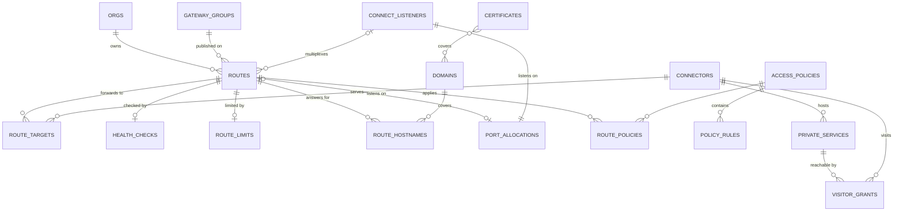
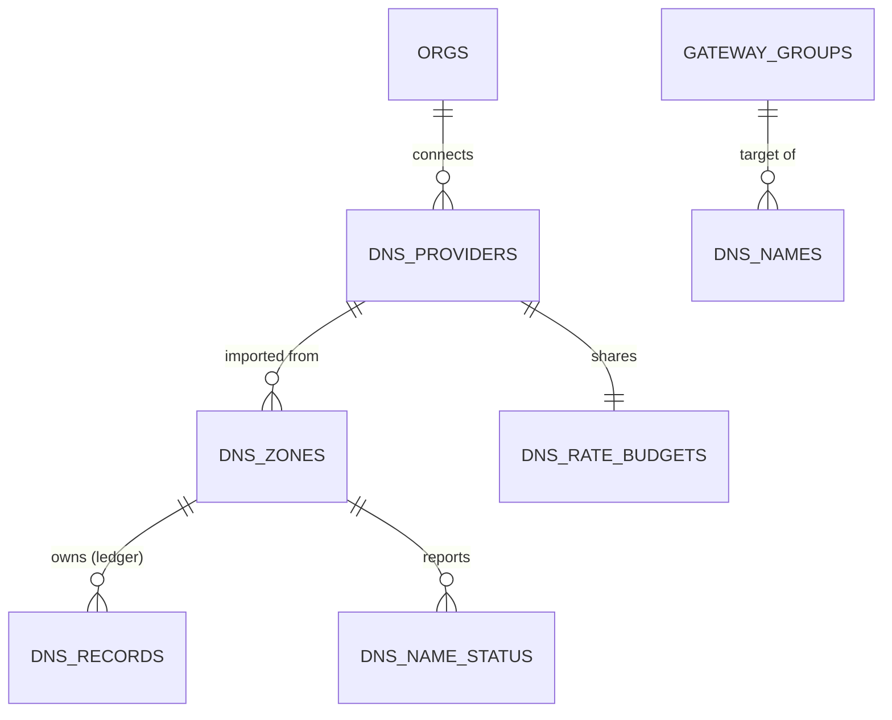
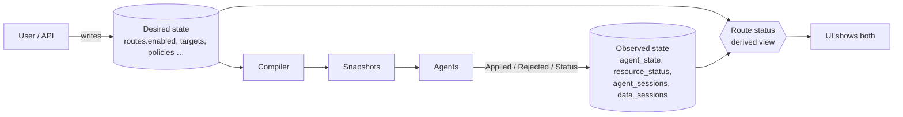

# 06 — Data model

> Status: Phase 1 is implemented. Tags: [F] fact · [R] recommendation · [T] target · [V] verify
> at implementation ([README](README.md#how-to-read-these-documents)).

## Principles

1. **Typed, end to end.** Every setting is a column or a typed child table derived from the same
   protobuf model the API and the agent protocol use. There are no opaque configuration blobs.
2. **One source of truth per fact.** A route exists once, in `routes`; there is no second copy
   inside an agent configuration.
3. **Desired and observed state are separate tables.** Users write desired state; only agent
   sessions, and for DNS the DNS job, write observed state
   ([Desired vs observed state](#desired-vs-observed-state)).
4. **Every configuration record belongs to an org**, enforced at three layers
   ([Tenancy enforcement](#tenancy-enforcement)).
5. **Versioned, reviewed migrations** for both supported databases
   ([Migrations](#migrations)).

Polymorphic parameters (for example the parameters of an access-policy rule, which differ per rule
kind) are stored as a **typed protobuf message with a `oneof`**, serialised into one column. The
controller owns that schema, validates it on every write, and migrations can rewrite it. It is not
an opaque blob: no foreign system's configuration is embedded, and every field is known.

## Identifiers

- [R] IDs are text: `<prefix>_<26-character Crockford base32 encoding of a UUIDv7>`, e.g.
  `rt_01JA2Z8Q6W7Y3V9K4M5N6P7Q8R`. They sort by creation time, are globally unique, show their type
  in logs and URLs, and behave the same on SQLite and PostgreSQL. `uuid.NewV7` is available in
  `google/uuid` [F google/uuid v1.6.0 `version7.go:23`].
- Names (`routes.name`, `connectors.name`, `gateways.name`) are unique per org and may be changed;
  IDs never change. A connector's or gateway's name is unique among those not decommissioned, so a
  tombstone's name is free for a new one ([Lifecycle and deletion](#lifecycle-and-deletion)).

| Prefix | Entity | Prefix | Entity |
|---|---|---|---|
| `org_` | org | `rt_` | route |
| `usr_` | user | `tg_` | route target |
| `mem_` | membership | `dom_` | domain |
| `ses_` | session | `crt_` | certificate |
| `atk_` | API token | `ap_` | access policy |
| `inv_` | invitation | `pr_` | access policy rule |
| `prs_` | password reset | `cab_` | CA bundle |
| `tot_` | TOTP credential | `rcv_` | recovery code |
| `enr_` | enrollment token | `pp_` | port pool |
| `con_` | connector | `pq_` | port quota |
| `gw_` | gateway | `pa_` | port allocation |
| `gwg_` | gateway group | `dss_` | data session |
| `aud_` | audit entry | `acp_` | audit checkpoint |
| `sva_` | service account (Phase 2) | `hck_` | health check (Phase 2) |
| `psv_` | private service (Phase 2) | `vgr_` | visitor grant (Phase 2) |
| `dnp_` | DNS provider (Phase 2) | `dnz_` | managed DNS zone (Phase 2) |
| `dnn_` | DNS name (Phase 2) | `dnr_` | owned DNS record (Phase 2) |
| `dnt_` | DNS name status (Phase 2) | | |
| `cak_` | CA key | `cab_` | CA bundle |
| `pwr_` | password reset | `whk_` | webhook |
| `rel_` | release | `rol_` | rollout |
| `evt_` | event (Phase 2) | `alr_` | alert (Phase 2) |
| `whd_` | webhook delivery (Phase 2) | `ask_` | audit sink (Phase 2) |
| `ost_` | org settings | `ctn_` | controller node |
| `rlt_` | rollout target | `gwp_` | gateway page (Phase 2) |
| `asc_` | audit sink cursor (Phase 2) | `chr_` | cache rule (Phase 3) |
| `cpg_` | cache purge (Phase 3) | `wfx_` | WAF exclusion (Phase 3) |
| `wfc_` | WAF custom rules (Phase 3) | `wfh_` | WAF hit (Phase 3) |

## Entities

### Identity and access

| Table | Key fields | Notes |
|---|---|---|
| `orgs` | id, name, slug, created_at, deleted_at | One row in a single-org install. A **system org** owns shared gateway groups and instance-level DNS providers; it is created with the first such resource |
| `users` | id, email (unique, lower case), display_name, password_hash (argon2id, nullable for SSO-only), status (`active`, `disabled`), instance_admin, created_at, last_login_at, theme (`system`, `light`, `dark`; the web UI's theme, [09](09-web-ui.md#ux-principles) U10) | Global, not org-scoped: a user can be a member of several orgs. `instance_admin` is the instance-level role ([04](04-security.md#roles)). Only the system scope reads or writes users |
| `memberships` | id, org_id, user_id, role (`owner`, `admin`, `operator`, `viewer`), created_by | Unique (org_id, user_id) |
| `invitations` | id, org_id, email, role, token_hash, created_by, created_at, expires_at, accepted_at, accepted_by | The invitation is a one-time link; it is also e-mailed if SMTP is configured |
| `password_resets` | id, user_id (null: the first-user link), token_hash, created_by, created_at, expires_at, used_at | One-time reset links, created by an Admin, by `rpmgr user reset-password` on the controller host, or by the user through e-mail if SMTP is configured ([04](04-security.md#human-authentication-and-sessions)); a link goes with its user. Only the system scope reads or writes them |
| `sessions` | id, user_id, token_hash, created_at, last_seen_at, idle_expires_at, absolute_expires_at, elevated_until, amr, ip, user_agent, revoked_at | Server-side sessions ([04](04-security.md#human-authentication-and-sessions)). Use moves `idle_expires_at` on, never past `absolute_expires_at`, and is written at most once a minute. A session goes with its user. Only the system scope reads or writes them |
| `totp_credentials` | id, user_id (unique), seed_enc, created_at, confirmed_at, last_step | One authenticator per user; `seed_enc` under the KEK with the row as its context; `confirmed_at` null until a first code; `last_step` is the time step of the last code used. Only the system scope reads or writes it |
| `recovery_codes` | id, user_id, code_hash (unique, SHA-256), created_at, used_at | Ten per user, each used once. Only the system scope reads or writes them |
| `webauthn_credentials` | user_id, … | Phase 2 ([V VB-01](13-roadmap.md#verification-backlog)) |
| `identity_providers` | id, org_id, issuer, client_id, client_secret_enc, group_role_mapping | OIDC SSO |
| `route_identity_providers` | id, org_id, name, issuer, client_id, client_secret_enc, groups_claim | Phase 2: providers that sign visitors in to routes (`oidc` rules), apart from the SSO providers so that a route's visitors never reach the control plane; the secret never leaves the controller ([04](04-security.md#oidc-sign-in-on-routes)) |
| `external_identities` | idp_id, subject, user_id | Unique (idp_id, subject) |
| `service_accounts` | id, org_id, name, role | Non-human principals for automation |
| `api_tokens` | id, org_id, owner_type (user, service_account), owner_id, name, prefix, token_hash, scopes, mfa, created_at, expires_at, last_used_at, last_used_ip, revoked_at, step_up_at (the token's last step-up, [D63](14-open-decisions.md#engineering)) | Expiry mandatory; `mfa` records that the token was made from a session with a second factor |
| `enrollment_tokens` | id, org_id, token_hash, role (connector, gateway), gateway_group_id, gateway_id (gateway tokens), connector_id (re-enrollment only), labels, ephemeral, built_in, max_uses (null: unlimited, ephemeral tokens only), use_count, expires_at, created_by, last_used_at, last_used_ip, revoked_at | Consumed atomically ([04](04-security.md#enrollment)). A gateway token is bound to exactly one gateway, which an Admin created first, so a host chooses neither its identity nor its endpoints; a connector token to no gateway; a re-enrollment token to its connector, and it is single-use. `built_in` makes the connector it enrolls the all-in-one's own; only all-in-one makes such a token, which the API never shows ([ADR-0019](adr/0019-all-in-one-runs-a-connector.md)) |

### Fleet

| Table | Key fields | Notes |
|---|---|---|
| `connectors` | id, org_id, name, labels, spiffe_id, pubkey_sha256, ephemeral, enabled, transport, desired_version, built_in, created_at, decommissioned_at | One row per enrolled connector. `name` is unique among the org's connectors that are not decommissioned; enrollment names a connector after its host, with the next free suffix (`nas`, `nas-2`, …) when an active connector holds the name. `transport` (`auto`, `quic`, `h2`; null = the instance default) overrides the data-session transport ([03](03-connections.md#transport-selection)). `built_in` marks the all-in-one's own connector, which the API neither decommissions nor re-enrolls ([ADR-0019](adr/0019-all-in-one-runs-a-connector.md)) |
| `gateway_groups` | id, org_id, version, name, region, public_hostnames (DNS names or anycast addresses for **public** traffic), trusted_proxy_cidrs (the proxies whose forwarding headers gateways keep, [03](03-connections.md#http-routes)), dns_cname and dns_addresses (an FQDN, or a list of IPv4/IPv6: the two forms of the API's `dns_target` `oneof`, at most one set; unset = nothing is published), cache_memory_bytes and cache_disk_bytes (Phase 3: the sizes of each gateway's cache tiers, set by the Instance Admin, [03](03-connections.md#cache-and-waf-limits-phase-3)) | Shared groups belong to the system org. `dns_target` is where managed DNS records for this group point ([15](15-dns.md#publication-rules)). A group has **at most 4 gateways**, enforced by the store, because connectors keep a session to every gateway of the group ([03](03-connections.md#multiple-gateways)) |
| `gateway_group_grants` | gateway_group_id, org_id | Which orgs may publish routes on a shared group |
| `gateways` | id, org_id, version, gateway_group_id, name, slot, spiffe_id, pubkey_sha256, **tunnel_endpoints** (this gateway's own `host:port` addresses for connectors; its WSS hostname in Phase 2), wss_hostname (Phase 2; unique, under a verified domain of the org, no route hostname of the group nor covered by one), enabled, desired_version, built_in, created_at, decommissioned_at | Connectors dial each gateway at its own endpoint, because they must know which gateway ID they reach ([03](03-connections.md#establishment)). An Admin creates a gateway before it enrolls, so its identity columns are empty until then. `name` is unique among the org's gateways that are not decommissioned. `slot` (1–4) is unique among a group's gateways that are not decommissioned: the store gives a new gateway the lowest free slot, and the unique index keeps a group at four gateways under concurrent creates. `enabled = false` takes a gateway out of service: its snapshot has no routes, connectors leave it out of theirs, and it drains its data sessions for the gateway drain period ([03](03-connections.md#multiple-gateways)). Decommissioning sets `decommissioned_at`, frees the slot and the name, and revokes the gateway's identity in the same transaction ([04](04-security.md#revocation)). `built_in` marks the all-in-one's own gateway, which the API neither decommissions nor enrolls anew; all-in-one sets it, also on a gateway made before it existed ([ADR-0019](adr/0019-all-in-one-runs-a-connector.md)). `wss_hostname` (Phase 2) lies under a verified domain of the group's owner org, is unique in the instance and is no route hostname of the group, nor covered by a wildcard one ([03](03-connections.md#transport-selection)) |
| `gateway_pages` | id, gateway_group_id, org_id, kind (`not_found`, `unavailable`, `maintenance`), html, content_sha256, updated_at, updated_by | Phase 2: a group's own pages, one per kind, set by the group's owner org; gateways fetch them by `content_sha256` ([03](03-connections.md#http-routes), [D132](14-open-decisions.md#engineering)) |
| `port_pools` | id, version, gateway_group_id, protocol (tcp, udp), port_from, port_to, org_id (nullable = any granted org) | Pools of one group and protocol never overlap. A pool's range may change as long as every port allocated from it stays inside, and a pool with allocated ports cannot be deleted. In Phase 1 every gateway group, and so every pool, belongs to one org; pools without an org come with shared groups (Phase 2) |
| `port_allocations` | id, org_id, gateway_group_id, protocol, port, route_id, connect_listener_id | Unique (gateway_group_id, protocol, port). An allocation belongs to a route or, in Phase 2, to a CONNECT listener |
| `port_quotas` | org_id, gateway_group_id, protocol, max_ports | Maximum ports an org may allocate in a gateway group (Phase 1). Unique (org_id, gateway_group_id, protocol); no row = limited only by the pools. A lowered limit keeps the ports already allocated and refuses new ones; a route moving to another port does not count its old one. A `tcp_udp` route counts against the TCP and the UDP quota; its port lies in a TCP and a UDP pool and is free in both |
| `issued_certificates` | serial, org_id, subject_type, subject_id, spiffe_id, pubkey_sha256, not_before, not_after, first_seen_at, superseded_at, revoked_at, revocation_reason, certificate (DER), enrollment_token_id | Source of the deny-list, with `revoked_identities` and `revoked_serials` ([04](04-security.md#revocation)). `serial` is lower-case hexadecimal. An enrollment records the token it consumed and keeps the DER, so a retry with the same token and key within the retry window of [04](04-security.md#tokens) gets the same certificate. Agent certificates belong to their org; controller node certificates have no org and are visible only in the system scope |
| `revoked_serials` | serial, org_id, revoked_at, reason, not_after | A certificate revoked after the backup a restore came from, which the restored `issued_certificates` does not hold: the restore records it from the revocation log, and the deny-list names it until `not_after` ([10](10-operations.md#backup-and-restore)). `org_id` is empty when the backup does not hold the org either |
| `revoked_identities` | spiffe_id, org_id, subject_type, subject_id, revoked_at, reason, not_after | A revoked identity: every certificate of it is refused, also one issued later, and none is issued or renewed. `not_after` is its certificates' latest expiry; the deny-list names the identity until then ([04](04-security.md#revocation)) |

### PKI and ACME

| Table | Key fields | Notes |
|---|---|---|
| `ca_keys` | id, kind (`root`, `intermediate`, `config_signing`, `audit_checkpoint`, `route_assertion` in Phase 2), algorithm, public_key, certificate, cross_certificate (DER; a root only), csr (PEM; a `next` key whose certificate an offline root has yet to sign), key_enc, not_before, not_after, status (`next`, `active`, `retired`, `compromised`) | Instance-level keys of [04](04-security.md#ca-hierarchy). `key_enc` is envelope-encrypted under the KEK, and null for an offline root (`rpmgr ca offline-root`, [04](04-security.md#offline-root-ca)) and for a `compromised` key, whose material is wiped. A `next` key whose `certificate` is null waits for its signature. Its `not_before` and `not_after` then hold the validity the root will most likely give, and the import replaces them with the certificate's. A `next` root carries the `cross_certificate` that its predecessor signed ([04](04-security.md#root-rotation)). Each kind has one `active` key, and a root can have a second, `next`, during a rotation; the controller refuses to start otherwise. Only the system scope reads or writes the table |
| `acme_storage` | key, value_enc, size, modified_at | certmagic's storage (account keys, orders, certificates in progress); `value_enc` is under the KEK with the key as its row, `size` the plain value's; locks are `leases` named `acme:<lock>` (holder, expiry, fencing token), kept alive while held, so replicas never order the same certificate twice ([S6](spikes/S6.md)). Only the system scope reads or writes it |
| `ca_bundles` | id, org_id, name (unique per org), pem | Custom CAs for verifying HTTPS upstreams ([04](04-security.md#controller-certificates)), referenced by `route_targets.tls_ca_bundle_id` of the same org (composite foreign key) |

### Routing

| Table | Key fields | Notes |
|---|---|---|
| `routes` | id, org_id, name, type (`http`, `tcp`, `udp`, `tcp_udp`, `tls_passthrough`), gateway_group_id, **enabled**, transport, description, labels, version, created_at, updated_at, updated_by | The only place a route exists. `version` is the optimistic-concurrency counter ([07](07-api.md#concurrency)). `transport` (`auto`, `quic`, `h2`; null = the connector's) pins the route's data-session transport on every connector serving it ([03](03-connections.md#transport-selection)) |
| `route_http` | route_id, org_id, path_prefix (copied to the route's `route_hostnames`), header_matches (Phase 2: at most 8 of name and exact value or presence), match_key (Phase 2: a hash of the sorted matches, `''` without any), tls_mode (`acme`, `certificate`), certificate_id (of the same org, composite foreign key), port80 (`redirect` default, `serve`, `off`), hsts_max_age_seconds (0 = no HSTS), host_header (`preserve` or a value), request_headers_set, response_headers_set (name to value; an empty value removes the header), websocket, max_body_bytes (0 = no limit), dns_proxied, maintenance, maintenance_message (plain text, at most 500 characters), upstream_response_header_timeout_seconds, upstream_idle_timeout_seconds (Phase 2; 0 = the gateway's, [D94](14-open-decisions.md#engineering)), cache_mode (Phase 3: `inherit`, `off`, `on`; `on` only on an `http` route, [17](17-cache-and-waf.md#cache-settings)), cache_use_org_rules (Phase 3, default true) | One row per `http` route. `port80` decides what plain HTTP on port 80 does; ACME HTTP-01 challenges are always answered there. `dns_proxied` opts the route's hostnames into Cloudflare's proxy (Phase 2, [15](15-dns.md#proxied-http-routes)). `maintenance` has the gateways answer every request with the maintenance page and its message ([D88](14-open-decisions.md#engineering)) |
| `route_tcp` | route_id (unique), org_id, port_allocation_id (unique; null in `http_connect` mode), listener_mode (`plain`, `http_connect`), connect_listener_id, idle_timeout_seconds (0 = none; a route created without one gets the default of [03](03-connections.md#timeouts-keepalive-and-backoff), [D161](14-open-decisions.md#engineering); the column's own default only fills a row written without the API) | `http_connect` (Phase 2) is an HTTP CONNECT multiplexer: the route takes no port of its own but joins a `connect_listeners` row of its org and mode ([03](03-connections.md#http-connect-routes-phase-2)). A `tcp_udp` route has a row here and one in `route_udp`, whose allocations hold the same port number, one for TCP and one for UDP ([D83](14-open-decisions.md#engineering)) |
| `connect_listeners` | id, org_id, gateway_group_id, port_allocation_id (unique), auth_mode (`none`, `tls_basic`, `plain_basic`), hostname, domain_id, certificate_id (`tls_basic` only) | Phase 2 ([D130](14-open-decisions.md#engineering)): one TCP port of one org, shared by its `http_connect` routes of the same mode and hostname, counted once against the quota; deleted with its last route. `domain_id` is the verified domain `hostname` lies under, which cannot be removed while it does. `certificate_id` is an uploaded certificate that covers `hostname`, not part of the listener's identity: a route that names one sets it for every route of the listener, so it is replaced without moving the port |
| `connect_authorities` | org_id, connect_listener_id, route_id, authority | Phase 2: the host names that choose a route on its CONNECT listener, lower case; unique (connect_listener_id, authority) |
| `route_udp` | route_id (unique), org_id, port_allocation_id (unique), flow_idle_timeout_seconds (default 60) | A flow is one client address on the route's port ([03](03-connections.md#udp-routes)) |
| `route_hostnames` | route_id, org_id, gateway_group_id, route_type, hostname, path_prefix (`''` for `tls_passthrough`), match_key (Phase 2, from `route_http`), domain_id | `http` and `tls_passthrough`; group, type, prefix and match key are copied from the route so the constraint can be declared here. Unique (gateway_group_id, hostname, path_prefix, match_key), so two routes may share a hostname and prefix only with different header matches ([03](03-connections.md#http-routes)). Within a group a hostname is **either** exactly one `tls_passthrough` route **or** any number of `http` routes, enforced by the store, so the gateway's SNI decision is never ambiguous |
| `route_targets` | id, org_id, route_id, connector_id, kind (`address`, `unix`), host, port, unix_path, upstream_protocol (`tcp`, `http`, `https`, `h2c`), tls_server_name, tls_ca_bundle_id, tls_spki_sha256, tls_verification (`verified`, `unverified`, `pinned_key`), proxy_protocol (`none`, `v1`, `v2`), weight, priority, enabled | Several rows = load balancing and failover. `tls_ca_bundle_id` references `ca_bundles`; `tls_spki_sha256` optionally pins the upstream's public key, as 64 lower-case hexadecimal digits. `tls_verification` is how an https target's certificate is checked; an `unverified` one has neither a CA bundle nor a pin, a `pinned_key` one a pin and no CA bundle ([ADR-0017](adr/0017-upstream-tls-verification-modes.md)). The connector must be of the route's org (composite foreign key). A udp or tcp_udp route's targets are addresses without a PROXY header ([03](03-connections.md#udp-routes)). An http route's targets speak HTTP, HTTPS or H2C, and its enabled ones the same, because the first of them decides how the gateway speaks to all; the other route types' targets speak `tcp`, and only tcp and tls_passthrough routes' send a PROXY header. A decommissioned connector gets no new target |
| `route_limits` | route_id (unique), org_id, max_connections, requests_per_sec, bandwidth_bytes_per_sec (each 0 = none) | Phase 2: for the route as a whole; the compiler divides each by the group's enabled gateways ([03](03-connections.md#route-limits-phase-2)) |
| `health_checks` | route_id (unique), org_id, type (`tcp`, `http`), port (0 = the target's), http_path, expected_status_min, expected_status_max, interval_seconds, timeout_seconds, unhealthy_threshold, healthy_threshold | Phase 2: at most one per route, run by each connector against each of its targets of the route ([03](03-connections.md#target-health-phase-2), [D133](14-open-decisions.md#engineering)) |
| `access_policies` | id, org_id, name, description | Reusable across routes |
| `policy_rules` | id, org_id, policy_id, position (unique per policy), kind (`ip_allow`, `ip_deny`, `basic_auth`, `oidc`, `rate_limit`, `require_header`), params (`rpmgr.v1.PolicyRuleParams`, a typed proto `oneof`: CIDRs for IP rules, users with argon2id hashes for `basic_auth`; in Phase 2 a header name and up to 4 SHA-256 value hashes for `require_header`, a rate and burst for `rate_limit`, a route identity provider, accepted e-mail addresses, domains and groups and a session length for `oidc`) | Kept in order; for IP rules the order does not matter, as a deny wins ([03](03-connections.md#access-policies)) |
| `route_policies` | route_id, policy_id, org_id, position (unique per route) | A policy once per route; route and policy of the same org (composite foreign keys) |
| `domains` | id, org_id, fqdn (unique), wildcard, status (`pending`, `pending_approval`, `verified`, `failed`), method (`dns_txt`, `http`, `trusted`, `delegated`), challenge_value, verified_at, last_checked_at, version | Ownership per org ([04](04-security.md#route-and-hostname-ownership)). `fqdn` is stored in one form: lower-case ASCII (IDNA), without a trailing dot, at least two letter-digit-hyphen labels, at most 253 characters; it is unique in the instance whatever the status. `wildcard = false` covers exactly `fqdn`; `true` covers `fqdn` and every name below it, at any depth; a label never matches partly. `trusted`: marked by the Instance Admin without proof (Phase 1, [D13](14-open-decisions.md#tenancy-and-data)); `delegated`: a label under the instance base domain handed to the org by the Instance Admin (Phase 2, [D23](14-open-decisions.md#tenancy-and-data)); `pending_approval`: a nested claim waiting for the Instance Admin (Phase 2) |
| `certificates` | id, org_id, source (`acme`, `uploaded`), sans, not_before, not_after, chain, key_enc, content_sha256, status, last_error, issuer | `chain` is the DER certificates, leaf first; `key_enc` the leaf's key under the KEK; `content_sha256` the hash of the chain and key as gateways fetch them ([04](04-security.md#controller-certificates)). An ACME certificate has one name; until it is obtained it has no chain, key or validity, status `failed` and the CA's error in `last_error`. ACME state in progress lives in `acme_storage` |
| `private_services` | id, org_id, name, connector_id, protocol (`tcp`, `udp`), target (as in `route_targets`), p2p_mode (`relay_only`, `prefer_p2p`), enabled, version | Reachable only by connectors with a visitor grant ([03](03-connections.md#private-services)) |
| `visitor_grants` | id, org_id, private_service_id, visitor_connector_id, bind_address, bind_port, enabled | The bind must also be allowed by the visitor host's local policy |

### DNS

Phase 2 ([15](15-dns.md)). Which managed zone a name belongs to is computed by longest suffix over
`dns_zones.name`; no other table stores a zone reference for it.

| Table | Key fields | Notes |
|---|---|---|
| `dns_providers` | id, org_id, kind (`cloudflare`), name, credential_enc, account_id (optional, for account-owned tokens), status (`ok`, `invalid`), token_expires_at, last_checked_at, last_error, created_at, version | The credential is write-only ([04](04-security.md#secrets-at-rest-and-in-logs)) and recorded in `secrets_meta`; `name` is unique per org; `status` is what the last token check found. Instance-level providers belong to the system org |
| `dns_zones` | id, org_id, dns_provider_id, provider_zone_id, name (unique), sync_state (`active`, `held`, `disabled`), held_reason, pending_plan (JSON), pending_plan_hash, provider_status (`ok`, `permission_denied`, `unreachable`, `rate_limited`), publish_route_hostnames, allow_proxied, allow_wildcards, delete_threshold, default_ttl, last_synced_at, assigned_nameservers (JSON), delegation_state (`unknown`, `ok`, `mismatch`), delegation_nameservers (JSON), delegation_checked_at, created_at, version | One row per imported zone, starting `held` with `held_reason` `imported`; the apex is `name`, unique in the instance, and the provider's zone is imported once. The zone and its provider are of the same org (composite foreign key). The assigned nameservers and the delegation are those of [15](15-dns.md#delegation). Gates and defaults in [15](15-dns.md#publication-rules) and [15](15-dns.md#timers-and-limits) |
| `dns_names` | id, org_id, fqdn (unique), gateway_group_id, domain_id, ttl, created_at, version | Explicit names, wildcards allowed; always DNS-only. `fqdn` is stored as for `domains`, with a leading `*.` for a wildcard, and is unique in the instance. `gateway_group_id` follows the rule of `routes.gateway_group_id`: an own group or a granted shared group (Phase 2 creates names for own groups only, until shared groups are granted). `domain_id` is the verified domain of the org that covered the name when it was created, as for `route_hostnames`, so the domain and the group stay while a name uses them (composite foreign keys). `ttl` is 0 for the zone's `default_ttl` |
| `dns_records` | id, org_id, dns_zone_id, name, type (`A`, `AAAA`, `CNAME`, `TXT`), content, ttl, proxied, provider_record_id, state (`creating`, `synced`, `drifted`, `orphaned`, `error`, `deleting`), reason, adopted_from, adopted_at, last_synced_at, corrected_at | The **ownership ledger**: one row per provider record rpmgr owns. Controller-managed durable state, written only by the DNS job and by adopt/release; never rebuilt from the provider ([15](15-dns.md#ownership-ledger)). `provider_record_id` is NULL until the provider's ID is known and unique per zone; `corrected_at` is when the job last put back a change someone else made, for the stop window; the row is of the zone's org (composite foreign key) and has no `version`, as only the DNS job under its lease and adopt/release write it. Removing a zone drops its rows, and leaves the records at the provider |
| `dns_rate_budgets` | id, org_id, dns_provider_id (unique), window_started_at, used, dns01_used, blocked_until, version | The **rate budget** of one provider, one row each: requests taken in the current window, how many of them by DNS-01 (at most half of the window), and the end of a `retry-after` block. The row is created with the first request, and the provider's org is the row's (composite foreign key). The DNS job and the DNS-01 adapter take a request from it in a transaction, on any replica, so they share it ([15](15-dns.md#batches-failures-and-the-rate-budget), [D164](14-open-decisions.md#engineering)). Runtime state, not configuration: no revision (the version guards the row), deleted with the provider |

### Observability (Phase 2)

| Table | Key fields | Notes |
|---|---|---|
| `events` | id, org_id (null: an instance event), type, ts, actor_type, actor_id, subject_type, subject_id, subject_name, summary, changed | The outbox: written in the transaction of the change, by the audit append for audited changes, so an event exists exactly when its change committed ([07](07-api.md#webhooks-phase-2)). Kept for the period in [03](03-connections.md#timeouts-keepalive-and-backoff), then purged by a singleton job |
| `alerts` | id, org_id (null: an instance alert), kind, subject_type, subject_id, subject_name, state (`pending`, `firing`, `resolved`), since, fired_at, resolved_at | One row per alert and subject; the singleton alert job moves it from `pending` to `firing` once its condition held for its duration, and writes `alert.fire` and `alert.resolve` events once each, so a restart or a lease takeover never fires twice ([10](10-operations.md#suggested-alerts)). A pending alert whose condition ends is deleted without an event; a resolved one is kept as long as events, then purged by the same job. `subject_name` keeps the subject's name for the events of a subject that is gone |
| `status_marks` | id (`<kind>:<subject id>`, kind `agent`, `apply` or `route`), org_id (null: an instance event), state, changed_at | The last state the status events reported for a subject: an agent `online` or `offline`, an agent's last snapshot `ok` or rejected (with the snapshot's epoch and sequence), a route's status. The alert job compares what it observes with the mark and writes `agent.connect`, `agent.disconnect`, `apply.reject` and `route.status` only for a change, in its own transaction, so a restart neither replays nor loses one; the mark of a subject that is gone is deleted ([07](07-api.md#webhooks-phase-2), [10](10-operations.md#suggested-alerts)) |
| `mail_jobs` | id, org_id (null: an instance event), event_id (unique), state (`pending`, `sent`, `skipped`, `given_up`), attempts, next_attempt_at, created_at, done (the addresses that got it) | The e-mail of one event: `alert.fire`, `alert.resolve` or `webhook.disable`. The singleton mail job makes one per event, sends it to the org's active Owners and Admins (the Instance Admins for an instance event) and retries a failure until the give-up time; `skipped` is no SMTP, `alert_email` off (alert events only) or nobody to mail. Purged with the events ([10](10-operations.md#suggested-alerts), [04](04-security.md#human-authentication-and-sessions)) |
| `webhooks` | id, org_id (null: an instance endpoint), format (`rpmgr`, `discord`, `slack`, `teams`), url, url_enc, secret_enc, previous_secret_enc, previous_until, event_types, enabled, disabled_reason, enabled_at, last_success_at, failing_since, created_at, version, mention, mention_when, discord_username, discord_avatar_url, thread_name | Endpoints ([07](07-api.md#webhooks-phase-2)); the secrets are write-only. A chat format's `url` is only its scheme and host and its whole URL, which holds the service's token, is sealed in `url_enc`; its `secret_enc` is empty ([D162](14-open-decisions.md#engineering)). The options of a chat format (`mention`, `mention_when`, and Discord's `discord_username`, `discord_avatar_url` and `thread_name`) are no secrets and are kept as set ([D170](14-open-decisions.md#engineering)). A disabled endpoint keeps its reason (`failing`, or turned off by a person) until a person enables it ([D143](14-open-decisions.md#engineering)) |
| `webhook_deliveries` | id, webhook_id, org_id, event_id, event_type, attempt, status_code, error, sent_at, next_attempt_at | One row per attempt, written after the attempt in the delivery job's fenced transaction; unique (webhook_id, event_id, attempt). An event without a row for an endpoint is new to it; `next_attempt_at` is set on the newest failed attempt while a retry is due. An endpoint receives the events from its `enabled_at` on, so none of the time it was disabled; `failing_since` is its first failed delivery after its last success. Kept for the period in 03 |
| `webhook_messages` | id, webhook_id, org_id, alert_key, message_id, thread_id, created_at | The Discord message an alert was posted as, so that its resolve edits it ([D170](14-open-decisions.md#engineering)); unique (webhook_id, alert_key), where the key is the alert's kind, subject type and subject ID. Written with the delivery of the firing, deleted with the delivery of the resolve or with the endpoint, and kept for at most the period in 03 for deliveries |
| `audit_sinks` | id, kind (`syslog`, `webhook`, `s3`), name, settings (address, or endpoint, region, bucket, access key ID, lock days and CA bundle), secret_enc, entries (whether entries go with the checkpoints), enabled, last_error, last_success_at, verification (the outcome of the last read-back of an object-storage sink: when, and per chain the last verified checkpoint, any gap and any problem; NULL before the first), created_at | Instance-level, set by the Instance Admin ([04](04-security.md#audit-log), [D141](14-open-decisions.md#engineering)) |
| `audit_sink_cursors` | sink_id, chain (org ID or `instance`), entry_seq, checkpoint_seq, oldest_unshipped_at | How far each sink has acknowledged each chain; advanced only after the sink acknowledged a batch. The job keeps `oldest_unshipped_at` for its own status, NULL when the sink holds everything; the backlog metric, the alert and the API's status do not read it but count from the audit tables and these cursors, so they stay right while no replica ships. Unique (sink_id, chain); deleting a sink deletes its cursors. The `webhook` sink keeps its URL in `settings` and its signing secret in `secret_enc`, which is write-only |

### Releases (Phase 2)

| Table | Key fields | Notes |
|---|---|---|
| `releases` | id, version, channel (`stable`, `prerelease`), manifest_seq, manifest, signature, signing_key_statement, statement_signature, source (`check`, `upload`, `import`), mirrored_at, created_at | Verified release manifests the release check listed or an Instance Admin uploaded; `mirrored_at` is set once the mirror holds every artifact under `/dl/` ([04](04-security.md#over-the-air-updates)). `version` is unique; a manifest of the same version with a higher `seq` replaces the row's manifest |
| `rollouts` | id, release_id, mode (`advanced`, `easy`), stage (`canary`, `percentage`, `all`), percentage, state (`running`, `paused`, `completed`, `cancelled`), active, pause_reason, created_by, created_at, updated_by, updated_at, version | A staged rollout ([D121](14-open-decisions.md#engineering)), or an easy rollout, a queue of agents updated one after another ([D129](14-open-decisions.md#engineering)); rows written before the column existed are `advanced`, and an easy rollout leaves stage and percentage at their defaults. At most one rollout is `running` or `paused`: `active` is true exactly then, kept in step with `state` by a hook and never set by hand, and a partial unique index allows one row where it is true. The target is never newer than the controller's version, which the API checks at creation |
| `rollout_targets` | id, rollout_id, agent_id, agent_kind (`connector`, `gateway`), canary, bucket (0–99), position, state (`pending`, `offered`, `staged`, `updated`, `rolled_back`, `refused`, `skipped`, `stalled`), reason, version_before, drain_started_at, updated_at | Per-agent progress. A staged rollout has one row per agent from its creation, the canary agents marked; an easy rollout has one per queued agent, in the order of `position` (from 1 and unique within an easy rollout; none in a staged rollout), and a row added to a running or paused one takes the next position; built-in agents, which update with the controller, and gateways not enrolled get none. `bucket` is the first two bytes of SHA-256 of the agent ID, modulo 100, so a stage of p % takes every agent with a bucket below p. `drain_started_at` is when the rollout disabled the gateway to drain it before its offer; nil means an operator disabled it, and its target is skipped and the gateway left disabled. `skipped` covers agents that are offline, decommissioned, on `auto_update: notify` or `off`, or on a channel that refuses the release; the purge that deletes an agent's row deletes its targets in the same transaction |

### Phase 3 entities

| Table | Key fields | Notes |
|---|---|---|
| `virtual_networks` | id, org_id, name, cidr, acl (typed) | |
| `vnet_members` | id, org_id, network_id, connector_id, address, wg_public_key, advertised_routes | **Public keys only**; private keys stay on the connector ([04](04-security.md#secrets-at-rest-and-in-logs)) |
| `functions`, `function_versions`, `function_deployments` | id, org_id, name; code_sha256, bundle ref; connector_id, version_id | Bundles are content-addressed and fetched with `FetchResource` |
| `ssh_keys` | id, org_id, user_id, public_key, fingerprint | For SSH ad-hoc tunnels |
| `shell_grants` | id, org_id, user_id, connector_id, granted_by, expires_at | Shell needs grant + host opt-in + step-up |

### Cache and WAF (Phase 3)

[17](17-cache-and-waf.md) is the mechanism. Cached objects are **not** in the database: they live on
the gateway, and the controller reads a gateway's objects on demand only
([17](17-cache-and-waf.md#cache-tab)). The org's cache defaults (`cache.default_mode`,
`cache.rules`) are part of `org_settings`; the instance's WAF settings and floor are part of
`instance_settings`.

| Table | Key fields | Notes |
|---|---|---|
| `cache_rules` | id (`chr_`), org_id, route_id (null: an org default), position (unique per route, or per org for defaults), match_kind (`prefix`, `glob`, `extensions`), pattern, ttl_seconds, stale_if_error_seconds, ignore_cookies (default false; only an Admin sets it, [17](17-cache-and-waf.md#cache-rules)), enabled | A route's own rules and an org's defaults, the same row. The compiler puts the route's rules, then the org's (when `route_http.cache_use_org_rules`), in the snapshot. A route's composite foreign key keeps it in the rule's org. Changing or deleting a rule makes the gateways drop the objects it stored |
| `cache_purges` | id (`cpg_`), seq (unique, from a counter row like `config_seq`), db_epoch, org_id, route_id (null: the org's everything), kind (`url`, `prefix`, `route`, `org`), value (the path and query of a URL or the prefix; empty for the others), url_sha256, actor_type, actor_id, created_at | Kept for the replay window and then deleted by a singleton job ([03](03-connections.md#cache-and-waf-limits-phase-3)); the audit log is the long record. The query values of a URL are not stored here either, only the SHA-256 of the whole URL |
| `cache_purge_results` | purge_id, gateway_id, org_id, state (`pending`, `applied`, `emptied`), removed_objects, updated_at | One row per gateway the purge goes to, written when the purge is made and updated by the gateway's answer or when a reconnecting gateway empties its cache |
| `cache_rollups` | route_id, gateway_id, org_id, bucket_start, hits, misses, bypasses, not_storable, stale_served, bytes_from_cache, bytes_from_origin | Hourly and daily buckets from the gateways' counters, with the same retention as the route traffic rollups ([10](10-operations.md#runtime-settings-ui--settings)); the Cache tab's hit ratio and bytes |
| `gateway_cache_status` | gateway_id, org_id, memory_used_bytes, disk_used_bytes, objects, tier state (`on`, `off`, `disk_error`), purge_seq, reported_at | Observed state from the gateway's `Status`; the size used per gateway and the group's totals. A gateway's per-route sizes are not stored; the object list asks the gateway |
| `waf_exclusions` | id (`wfx_`), org_id (null: instance scope), scope_kind (`instance`, `org`, `gateway_group`, `route`), scope_id, kind (`rule_id`, `tag`), value, path_kind (`any`, `exact`, `prefix`), path, parameter (empty: any), state (`active`, `disabled`: a scope's switch-off of an inherited exclusion), source_hit_id, created_by, created_at | Exclusions of every scope. A rule or tag the instance floor protects is refused below the instance. At most the number per scope in [03](03-connections.md#cache-and-waf-limits-phase-3) |
| `waf_custom_rules` | id (`wfc_`), org_id (null: instance scope), scope_kind, scope_id, text, text_sha256, enabled, version, updated_by | SecLang text, written only by the Instance Admin; the compiler puts it in the snapshot as a content-addressed item. Validated on write and again by the gateway |
| `waf_hits` | id (`wfh_`), org_id, route_id, gateway_id, ts, host, method, path, client_ip, action (`detected`, `blocked`), score, rules (rule IDs and tags with their scores), variables (names and the length of each matched value, never a value), request_id, sampled | One row per request, redacted at the gateway ([04](04-security.md#gateway-cache-and-waf-phase-3)); deleted past the retention and above the per-org bound by a singleton job. Deleted with the route and the org. Never copied to audit sinks or webhooks |
| `waf_rollups` | route_id, gateway_id, org_id, bucket_start, inspected, detected, blocked, truncated, fail_open; and per rule: rule_id, count | Exact counts from the gateways' counters, hourly and daily, with the route traffic rollups' retention; the WAF tab's totals and the block-spike alert read them |

The WAF's mode, paranoia level, threshold and enforced floor are typed fields, not rows:
`waf` messages in `instance_settings`, `org_settings` and, for a gateway group and a route, columns
of `gateway_groups` and `route_http` (`waf_mode`, `waf_paranoia_level`, `waf_anomaly_threshold`,
each empty to inherit). The floor is `InstanceSettings.waf_floor` (minimum mode, minimum paranoia
level, maximum threshold, protected rules and tags). The controller compiles the effective profile
of each route, with the floor applied, into the snapshot of every gateway that serves it
([17](17-cache-and-waf.md#scopes)).

### System

| Table | Key fields | Notes |
|---|---|---|
| `instance_settings`, `org_settings` | instance: id (single row); org: id, org_id (unique); both: value (the serialised `rpmgr.v1.InstanceSettings` or `OrgSettings` message), version, updated_by, updated_at | Runtime settings edited in the UI; boot settings stay in the config file ([10](10-operations.md#configuration)). `default_transport` is the instance default of the data-session transport, `auto` until changed ([03](03-connections.md#transport-selection)). `base_domain` is the instance base domain of delegated labels: set by the Instance Admin, a verified or trusted domain of the system org ([15](15-dns.md#base-domain), [D165](14-open-decisions.md#engineering)). `cloudflare_ip_ranges` is written by a daily job in a configuration transaction, so gateway snapshots stay deterministic ([15](15-dns.md#proxied-http-routes)). One typed message per scope: a field that is not set has its default, updates name their fields in a field mask, and every change is a configuration transaction |
| `instance` | id (single row), trust_domain, db_epoch, created_at, retired_at, retired_to | The installation's trust domain, which never changes, and its database epoch, a random UUIDv7 that is new at init and at every restore ([03](03-connections.md#revisions-and-ordering)). `retired_at` and `retired_to` (the path of the target's boot file) are set by `rpmgr migrate-db` on the source once the copy has committed, and a controller **refuses to start on a database that has them** ([Copying a database](#copying-a-database)) |
| `config_seq` | id (single row), seq | Incremented with a row lock inside every configuration transaction, so commit order equals revision order ([03](03-connections.md#revisions-and-ordering)) |
| `config_revisions` | seq, db_epoch, org_id (null: an instance-wide change), created_at, actor, changed_resources; index (org_id, seq) | One row per configuration transaction. `db_epoch` is a random UUIDv7, new at init and on every restore. `org_id` is the org whose resources it changed, also when a controller job made the change; the org's event stream reads its revisions by it ([07](07-api.md#events-and-streaming)) |
| `compiled_snapshots` | agent_id, db_epoch, seq, hash, size_bytes, payload, signature, key_id, created_at | The last 5 sent to each agent, as signed; for diffing and support |
| `audit_log` | id, org_id (null: the instance chain), seq, prev_hash, hash, ts, actor_type (`user`, `agent`, `system`, `anonymous`), actor_id, credential_id (session or token ID), auth_method, ip, user_agent, request_id, action, target_type, target_id, result (`success`, `failure`, `denied`), diff (redacted), reason | A hash chain per org and one for the instance ([04](04-security.md#audit-log)); seq is unique within a chain. Text is stored as valid UTF-8 without NUL. Fields a client controls are truncated, never refused, so an over-long header cannot keep an event out of the log: user_agent at 512 bytes, request_id at 128 |
| `audit_heads` | chain (org ID or `instance`), seq, hash | The last entry of each audit chain; every append locks and increments it first |
| `audit_checkpoints` | org_id, seq, head_hash, ts, key_id, signature | One per chain and seq; `org_id` is NULL for the instance chain. `key_id` names the audit-checkpoint key that signed ([04](04-security.md#audit-log)). Written only by the audit package; what each external sink has shipped is in `audit_sink_cursors` (Phase 2) |
| `instance_secrets` | name, value_enc, updated_at | Secrets of the instance settings, such as the mail relay's password, under the KEK with the name as their row; the settings themselves hold none. Also the keys that no other row holds: `page_token_key`, which authenticates the API's page tokens, and `page_preview_key`, which authenticates the previews of gateway pages, made once by the statement that finds the row missing and inserts it, so that every replica reads the same key ([04](04-security.md#secrets-at-rest-and-in-logs)). Only the system scope reads or writes them |
| `api_requests` | id, caller_id, method, request_id, request_hash, response_enc, created_at | The `request_id`s of `Create` calls within the deduplication window ([07](07-api.md#resource-design)), unique per caller and method. The first request's transactions insert the row, so the change and the row commit together; `response_enc` is its response under the KEK, null until it answered. Only the system scope reads or writes it |
| `leases` | name, holder, fencing_token, expires_at (Unix milliseconds, so both dialects compare numbers) | Singleton jobs in HA, including the DNS job's `dns` lease ([10](10-operations.md#high-availability)). A takeover raises the fencing token; a job commits its work in a transaction that first **locks the lease row and checks it**, with `SELECT … FOR UPDATE` or a conditional `UPDATE … WHERE holder = … AND fencing_token = … AND expires_at > <the database's time> RETURNING`, so that the row cannot change before the commit and a replica that lost the lease commits nothing; a plain read under `READ COMMITTED` would let another replica take the lease between the check and the commit. **The database's clock decides every expiry**: a statement that takes, renews or checks a lease compares `expires_at` with the database's time and writes the new `expires_at` as the database's time plus the TTL, and no replica compares `expires_at` with its own clock. On PostgreSQL that time is `clock_timestamp()`, which moves during a transaction, not `now()`; on SQLite it is the process's clock, because the file lives on one host. The handle a job holds carries the lease's expiry as a deadline on the replica's own monotonic clock, counted from before the statement was sent, so it never outlasts the row and a job can refuse to start work the lease will not outlast, as the DNS job does before each batch ([15](15-dns.md#the-dns-job)). Clocks that differ by seconds therefore cannot give a lease to two replicas |
| `controller_nodes` | node_id (`ctn_`), internal_address, version, started_at, boot_nonce, last_seen_at, stopped_clean, revlog_backlog, revlog_local_seq | HA: one row per replica that has run, where the others reach it over controller-to-controller mutual TLS ([10](10-operations.md#high-availability)). `node_id` is made at the replica's first start and kept in `<state_dir>/node-id` [D181](14-open-decisions.md#engineering), so a restart is the same node; the node certificate's SPIFFE ID names it ([04](04-security.md#trust-domain-and-identities)). `internal_address` is the `host:port` of `listen.internal_address`, empty on a single controller. `version` is the release that runs. `last_seen_at` is the database's time at the replica's last heartbeat ([03](03-connections.md#timeouts-keepalive-and-backoff)); a replica is **live** while that is recent. `revlog_backlog` is the number of entries in its local revocation log that the sink does not hold yet, and `revlog_local_seq` the number of its last local entry, both written by the heartbeat: a restore reads them to tell which logs it must have ([04](04-security.md#revocation-log)). `boot_nonce` is random and written by every start: a replica that finds a **live** row with another nonce refuses to start, which catches a cloned machine or a copied state directory that carries the same `node_id` [D181](14-open-decisions.md#engineering). `stopped_clean` is false from the start and set by the **final heartbeat of a clean stop**, which comes after the replica has shipped its backlog, so the backlog columns, which are up to one heartbeat old, are not trusted for a node that did not stop clean. A single controller keeps its row too, so that moving to replicas finds it. A row with no backlog that stopped clean is removed after the period in [03](03-connections.md#timeouts-keepalive-and-backoff); **a row with a backlog, or that did not stop clean, stays** until a restore has read that replica's log or a `migrate-db` accepted its loss (`--accept-lost-backlog` clears the target's copy of the row and records the loss in its audit entry; an archive older than the migration still holds the row, so a restore of one still treats that node as possibly having a backlog) |
| `secrets_meta` | table_name, row_id, column_name, kek_version (16 hexadecimal digits for a local KEK, `<mount>/<key>@v<n>` for a Transit key), created_at | Bookkeeping for KEK rotation: one row per sealed column of a row, written in the transaction that writes the sealed value; `rpmgr kek status` reads it. The stored responses of `request_id`s, kept for a day, are not recorded; `rpmgr kek rotate` re-wraps every sealed column all the same and rewrites these rows ([04](04-security.md#secrets-at-rest-and-in-logs)) |

## Desired vs observed state

**Desired** (written by users and the API):

- `routes.enabled`, `route_targets.enabled`, `private_services.enabled`, `visitor_grants.enabled`,
  `connectors.enabled`, `gateways.enabled`. **One flag per thing.** There is no second "stopped"
  flag and no `enabled` inside a configuration blob, so desired state can never disagree with
  itself.

**Observed** (written only by control-session handlers; `dns_name_status` only by the DNS job):

| Table | Key fields |
|---|---|
| `agent_sessions` | agent_id, session_epoch, controller_node, remote_addr, agent_version, capabilities, roots_digest, connected_at, last_seen_at, disconnected_at, last_goodbye (one row per agent; each new session raises `session_epoch` in the statement that records it, so two replicas never hand out the same epoch; the end of a session that no newer one replaced sets `disconnected_at`, and how `last_seen_at` is kept is in [03](03-connections.md#timeouts-keepalive-and-backoff); `last_goodbye` is the reason of the `Goodbye` that last refused the agent a session, `upgrade_required` below `min_agent_version`, recorded with the version it came with, and empty again once a session is accepted) |
| `agent_state` | agent_id, boot_id, clock_offset_ms; the snapshot applied last (applied_db_epoch, applied_seq, applied_hash, last_ack_at), sent last (pushed_db_epoch, pushed_seq, pushed_hash, pushed_at) and rejected last (rejected_db_epoch, rejected_seq, rejected_hash, last_rejection: the structured errors). The apply status is derived from it ([03](03-connections.md#configuration-reconciliation)) |
| `resource_status` | agent_id, resource_id, reason, detail, since: one row per resource an agent reports not ready, so a resource without one is ready or not reported yet; a connector's rows also name the targets its health checks find unhealthy. The limits are in [03](03-connections.md#configuration-reconciliation) |
| `data_sessions` | gateway_id, connector_id, transport (`quic`, `h2`, `wss`), rtt_ms (0 where the transport does not measure it), ready_routes (the routes the connector reports ready on its sessions of this transport; unset where the gateway does not report them, an earlier release), established_at (first reported), reported_at: one row per gateway, connector and transport, replaced by each report of the gateway ([03](03-connections.md#configuration-reconciliation)) |
| `route_traffic_hourly`, `route_traffic_daily` | org_id, route_id, bucket, bytes_in, bytes_out, connections, errors | One row per route and hour or day; `bucket` is its start in UTC. No foreign key to the route: retention removes a deleted route's rows |
| `traffic_baselines` | org_id, gateway_id, route_id, boot_id, bytes_in, bytes_out, connections, errors, reported_at | A gateway's last reported route counters, which the next report's increase is taken over |
| `dns_name_status` | id, dns_zone_id, org_id, name, status (`not_managed`, `pending`, `published`, `conflict`, `ambiguous`, `held`, `error`), reason, since: one row per name with a source in the zone, unique per zone and name, written in the DNS job's fenced transaction and dropped with the zone. `reason` is the conflict kind, why a name is `not_managed`, or the provider's words for `error` ([15](15-dns.md#publication-rules)) |

**Derived route status** (computed, never stored as desired state):

| Status | Meaning |
|---|---|
| `disabled` | `enabled = false` |
| `pending` | The latest revision touching the route is not yet applied by every agent involved |
| `ready` | Enabled and applied; every enabled target is ready and every enabled gateway of the group serves the route |
| `degraded` | Enabled and applied; at least one target is ready and one gateway serves the route, but not all |
| `unavailable` | Enabled and applied, but no ready target (all unhealthy, blocked by local policy, or connectors offline), or no gateway that serves the route |
| `error` | An agent rejected the revision; the rejection reasons are attached |
| `maintenance` | Enabled and applied, an `http` route in maintenance that an online gateway of its group reports ready: that gateway answers with the maintenance page whatever the route's targets are, whose counts it still reports. Without such a gateway the other rules decide, as `unavailable` when none serves it; `pending` and `error` come first ([D88](14-open-decisions.md#engineering)) |

The terms of the table:

- **Transport per target:** the status also tells, for each enabled target, the transport of the
  data sessions that have the route ready, per online gateway of the group, and the level that
  pins it and the transport that pin sets; the built-in connector of an all-in-one shows as in
  process, to which no pin applies; it is not part of the state
  ([03](03-connections.md#transport-selection)).

- **Agents involved:** the enabled gateways of the route's group and the connectors of its enabled
  targets, if they have a live control session. Offline agents get the revision when they connect,
  so they hold neither `pending` nor `error`, as for the apply status
  ([07](07-api.md#writes-and-apply-status)).
- **The latest revision touching the route:** the newest revision whose changed resources name the
  route or one of its targets. Only the org's revisions after the oldest one an agent involved has
  applied are read, at most 1 000. If more are there, a change not read counts as the oldest one
  read, so an agent that far behind shows the route `pending` or `error`.
- **Ready target:** its connector is enabled, online, has every capability the route needs, and
  reports the route ready (no `resource_status` row). With a health check, the connector also
  reports each target its checks find unhealthy, under the target's ID, so a target with such a
  row is not ready either. A target that is not ready shows its reason: `OFFLINE`, `DISABLED`,
  `CAPABILITY_MISSING`, or the connector's own, such as `BLOCKED_BY_LOCAL_POLICY` or
  `TARGETS_UNHEALTHY` with the check's last failure. A target whose check has not decided yet
  shows `TARGET_UNKNOWN` and counts as ready, as it serves when no other target of its priority is
  healthy ([03](03-connections.md#target-health-phase-2), [D156](14-open-decisions.md#engineering)).
  The targets whose connector lacks
  `health.active` count as healthy and are listed as "health not checked"
  ([D133](14-open-decisions.md#engineering)).
- **Serving gateway:** online, with every capability the route needs, reporting the route ready,
  and with a data session to the connector of a ready target. A gateway that does not serve shows
  `OFFLINE`, `CAPABILITY_MISSING`, `CERTIFICATE_PENDING` (the route's TLS CONNECT listener has no
  certificate yet; the detail names the hostname and the last ACME error), its own reason, or
  `NO_DATA_SESSION`.
- **Capabilities the route needs:** those of the gated features it uses, read from the agent's
  current control session; an agent that lacks one does not get the route in its snapshot, and
  `CAPABILITY_MISSING` names what it lacks
  ([03](03-connections.md#versioning-and-capabilities)).

`GetRoute` and `ListRoutes` return the status with the route ([07](07-api.md#example-a-route)).

DNS publication is reported separately, as `dns_status` per hostname (`not_managed`, `pending`,
`published`, `conflict`, `ambiguous`, `held`, `error`; [15](15-dns.md#publication-rules)). It never
changes the route status, which describes whether the gateways can serve the route.

High-resolution metrics live in Prometheus; the database holds only hourly and daily rollups for
the UI. [R] Retention: hourly rollups 30 days, daily rollups 400 days, both configurable.

[R] **Traffic rollups.** Gateways report their route counters, cumulative since their process
started ([03](03-connections.md#configuration-reconciliation)). The controller adds each counter's
increase over the gateway's last report to the route's hourly and daily buckets of the time it
receives the report. A new `boot_id` of the gateway, or a counter lower than before (a route the
gateway forgot and serves again), counts the whole report. Counters of a route that no longer
exists are not kept. A singleton job removes buckets past their retention, and the baselines of
routes not reported within the hourly retention.

## Tenancy enforcement

Every configuration table carries `org_id NOT NULL`. Isolation is enforced at three layers
([ADR-0012](adr/0012-org-scoped-tenancy.md)):

1. **API**: the authorization interceptor resolves the target resource's org and checks the caller's
   membership and role ([04](04-security.md#one-enforcement-point-with-defence-in-depth)).
2. **Store**: Ent queries on org-owned tables require an `OrgScope` that only the authorization
   layer can construct (unexported fields, unexported context key). System jobs use an explicit
   system scope, granted only together with an audit record. A mixin on every org-owned table
   implements it in three parts ([S5](spikes/S5.md)):
   - a **deny-by-default privacy policy**: without a scope, every query and mutation fails;
   - an **interceptor** that adds `org_id = <scope>` to every query, edge traversal and eager
     load, so another org's IDs yield `NotFound`, not a permission error;
   - a **mutation hook** that adds the same condition to every update and delete and refuses a
     create in another org.

   Ent skips its policies when a caller sets `privacy.DecisionContext(ctx, privacy.Allow)`, and
   allows when no rule decides; the interceptor and the hook ignore both, and lint bans
   `privacy.DecisionContext` outside `internal/store`
   ([12](12-testing-and-quality.md#security-testing)).
3. **Database**: foreign keys between org-owned tables are **composite** — for example
   `route_targets (org_id, route_id) REFERENCES routes (org_id, id)` and
   `route_targets (org_id, connector_id) REFERENCES connectors (org_id, id)` — so a route can never
   point at another org's connector, even through a bug in the layers above or plain SQL. Every
   org-owned table has `UNIQUE (org_id, id)` for them to reference, and `org_id REFERENCES
   orgs (id)`. Ent cannot declare composite keys, so a diff hook adds them when migrations are
   generated ([Migrations](#migrations)). They keep `ON DELETE NO ACTION`: a parent that still has
   children cannot be deleted, and no row can move to another org under its children. This works
   on both SQLite and PostgreSQL ([S5](spikes/S5.md)).

Exceptions, each explicit:

- `users` are global (a person can belong to several orgs); access is always through `memberships`.
- Shared **gateway groups** belong to the system org; other orgs reference them through
  `gateway_group_grants`, and their routes on that group are still owned by their own org.
  `routes.gateway_group_id` and `port_allocations.gateway_group_id` are therefore single-column
  foreign keys; the grant is checked above the database.
- Names under the instance base domain that are delegated to an org
  ([D23](14-open-decisions.md#tenancy-and-data)) are published in the system org's zone. The DNS
  job writes those records under the audited system scope; the ledger rows belong to the system
  org.

A **cross-tenant leak test suite** creates two orgs with identical resources and asserts that no API
method, list filter or search returns or modifies the other org's data
([12](12-testing-and-quality.md#security-testing)).

## Lifecycle and deletion

- **Configuration is hard-deleted.** The audit log keeps the redacted before-image, so history is
  not lost, and there is no `deleted_at` filter to forget in a query.
- **Tombstones** only where identity matters: connectors and gateways (`decommissioned_at`, kept
  for the tombstone period so their certificates stay on the deny-list until expiry), users
  (deactivated, not deleted, while audit entries reference them), orgs (a grace period before
  purge). Both periods are defined in [04](04-security.md#lifecycle).
- **Ephemeral connectors** are hard-deleted 30 minutes after their last disconnect
  ([04](04-security.md#lifecycle)).
- **Decommissioning** a connector or gateway sets `decommissioned_at` and revokes its identity in
  the same transaction ([04](04-security.md#revocation)). It is final, so its name is free at once
  for a new or renamed agent; the tombstone keeps it, and lists and lookups by name show only
  active agents unless asked for tombstones. Decommissioning a connector, also by `rpmgr leave`,
  deletes its route targets and each route left with no target, with its hostnames, port and
  policy links, so that its ports and hostnames are free again
  ([D78](14-open-decisions.md#engineering)). A route with a target on another connector keeps that
  one. Each deleted route is audited as `route.delete`, and the response names it.
- **Connectors are not deleted** through the API: a decommissioned one stays as a tombstone until
  the purge ([04](04-security.md#lifecycle)).
- **Deleting a route** removes its DNS records in managed zones on the next DNS pass, unless another
  source still needs the name ([15](15-dns.md#publication-rules)).
- **Removing a managed zone or a DNS provider** keeps the records at the provider and drops the
  ledger rows; removing the records as well is an explicit option that goes through a plan
  ([15](15-dns.md#connecting-importing-and-disconnecting)). An **org purge** removes the org's owned
  records if the provider still accepts the token, then drops the rows.

## Migrations

- [R] Schema defined in **Ent**; versioned, forward-only SQL migrations, one directory per dialect,
  with an `atlas.sum` checksum file ([ADR-0011](adr/0011-sqlite-postgres-ent-atlas.md)).
  - **Generated** by rpmgr code on Ent's Go API and the `ariga.io/atlas` library, replaying the
    directory on a clean dev database, with the composite-key diff hook
    ([Tenancy enforcement](#tenancy-enforcement)). The Atlas CLI's Apache-2.0 build cannot read Ent
    schemas, so it is not used for generation ([S5](spikes/S5.md)).
  - **How:** `go run ./tools/storemigrate diff -dialect sqlite -name <name>`, and for PostgreSQL
    with `-dev <empty database>`; the files go to `internal/store/migrations/{sqlite,postgres}` and
    are embedded in the binary.
  - **Checked in CI:** regenerating yields no new migration; Atlas lint (community CLI); every
    migration applied on both dialects; the resulting schema equals the Ent schema.
- Migrations are embedded in the binary and applied by it with Atlas's migration executor and a
  revision table of its own, `rpmgr_schema_revisions`. An edited or unlisted migration file is
  refused before anything runs. Single node: applied at startup under a database lock. HA: applied
  explicitly with `rpmgr migrate` before upgrading the replicas.
- **One transaction per file.** A file that fails leaves no change and no revision. On SQLite,
  Atlas changes a table by rebuilding it between `PRAGMA foreign_keys = off` and `= on`, a pragma
  SQLite ignores inside a transaction; the controller therefore switches foreign keys off on the
  migrating connection, runs the file in a transaction and `PRAGMA foreign_key_check` before the
  commit, which fails the file on any violation ([S5](spikes/S5.md)).
- **No down migrations.** Rollback means restoring the pre-upgrade backup. On SQLite, the controller
  takes a `VACUUM INTO` copy before migrating. `VACUUM INTO` writes a consistent copy while readers
  and the writer keep working; it needs an ordinary connection, because a `query_only` connection
  refuses it, but it takes no write lock ([S8](spikes/S8.md)).
- **SQLite ↔ PostgreSQL** (Phase 2): `rpmgr migrate-db --from <database> --to-file <boot file>`
  copies a stopped controller's database into an empty database of either dialect, with the
  secrets still sealed under the same KEK and the `db_epoch` kept, because the content is
  unchanged ([Copying a database](#copying-a-database),
  [10](10-operations.md#moving-between-sqlite-and-postgresql),
  [D175](14-open-decisions.md#engineering)).
- CI applies every migration to an empty database and to a database seeded at the previous release,
  on both dialects ([12](12-testing-and-quality.md#continuous-integration)).
- The migrations written while Phase 1 was developed are squashed into one baseline per dialect,
  `…_baseline.sql`, before `v0.1.0-rc.1`, because no release had them; from then on migrations are
  forward-only ([D57](14-open-decisions.md#engineering)).
- A database with an applied migration that the running version does not have is refused before
  anything runs: one made by a newer version, or by a development build before the squash, which
  must be created again.

## Database engines

| Engine | Use | Notes |
|---|---|---|
| **SQLite** (pure Go, `modernc.org/sqlite`) | Default; single controller | Needed for `CGO_ENABLED=0` static builds. WAL mode, `busy_timeout`, one writer connection. `PRAGMA foreign_keys = 1` on every connection: SQLite enforces no foreign key without it, and the controller refuses a connection on which it is off ([S5](spikes/S5.md)). Works on linux/amd64, arm64, armv7 and riscv64 ([S8](spikes/S8.md)). Every setting is part of the DSN, so each pooled connection has it; [R] `synchronous = FULL`, `busy_timeout` 5 s, and readers in a separate `query_only` pool. `sqlite.StrictPragmas(true)` is set at start, because the DSN comes from the boot file and a `_pragma` value otherwise also runs whatever follows a `;` [F modernc.org/sqlite v1.60.1 `strictpragma.go:20-43`]. An `ON DELETE RESTRICT` violation carries the extended code `SQLITE_CONSTRAINT_TRIGGER`, not `SQLITE_CONSTRAINT_FOREIGNKEY`; the store maps both to the same error ([S8](spikes/S8.md)). The path in the boot file must not contain `?`, `#` or `%`, so it cannot add DSN parameters. A running controller holds an exclusive lock on `<database>.lock`; a second controller on the same file refuses to start, while administration commands open the database without the lock. Pinned to a current version |
| **PostgreSQL** | HA, larger installations (Phase 2) | Required for more than one controller replica; one controller may use it too. Every major the project supports ([Connecting to PostgreSQL](#connecting-to-postgresql-phase-2), [D174](14-open-decisions.md#engineering)). Installations move between SQLite and PostgreSQL with `rpmgr migrate-db`, in either direction ([Copying a database](#copying-a-database)). Phase 1 generated and tested its migrations without offering it ([D57](14-open-decisions.md#engineering)); a controller's boot file accepts it from slice 8.6, all-in-one's not yet |
| MySQL | **Dropped** | A third dialect multiplies migration and test cost. The importer still reads MySQL source databases ([11](11-migration.md)) |

### Connecting to PostgreSQL (Phase 2)

[D177](14-open-decisions.md#engineering), [ADR-0024](adr/0024-controller-ha-and-key-custody.md).

- **Versions.** The controller supports every PostgreSQL major version the project still supports
  when the release ships: 15 to 19 on 2026-11-24, since 14 reached its end of life on 12 November
  2026 and 19 was released on 19 November 2026 [F postgresql.org/support/versioning, retrieved
  2026-11-24] ([D174](14-open-decisions.md#engineering)). At start it reads `server_version_num` and
  **refuses a server older than its release's floor**, naming both versions; the floor is one
  constant, 15 for the first release that offers PostgreSQL. CI runs the whole database suite on the
  oldest and the newest supported major ([12](12-testing-and-quality.md#database-tests)). A server
  newer than the newest tested major starts with a logged warning. The floor rises in the release
  that first ships after the project ends support, and that release's notes say so.
- **Boot file.** The `database` section takes `driver: postgres`, `dsn`, and at most one of
  `password_file` and `password_credential` ([10](10-operations.md#boot-files)). The driver is pgx;
  the DSN is a `postgres://` URL or a key-value string. A server that is down, or does not answer
  within the time in [03](03-connections.md#timeouts-keepalive-and-backoff), stops the controller
  at start with an error that names PostgreSQL. The files that are not in the database stay in the
  host's state directory, `/var/lib/rpmgr` ([10](10-operations.md#filesystem-layout)).
- **The password** comes from `database.password_file`, a regular file of mode 0600 or 0400 that
  holds one non-empty line, or from the systemd credential `database.password_credential` (read from
  `$CREDENTIALS_DIRECTORY`, with the rules of the KEK's credential,
  [04](04-security.md#secrets-at-rest-and-in-logs)). A server that authenticates by a certificate or
  a socket peer needs neither. **A password in the DSN, in `PGPASSWORD`, in a `.pgpass` file (also
  one named by `passfile=` or `PGPASSFILE`) or in a service file is refused**, checked on the parsed
  configuration, so that no password appears in a boot file, an environment or a unit file. No error
  and no log line carries the password or a DSN with one. Its size limit is in
  [03](03-connections.md#timeouts-keepalive-and-backoff).
- **TLS.** **rpmgr builds the TLS configuration itself** for every host that is not local, and does
  not trust the `sslmode` it reads: duplicate keys in the DSN, `ssl=true`, service files,
  multi-host URLs and `PGSSLMODE` could each downgrade it. For each such host, and each fallback
  of a multi-host DSN, the configuration verifies the server certificate and sets the
  `ServerName` to that host; the roots are `sslrootcert` or, without it, the system pool, **never
  `~/.postgresql/root.crt`**. A DSN whose parsed configuration asks for less than `verify-full`
  for a non-local host stops the controller at start, with the host and the reason. Environment
  and service files are applied before the checks (`PGSSLMODE`, `PGHOST`, `PGSSLROOTCERT`,
  `PGSERVICE`), and the checks run on pgx's parsed configuration, never on the DSN text. **Local
  means** a literal loopback IP address or a Unix socket; the name `localhost` is local only when
  every address it resolves to is loopback, and another name is remote even when it resolves to
  loopback. The connection negotiates TLS 1.3 or 1.2, as every third-party server does
  ([04](04-security.md#audit-log)). A client certificate (`sslcert`, `sslkey`) is allowed;
  **`sslpassword` and `PGSSLPASSWORD` are refused**, as a password in
  the DSN is.
- **Advisory locks.** Both are session locks in the two-key form `pg_advisory_lock(namespace, key)`,
  so they cannot collide with another application's single-key lock in the same database. The
  namespace is `0x72706d67` (1 919 970 663, "rpmg"):

| Lock | Key | Taken by | Mode |
|---|---|---|---|
| Migrations | 1 | `rpmgr migrate` and the migrations a single controller runs at start | Exclusive and blocking: a second migrator waits, so two migrators run one after the other and the second finds nothing to do |
| Controller | 2 | A running controller, on a connection of its own outside the pool; `rpmgr restore`, `rpmgr migrate-db` (on its target) and `rpmgr kek rotate` when it changes the KEK (a local one, or with `--previous-*`), which need the database to themselves; `rpmgr migrate` and the Transit rewrap of `rpmgr kek rotate`, which need only that no single controller runs | A single controller and the commands that need the database to themselves take it exclusively and **do not wait**: a second controller, or such a command beside a controller, is refused. A replica (`listen.internal` set, [10](10-operations.md#high-availability)) takes it shared, so replicas coexist, and so do the two commands that take it shared, which is how a roll migrates under running replicas; beside a single controller they are refused. **The lock is per database**: a restore into a new, empty database is not stopped by replicas that still run on the old one ([10](10-operations.md#backup-and-restore)) |

  The lock's connection is made with `idle_session_timeout` set to 0 and TCP keepalives, so
  neither the server nor a middlebox ends it for being idle. It is checked on the interval in the
  table of [03](03-connections.md#timeouts-keepalive-and-backoff); **a detected loss stops the
  controller at once**: every statement it starts and every commit then fails with `ErrLockLost`,
  and it closes its listeners and connections without draining or writing a final checkpoint.
  That is local, and a statement already on the wire is beyond it (a COMMIT held back by a stalled
  socket, a process that was frozen). Two guards on the server cover that. **The new exclusive
  holder ends the other sessions of the controller before it**: every connection of a controller
  carries `application_name = rpmgr-controller:<random>`, and the holder runs
  `pg_terminate_backend` on those of another name in the database right after it took the lock,
  waiting for each to be gone (the time in [03](03-connections.md#timeouts-keepalive-and-backoff));
  a role that may not end them (the sessions of another role need `pg_signal_backend`; a server
  that hides other roles' `application_name` also needs `pg_read_all_stats`) or a session that
  stays stops the start with an error. And **a fence epoch** in the `instance` row, bumped by each
  controller before its migrations (or after, on a schema that has no epoch column yet), is read
  `FOR SHARE` by every write transaction: a transaction of an earlier controller, however late,
  finds another epoch and fails, and the bump waits for a transaction still open (at most the time
  in that table) or stops the start. That covers every write: a statement that Ent runs without a
  transaction of its own (a single `Create`, `Update` or `Delete`) is run inside one for the check,
  and a read-only transaction, which cannot take the row lock and writes nothing, skips it.
  `rpmgr migrate-db` bumps the epoch of a PostgreSQL source in the transaction that retires it. The server releases the lock only when it notices that the connection has
  gone, so a controller that has just taken the lock **waits the stop bound of that table plus a
  margin before its first write**; that covers the rest, such as a controller that has not yet
  noticed. A migration file commits on the pool outside the epoch, and is safe because the
  migration lock makes the new holder wait for it. Administration commands that run beside a controller, such as
  `rpmgr user reset-password`, open the database without the lock, as on SQLite.
- **Poolers.** The controller runs on direct connections or behind a session pool. PgBouncer in
  transaction mode is unsupported: `LISTEN` and session locks do not work there
  ([10](10-operations.md#high-availability), [D112](14-open-decisions.md#engineering)).
- **The host's files belong to the host.** A PostgreSQL database is reachable from any host, but
  the controller's node ID (`controller-node.id`) and revocation log (`revocations.log`) are files
  of the state directory ([10](10-operations.md#filesystem-layout)), which `rpmgr controller init`
  makes. The controller, `rpmgr ca offline-root`, the warnings of `rpmgr ca status` and `rpmgr
  release import` refuse a host whose state directory lacks them, and create nothing: started
  elsewhere, a controller would begin with a log that misses every earlier revocation. Moving the
  controller to another host means moving the two files, `audit-checkpoints.log` and the mirror in
  `dl/`; `rpmgr controller adopt-state --old-host-lost` makes new ones when the old are gone for
  good. The database records the node ID of the controller host (`instance.active_node`, set by
  `init` and `adopt-state`, or by the first controller on a database that has none), and a
  controller whose node ID differs refuses to start, before it migrates, bumps the epoch or
  writes anything: after `adopt-state` on another host, the old host, even with its files intact,
  is refused until `adopt-state` is run there on purpose, and then only without its old
  `revocations.log`: `adopt-state` refuses a host that has one while the database names another
  host, since that log lacks what the active host recorded since, so the operator replaces it with
  the active host's log or moves it aside (there is no override). `adopt-state` also refuses a
  database whose schema is behind this binary.
- **The database's clock** decides lease expiry ([`leases`](#system)).

### Copying a database

One **copier** moves a controller's database between the two dialects. `rpmgr migrate-db` runs it,
and so do `rpmgr backup` and `rpmgr restore` for PostgreSQL
([10](10-operations.md#backup-and-restore), [D175](14-open-decisions.md#engineering),
[D176](14-open-decisions.md#engineering)). It is the same code in every direction and every use.

- **Source and target.** Each is an open database of either dialect. The target must be **empty**:
  no row in any table, and **migrated to the schema of the source**. The command migrates an empty
  target itself, with this binary's migrations; a source whose last applied migration this binary
  does not have, or one behind it, is refused with the command to run (`rpmgr migrate` or an
  upgrade). A target with a row, a schema that differs from the source's, or a source that a
  controller holds ([lock](#connecting-to-postgresql-phase-2); on SQLite the `<database>.lock`
  file) is refused before anything is written, except that backup and restore read a running
  controller's database through a snapshot.
- **One consistent snapshot.** The source is read in one read-only transaction: `REPEATABLE READ,
  READ ONLY` on PostgreSQL, an explicit read transaction on SQLite, so a backup under concurrent
  writes holds one revision.
- **Foreign-key order.** The tables come from the Ent schema: a topological order of the foreign
  keys, ties broken by table name, so every parent is copied before its children. A table that
  references itself is copied in passes, each taking the rows whose parent is already in the
  target, and a pass that takes none while rows remain stops the copy with the table named. A
  test fails the build when a table of the migrated schema is neither in the order nor named as
  excluded, so a new table cannot be forgotten.
- **Values** are moved by the Ent schema's column types, not by the drivers' guesses: integers,
  strings, booleans, bytes and times only. A time is moved as UTC and at the precision
  PostgreSQL stores, a microsecond ([V VB-30]). Identity and sequence columns of the target are set
  past the largest copied value.
- **Nothing is opened.** The copier **never reads the KEK and never opens a sealed value**: every
  sealed column (`key_enc`, `value_enc`, `response_enc`, the secrets of the integrations) moves
  as the bytes it is, and the target opens under the same KEK or not at all. The commands that run
  it take no `kek` section.
- **What is kept.** `config_seq`, every revision (`config_revisions`), the audit chains and their
  checkpoints, the leases and the rest of every table are copied as they are. `migrate-db` keeps
  the `db_epoch`, because the content is unchanged, so agents see no break. `restore` writes a new
  one after the copy, in the same transaction ([10](10-operations.md#backup-and-restore)).
  Both ends may have the same dialect: a controller moves to a new PostgreSQL server by a copy
  into an empty database there.
- **One transaction on the target.** The copy is one transaction, committed only after the check
  below, so an interrupted or refused copy leaves the target empty and migrated, never half
  copied. The batch size is in [03](03-connections.md#timeouts-keepalive-and-backoff).
- **Counts and a content hash.** After the last table the copier reads the target again, still in
  its transaction, and compares, per table, the **row count** and a **SHA-256 over the rows in
  primary-key order**. A row is encoded as, for each column in schema order, the length-prefixed
  column name, a type tag and the length-prefixed canonical value (integers in decimal, booleans
  as `0` or `1`, bytes as they are, times as RFC 3339 UTC with six fractional digits). The
  source's hash is taken while it is read, so the source is read once. A difference rolls the
  target back and names the table. The report lists the tables, counts and hashes, and the hash of
  the hashes; it holds no value.
- **The source is held for the copy, and retired after it.** `migrate-db` reads the source in one
  transaction that also keeps every other writer out until the end (`BEGIN IMMEDIATE` on SQLite), so
  a command that takes no controller lock cannot write to a database about to be retired, and
  retires it in that same transaction. The path of a SQLite database is resolved through symbolic
  links before its lock file is named, and a source with a second hard link is refused. `migrate-db`
  has the same `db_epoch` and revisions on both sides, so a controller started on each would hand
  agents two histories; after the target's transaction has committed, `migrate-db` therefore sets
  `instance.retired_at` and `retired_to` on the source, and **a controller refuses to start on a
  retired database**. Every command that opens the database without the controller lock refuses a
  retired one too, naming `retired_to`, and checks again inside each write transaction (a share lock
  on the instance row on PostgreSQL), so a write that waited for the retirement never lands in the
  retired database. A database, lock, journal or shared-memory file that is a link, a special file
  or has a second name is refused, no lock file is opened through a link, and `migrate-db` runs as
  the owner of the directories it works in and never changes an owner. `--no-retire` leaves the
  source usable, for a test copy, and says so. A restore creates a new database, which is not
  retired; it keeps the database it replaces, retired or not, under the suffix of the replaced
  files, and `restore --replaces` warns when it names a retired one (slice 8.5). Backup and restore
  never retire anything ([10](10-operations.md#moving-between-sqlite-and-postgresql)).
