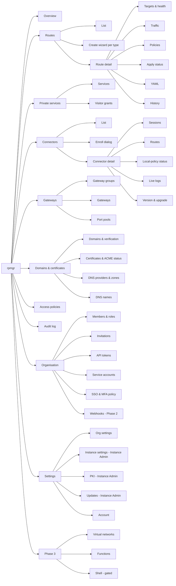

# 09 — Web UI

> Status: Phase 1 is implemented. Tags: [F] fact · [R] recommendation · [T] target · [V] verify
> at implementation ([README](README.md#how-to-read-these-documents)).

The web UI is the main way most operators use rpmgr. It is a single-page application embedded in the
`rpmgr` binary and served by the Controller on the same origin as the API. Everything the UI can do
is also possible through the public API and `rpmgr apply` ([07](07-api.md)). The UI has no private
endpoints.

## UX principles

| # | Principle | What it means in practice |
|---|---|---|
| U1 | **Forms are the model** | Every form maps 1:1 to a protobuf message of the public API. A form submits the complete typed resource, with an etag. It never merges over a stored blob, because there is no blob. A field the form does not show cannot exist. |
| U2 | **Saved ≠ applied, and the UI says which** | After every save, the UI shows the new revision and the per-agent apply status: `pending` → `applied` / `rejected` / `apply_timeout` ([07](07-api.md#writes-and-apply-status), [03](03-connections.md#configuration-reconciliation)). A rejection lists the agent and the structured reasons. |
| U3 | **Desired and observed, side by side** | Each resource shows what was configured (desired) next to what the agents report (observed): enabled vs the route status `disabled` / `pending` / `ready` / `degraded` / `unavailable` / `error` / `maintenance`, and per target the connector's readiness `ready` / `not_ready (reason)` ([06](06-data-model.md#desired-vs-observed-state)). There is never a second "enabled" switch; an HTTP route's maintenance changes what it answers, not whether it is served ([D88](14-open-decisions.md#engineering)). |
| U4 | **Every error says what to do** | A route blocked by a connector's local policy shows the exact host command with a copy button, e.g. `sudo rpmgr policy allow-target 10.0.0.5:5432` ([04](04-security.md#connector-local-policy)). An unverified domain shows the TXT record to create. A DNS conflict names the foreign record that occupies the hostname and offers **Adopt** ([15](15-dns.md#conflicts)). |
| U5 | **YAML instead of raw JSON editors** | Every resource has a *YAML* tab: view, copy and download (Phase 1); edit and import arrive with declarative manifests in Phase 2 ([D58](14-open-decisions.md#project-and-process)). The YAML is the same document `rpmgr apply -f` accepts. It is validated by the same server-side rules as the form, and the result is shown as a diff before saving. |
| U6 | **No lost updates** | Every write carries the etag of the version the user started from. On a conflict, the UI shows "changed by *alice* 2 min ago" with a field-level diff and lets the user reapply their change on top or discard it. |
| U7 | **Dangerous actions are deliberate** | Deleting, revoking, minting enrollment tokens, granting roles, opening a shell, adopting or releasing DNS records and approving a held DNS zone's plan need a confirmation that names the object. Where [04](04-security.md#human-authentication-and-sessions) requires step-up re-authentication, the UI asks for it inline and keeps the user's place. |
| U8 | **Accessible** | [T] WCAG 2.2 AA: full keyboard operation, visible focus, labels on every control, ARIA live regions for apply-status changes, contrast in both themes, no information carried by colour alone (status chips have an icon and text). |
| U9 | **Fast to navigate** | A command palette (`Ctrl/⌘ K`) jumps to any resource by name or ID and runs common actions ("create route", "enroll connector"). Lists are paginated on the server, filterable and sortable, and keep their filter state in the URL. |
| U10 | **Light, dark and system themes** | Follows the OS preference by default; the user's choice is stored server-side in their profile and is changed with the switch in the top bar ([Layout and navigation](#layout-and-navigation)). |
| U11 | **Localised** | English is the source language. Translations use i18next with the same keys. Missing keys fall back to **English**, so a partial translation never shows raw keys or another language. Phase 1 ships English only ([D32](14-open-decisions.md#project-and-process)); every string is keyed from the start, so further languages are translation files without code changes. |

## Information architecture



| Area | Contents | Minimum role to view / change ([04](04-security.md#roles)) |
|---|---|---|
| **Overview** | Health of agents, sessions and certificates; routes not `ready`; pending, rejected or timed-out applies; expiring certificates and tokens; unverified domains; DNS conflicts, held DNS zones and expiring DNS-provider tokens; agents below `min_agent_version`; a traffic summary | Viewer |
| **Routes** | List; create wizard per type (`http`, `tls_passthrough`, `tcp`, `udp`, `tcp_udp`); detail with targets, health checks, traffic, access policies, transport override (advanced), per-agent apply status, YAML, change history | Viewer / Operator |
| **Private services** | Services, visitor grants, relay vs P2P state per grant | Viewer / Operator |
| **Connectors** | List with status, version, transport, RTT, last seen; enroll dialog; detail with data and control sessions, served routes, local-policy status, transport override (`auto`, `quic`, `h2` or the instance default), live logs, version and staged upgrade | Viewer / Admin to enroll or revoke (Operator if the org allows it) |
| **Gateways** | Gateway groups (region, public hostnames for route traffic, DNS target for managed DNS records, port pools), gateways (own tunnel endpoints — address/port and, for WSS, the gateway's own hostname — status, version, sessions, listeners), drain action. Connectors dial each gateway at its own tunnel endpoints; group-level DNS or anycast names are for public traffic only ([03](03-connections.md#establishment)) | Viewer / Admin |
| **Domains & certificates** | Domain claims with the verification flow (TXT record or HTTP token, a "check now" button, status), certificates with source (ACME/uploaded), SANs, expiry, last ACME error. Phase 2: DNS providers (connect, rotate token, status, token expiry), managed zones (import, gates, plan approval, records, conflicts, adopt and release) and DNS names ([15](15-dns.md)) | Viewer / Admin; foreign records of a zone: Admin |
| **Access policies** | IP allow/deny lists, basic auth, OIDC forward-auth, rate limits; where each policy is used | Viewer / Operator |
| **Audit log** | Searchable by actor, action, target and time; entry detail with the redacted diff; chain-verification status; export (step-up) | Admin |
| **Organisation** | Members and roles; invitations as copyable one-time links, also e-mailed when SMTP is configured; API tokens (personal tokens in Phase 1, service accounts and their tokens in Phase 2: list, create with mandatory expiry, revoke); SSO and MFA policy; Phase 2: webhooks (endpoints and delivery log) | Admin; SSO and MFA policy are Owner-only |
| **Settings** | **Org settings**, and **instance settings** for the Instance Admin. Both are runtime settings stored in the database and editable here, with validation, a description and the default for each field. Boot settings (listen addresses, database DSN, KEK source) are shown read-only with the file they come from ([10](10-operations.md#configuration)). Instance settings include the default data-session transport ([03](03-connections.md#transport-selection)). Two instance-level pages: **PKI** (CA and intermediate status, intermediate rotation with step-up, leaf-certificate lifetime and grace period, password-hash profile, [04](04-security.md#pki-and-identity)) and **Updates** (release check, on by default; update channel; manifest upload for air-gapped installs; staged rollouts in Phase 2, [04](04-security.md#over-the-air-updates)). | Owner (org settings) / Instance Admin (instance settings, PKI, Updates) |
| **Account** | Profile, password, MFA (TOTP, passkeys, recovery codes), active sessions with revoke, personal API tokens, theme and language | Any user |
| **Restore review** (only after a fail-closed restore) | A full-width banner and a per-org checklist: each org stays read-only until its Owner re-confirms that org's memberships and roles (or the Instance Admin, with `rpmgr restore confirm --org` on the controller host); API tokens and service accounts are listed as suspended with a per-item re-enable action; users sign in again after a password reset and set up their second factor again. The banner explains that the instance-wide review is ended by the Instance Admin with `rpmgr restore confirm` on the controller host — not from the UI, because restored Owner memberships are exactly what is in doubt ([10](10-operations.md#backup-and-restore)) | Org Owner (own org); Instance Admin |
| **Phase 3: Virtual networks** | Networks (CIDR, ACL), members, endpoints, topology graph with measured links | Operator |
| **Phase 3: Functions** | Function code and versions, deployments to connectors, ingress routes | Operator |
| **Phase 3: Shell** | A tab in the connector detail. It appears only when the connector's local policy allows it and the user has an explicit `connector.shell` grant. Opening it needs step-up re-authentication. | Explicit grant |

## Key screens

### Layout and navigation

```
┌────────────────┬───────────────────────────────────────────────────────────────────────┐
│ ◆ rpmgr        │ [⌕ Go to…                     Ctrl K]            [▣|☀|☾]  (A) Ada ▾   │
│                ├───────────────────────────────────────────────────────────────────────┤
│ ▣ Overview     │ Routes                                              [+ Create route]  │
│                │                                                                       │
│ NETWORK        │ ┌───────────────────────────────────────────────────────────────────┐ │
│ ⇄ Routes       │ │ the page's content: cards, tables and forms                       │ │
│ ⌁ Connectors   │ └───────────────────────────────────────────────────────────────────┘ │
│ ▤ Gateways     │                                                                       │
│                │                                                                       │
│ SECURITY       │                                                                       │
│ ◎ Domains & c… │                                                                       │
│ ⛨ Access pol…  │                                                                       │
│                │                                                                       │
│ ADMINISTRATION │                                                                       │
│ ⚇ Organisation │                                                                       │
│ ≡ Audit log    │                                                                       │
│ ⚙ Settings     │                                                                       │
│                │                                                                       │
│ rpmgr 0.1.0    │                                                                       │
└────────────────┴───────────────────────────────────────────────────────────────────────┘
```

- **The sidebar** lists the pages in groups, each with an icon and its name: Overview; *Network*
  with Routes, Connectors and Gateways; *Security* with Domains & certificates and Access policies;
  *Administration* with Organisation, Audit log and Settings. The current page is marked, also for
  screen readers (`aria-current`).
- **The version** the controller runs stands at the foot of the sidebar, as `rpmgr 0.1.0`, for
  every signed-in user ([D80](14-open-decisions.md#engineering)). The sign-in,
  setup and other public pages show none.
- **On screens narrower than 1024 px** the sidebar is a menu behind a button in the top bar. It
  opens from the left as a modal dialog, and Escape, a click beside it, its close button and
  choosing a page close it.
- **The page fills the window** beside the sidebar, however wide the screen is. From 1280 px, the
  route form and the instance settings stand in two columns, and the account page sets its profile,
  password and authenticator cards side by side. Short forms keep a readable width inside their
  card.
- **The top bar** holds "Go to…", which opens the [command palette](#command-palette), the theme
  switch and the user menu. It stays at the top while the page scrolls.
- **The theme switch** chooses *like the system*, *light* or *dark* (U10). It is a group of radio
  buttons, so the arrow keys move through the themes. The choice applies at once and is saved to
  the profile, with the display name unchanged, so it follows the user to every browser. If it
  cannot be saved, the stored theme comes back and the switch says why.
- **The user menu** shows the user's name and e-mail address, and leads to the account page and to
  signing out. Escape, a click elsewhere or a choice close it.
- **The look:** slate surfaces with an indigo accent, in a light and a dark theme. Every text colour
  keeps a contrast of at least 4.5:1 on the surfaces it is drawn on, and control borders, the focus
  outline and chart lines at least 3:1, in both themes (U8). Pages are built from a header with the
  page's actions, cards, tables and status badges. A status badge always has an icon and text.
- **Required fields:** a field the form or the server refuses to leave empty has a red asterisk
  after its label ([D77](14-open-decisions.md#engineering)). The control is marked required, so
  screen readers say so; the asterisk itself has an empty alternative text and is not read. A field
  required only in some cases has the asterisk while the case holds: an uploaded certificate,
  a target's host and port or its socket path, an HTTPS target's server name on a socket, the mail
  relay's sender address, and the password of a basic-auth user the policy does not have yet. A
  number field that is filled in with its default, such as a port of 0 for any free port, is
  required too, since an empty one is refused. A group of checkboxes of which one must be chosen,
  such as an API token's scopes, has the asterisk after its legend, and the legend says "required"
  to screen readers, since no checkbox can be marked required. Selects and radio buttons that
  always hold a value, and search and filter fields, have none. Forms do not explain the asterisk.
- **Icons** come from lucide-react and are bundled with the UI, so the CSP needs no other origin
  ([Frontend architecture](#frontend-architecture)). They are hidden from screen readers; their
  name is always in the text next to them or in the control's label.
- **Pages that need no session** (sign-in, setup, resets, invitations) show their form as a card in
  the middle of the page, under the product's mark.

### Routes list

```
┌ Routes ──────────────────────────────────────────────────────────────── [+ Create route] ┐
│ Search: [ app.example.com            ]  Type: [All ▾]  Status: [All ▾]  Group: [eu ▾]    │
├──────────────────────┬────────┬───────────────┬────────────┬──────────────┬─────────────┤
│ Name / hostnames     │ Type   │ Gateway group │ Targets    │ Status       │ Applied     │
├──────────────────────┼────────┼───────────────┼────────────┼──────────────┼─────────────┤
│ wiki                 │ http   │ eu            │ 2/2 ready  │ ● ready      │ ✓ rev 1042  │
│  wiki.example.com    │        │               │            │              │             │
│ postgres             │ tcp    │ eu            │ 0/1 ready  │ ▲ unavailable │ ✓ rev 1040 │
│  eu.example.net:25432│        │               │ 1 blocked by local policy                 │
│ grafana              │ http   │ eu            │ 1/1 ready  │ ○ disabled   │ ⧗ pending   │
│  grafana.example.com │        │               │            │              │  2/3 agents │
├──────────────────────┴────────┴───────────────┴────────────┴──────────────┴─────────────┤
│ 3 of 27   ◂ 1 2 3 ▸                                                       Export YAML   │
└─────────────────────────────────────────────────────────────────────────────────────────┘
```

**How the list works.**
- It reads all of the org's routes and filters them in the browser by text (name or address),
  type, status and gateway group. It sorts them by name and shows 25 a page. The filters and the
  page stay in the URL (U9).
- **The address** of an HTTP or TLS passthrough route is its hostnames. A TCP, UDP or "TCP and UDP"
  route shows its public port at each public hostname of its gateway group, such as
  `eu.example.net:25432`, an IPv6 address in brackets; while the group has none, only `:25432`
  (D79).
- **Without routes,** the list offers to create the first. When the filters match none, it says so
  and offers to clear them.
- **Targets** shows how many are ready, and how many a connector's local policy blocks.
- **Status** shows the observed state, with an icon and text, and how many agents rejected the
  route.
- **"Create a route"** opens a form: the type, the gateway group, and the fields of that type.
  - **Types:** HTTP, TCP, UDP, "TCP and UDP" ([D83](14-open-decisions.md#engineering)) and TLS
    passthrough. A "TCP and UDP" route has one public port and both idle timeouts, TCP and UDP.
  - **Defaults:** HTTP routes start with ACME certificates and a redirect on port 80. Routes on a
    port start on port 0, a free port of the group's pools, free in both for "TCP and UDP". The
    org's default gateway group ([Settings](#settings)) is preselected unless a group was chosen
    first.
  - **Retries:** the creation carries one request ID, however often it is retried.
  - **After creating,** the apply status follows live, and a link opens the new route to add its
    targets.
- **Preview** (`PreviewRoute`), in the create and edit forms, checks the route as the save would,
  without saving. It shows where the route would be reached, the gateways and connectors that would
  carry it, and anything a gateway would refuse. A gateway or connector whose release lacks a
  capability the route needs is not among them
  ([03](03-connections.md#versioning-and-capabilities)).
- [R] The "Applied" column of the mock-up is left out in Phase 1. It needs the revision that last
  changed each route, which the API does not report. Rejections show under Status instead, and the
  apply status of a change shows after each save.

### Overview

- **The summary** is a row of four figures, each leading to its page: the enabled routes that
  serve fully, the agents in service that are connected, the certificates that have not failed and
  do not expire within 21 days, and the verified domains, each of how many there are. A status
  badge under each figure says how many need attention, that all is well, or that the area has
  nothing yet. Disabled routes, disabled connectors, drained gateways and decommissioned agents are
  not counted ([D81](14-open-decisions.md#engineering)). Routes in maintenance are not counted
  either; the routes' figure says how many there are ([D88](14-open-decisions.md#engineering)).
- **Needs attention** is a card next to the traffic. Each area is marked as fine or as needing
  attention, and lists what needs it, each linked to its page, or says that nothing in it does:
  - agents without a control session: gateways, with when they were last seen or that they have
    not enrolled, and connectors, with when they were last seen, under the count of connected ones;
    disabled connectors and drained gateways are left out, since none is expected to connect;
  - routes that do not serve fully (`pending`, `degraded`, `unavailable`, `error`) or that agents
    rejected, with their state; disabled routes and routes in maintenance are left out;
  - certificates that failed, with the error, or that expire within 21 days, as on the certificates
    page;
  - domains not verified, with their status;
  - the user's own API tokens that expire within 21 days or have expired.
- [R] Agents below `min_agent_version` are not listed apart in Phase 1, although
  [03](03-connections.md#versioning-and-capabilities) says the refusal is shown. Such an agent
  shows as without a control session. From Phase 2 the API reports, for each connector and gateway
  the controller refused, that it is below the minimum, the version it came with and the reason of
  that `Goodbye` ([07](07-api.md#services)); the lists show it with the rollouts of
  `/settings/updates`.
- DNS conflicts, held DNS zones and DNS-provider tokens join the list with managed DNS (Phase 2).
- **Traffic, last 24 hours:** the org's bytes in and out, connections and errors as figures, the
  bytes in and out per hour as a chart, and its busiest routes, each linked to its detail.

### Charts

- **Drawing:** Recharts draws traffic in the UI's theme colours: a 2 px line per series over a light
  wash, on hairline grid lines. The figures above the chart name the series next to their colours,
  so they are its legend. The two colours stay apart for every kind of colour vision, in both
  themes. The tooltip writes in the text colour, because the series' colours are too light for
  text.
- **No traffic:** a period without any traffic shows a note instead of a flat line.
- **Gaps:** the API sends only buckets with traffic. The chart fills the others with zeros, so time
  runs evenly along its axis.
- **Accessibility (U8):** the drawing is hidden from screen readers. The same values are in a table
  under "Show the values as a table".
- [R] Charts do not use shadcn/ui's chart component. It writes a `<style>` element, which the CSP
  refuses and the lint rule against `dangerouslySetInnerHTML` forbids
  ([Frontend architecture](#frontend-architecture)).

### Command palette

- **`Ctrl K` or `⌘ K`** on any signed-in page, or "Go to…" in the top bar, opens the palette (U9).
- **Without a query** it offers the pages and the actions "Create a route" and "Enroll a
  connector".
- **A query** also finds routes, connectors, gateway groups and gateways. They are found by name,
  labels that start with the query first, or by the start of their ID. At most 50 matches are
  shown.
- **Keyboard:** the arrow keys move through the matches, `Enter` runs one and `Escape` closes the
  palette, as does a click beside it. It is a combobox with a list box, so screen readers announce
  the active match.
- **Linkable dialog:** the enroll dialog's state is in the connectors page's URL, so the palette, or
  a link, can open it.

### YAML view

- **"YAML"** on the detail of a route, a connector or a gateway group shows its manifest, with
  the group's gateways. **"Export YAML"** on the list of routes, connectors, gateways, access
  policies, domains and CA bundles shows every resource of that list's kinds.
- **The dialog** shows the manifests read-only, with line numbers and highlighting, and how many
  there are. It has buttons to copy them and to download them as a `.yaml` file
  ([07](07-api.md#declarative-manifests)). The text can be selected with the keyboard.
- **Loading:** CodeMirror loads only when a YAML view opens.

### Route detail

```
┌ Route: postgres (tcp)                      [Enabled ●━]  [Edit]  [YAML]  [⋯ Delete]   ┐
│ Desired: enabled · gateway group eu · eu.example.net:25432   Observed: ▲ unavailable   │
├ Targets & health ─────────────────────────────────────────────────────────────────────┤
│ Connector   Address          Weight  Health       Status                                │
│ db-host-1   10.0.0.5:5432    100     tcp / 10 s   ▲ not_ready: blocked by local policy  │
│             Run on db-host-1:  sudo rpmgr policy allow-target 10.0.0.5:5432   [Copy]    │
├ Apply status (revision 1040) ─────────────────────────────────────────────────────────┤
│ gw-eu-1 ✓ applied    gw-eu-2 ✓ applied    db-host-1 ✓ applied (target not_ready)      │
├ Traffic (24 h) ──────────────────────────── Policies ──────────────────────────────────┤
│ ▁▂▃▅▇▅▃▂▁  in 1.2 GB · out 310 MB          IP allow-list "office" · rate limit 50/s    │
├ History ──────────────────────────────────────────────────────────────────────────────┤
│ rev 1040  alice  changed target port 5433 → 5432           2026-10-06 09:12  [diff]    │
└─────────────────────────────────────────────────────────────────────────────────────────┘
```

**How the detail works.**
- **Layout:** a link back to all routes; the route's name and type with the "Enabled" switch, for an
  HTTP route the "Maintenance" switch, "YAML", "Delete…" and "Edit"; the configured settings next to
  the observed state; then cards for the gateways not serving it and the agents that rejected it,
  when there are any, and for its targets, traffic and access policies.
- It shows the configured settings next to the observed state (U3), and how many of the group's
  gateways serve the route.
- **The address** is the list's. A route on a port whose gateway group has no public hostname
  shows only its port, says so, and links to the group, where they are set.
- **Each target** shows its connector by name, its address and weight, and whether it serves; if
  not, it says why.
- **Targets are added, edited and removed** on the page, in the targets card, one form at a time.
  - **The form:** the connector (fixed once the target exists), a host and port or a socket path,
    for HTTP routes the protocol to the target (HTTP, verified HTTPS with its server name, CA
    bundle, chosen among the org's by name or none for the system's roots, and key pin, HTTPS by
    pinned key, unverified HTTPS with its server name, or h2c; other routes pass the bytes, or for
    UDP the datagrams, as they come, and show no such field), the PROXY protocol for TCP, TCP and
    UDP, and TLS-passthrough routes (on a TCP and UDP route with the note that it goes on TCP
    connections only, [D86](14-open-decisions.md#engineering)), weight, priority, with the note
    that a higher priority on any connector is a failover
    ([D90](14-open-decisions.md#engineering)), and whether it is enabled.
  - **Unverified HTTPS** ([ADR-0017](adr/0017-upstream-tls-verification-modes.md)): choosing it
    shows a warning that anyone on the network between the connector and the target can read and
    change the traffic, and the target shows an "unverified" badge next to its address.
  - **HTTPS, pinned key:** the key pin is required, and "Trust the certificate it shows now" has
    the connector read the certificate of the target in the form, saved or not. The form shows its
    subject, names, issuer or "self-signed", expiry and key fingerprint; "Trust this key" fills in
    the pin, which the save then stores.
  - **Edits** send the whole target as read, with the update mask of those fields and its etag
    (U1).
  - **Removal** first asks, naming the target's address.
  - **After each change,** the apply status follows live.
- **A target that a connector's local policy blocks** shows the command for that connector's host,
  with a copy button (U4): `rpmgr policy allow-target` for a target nothing allows, and
  `rpmgr policy remove-deny-target` with the deny entry for one a `deny_targets` entry refuses
  ([D84](14-open-decisions.md#engineering)). The value is shell-quoted, for example a socket path
  with a space.
- **A target whose connector reaches the gateways only over TLS and HTTP/2** is marked as served
  over the fallback for QUIC. A route pinned to HTTP/2 is not marked.
- **Gateways that do not serve the route, and agents that rejected it,** are listed with their
  reasons.
- UDP and "TCP and UDP" routes show the MTU hint of [03](03-connections.md#udp-routes).
- **Traffic:** the bytes in and out of the last 24 hours per hour, or of the last 30 days per day,
  with their totals, connections and errors ([Charts](#charts)).
- **Access policies:** the policies the route applies. They are attached from the org's policies
  and detached, with no order to set: a deny rule of any of them wins
  ([D85](14-open-decisions.md#engineering)), which the card says once two apply. They are then saved
  as one change: the route as read, with the mask `policy_ids` and its etag.
- **The "Enabled" switch** turns the route on or off; it is the only desired on/off switch (U3).
  - It sends the route as read, with the mask `enabled` and the route's etag.
  - The revision's apply status then follows live (U2): the state over the online agents, each
    agent that has not applied it with its reasons, and the offline agents, through
    `WatchApplyStatus`, in a live region (U8).
  - If the route changed since the page read it, the switch says so, and the page shows the route as
    it is now.
- **The "Maintenance" switch** of an HTTP route ([D88](14-open-decisions.md#engineering)) puts it in
  maintenance and takes it out, as the "Enabled" switch does, with the mask `http.maintenance`. The
  configured settings then say "in maintenance" and show the message the maintenance page shows. The
  form has both, the setting and the message.
- **"Edit"** opens the route's form, with the fields the API lets a route of its type change.
  - **Full resource (U1):** the form starts from the route as read and sends it whole, with its
    fields set from the form, the update mask of those fields and the etag. A field the form does
    not show keeps what the server sent, so a save loses nothing.
  - **Validation:** before sending, the form checks the API's rules. The server's violations land
    on their fields, and any it cannot place are shown with the form.
  - **Labels and headers** take one per line, labels as `key=value` and headers as `Name: value`,
    and each field's hint says which. The form checks each line, and names the first that has no
    separator, a key or name the API refuses, or a key or name an earlier line has; header names
    are compared without case.
  - **An uploaded certificate** is chosen among the org's uploaded certificates that cover every
    hostname the form has, by its names, ID and expiry; the form stores its ID. The choice shows
    only while the route uses an uploaded certificate. A certificate chosen before stays offered,
    marked if it does not cover the hostnames, so the form never changes it unasked.
  - **Phase 2 sections** ([03](03-connections.md#http-routes)), each folded until used:
    - **Header matches** (http): up to eight rows of a header name with "equals" and a value, or
      "is present"; a hint explains that more matches win and that the route created first wins
      a tie, which preview reports.
    - **Timeouts** (http): upstream response header and upstream idle, empty for the gateway's.
    - **Limits** (every type): connections, request rate and bandwidth for the route as a whole,
      with a hint that the group's enabled gateways share them.
    - **Health check** (every type): TCP or HTTP, port, path, expected status, interval, timeout
      and thresholds; route detail shows each target's health, and "health not checked" for a
      connector that runs no checks.
    - **CONNECT** (tcp in `http_connect` mode): the authorities and the authentication mode; for
      "basic auth in the clear" a warning stays on the form, in the colour of errors, that the
      password crosses the network readable by anyone on the path.
  - **After a save,** the apply status follows live, as for the switch.
  - **A save that meets a newer version (U6)** opens a panel in the form. It says who changed the
    route and how long ago, and lists the fields either side changed, with the user's value next to
    the saved one. Fields both sides changed differently are marked.
    - "Put my changes on the new version" refills the form with the saved version and the user's
      changes on top, for a second save.
    - "Drop my changes" refills it with the saved version.
- **"Delete…"** asks first, naming the route and saying that its hostnames, targets and port go
  with it (U7). The question takes the place of the page's actions until it is answered or
  cancelled.
  - It sends the route's ID with the etag as read (U6). A route that changed since the page read it
    is not deleted; the page says so and shows the route as it is now.
  - **After the deletion,** the page says the route is deleted and follows the revision's apply
    status live (U2), with the link back to all routes.

### Connectors

- **The list** (`/connectors`) shows the org's connectors in service, sorted by name. Each row has
  its state (disabled, else whether its control session is connected or offline, with an icon and
  text), version, last contact and labels. A text filter (name or `key=value` label) and a state
  filter stay in the URL (U9).
  Without connectors, the list offers to enroll the first. When the filters match none, it says so
  and offers to clear them.
- **The detail page** has a link back to the list above its title, an **Enabled** switch next to it,
  as a route has (U3, [D81](14-open-decisions.md#engineering)), and:
  - **Sessions:** the control session (address, last contact), and the data sessions per gateway,
    with transport, round-trip time and start.
  - **Routes:** those with a target on the connector. Those it reports not ready show their reason,
    and, for a target its local policy blocks, the command for its host with a copy button (U4); a
    target that is one of rpmgr's own ports gets no command but says that the all-in-one's
    connector never dials it ([04](04-security.md#connector-local-policy)).
  - **Settings:** name, labels and transport policy. They are saved as the whole connector as
    read, with their mask and the etag (U1).
  - **Decommission** comes after a confirmation that names the connector and says what it does
    (U7), including the routes that are deleted with it because they have no other target
    ([06](06-data-model.md#lifecycle-and-deletion)). It can be confirmed only once the routes are
    read; if they cannot be, it says so. The page then returns to the list.
  - **The all-in-one's own connector** is marked "built in", in the list too, and offers no
    decommission, which the API refuses; its switch still turns it off
    ([ADR-0019](adr/0019-all-in-one-runs-a-connector.md)).

### Gateways

- **The groups** (`/gateways`): each with its region, public hostnames, and how many of its gateways
  are connected. A new group is created there, and the page then opens it. Without groups, the
  page offers to create the first.
- **A group's page** has a link back to the groups above its title. It lists its gateways by slot,
  with their tunnel endpoints, state (not enrolled, connected or offline, and drained), version and
  last contact. It also edits the group's name, region, public hostnames and trusted proxies, as
  the whole group as read with their mask and the etag (U1). If the group changed since the page
  read it, the form says so.
- **Gateway actions** on a group's page:
  - **Add a gateway** with its name and its own tunnel endpoints. A group has at most four; the
    server says so.
  - **Edit** its name and endpoints, and in Phase 2 its WSS hostname, which the server checks
    against the verified domains of the group's owner org
    ([03](03-connections.md#transport-selection)).
  - **Drain or resume** it (R22, [03](03-connections.md#multiple-gateways)). A drained gateway takes
    no new public connections, and it ends the open ones after the gateway drain period.
  - **Decommission** it, after a confirmation that names it. The all-in-one's own gateway is marked
    "built in" and offers neither a decommission nor an enrollment token; it can be drained
    ([ADR-0019](adr/0019-all-in-one-runs-a-connector.md)).
  - **For a gateway that has not enrolled,** make its enrollment token after a step-up. The token is
    bound to that gateway and valid for 1 hour, and is shown once next to the install command,
    which does not hold it.
  - **After each change,** the apply status follows live.
- **Port pools and quotas** on a group's page:
  - the group's TCP and UDP port pools, from which TCP and UDP routes get their public ports;
  - a pool is added, its range changed, or removed after a confirmation that names it;
  - a range is checked first: 1 to 65535, the first port no larger than the last;
  - per protocol, the org's quota of the group's ports, with how many are in use. An empty quota is
    removed, so that the pools alone limit the org.
- **Pages** (Phase 2, [D132](14-open-decisions.md#engineering)) on a group's page, for the group's
  owner org: the not-found, unavailable and maintenance pages, each "built in" or "own" with a
  preview in a sandboxed frame without script, an upload of its HTML, the placeholders it may use,
  and a reset to the built-in page after a confirmation.

### Domains and certificates

- **Domains** (`/domains`):
  - **Each claim:** its name (`*.` for a wildcard), status with an icon and text, method, last
    check and last error.
  - **A pending or failed claim shows the proof it waits for (U4):** the TXT record's name and
    value, or the URL at which the org's gateways serve the HTTP token and its value, each with a
    copy button. "Check now" checks it at once.
  - **Claiming** takes the name, whether names below it are covered, and the method (TXT record or
    HTTP token). The name is lower-cased, without a trailing dot.
  - **Removal** comes after a confirmation that names the claim.
  - **The Instance Admin** can mark a claim trusted after a step-up
    ([15](15-dns.md)).
- **Certificates**, on the same page:
  - **Each certificate:** its names, source (ACME or uploaded), status, expiry and issuer, its last
    error, the routes that use it, and its ID with a copy button. An expiry within 21 days is
    pointed out.
  - **Uploading** takes the chain and the private key as PEM, pasted or read from a file in the
    browser. The key leaves the page once it is sent.
  - **An ACME certificate** can be renewed now.
  - **Removal** of an uploaded certificate comes after a confirmation that names the certificate.
    The server refuses a certificate that routes use, and says which. An ACME certificate offers
    no removal, which the server always refuses, and says that ACME manages it.
- **CA bundles,** which HTTPS targets verify their upstreams with: each with its certificates'
  subjects and expiry, how many targets use it, and its ID with a copy button. A bundle is added,
  changed (name and PEM, as the whole bundle as read with mask and etag), or removed after a
  confirmation.

### Access policies

- **The list** (`/policies`): each policy with its description, its rules (allow or deny
  addresses, basic auth with its users' names), and the routes that use it.
  Without policies, the page offers to create the first.
- **The form** creates a policy, or changes one as the whole policy as read with its name,
  description and rules, their mask and the etag (U1).
  - **Rules** are added and removed. They have no order to set: the form says that a deny rule
    wins over every allow rule ([D85](14-open-decisions.md#engineering)).
  - **Basic auth:** each user has a name and a password. Passwords are write-only: an existing user
    whose password field stays empty keeps their password.
  - **Phase 2 rules** ([03](03-connections.md#access-policies)): **rate limit** (requests or new
    connections per second per client, and a burst); **require header** (a header name and up to
    four values, write-only like passwords, at least 32 characters, with a "generate" button);
    **OIDC sign-in** (a route identity provider, accepted e-mail addresses, domains and groups, and
    the session length). The form says which route types each rule applies to.
- **Removal** comes after a confirmation. The server refuses a policy that routes use, and says
  which.
- **After each change,** the apply status follows live.

### Organisation

- **`/org`** shows the org's name, which the Owner can change.
- **Members:** each with name, e-mail address, role and since when. A member's role is changed with
  a step-up where [04](04-security.md#roles) requires one (granting Admin or Owner). A member is
  removed after a confirmation that names them.
- **Account recovery** ([04](04-security.md#account-recovery)): on another member's row, "Reset
  link" for an Owner, and for an Admin where the member is no Owner, shows a one-time link to pass
  on, with its expiry and a copy button. "Remove second factor…", for an Owner, asks for a
  confirmation that names the member and says that their sessions end. Both take a step-up; a
  member the server will not let the caller recover gets a message that says why.
- **Invitations:** an address and a role. The step-up rule is the same.
  - The answer is a one-time link with its expiry. It is shown with a copy button.
  - The page says whether the controller e-mailed the link, or whether it must be sent by hand.
- **The invitation link** opens `/invite#<token>`.
  - A signed-in user joins with their account.
  - Without a session, the page creates an account for the invited address, with a name and a
    password, and the user then signs in.
  - Pages that need no session never send the user to sign in.

### Audit log

- **`/audit`** shows the org's audit log, newest first, 100 entries at a time with "Older entries".
  The Instance Admin can switch to the instance's log.
- **Each entry** shows time, action, target, actor (by name for members) and result, the result as
  a status badge. Opened, it shows the entry number, credential, authentication, address, user
  agent, request ID, reason, and the redacted request, as text that wraps, so that a long one
  never widens the page.
- **Filters:** action (exact) and actor ID, kept in the URL (U9). When no entry matches, the page
  says so instead of showing an empty list.
- **"Verify the chain"** checks the whole hash chain from its anchor: the first entry, or, once
  retention removed entries, the signed checkpoint just before the oldest entry left. It checks
  every checkpoint's signature and, while its entry is kept, that entry's hash. It says whether the
  chain is intact up to which entry, with the last checkpoint, or where it broke and why
  ([04](04-security.md#audit-log)).
- [R] The export of the information architecture is left out in Phase 1: the API has no export
  method, and the log is read in pages.

### Settings

- **`/settings`** shows the org's settings to every member; only the Owner changes them. They are
  "every member must sign in with a second factor", whose change needs a step-up, "Operators may
  enroll connectors", and the gateway group preselected for new routes.
- **Instance settings** are shown to the Instance Admin only, in sections: transport, web UI and
  controller endpoints, traffic statistics, ACME, mail relay and audit log. Each field states its
  range ([10](10-operations.md#runtime-settings-ui--settings)).
  - Emptying the relay's address removes the mail relay.
  - The relay's password is write-only. The page says whether one is set, and replaces or removes
    it.
- **The Instance Admin** moves between `/settings`, `/settings/pki`, `/settings/updates` and
  `/settings/users` by tabs under the page header, which mark the current page. Others see no tabs.
- **`/settings/pki`** shows the trust domain and the root's pin, as `rpmgr enroll --ca-pin` takes
  it. It lists each key whose certificate has not expired, with its kind, state, subject, validity,
  and when the schedule replaces it ([04](04-security.md#pki-and-identity)).
  - **"Rotate the intermediate now"** asks for a confirmation and a step-up. The old intermediate
    keeps verifying the certificates it issued until they expire.
  - The page also holds the leaf-certificate lifetime, the grace period and the password-hash
    profile.
- **`/settings/users`** lists every user of the instance: name, e-mail address, Instance Admin,
  second factor, status and last sign-in. Each other user's row has "Reset link" and, where they
  have one, "Remove second factor…"; every row grants or revokes the Instance Admin role after a
  confirmation. All take a step-up; the last active Instance Admin keeps the role, and the page
  says so ([04](04-security.md#account-recovery)).
- **`/settings/updates`** holds the release check and the update channel. In Phase 2 it also runs
  rollouts ([04](04-security.md#over-the-air-updates),
  [D121](14-open-decisions.md#engineering), [D129](14-open-decisions.md#engineering)):
  - **Rollout mode:** a switch, "Easy" or "Advanced", saved as the instance setting
    `rollout_mode`, says which rollout "Roll out…" starts: an easy rollout, a queue of agents
    updated one after another ([04](04-security.md#easy-rollouts)), or the staged rollout below.
    It is "Easy" until an Instance Admin changes it. A rollout that runs keeps its own kind when
    the switch changes.
  - **Releases:** each listed release with its channel, where it came from and whether the mirror
    holds it; "Upload release…" takes the signed manifest, the signing-key statement and their
    signatures, after a step-up. Its dialog has a "Choose files…" button and a drop zone that take
    the four files at once and sort them by name, leaving others out with a note; each file also
    has a row with its state (chosen, chosen under another name, empty, missing) and its own
    "Choose…". "Upload" stays at the foot of the dialog, off until all four are there, and says
    which are still missing; it reads "Uploading…" while the upload runs, and an error from the API
    is shown in the dialog with the files kept (#874).

    ```
    ┌ Upload a release ────────────────────────────────────────────────┐
    │ Give the four signed files of the release, …                     │
    │ ┌╌╌╌╌╌╌╌╌╌╌╌╌╌╌╌╌╌╌╌╌╌╌╌╌╌╌╌╌╌╌╌╌╌╌╌╌╌╌╌╌╌╌╌╌╌╌╌╌╌╌╌╌╌╌╌╌╌╌╌╌╌╌┐ │
    │ ╎        Drop the four files here, or  [Choose files…]         ╎ │
    │ └╌╌╌╌╌╌╌╌╌╌╌╌╌╌╌╌╌╌╌╌╌╌╌╌╌╌╌╌╌╌╌╌╌╌╌╌╌╌╌╌╌╌╌╌╌╌╌╌╌╌╌╌╌╌╌╌╌╌╌╌╌╌┘ │
    │ ✓ signing-key.json          chosen                    [Choose…]  │
    │ ✓ signing-key.json.minisig  chosen                    [Choose…]  │
    │ ✓ manifest.json             chosen: manifest (1).json [Choose…]  │
    │ ○ manifest.json.minisig     missing                   [Choose…]  │
    ├──────────────────────────────────────────────────────────────────┤
    │ Still missing: manifest.json.minisig        [Cancel]  [Upload]   │
    └──────────────────────────────────────────────────────────────────┘
    ```
  - **Starting an easy rollout:** "Roll out…" on a release no newer than the controller, in the
    easy mode, opens one dialog. It lists the connectors and gateways that can take the release,
    the connectors first and then the gateways, each by name, with their version and whether they
    are online, a search box and "Select all"; agents that cannot (built in, without the
    over-the-air updater, or already on the release) are listed below with their reason and cannot
    be ticked. The ticked agents form the queue, shown in its order on the right with "Move up" and
    "Move down" on each. "Start" starts it after a step-up and is off while no agent is ticked.
  - **Following an easy rollout:** its card shows the agent whose turn it is with its step
    (offered, downloading, staged, installing), then the queue still to come, the agents updated
    and those that failed or were skipped, each with its reason. A count of the failures stands
    next to the title in the error colour as soon as there is one; three in a row pause the
    rollout, and the card says so above "Resume" and "Cancel". "Pause", "Resume" and "Cancel"
    work as for a staged rollout.

  ```
  ┌ Roll out 1.5.0 ─────────────────────────────────────────────────────────┐
  │ Agents that get 1.5.0, one after another                                │
  │ [ Search agents…              ]  [Select all]       Order               │
  │ CONNECTORS                                          1 db-host  [↑] [↓]  │
  │  [x] db-host   1.4.2  online                        2 nas      [↑] [↓]  │
  │  [x] nas       1.4.2  online                        3 edge     [↑] [↓]  │
  │ GATEWAYS                                                                │
  │  [x] edge      1.4.2  online                                            │
  │ Cannot update: aio (built in) · lab (no over-the-air updater)           │
  │                                                    [Cancel]  [Start]    │
  └─────────────────────────────────────────────────────────────────────────┘

  ┌ Rollout of 1.5.0 (easy) ───────────────────────────  running · 1 failed ┐
  │ Now        nas       staged, installing                                 │
  │ Next       edge                                                         │
  │ Updated    db-host                                                      │
  │ Failed     lab-2     rolled back: not ready within the readiness window │
  │ [Pause]  [Cancel]                                                       │
  └─────────────────────────────────────────────────────────────────────────┘
  ```
  - **Starting a staged rollout:** "Roll out…" in the advanced mode opens two steps.
    "Test agents" says that they update first and that all other agents wait until the Instance
    Admin continues; it lists the org's connectors and gateways that a rollout updates, grouped by
    kind with their version and whether they are online, with a search box, and ticks the first
    online connector and gateway that do not run the release yet. Its footer counts the agents
    that get the release, those that run it already and those left out (built in, decommissioned
    or not enrolled). "Review" shows the plan, test agents → 25 % → all agents, and starts the
    rollout after a step-up.
  - **Following a staged rollout:** the running or paused rollout shows its stages, each done,
    current or to come with its agents, and a bar of the agents updated, of those not skipped. One
    primary button continues on the default path, "Continue to 25 % (k more agents)" and then
    "Continue to all agents"; it is enabled once no agent of the current stage is still offered or
    staging, and otherwise says how many still are. "Choose another stage" offers the other
    percentages above the current one, any other from there to 99 and all agents. "Pause", "Resume"
    and "Cancel" are next to it, each after a step-up but "Pause". The agents are grouped: those
    that need attention (rolled back, refused or stalled, with the reason) first, then those
    updating in the current stage, those waiting for a later stage, the updated and the skipped. A
    rollback or a stalled agent pauses the rollout, and the page says which agent and why.
  - Others never see the page; connectors and gateways show their own update state on their pages.

  ```
  ┌ Updates ────────────────────────────────────────────────────────────────┐
  │ Release check  [on]   Channel  (stable ▾)                               │
  │ Releases                                                 [Upload…]      │
  │  1.5.0  stable  release check  mirrored     [Roll out…]                 │
  │  1.4.2  stable  release check  mirrored     (controller's previous)     │
  │ Rollout of 1.5.0                                              running   │
  │  ✓ Test agents ──── ● 25 % ──────────── ○ All agents                    │
  │    2 of 2 updated     1 of 3 updated      9 waiting                     │
  │  ██████░░░░░░░░░░░░░░  3 of 12 agents updated · 1 skipped               │
  │  [Continue to all agents (9 more agents)]  [Choose another stage ▾]     │
  │  You can continue once this stage is done: 2 agents are still updating. │
  │  [Pause]  [Cancel]                                                      │
  │  ▾ Updating now (2)   ▸ Waiting for a later stage (9)   ▸ Updated (3)   │
  └─────────────────────────────────────────────────────────────────────────┘

  ┌ Roll out 1.5.0 ─────────────────────────────────────────────────────────┐
  │ Step 1 of 2: test agents                                                │
  │ These agents update first. All other agents wait until you continue.    │
  │ [ Search agents…                 ]                                      │
  │ CONNECTORS   [x] db-host  1.4.2  online    [ ] nas  1.4.2  offline      │
  │ GATEWAYS     [x] edge     1.4.2  online                                 │
  │ 4 agents get the release · 1 already runs 1.5.0                         │
  │                                                     [Cancel]  [Next]    │
  └─────────────────────────────────────────────────────────────────────────┘
  ```
- **Connector and gateway lists** show each agent's version, and from Phase 2 its update state
  (offered, staged, updated, rolled back, skipped and why), and a warning when it is below
  `min_agent_version`, with the reason of its last `Goodbye`.
- **Update** ([D129](14-open-decisions.md#engineering)), for the Instance Admin only: each
  connector and gateway, in its list row and on its detail page, has "Update to 1.5.0" with the
  controller's own version when it runs an older one. After a step-up it adds the agent to the end
  of the running easy rollout of that version, or starts one with that agent alone
  ([04](04-security.md#easy-rollouts)); the button then shows the agent's place in the queue. It
  works in both rollout modes. It is off, with the reason next to it, when the agent is up to
  date, built in, has no over-the-air updater, declined the last offer because of its local policy,
  or is offline, and while a staged rollout or a rollout of another release runs.
- **Saving** sends the settings as read with the page's fields changed, the mask of those fields and
  the etag (U1); a page never saves another page's fields. If the settings changed since they were
  read, the page says so and shows them as they are now.
- [R] The boot settings of the information architecture are not shown in Phase 1: no API method
  returns them. Showing them needs a method that returns the boot file without its secrets.
- **The revocation log** ([10](10-operations.md#backup-and-restore)) is shown to the Instance Admin
  above the settings:
  - **No sink:** the standing warning that the log has no copy off the host.
  - **Waiting entries:** the alert "not yet off-host", with how many entries have waited since
    when, once an entry has waited more than 5 minutes.
  - **Otherwise:** nothing.

### Enroll connector dialog

```
┌ Enroll a connector ─────────────────────────────────────────────────────────── [×] ┐
│ Name         [ db-host-1          ]   Labels  [ site=office ] [+]                  │
│ Gateway group[ eu ▾ ]                Type    (●) permanent  ( ) ephemeral           │
│ Token valid  [ 1 hour ▾ ]   Uses: 1                                                │
│ Allow targets on the host (written into the local policy by the installer;        │
│ none listed = the connector may reach nothing until a target is allowed):         │
│ [ 10.0.0.5:5432 ] [+]                                                              │
├────────────────────────────────────────────────────────────────────────────────────┤
│ 1. On the host, run:                                                       [Copy]  │
│   curl -fsSLO https://panel.example.com/install.sh && sudo sh install.sh \         │
│     --controller https://panel.example.com --ca-pin sha256:3q2+7w… \               │
│     --allow-target 10.0.0.5:5432                                                   │
│ 2. When the installer asks for it, paste this token (shown once):          [Copy]  │
│   rpmgr_enr_•••••••••••••••••••••••••••••••••••••••••••••_8f2k1a          [Show]     │
│                                                                                    │
│ The token is never part of the command line, and it expires in 1 hour.            │
│ Waiting for the connector to enroll …  ⧗                                           │
└────────────────────────────────────────────────────────────────────────────────────┘
```

- The token is shown once, masked by default, and is never put into the command. This keeps it out
  of argv, unit files and shell history ([04](04-security.md#join-command)). The install script
  reads the token from the terminal (`/dev/tty`) with echo off. The command downloads the script
  and runs the file with `sudo` instead of piping it in, so that what is typed reaches the prompt
  under sudo-rs too ([04](04-security.md#join-command)). Unattended installs use `--token-file`,
  or `RPMGR_ENROLL_TOKEN` passed through explicitly (`sudo --preserve-env=RPMGR_ENROLL_TOKEN …`).
- **The command and the token wrap,** so neither the dialog nor a part of it scrolls sideways, also
  on a phone. The same holds for the gateway's token and every other command the UI shows.
- **"Copy"** says "Copied" for a moment. Where the browser does not copy, because the page has no
  clipboard or the browser refuses it, the dialog says to copy by hand and shows the token.
- Targets entered in the dialog become `--allow-target` flags, and denied targets `--deny-target`
  flags, in the target forms of the local policy, such as `10.0.0.0/16` or `127.0.0.1:200-500`.
  Without any, the default local policy is `allow_targets: []`
  ([04](04-security.md#connector-local-policy)).
- The dialog waits on the enrollment event and switches to the new connector's detail page when it
  connects.
- **Making the token:**
  - it needs a step-up;
  - its creation is one request, however often it is retried;
  - it is valid for 15 minutes up to 30 days, 1 hour by default, and can be scoped to a gateway
    group;
  - an ephemeral token may enroll several connectors, 0 meaning any number;
  - the dialog asks for the install command with the targets as `--allow-target` and
    `--deny-target`.
- [R] The mock-up's "Name" field is left out. A token does not name the connector it enrolls: the
  connector takes its host's name, and it is renamed on its page.
- **The connectors page lists the enrollment tokens** that can still enroll, with creation, expiry,
  uses, labels and last use; an ephemeral one has the badge "ephemeral", whose description says
  what the kind means. A token is revoked after a confirmation. Tokens that re-enroll one
  connector belong to that connector and are not listed.

### Managed DNS zone (Phase 2)

```
┌ Zone: example.com · Cloudflare account "home" ───────────────── ▲ held: first plan  [Sync now] ┐
│ Gates: publish route hostnames ✓ · proxied ✗ · wildcards ✗ · delete threshold 10    [Edit]     │
├ Plan 9f3c…e1 (approve to publish) ─────────────────────────────────────────────────────────────┤
│ + CNAME  wiki.example.com                  → eu.gw.example.net    route wiki                   │
│ + CNAME  nas.example.com                   → eu.gw.example.net    route nas                    │
│ ! A      grafana.example.com               203.0.113.5 (foreign)  conflict: route grafana      │
│                                                                   [Adopt → eu]                 │
│ ~ wiki.example.com no longer follows the foreign *.example.com                                 │
│                                               [Discard]  [Approve plan · step-up]              │
├ Records (read live from Cloudflare) ───────────────────────────────────────────────────────────┤
│ Name                     Type   Content               Owner             Status                 │
│ example.com              A      203.0.113.5           foreign           —                      │
│ grafana.example.com      A      203.0.113.5           foreign           ! conflict             │
│ *.example.com            CNAME  example.com           foreign           —                      │
│ mail.example.com         MX     10 mx.example.net     foreign           —                      │
└────────────────────────────────────────────────────────────────────────────────────────────────┘
```

- **Import** is a short flow: connect a Cloudflare account (API token, step-up), choose zones (only
  `active`, `full` zones can be selected; the others say why), review the first plan, approve it
  ([15](15-dns.md#connecting-importing-and-disconnecting)).
- **Approve** is bound to the plan's hash. If anything changed since the plan was shown, the new
  plan replaces it and the approval has to be repeated.
- **Foreign records** are shown only to Owners and Admins, read live from Cloudflare and never
  stored. Adopting one shows its current content, which is kept for a later "release and restore".
- **Route detail** shows one DNS line per hostname: `dns_status`, the published records and, for
  `http` routes, the proxy toggle. When the zone does not allow proxied names the toggle is
  disabled and says so.

## Frontend architecture

| Concern | Choice | Notes |
|---|---|---|
| Application | **Vite + React + TypeScript** single-page app, built to static assets and embedded with `embed.FS` | Nothing needs server rendering; a static export of a server framework cannot use its SSR, middleware or API routes, so a plain SPA is simpler ([08](08-software-stack.md#frontend)) |
| Routing | TanStack Router, with typed routes and URL search params for list filters | — |
| Server state | TanStack Query through **connect-query**, with generated clients for `rpmgr.v1` | One generated client; no hand-written API layer |
| Live updates | Connect **server streaming** for events (apply status, agent status) and live logs | WebSockets only for the Phase 3 shell |
| Components | shadcn/ui on Radix primitives, styled with Tailwind; icons from lucide-react | The look of [Layout and navigation](#layout-and-navigation) |
| Forms | react-hook-form with **protovalidate-es** as its resolver, so the form checks the same proto rules the server enforces, for immediate feedback only (VB-16, resolved). **The server's protovalidate result is authoritative**, and the server's field errors (`buf.validate.Violations`) are mapped back onto form fields; a violation of a field the form does not edit is shown with the form | Forms submit the full typed resource (U1) |
| YAML editing | CodeMirror 6 with a YAML mode and schema-driven completion | Smaller than Monaco ([08](08-software-stack.md#frontend)) |
| Terminal (Phase 3) | xterm.js over a WebSocket with a single-use ticket ([04](04-security.md#human-authentication-and-sessions)) | — |
| Charts | Recharts in the UI's theme colours, for traffic and latency ([Charts](#charts)) | Same look as the rest of the UI ([08](08-software-stack.md#frontend)) |
| i18n | i18next, English source, English fallback; Phase 1 ships English only | See U11 |

**Code and patterns** (`web/`):
- **Pages and routes.** Each page is a component in `src/pages/` with a route in `src/router.tsx`
  (TanStack Router, code-based). The pages of the information architecture arrive with their
  slices; an unknown path shows a "not found" page.
- **Data.** Pages call the API only through connect-query hooks on the generated method
  descriptors, e.g. `useQuery(AuthService.method.getSession, {})`. The transport is the UI's own
  origin. There is no hand-written API layer.
- **Generated code.** `npm run generate` writes the TypeScript code of `rpmgr.v1` to `src/gen/` with
  buf and `protoc-gen-es`; `build`, `test` and `typecheck` run it first. It is not committed.
- **Text.** Every string is `t("key")` with its English text in `src/locales/en.json`. A unit test
  fails when the code uses a key without English text.
- **Components.** shadcn/ui components are copied into `src/components/ui/` with their MIT license
  notice. Pages build on them and on the shared parts in `src/components/`: the page header, cards,
  status badges and the sidebar's list of pages, which the command palette also offers.
- **Colours.** Both themes are custom properties in `src/index.css`. The dark ones are written once,
  for the user's choice and for the system's preference alike, and Tailwind's `dark:` variant
  follows the same rule. A unit test checks the contrast of each theme's pairs (U8).
- **Tests.** Vitest with jsdom. The API is answered by Connect's router transport, so tests need
  no server.
- **Libraries in chunks of their own.** React, TanStack, Protobuf-ES with Connect, and the
  generated code each get a chunk. Browsers keep them across releases that do not change them.

**Signing in.** Every page except the sign-in pages needs a session
([04](04-security.md#human-authentication-and-sessions)):
- Without a session, or when it ends by expiry or revocation, the UI goes to `/login` and returns
  to the page afterwards. It returns only to its own paths, never to another site.
- The login page asks for the e-mail address and password. When the API answers `MFA_REQUIRED`, it
  asks for an authenticator code or a recovery code.
- A wrong address and a wrong password show the same message. A rate limit shows when to try
  again.
- **One-time links.** Each kind opens its own page. The page reads the token from the URL fragment,
  then removes it from the address bar and the history.
  - The first-user link opens `/setup#<token>`. The page asks for the e-mail address, the name and
    a password, creates the account and signs the user in.
  - A reset link opens `/reset#<token>`, which sets a new password. The user then signs in again,
    because the reset ended every session.
- `/forgot` asks for a reset link by e-mail. Its answer does not depend on whether the address
  belongs to an account. Without a mail relay, it says to ask an Owner or the Instance Admin. A
  link leads back to sign in.
- New passwords are checked in the browser for length (12 to 256 characters) and for a matching
  repetition before they are sent.
- **Step-up.** An action the API answers with `STEP_UP_REQUIRED` opens a dialog over the page
  (U7). The dialog asks for the password, or for an authenticator or recovery code if the user has
  an authenticator. After `StepUp` it runs the action again, so the user keeps their place.
  Cancelling ends the action with the API's error. Pages run such actions through `useStepUp()`.

**Account** (`/account`, opened from the user menu in the top bar):
- **Profile:** the display name. The e-mail address is shown, but it cannot be changed there. The
  theme is chosen with the switch in the top bar ([Layout and navigation](#layout-and-navigation));
  every page applies it from the profile, so it follows the user to every browser. "Like the
  system" follows the operating system's preference.
- **Password:** the change needs the current password, and it ends the user's other sessions.
- **Two-factor authentication:** setting up an authenticator, renewing the recovery codes and
  removing the authenticator each need a step-up and end the user's other sessions.
  - **Setup:** a QR code of the authenticator's URI, drawn as SVG, and the key for typing in. A first
    code turns the authenticator on.
  - **Recovery codes** are shown once, with a copy button.
  - **Removal** first says that the password alone will then sign the user in.
- When an org's policy refuses a user without a second factor (`MFA_REQUIRED`), the UI opens the
  account page with a notice to set one up.
- **Sessions:** the user's live sessions, newest first, each with its browser, address and last
  activity. Any session but the current one can be ended, after a confirmation that names its
  address; the current one ends by signing out.
- **API tokens:** the user's personal tokens of the org, each with its name, prefix, scopes, expiry
  and last use.
  - **New tokens:** a name, 1 to 365 days of validity (90 by default) and scopes from the
    permissions of [04](04-security.md#roles); `org.read` is preselected.
  - **Creation** needs a step-up. The token is shown once, with a copy button, and with the
    `rpmgr login` command for it, which names the controller and the org ID, shown nowhere else,
    and leaves the token out, so that the command asks for it ([16](16-cli.md)).
  - **Revocation** comes after a confirmation that names the token.

In Phase 1 the UI works in the user's first org. The org switcher comes with the multi-org UI
([05](05-features.md), Phase 2).

**Serving.** The controller serves the UI on every path of its UI name that the API and
`/.well-known/rpmgr/` do not take:
- `npm run build` in `web/` writes the app to `internal/webui/ui/app/`, which is not committed, and
  `go build` embeds it.
- A binary built without the app serves a placeholder page that says so.
- A path that is a built file gets that file. Every other path gets the app's page, for the SPA's
  router to show. Unknown API services (`/rpmgr.…`), other `/.well-known/` paths and missing files
  under `/assets/` get 404.
- The page carries the response's nonce wherever the build wrote the placeholder
  `RPMGR_CSP_NONCE`. A build without that placeholder stops the controller at start.

**Security of the frontend**

- **No credentials in browser storage.** The session is an `HttpOnly` `__Host-` cookie. The SPA
  never sees a token and stores none in `localStorage` or `sessionStorage`, where any XSS could
  read it.
- **Strict Content Security Policy:**
  `default-src 'self'; script-src 'self'; style-src 'self' 'nonce-<per-response>'; img-src 'self' data:; connect-src 'self'; frame-ancestors 'none'; base-uri 'none'; form-action 'self'`.
  CodeMirror injects style elements, which carry the page's nonce from its `csp-nonce` meta element
  (VB-07, resolved in [13](13-roadmap.md#verification-backlog)).
  Also: no inline scripts, no `eval`, no third-party origins (fonts and icons are bundled).
  The nonce is 128 random bits, new for each response.
- [R] **Other response headers:**
  - `X-Content-Type-Options: nosniff` and `Referrer-Policy: same-origin` on every UI response.
  - The page is `Cache-Control: no-store`, because its nonce changes.
  - Built files under `/assets/` have content hashes in their names and are cached for a year
    (`immutable`); other built files are `no-cache`.
- **Cross-origin protection.** The SPA calls the API on the same origin. CSRF and WebSocket
  protections are described in [04](04-security.md#human-authentication-and-sessions).
- **Rendering untrusted data.** Hostnames, labels, log lines and audit diffs are rendered as text;
  `dangerouslySetInnerHTML` is banned by lint.

## Testing the UI

- Component and unit tests for form ↔ proto mapping: every form must round-trip a full resource
  without losing fields. This is the regression test for U1.
- End-to-end tests (Playwright) for the main flows: first-run setup, enroll a connector, create an
  HTTP route through to `applied`, a local-policy block (`not_ready`, snapshot still `applied`) shown
  with its command, etag conflict,
  step-up prompt, token creation and revocation.
- Every page a Playwright flow visits is checked with axe for WCAG 2.2 A and AA. A flow also fails
  on any CSP violation, and on anything in `localStorage` or `sessionStorage`.
- A flow checks, in a window 2560 px wide, that each page it visits fills the width beside the
  sidebar, and that the route form stands in two columns there and in one on a phone.
- Flows check that every required control has the red asterisk, drawn with an empty alternative
  text, and that no other control has one; component tests check the same for each form, including
  the fields required only in some cases.
- A unit test computes the contrast of every text colour on its surfaces, 4.5:1, and of control
  borders, the focus outline and chart lines, 3:1, in both themes.
- Accessibility checks (axe) in CI on every page, plus manual keyboard and screen-reader passes per
  release.
- Security checks (CSP present, no tokens in storage, `dangerouslySetInnerHTML` lint) are part of
  [12](12-testing-and-quality.md#security-testing).
