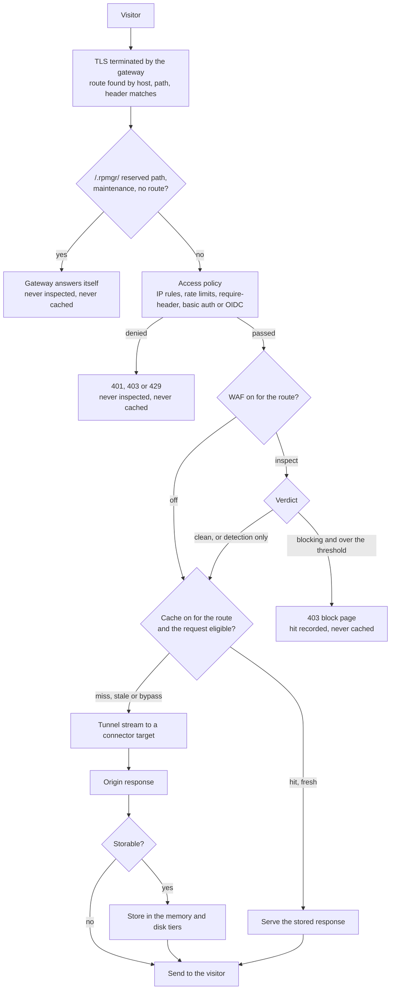
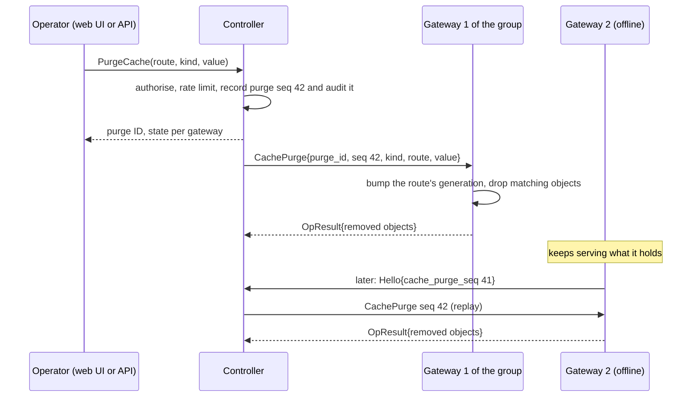
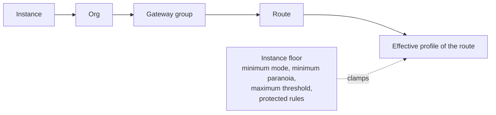

# 17 — Gateway cache and WAF

> Status: Phase 3 design, not built. Both features come after v1.0.0 and leave the v1.0 plan
> unchanged ([13](13-roadmap.md#phase-3--advanced)). Tags: [F] fact · [R] recommendation · [T]
> target · [V] verify at implementation ([README](README.md#how-to-read-these-documents)).
>
> This document describes how a gateway caches the responses of http routes and how it runs a web
> application firewall (WAF) in front of them. It holds **no value**: every size, limit, time and
> default is in [03](03-connections.md#cache-and-waf-limits-phase-3), and every security rule in
> [04](04-security.md#gateway-cache-and-waf-phase-3). The decisions are
> [D171](14-open-decisions.md#engineering), [D172](14-open-decisions.md#engineering) and
> [D173](14-open-decisions.md#engineering); the engine and library choices are
> [ADR-0023](adr/0023-coraza-waf-and-gateway-cache.md), which spike [S11](13-roadmap.md#phase-0--spikes)
> decides. Tables are in [06](06-data-model.md#cache-and-waf-phase-3), RPCs in
> [07](07-api.md#cache-and-waf-phase-3), screens in [09](09-web-ui.md#cache-and-waf-phase-3),
> metrics and runbooks in [10](10-operations.md#cache-and-waf-phase-3).

## Scope

- **What it is.** A gateway may cache the responses of an http route it terminates TLS for, and may
  inspect the requests of such a route with a WAF. Both are off by default and opt-in per route
  (cache) or per scope (WAF).
- **Where it runs.** On gateways only, on `http` routes whose TLS the gateway terminates. Never on
  `tcp`, `udp`, `tcp_udp`, `tls_passthrough` or CONNECT routes, whose bytes the gateway does not
  read, and never on the controller or a connector. The controller holds the settings, shows the
  state and sends purges ([02](02-architecture.md#gateway)).
- **Not a CDN.** rpmgr has no edge network of its own, and each gateway caches only for itself:
  two gateways of a group never share an object, and one org's objects are never another org's
  ([D171](14-open-decisions.md#engineering), [00](00-vision-and-scope.md#non-goals)).
- **Not offered in Phase 3** [R]: caching of anything but `GET`, partial content, a cache shared
  between gateways, a cache that keeps a response the origin forbids, response inspection by the
  WAF, a WAF mode that differs by path, rate limiting or bot scoring by the WAF (rate limits are an
  access-policy rule, [03](03-connections.md#access-policies)), IP reputation feeds and rule feeds
  downloaded at run time.

## The request path

**The order is TLS, access policy, WAF, cache, tunnel** [R]. The first three steps are given by
what each needs: TLS gives the plaintext, and the access policy already decides who may talk to
the route at all ([03](03-connections.md#access-policies)). The decision this document takes is
the **WAF before the cache**, for four reasons:

1. **A hit is judged like a miss.** A cache that answered first would serve a request the WAF has
   never seen, so blocking mode would block nothing that the cache can answer, the hits tab would
   miss every probe of a cached URL, and a new rule or a higher paranoia level would take effect
   only for the requests that miss. With the WAF first, a verdict never depends on what is cached,
   and a change of rules needs no purge.
2. **An attack never creates an object.** A response is stored only for a request the WAF let
   through. A crafted request that the engine blocks never reaches the origin, so its response is
   never stored, which closes the usual route to poisoning a cache with the answer to an attack.
   A request that scores over the threshold in detection mode is let through but its response is
   not stored either ([Storing](#what-is-stored)).
3. **The gateway's own answers stay out.** The block page, the access policy's refusals, the
   error pages and the maintenance page are made by the gateway, are never inspected and are never
   stored, whatever order is chosen; the policy comes first so that a visitor who may not enter
   costs the gateway no inspection.
4. **The price is bounded.** Inspecting every request costs CPU that a cache-first order would
   save on hits. The inspection of a request without a body, which is nearly every `GET` a cache
   answers, is the cheap part of the engine, and the body is inspected up to a limit
   ([03](03-connections.md#cache-and-waf-limits-phase-3)). S11 measures the cost
   ([S11](13-roadmap.md#phase-0--spikes)); if it is above the rule there, the fallback lowers the
   inspected size or the paranoia levels, and the order stays.

The WAF sees the request as the client sent it, after the gateway removed its own reserved headers
([03](03-connections.md#http-routes)). The route's header edits for the upstream apply after the
WAF and before the cache key is made, because the key must name the request as the origin saw it.
A route's response header edits apply each time a response is sent, from a hit as from a miss; a
stored response keeps the headers the origin sent.

## Gateway cache

### What is cached

By default a route's cache is a **strict shared cache** as RFC 9111 defines it
[F rfc9111: §3.5, §4.4, retrieved 2026-11-07]. It stores only what the origin marks cacheable and
never more than the RFC allows; the owner's rules below are stricter than the RFC in places and
the stricter rule wins.

- **Opt-in.** A route caches only when its cache is on ([Settings](#cache-settings)), and only an
  http route whose TLS the gateway terminates. The API refuses the setting on any other route
  type. Requests on port 80 of a route that serves plain HTTP bypass the cache, so an object is
  only ever made for and served to a request over TLS [R].
- **What the origin must say.** A response is stored when it has explicit freshness: `max-age`,
  `s-maxage` (which a shared cache honours before `max-age`) or `Expires`. The gateway never
  guesses a lifetime from `Last-Modified` [R]. `no-cache` and `must-revalidate` are stored and
  checked with the origin at every use, as the RFC says.
- **What is never stored,** by default and under every rule
  ([04](04-security.md#gateway-cache-and-waf-phase-3)):
  - the response to a request that carries credentials, `Authorization` or a `Cookie`, except
    under a rule marked ignore cookies for a request with a `Cookie` and no `Authorization`
    ([Cache rules](#cache-rules));
  - a response with `Set-Cookie`, with `private` or with `no-store`, and one with `Vary: *`;
  - the response of a request whose `Cache-Control` says `no-store`;
  - a response to a method other than `GET`, to a request with `Range`, to an upgrade
    (WebSocket) and to a request the WAF scored over the threshold, also in detection mode [R].
- **What is stored.** The statuses RFC 9110 marks as cacheable by default: 200, 203, 204, 300,
  301, 308, 404, 405, 410, 414 and 501 [R]; the body only when it arrived whole and within the
  object limit. A `HEAD` request is answered from a stored `GET` response and makes none.
- **Requests that carry credentials bypass the cache altogether,** with no lookup and no store
  [R], unless an ignore-cookies rule matches. A lookup could hand the generic page stored for an anonymous visitor to a signed-in one.
  The weakness is plain: a browser that holds a cookie for the hostname never uses the cache, also
  for static files, so the cache works for anonymous traffic and, best, for assets served from a
  hostname that sets no cookie. A route's rule may be marked **ignore cookies** to lift this for
  its own paths and nothing else ([Cache rules](#cache-rules), [D172](14-open-decisions.md#engineering)).
- **The gateway's own credentials do not count** [R]. The `Authorization` header of a `basic_auth`
  rule and the cookies `__Host-rpmgr-auth` and `__Host-rpmgr-state` of an `oidc` rule are consumed
  by the gateway ([03](03-connections.md#access-policies)); the origin never sees them, so its
  response cannot depend on them. On a route with the cache on the gateway removes the two cookies
  from the upstream request as it already removes `Authorization`, and the request counts as
  carrying credentials only if something else does.
- **Client directives.** A request with `no-store` bypasses the cache. A request with `no-cache`
  or `max-age=0` is answered only after the origin confirmed the object, with a conditional request
  when the object has a validator, so that it never serves a stale object against that wish
  [R]. A visitor can therefore make the gateway ask the origin, but never more often than one
  request at a time per object ([Collapsing](#collapsing-concurrent-misses)).

### What is stored

Beyond the table above, a response is **not stored** when any of these holds, and the gateway
counts the reason ([10](10-operations.md#cache-and-waf-phase-3)):

| Reason | Counted as |
|---|---|
| Credentials in the request, `no-store` in the request, a `Range`, a method other than `GET`, an upgrade | `bypass` (no lookup either) |
| `Set-Cookie`, `private`, `no-store` or `Vary: *` in the response | `not_storable` |
| A status outside the list above, or no explicit freshness and no matching rule | `not_storable` |
| Larger than the object limit, or the body ended early or longer than `Content-Length` | `not_storable` |
| The WAF scored the request over the threshold | `waf_flagged` |
| A purge of its route or key ran after the origin request began | `purged_meanwhile` |
| The route has `maintenance` on, or the response is one of the gateway's own | `not_storable` |

### The cache key

The key is the **route, the host, the path, the query and the request headers the response's `Vary`
names** [R]. The route is part of the key, so two routes, two orgs or two hostnames never share an
object, even for the same URL and the same origin; the host is the one the route matched, never a
header the client chose. The query is compared exactly as sent: not sorted and with no parameter
ignored. The headers `Vary` names are compared after normalising their case and white space;
`Accept-Encoding` is compared as the set of codings, so that the order a client lists them in makes
no second object. A response whose `Vary` names a header that the route's edits set is keyed by
the value the origin saw. No header the gateway adds (`Forwarded`, `X-Forwarded-*`, `Rpmgr-*`)
is part of a key.

### Freshness, validation and stale responses

- **Fresh** objects are served with an `Age` header and `Rpmgr-Cache: hit` [R]. A response from
  the origin carries `Rpmgr-Cache: miss`, one the cache could not take `Rpmgr-Cache: bypass` or
  `not_storable`. The header names a state, never a key or a rule.
- **Stale** objects are revalidated with the origin using the stored `ETag` or `Last-Modified`. A
  `304` renews the object and updates its stored headers as the RFC says; anything else replaces it.
- **Conditional requests from visitors** (`If-None-Match`, `If-Modified-Since`) are answered `304`
  from a fresh object when the validator matches, without asking the origin.
- **Stale on error.** The origin's own `stale-if-error` and `stale-while-revalidate`
  (RFC 5861) are honoured, and a rule may set a `stale-if-error` of its own. When the target
  answers 502, 503 or 504, or no connector serves the route, a stale object that allows it is served
  with `Rpmgr-Cache: stale` instead of the error page [R]. This is what keeps a site up while a
  connector restarts.
- **An unsafe request invalidates** the object its URL names when the origin answered it without
  an error, on the gateway that saw it only, as RFC 9111 requires [F rfc9111: §4.4, retrieved
  2026-11-07]. It is not a purge: other gateways keep their copy until it expires or is purged.

### Cache rules

A route may carry rules that cache what the origin does not mark ([D172](14-open-decisions.md#engineering)).

- **A rule** names a match, a time to live and, optionally, a stale-on-error time. The match is a
  path prefix (at a segment boundary, as routing does), a glob over the path, or a list of file
  extensions. Rules are checked in order and the first that matches decides; the route's own come
  before the org defaults ([Settings](#cache-settings)).
- **A rule applies only to a response the origin did not mark**: no `Cache-Control` and no
  `Expires`. Anything the origin said wins, so a rule never overrides a `max-age`, a `no-cache`,
  `private` or `no-store`. There is no rule that replaces the origin's lifetime [R].
- **A rule never stores** a response with `Set-Cookie`, `private` or `no-store`, nor the response
  to a request with credentials, whatever it says, except as the next point says. The gateway counts the reason, so that a page
  can show a rule that matches requests it can never store.
- **Ignore cookies** ([D172](14-open-decisions.md#engineering)). A rule may carry the flag, for
  the static paths of a site whose browsers hold a cookie for the hostname. For a request the rule
  matches, the `Cookie` header is **not forwarded to the origin on a miss and is not part of the
  key**, so the request is eligible, may be answered from the cache and may fill it, and every
  visitor shares the one object. Nothing else changes: a request with `Authorization` still
  bypasses the cache, a response with `Set-Cookie`, `private` or `no-store` is still never stored
  (it is passed on, and counted as not storable), and a path the rule does not match keeps the
  strict behaviour. Only an Admin may set the flag, and the web UI warns where it is set
  ([04](04-security.md#gateway-cache-and-waf-phase-3)). Without the flag, a request with
  credentials bypasses as before.
- A rule's response has the same key, the same eviction and the same purge as any other.

### Access policies and credentials

A route behind an access policy, such as sign-in or basic auth, may be cached
([D172](14-open-decisions.md#engineering)):

- **The policy always runs first.** A hit is served only to a visitor who passed it on this
  request; the cache is never consulted before the policy, and a tightened policy applies to hits
  at once because it is checked on every request ([03](03-connections.md#access-policies)).
- **Only shared-cacheable responses are stored,** as above, and one object serves every visitor who
  passed the policy.
- **The origin saw who asked on an `oidc` route:** it gets the identity headers
  `Rpmgr-User-Email`, `Rpmgr-User-Subject` and `Rpmgr-User-Groups`, and may build a response from
  them. On a route with an `oidc` rule the strict cache therefore stores a response only when the
  origin says it is for shared caches (`public` or `s-maxage`); `max-age` alone is not enough
  [R]. A request that a cache rule matches goes upstream **without** the identity headers, because
  the rule declares its response the same for everyone [R].
- **The web UI warns** when the cache is turned on for a route with an access policy: the stored
  object is shown to every visitor the policy admits, so it must never depend on who asks
  ([09](09-web-ui.md#cache-and-waf-phase-3)).

### Storage

Each gateway keeps its own objects in two tiers ([D172](14-open-decisions.md#engineering)). The
sizes are set per gateway group by the Instance Admin and apply to each gateway of the group
([03](03-connections.md#cache-and-waf-limits-phase-3)).

- **Memory tier** for small, hot objects; **disk tier** for everything storable. A stored object
  is written to the disk tier, when it has a size, and to the memory tier too when it is small
  enough; a disk hit of a small object is copied to memory [R]. Each tier is bounded and evicts
  its least recently used objects when full, independently: an object leaves the cache when no
  tier holds it, and lost content is fetched from the origin again.
- **Accounting** charges each object its size, and at least a minimum, so that many tiny objects
  cannot exhaust the index; an object whose size exceeds the limit of the tier it would go to, or
  the object limit, is not stored there.
- **A size of 0 turns a tier off,** and both at 0 turn the cache off for the group: the gateway
  stores nothing, the routes are served uncached and the Cache tab says so.
- **The disk tier persists** across restarts, so that a restart or a hand-off keeps the content
  [R]. At start the gateway rebuilds its index from the object files in the background and
  serves misses meanwhile; a file that does not parse is deleted. The directory is in the gateway's
  state directory, readable by the service user only, and holds plaintext responses
  ([04](04-security.md#gateway-cache-and-waf-phase-3)). It is emptied when the gateway is
  decommissioned or `rpmgr leave` runs.
- **Writes** go to a temporary file in the same directory and are renamed when the response ended
  whole, so a crash leaves no half object that a hit could serve. A client that goes away while the
  response is stored does not stop the store when the object is within the limit [R], so the
  next visitor gets a hit.
- **A route that changes its cache settings** drops the objects its rules stored, and a route
  that is deleted or turns its cache off drops all its objects. Objects stored by the strict
  cache survive a change of rules, because they follow the origin's headers alone.

### Collapsing concurrent misses

When several requests miss the same key together, one goes to the origin and the others wait for
its response, which they then share if it is storable and fetch alone if it is not
([03](03-connections.md#cache-and-waf-limits-phase-3) bounds the waiting). This protects a slow
origin from a flood of the same request and from visitors who send `no-cache`. A waiter never
receives a response made for a request with other credentials: collapsing happens only among
requests that are eligible for the cache.

### Purge

- **Kinds** ([D172](14-open-decisions.md#engineering)): by **exact URL** (every variant of the
  key), by **path prefix** (of one route), by **route**, and **everything of the org** (every route
  of the org on every gateway). An Operator and up may purge the first three; purging everything
  needs an Admin ([04](04-security.md#roles)). Every purge is audited
  ([04](04-security.md#audit-log)).
- **Propagation.** The controller sends the purge through the control session to **every gateway
  of the route's group** (for the org-wide kind, of every group that serves a route of the org). A
  gateway acknowledges with the number of objects it removed, within the deadline of the table in
  03. The API answers at once with the purge ID; `GetCachePurge` shows each gateway's state:
  `applied`, `pending` (offline or not yet answered) or `emptied` (see below).
- **No race with a response in flight.** Every purge raises a generation of its route on the
  gateway. A response whose request began under an older generation is sent to the visitor but not
  stored, so a purge can never be undone by a response that was already on its way.
- **An offline gateway** ([D172](14-open-decisions.md#engineering), decided here [R]): the
  controller keeps each purge for the replay window, and a gateway reports the number of the last
  purge it applied in its `Hello` ([03](03-connections.md#service-sketch)). On reconnect the
  controller replays the purges it still holds; purges are idempotent. If the gap is longer than
  the log (the gateway was away past the window, the purge log was cut, or the controller's
  database epoch changed after a restore), the gateway **drops its whole cache** and continues
  empty. A route's objects are never kept past a purge the gateway cannot prove it applied.
  The alternative, to drop the routes' cache at the moment of disconnection, was rejected: a
  gateway that loses the controller for a minute should keep serving, and the log covers it.
- **While a gateway is cut off** it serves what it holds; the purge shows `pending` for it, which
  is the honest answer. Its content ends by expiry, and by the purge on reconnect.
- **Limits.** Purges per org are rate limited, and a URL or prefix has a length bound
  ([03](03-connections.md#cache-and-waf-limits-phase-3)); a purge over the rate is
  `RESOURCE_EXHAUSTED`.

### Cache settings

Org defaults and route overrides [R]:

| Setting | Where | Meaning |
|---|---|---|
| `cache.default_mode` | org settings | `off` or `on`: what a route does that does not choose. Shipped `off` |
| `cache.rules` | org settings | The org's default rules, checked after a route's own |
| `cache.mode` | route | `inherit` (the org's default), `off` or `on` |
| `cache.use_org_rules` | route | Whether the org's default rules apply after the route's own. Shipped true |
| `cache.rules` | route | The route's own rules, in order |
| Storage sizes | gateway group (Instance Admin) | Memory and disk, per gateway of the group |

A route with the cache `on` on a gateway group whose sizes are both 0 stores nothing, and the
route page says so. A gateway without the capability `http.cache` serves the route uncached; the
cache is an optimisation, so a route is **not** left out of that gateway's snapshot, unlike a route
with a gated enforcement feature ([03](03-connections.md#versioning-and-capabilities)).

### Cache tab

The controller never stores what the cache holds. The **Cache tab** ([09](09-web-ui.md#cache-and-waf-phase-3))
shows, per route and per gateway: the hit ratio, the bytes served from cache and the size used,
from the counters gateways report with their status ([03](03-connections.md#timeouts-keepalive-and-backoff))
and rolled up like the route traffic. It also holds:

- the route's cache rules, and the purge actions with their history of the replay window;
- **the gateway storage limits** under Gateway groups, edited by the Instance Admin;
- **a full list of the objects of one gateway**, paged, fetched on demand through the control
  session as an imperative operation and **never stored on the controller**. A row shows the URL,
  size, age, expiry, tier, hits and the stored response's headers. The page size is bounded, and a
  list is of the caller's own org's routes only: the gateway filters by the route's org, which the
  controller sets from the caller's session, never from the request. The Instance Admin sees a
  gateway's totals and no URL ([04](04-security.md#gateway-cache-and-waf-phase-3)). The first page of a
  list and each lookup are audited ([D172](14-open-decisions.md#engineering));
- **an object lookup by URL** that asks every gateway of the route's group whether it holds the
  URL and shows each gateway's answer: held (with its variants, size, age and expiry), not held, or
  unknown (offline). It names each route whose hostname and path prefix match the URL, as header
  matches may let several do.

### Restarts and hand-off

A restart with socket hand-off keeps the disk tier: the new process opens the directory, and the
old one stops storing the moment the new one reports ready, serving hits from memory until it
exits, so that two processes never write the same file
([03](03-connections.md#restarts-with-socket-hand-off-phase-2)). The memory tier of the new process
starts empty and fills from disk. A purge that arrives while two processes run goes to the new
process, which owns the directory.

## WAF

### Engine and rule set

The WAF is **Coraza** running the **OWASP Core Rule Set** (CRS) ([D173](14-open-decisions.md#engineering)).
Coraza is Apache-2.0 licensed [F coraza: LICENSE, v3.8.1, retrieved 2026-11-07] and so is the CRS
[F crs: LICENSE, v4.30.0, retrieved 2026-11-07]. Coraza's module lists no cgo dependency
[F coraza: go.mod, v3.8.1, retrieved 2026-11-07], so `CGO_ENABLED=0` should hold; the build proves
it [V S11]. The choice is [ADR-0023](adr/0023-coraza-waf-and-gateway-cache.md), *Proposed* until S11.

- **The rule set is pinned and shipped inside the signed release**, never downloaded at run time:
  the CRS version is fixed in the repository with a content hash that a CI check verifies, embedded
  in the binary and covered by the release signature
  ([04](04-security.md#gateway-cache-and-waf-phase-3)). A new CRS reaches gateways only with a new
  rpmgr release, by the update path that already carries every other change
  ([04](04-security.md#over-the-air-updates)). The CRS version each gateway runs is reported and
  shown.
- **What is tuned,** and nothing else: the **mode**, the **paranoia level** (1 to 4), the
  **anomaly threshold** and **exclusions**. CRS scores each matched rule and blocks when the score
  of the request reaches the threshold; a higher paranoia level enables more rules, with more
  false positives.
- **Custom rules** in SecLang by Instance Admins only ([Custom rules](#custom-rules)).

### Scopes

Settings exist at four scopes, from the widest to the most specific: **instance**, **org**,
**gateway group** and **route** ([D173](14-open-decisions.md#engineering)).

- **The most specific scope that sets a field wins** for mode, paranoia level and threshold; a
  scope that sets nothing inherits. The shipped instance value is: mode `off`, paranoia level 1 and
  the CRS default threshold.
- **Exclusions** are the union of the scopes' lists, each identified by what it excludes. A more
  specific scope may switch an inherited exclusion off, which the effective view shows [R].
- **Who sets what.** Instance: Instance Admin. Org: Owner and Admin of the org. Gateway group: the
  Owner and Admin of the group's org, and for a shared group (the system org's) the Instance Admin.
  Route: Owner and Admin of the route's org. Operators read and cannot change WAF settings
  ([04](04-security.md#roles)). A shared group's setting reaches every org's routes on it, so only
  the Instance Admin may set one.
- **An enforced floor** is a setting the Instance Admin may add: a **minimum mode** (for example
  "at least detection everywhere"), a **minimum paranoia level**, a **maximum threshold**, and
  **protected rules** that no scope below the instance may exclude. The floor clamps the effective
  profile: a scope that sets a lower mode, a lower level or a higher threshold is accepted by the
  API, kept as it was set and shown as "raised to … by the instance floor", so that a later
  relaxation of the floor does not surprise anyone. An exclusion of a protected rule or of one of its
  tags below the instance is refused with a reason, so an exclusion can never lower a floor [R].
  Setting or changing a floor takes a step-up ([04](04-security.md#roles)).
- **The controller computes the effective profile when it compiles a snapshot** and puts only the
  result in a gateway's snapshot, with the exclusions that apply and the custom rules by content
  hash ([03](03-connections.md#service-sketch)). A gateway cannot be told a profile below the floor
  by a stale scope, and a restore reapplies the floor with the rest of the configuration.

### Modes and enabling

The modes are `off`, `detection` and `blocking` ([D173](14-open-decisions.md#engineering)).

- **Off by default.** Nothing is inspected until a scope sets a mode other than `off` or the floor
  does.
- **Detection logs what it would block** and lets every request through; each such request is a hit
  with the action `detected`. A response to such a request is not stored by the cache
  ([What is stored](#what-is-stored)).
- **Blocking is a separate, explicit switch per scope.** A scope whose effective mode is `off` can
  go to `detection` and not directly to `blocking`; the API refuses it with
  `WAF_BLOCKING_NEEDS_DETECTION`. A scope already in detection, own or inherited, may switch. The UI
  asks for a confirmation that shows how many requests of the scope's routes the WAF would have
  blocked in the retention period, from the recorded detections [R].
- A request over the threshold in blocking mode gets **403** with a built-in page that shows the
  request ID and names no rule [R]; the hit is recorded with the action `blocked`.

### Inspection

- **Request headers and the query** are inspected for every request on a route with the WAF on,
  on port 443 and on port 80 where the route serves plain HTTP. For a request without a body this
  is all the WAF does.
- **The request body** is inspected up to a limit; the rest of the body passes uninspected, and
  the request is counted as truncated [R]. Buffering the inspected part is bounded for the whole
  gateway; a request that finds the buffer full is inspected on headers and query only and counted
  ([03](03-connections.md#cache-and-waf-limits-phase-3)). The buffer is never written to disk.
- **Response inspection is off**; no response body or header is read by the WAF [R].
- **A failure inside the engine** ends the request with 500 in blocking mode and lets it through in
  detection mode, and is counted; the process survives it.
- **A reload** builds the engines of a new snapshot beside the running ones and switches at once;
  a snapshot whose engines do not build is rejected and the last-known-good one keeps serving
  ([03](03-connections.md#configuration-reconciliation)).
- **Engines.** The gateway runs one engine per distinct combination of paranoia level, threshold
  and custom rules, and applies the mode and the exclusions per request with rules it generates
  from the profile, as the CRS documents for exclusions [V S11]. The number of distinct profiles a
  gateway group may need is bounded; a change that would exceed it is refused with
  `WAF_TOO_MANY_PROFILES`.

### Exclusions

An exclusion switches a rule off where it gives false positives: **by rule ID or by tag**,
optionally **for a path** (exact or prefix) and **for a parameter** (a request argument, header or
cookie name)
([D173](14-open-decisions.md#engineering)). An exclusion without a path or parameter is
as wide as its scope, which the UI says before it saves. Exclusions are listed and edited per
scope.

The **one-click exclusion** from a hit ([WAF tab](#waf-tab)) makes a **route-scope** exclusion of the
hit's rule for the hit's path, and for the parameter when the hit names one, after a confirmation
that says exactly what will be excluded, where, and that it lowers protection there
([D173](14-open-decisions.md#engineering)). It needs `waf.write`, and a protected rule is refused.
Each exclusion is audited with the hit's ID.

### Custom rules

Custom rules are SecLang text that **only Instance Admins** write ([D173](14-open-decisions.md#engineering)),
with a step-up. They attach to any scope the Instance Admin chooses.

- **Validated twice.** The controller parses the text with the same engine and refuses what does
  not parse or what the allow-list below forbids; a gateway validates again when it applies the
  snapshot, and a snapshot it cannot build is rejected.
- **Allow-listed** ([04](04-security.md#gateway-cache-and-waf-phase-3)): rules and actions that
  match and decide on the request, in a reserved range of rule IDs. Anything that reads files,
  runs a program, keeps state across requests or writes the engine's own audit log is refused, as
  are the engine's own settings, which rpmgr sets.
- **Not excludable** unless the Instance Admin lets a scope exclude them: a custom rule counts as
  protected below the instance by default.

### WAF tab

The **WAF tab** ([09](09-web-ui.md#cache-and-waf-phase-3)) lists **hits**: the time, the route, the
rule, the client address, the method and the path, and whether the request was only detected or
blocked.

- **The client address** is found as for access policies, including the `CF-Connecting-IP` rules of
  a proxied route ([03](03-connections.md#http-routes), [15](15-dns.md#proxied-http-routes)).
- **Matched data is redacted.** A hit stores the names of the variables that matched
  (`ARGS:q`, `REQUEST_HEADERS:User-Agent`) and the length of the matched value, never the value.
  **Bodies are never stored**, nor the query string, nor any header value
  ([04](04-security.md#gateway-cache-and-waf-phase-3)).
- **A hit is one request,** with every rule that scored in it and the total score; it is written by
  the gateway, not by the engine's audit log, which is off.
- **Retention is bounded,** by time (an instance setting) and by a number of hits per org, oldest
  first. **Under load the gateway samples:** above a rate it keeps a share of the hits in detail, marks
  them, and still counts every hit exactly in its counters, from which the tab shows the exact
  totals beside the sampled list ([03](03-connections.md#cache-and-waf-limits-phase-3)).
- **Delivery is best effort.** A gateway batches hits to the controller over the control session,
  keeps unsent ones in memory up to a bound and drops the oldest beyond it, counted. A hit lost so
  is lost from the list only; the counters report with the gateway's status.
- **The tab offers** the one-click exclusion, a filter by route, rule, client and time, and a link
  to the route's WAF settings. It shows for each scope what its routes are inspected with, and
  where a floor raised it.
- **An alert and a webhook event** for a spike of blocks: `alert.fire` of the new alert kind
  `waf_block_spike` ([10](10-operations.md#suggested-alerts), [07](07-api.md#webhooks-phase-2)).
- **Prometheus metrics** ([10](10-operations.md#metrics)).

### Where the WAF does not run

On `tls_passthrough`, `tcp`, `udp`, `tcp_udp` and CONNECT routes the gateway sees no HTTP and the
WAF does not run; the UI says so on those routes. An instance floor of "at least detection
everywhere" therefore means every route the gateway terminates, and the route list shows which
routes it cannot cover. A gateway without the capability `http.waf` is sent **no route whose
effective mode is not `off`**: the WAF is an enforcement, so the compiler fails closed as for any
other gated route feature ([03](03-connections.md#versioning-and-capabilities)).

## Control-session traffic

All of it uses the control session; none of it crosses a data session
([03](03-connections.md#control-session)).

| Message | Direction | Purpose |
|---|---|---|
| `CachePurge` (`purge_id`, `seq`, kind, route, value, org) | controller → gateway | Apply a purge; answered with `OpResult` (objects removed) |
| `Hello` field `cache_purge_seq` | gateway → controller | The last purge the gateway applied, with the database epoch, so the controller replays or the gateway empties its cache |
| `Open{kind = cache.list}`, `Open{kind = cache.lookup}` | controller → gateway | One page of objects, or the objects of one key, over an `Attach` stream, as live logs run |
| `Status` (cache and WAF counters) | gateway → controller | Per route and gateway: hits, misses, bypasses by reason, bytes from cache, size used; inspected, detected, blocked and truncated requests and counts per rule |
| `WafHits` (batch) | gateway → controller | Redacted hits, acknowledged with `OpResult`; best effort |

## Failure modes

| Failure | Behaviour |
|---|---|
| Disk tier full or unwritable | Objects go to the memory tier only; counted `cache_disk_error`; the route is served |
| An object file does not parse, or its size differs from its header | Dropped and fetched again; never served |
| A gateway restarts | Disk tier kept; the memory tier refills; purges it missed are replayed |
| The controller is down | Gateways serve and cache as they are; purges and lists wait; WAF settings are those of the last-known-good snapshot |
| A purge cannot reach a gateway | `pending` for that gateway; replayed on reconnect; past the window the gateway empties its cache |
| The origin is down | A stale object that allows it is served with `Rpmgr-Cache: stale`; else the gateway's error page, as without a cache |
| The engine fails to build a new profile | Snapshot rejected, last-known-good kept ([03](03-connections.md#configuration-reconciliation)) |
| Hits arrive faster than the controller takes them | Sampled and counted on the gateway; never slows a request |

## Build order

A slice plan, in order, each independent of the later ones:

1. **S11** and the ADR ([13](13-roadmap.md#phase-0--spikes)): the WAF's cost and the cache library.
2. **Cache core**: the store, the key and the strict rules, with the capability `http.cache`.
3. **Cache rules, settings and purge**: rules, org defaults, purge over the control session, the
   replay.
4. **Cache tab**: statistics, the object list and lookup, the gateway group's limits.
5. **WAF core**: the engine, the pinned rule set, modes and scopes with the floor, with the
   capability `http.waf`.
6. **WAF tuning**: exclusions, custom rules, the one-click exclusion.
7. **WAF tab**: hits, retention and sampling, metrics, the alert and the event.

Each slice writes its CHANGELOG entry and its user guide pages when its feature can be reached; this
design has none, because no one can reach it yet.
