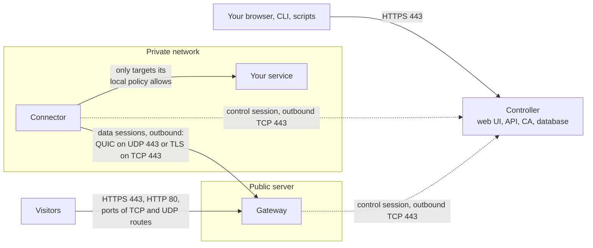

# Concepts

rpmgr publishes services that run in private networks through public servers you own. This page
explains its parts and the words the rest of the guide uses: the controller, gateways, connectors
and the all-in-one, organisations, gateway groups, routes and targets, domains, the two kinds of
policy, the sessions between the parts, and why the parts trust each other. Read it before you
install rpmgr, or when a term in another page is unclear.

## The parts

rpmgr is one program, `rpmgr`, which runs in one of several roles
([02](../02-architecture.md#roles)).

### Controller

The controller is where you manage everything: it serves the web UI, the API and the command
line's requests, keeps the database, runs the internal certificate authority (CA) that gives every
gateway and connector its identity, obtains public certificates through ACME, and keeps the audit
log. It tells each gateway and connector what to do. Visitor traffic never passes through it: if the
controller stops, every gateway and connector keeps running its last configuration, and only
changes wait until it is back ([03](../03-connections.md#failure-modes)).

### Gateway

A gateway is the public entrance. It runs on a server with a public IP address and takes the
traffic on ports 80 and 443 and on the TCP and UDP ports you publish. It ends TLS for websites with
the certificates the controller gives it, applies access policies, and passes each connection to a
connector that serves the route. Gateways and connectors together are the **agents**.

### Connector

A connector runs in your private network, next to the services you publish: on the same host or on
any host that reaches them. It only dials out, to the gateways and to the controller, so it needs no
open port, no public address and no port forwarding, and it works behind NAT, CGNAT and firewalls.
For each visitor's connection a gateway passes on, the connector dials the service, but only one
that its configuration names and that its **local policy**, a file on its host, allows.

### The all-in-one

The all-in-one runs a controller, a gateway and a connector in one process on one public server.
It is the usual start and enough for a homelab or a small team
([Topologies](install/topologies.md)).

- Its gateway, `local`, in the gateway group `default`, takes the public traffic. The web UI shares
  port 443 with the routes: the gateway hands the controller's name to the controller in the same
  process.
- Its connector, also named `local`, reaches services on the server itself, such as containers next
  to rpmgr. It reaches only what its local policy allows, nothing at first, and never rpmgr's own
  ports ([ADR-0019](../adr/0019-all-in-one-runs-a-connector.md)).
- Both are **built in**: you cannot decommission them, but you can switch them off.

Services in other networks still need a connector there.

## What reaches what

The arrows show who opens each connection. A visitor's traffic goes from the gateway through a
data session to the connector and on to the service, and the answers come back the same way. The
controller may run on the gateway's server, as in the all-in-one, on a host of its own, or in a
private network behind a gateway ([Topologies](install/topologies.md)). The full list of ports is
in [10](../10-operations.md#ports).

## Sessions

Gateways and connectors keep long-lived connections that they open themselves, all with mutual TLS
1.3, in which both ends prove who they are ([03](../03-connections.md#overview)):

- **The control session** runs from each gateway and connector to the controller. It carries the
  agent's configuration, its status and its certificate renewals. Each agent has one.
- **Data sessions** run from a connector to each gateway that serves its routes. They carry the
  visitors' connections, each as a stream of its own, so a new visitor costs no new handshake. A
  data session uses QUIC over UDP port 443, or TLS with HTTP/2 over TCP port 443 where UDP is
  blocked, and can go through an HTTP or SOCKS5 proxy
  ([Connector networking](connectors/network.md)).

The status pages show both: whether an agent holds its control session, and over which transport a
connector reaches each gateway ([Status and diagnostics](connectors/status-and-diagnostics.md)).

## Organisations and members

Everything you configure belongs to an **organisation**: its routes, connectors, gateway groups,
domains, certificates, access policies and its audit entries. People are **members** of an
organisation with a role ([Members and roles](accounts/members-and-roles.md)):

| Role | May |
|---|---|
| Owner | Everything in the organisation, including its settings and its Owners |
| Admin | Everything but the organisation's settings and its Owners: members, gateways, domains, certificates, routes, connectors, the audit log |
| Operator | Routes, targets and access policies; connectors if the organisation allows it |
| Viewer | Read everything but the audit log |

The **Instance Admin** is a role of its own for the whole installation: the CA, the instance
settings, and trusting a domain without a proof. The first account, made with the one-time link
that setup prints, becomes the Owner of the first organisation and the Instance Admin
([04](../04-security.md#roles)).

## Gateway groups and gateways

A **gateway group** is a set of gateways that serve the same routes, usually one region. A route is
published on one group, and every gateway of the group serves it, so the route survives the loss of
one gateway. A group has:

- **public hostnames:** the names visitors reach its gateways by, such as `panel.example.com`,
  where its `tcp` and `udp` routes are reached;
- **port pools:** the public TCP and UDP port ranges its `tcp` and `udp` routes take their ports
  from;
- **trusted proxies:** proxies in front of the gateways whose `X-Forwarded-For` the gateways keep.

Each **gateway** in a group has its own **tunnel endpoints**, the `host:port` where connectors reach
it. You can **drain** a gateway before maintenance, so that it takes no new connections
([Gateways](gateways.md)).

## Routes and targets

A **route** publishes one service: how visitors reach it, on which gateway group, and where it
goes. Its type decides how visitors reach it:

| Type | Visitors reach it by | Details |
|---|---|---|
| `http` | A hostname, and optionally a path prefix, on port 443 (and 80) | The gateway ends TLS with the route's certificate and speaks HTTP to the service: [HTTP routes](routes/http.md) |
| `tcp` | A TCP port from the group's port pool | [TCP and UDP routes](routes/tcp-and-udp.md) |
| `udp` | A UDP port from the group's port pool | [TCP and UDP routes](routes/tcp-and-udp.md) |
| `tcp_udp` | The same port number in TCP and UDP | [TCP and UDP routes](routes/tcp-and-udp.md) |
| `tls_passthrough` | A TLS server name on port 443 | The service ends TLS itself; the gateway never decrypts: [TLS passthrough](routes/tls-passthrough.md) |

A **target** is where a route's traffic goes: a connector and an address that connector dials,
such as `192.168.1.20:8080` or a Unix socket. A route can have several targets on several
connectors. Each target has a **priority**, where the lower number wins, and a **weight**, which
shares the connections among targets of the same priority; a target of a worse priority takes
connections only while no better one is ready ([Targets](routes/targets.md)).

Every change to a route can be previewed before you save it, and after saving you see which
gateways and connectors have applied it ([Preview and apply](routes/preview-and-apply.md)).

## Domains and certificates

An organisation may use a hostname in a route only under a **domain** it has proved is its own: by
a DNS TXT record, by an HTTP token its gateways serve, or because the Instance Admin trusted the
claim. This keeps one organisation from taking another's names
([Domains and certificates](domains-and-certificates.md)).

`http` routes need a certificate for each hostname: one the controller obtains and renews from an
ACME CA, Let's Encrypt by default, or one you upload.

## Access policies and the local policy

rpmgr has two kinds of policy. They protect different things and are set by different people:

| | Access policy | Connector-local policy |
|---|---|---|
| Lives | In the controller, attached to routes; the gateways enforce it | In a file on the connector's host, `/etc/rpmgr/policy.yaml` |
| Set by | Members of the organisation, in the web UI, the CLI or the API | Root on the connector's host, with `rpmgr policy` or an editor |
| Decides | Who may use a route: IP allow and deny lists, basic auth | What the connector may dial: allowed and denied targets |
| Default | A route without one is open to everybody | Nothing is allowed |
| Holds against a compromised controller | No | Yes, except on an all-in-one, which shares the process |

- **Access policies** are described in [Access policies](access-policies.md).
- **The local policy** gives the owner of each connector host the last word: whatever routes the
  controller configures, the connector reaches only what this file allows
  ([The local policy](connectors/local-policy.md)).

## How configuration reaches the agents

1. You change something in the web UI, with the command line or through the API.
2. The controller checks and stores the change, and raises the installation's configuration
   **revision**.
3. It compiles each affected agent's configuration and signs it. Agents accept only configuration
   that the controller signed.
4. Each agent applies the new configuration as a whole and reports it **applied**, or **rejected**
   with a reason. A change never interrupts the routes it does not touch.
5. An agent that rejects a configuration, or loses the controller, keeps running its last good one.

The web UI shows how far each change has got ([Preview and apply](routes/preview-and-apply.md)).

## Trust

rpmgr has no default password and no shared secret. Each part proves who it is
([04](../04-security.md#security-goals)):

- **An own CA.** Each installation has its own certificate authority and a **trust domain**, a name
  such as `rpmgr-7f3k2q9m`. The **CA pin**, `sha256:…`, is the SHA-256 hash of the root's public
  key; it is not the certificate fingerprint that `openssl x509 -fingerprint` prints. Setup prints
  it, the web UI shows it under **Settings → PKI**, and every install command carries it.
- **Enrollment with a pin and a token.** To join, an agent needs the controller's URL, the CA pin
  and an **enrollment token**. The agent makes its private key itself, and the key never leaves
  the host. It trusts the controller only if the controller's CA matches the pin, so a machine in
  between cannot pose as the controller, and nothing is trusted on first use
  ([04](../04-security.md#join-command)).
- **Tokens are secrets.** An enrollment token is shown once, is never part of a command line,
  enrolls one agent unless you allow more for ephemeral connectors, expires
  ([lifetime](../04-security.md#tokens)), and can be revoked. A token that leaks after its use is
  worthless.
- **Short-lived certificates.** Each agent's certificate is short-lived and renewed automatically
  over the control session ([04](../04-security.md#leaf-certificates)). A revoked or decommissioned
  agent is shut out at once: every gateway, connector and controller refuses its certificate
  ([04](../04-security.md#revocation)).
- **Mutual TLS everywhere.** Controller, gateways and connectors check each other against the
  installation's root, never against the CAs a system trusts.
- **Secrets at rest.** Private keys and other secrets in the database, such as TOTP seeds and the
  mail relay's password, are encrypted with the **key-encryption key (KEK)**. The KEK is kept
  outside the database: in a systemd credential or a file. Passwords are stored only as hashes
  ([04](../04-security.md#secrets-at-rest-and-in-logs)).
- **Accounts.** The first account is made with a one-time link. Accounts can add an authenticator
  app, and sensitive changes ask you to confirm it is you
  ([Sign-in and two-factor authentication](accounts/sign-in-and-mfa.md)).
- **Signed releases.** Releases are signed, and the install scripts verify the signatures before
  they install anything
  ([The install scripts](install/install-script.md#how-the-scripts-verify-a-release)).

The threat model and every mechanism are in [04](../04-security.md).

## Glossary

The design documents define every term rpmgr uses, from agent to visitor grant, in the glossary of
[00](../00-vision-and-scope.md#glossary). Some terms there, such as private services, DNS providers
and managed zones, belong to later phases ([05](../05-features.md)).
