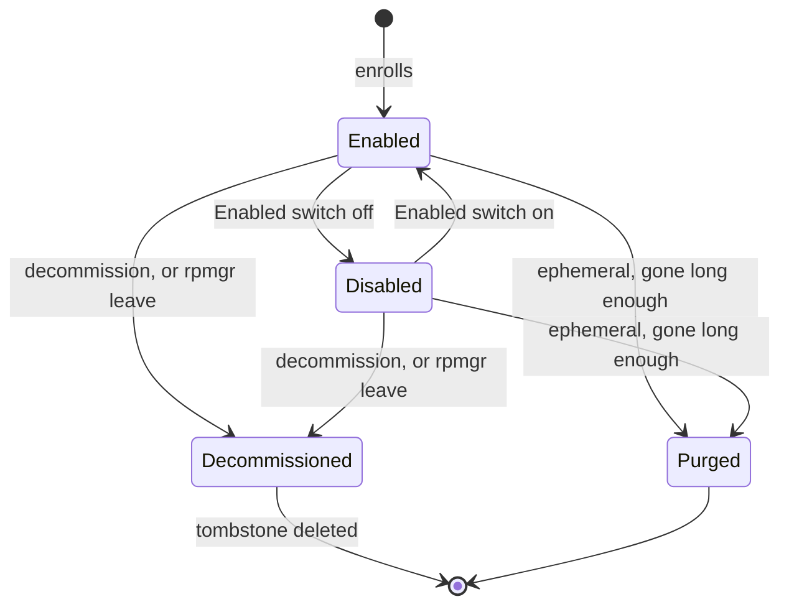

# Connector lifecycle

A connector lives from its enrollment until it is decommissioned, or, if it is ephemeral, until it
has been gone for a while. This page is for whoever manages connectors: it shows how to switch a
connector off and on, change its name, labels and transport, decommission it, and how ephemeral
connectors come and go. Enrolling is in [Enrolling connectors](enroll.md).



## Who may do what

Switching a connector off, changing it and decommissioning it need the permission to manage
connectors: Owners and Admins, and Operators when the organisation's setting **Operators may
enroll and revoke connectors** is on ([Settings](../operations/settings.md#organisation-settings)).
Everyone in the organisation can see connectors.

## Switch a connector off and on

A connector has an **Enabled** switch ([D81](../../14-open-decisions.md#engineering)). Switched off,
it keeps its identity and its targets, but gets an empty configuration: it serves no route, and the
gateways send its routes' connections to the routes' other connectors. Its targets show as
**disabled** on the routes' pages, and a route whose only targets are on it is unavailable. The
Connectors list shows it as **disabled**, not offline, and the Overview leaves it out of its
summary and **Needs attention**. Switched on again, it gets its configuration back at once.

Use it to take a connector out of service for a while, for maintenance of its host or to test a
failover, without losing its enrollment.

### With the web UI

Open the connector under **Connectors** and turn the **Enabled** switch at the top of its page off
or on. The page follows the change until every agent applied it.

### With the API

The command line has no flag for the switch; use the web UI, or `ConnectorService.UpdateConnector`
with the mask `enabled` ([API](../reference/api.md#change-a-resource-etags-and-update-masks)):

```sh
curl -sS https://panel.example.com/rpmgr.v1.ConnectorService/UpdateConnector \
  -H "Authorization: Bearer $RPMGR_TOKEN" -H "Content-Type: application/json" \
  -H "Rpmgr-Wait-Applied: 10s" \
  -d '{"connector":{"id":"con_01M4ZEK2EXFBJRKFW4JB7DQVZ6","enabled":false},"updateMask":"enabled"}'
```

## Change a connector's name, labels or transport

- **Web UI**: the connector's page, **Settings**: **Name**, **Labels** (one `key=value` per line)
  and **Transport**, then **Save**.
- **Command line**: `rpmgr update connector` with the fields to change. `--label` replaces all
  labels with those you give:

  ```sh
  rpmgr update connector --name nas --label site=home --label rack=2 hug-p-ntb439
  rpmgr update connector --transport h2 nas
  ```

A name is lower-case letters, digits and hyphens, and unique among the organisation's connectors in
service. The transport is explained in [Connector networking](network.md#choose-a-transport).

## Decommission a connector

Decommissioning takes a connector out of service for good, from the web UI, the command line, or
its own host with `rpmgr leave`:

- its identity is revoked: every gateway and the controller refuse it at once, and its sessions
  end ([04](../../04-security.md#revocation));
- its route targets are deleted, and so is **every route left without a target**, which frees the
  route's port and hostnames ([D78](../../14-open-decisions.md#engineering)). Each deletion is in
  the audit log as `route.delete`;
- it stays as a **tombstone** for a while, listed with `rpmgr list --all connector`, then is deleted
  ([04](../../04-security.md#lifecycle)). A new connector may take its name at once;
- it can never enroll again with its identity. To use the host again, enroll it as a new
  connector.

Nothing blocks a decommission, since it revokes an identity. Move routes to another connector
first if they should stay: add a target on the other connector, then decommission
([Targets](../routes/targets.md#targets-on-several-connectors)).

### With the web UI

1. Open the connector under **Connectors**.
2. In **Decommission**, select **Decommission…**. The warning names the routes that have no other
   target and are deleted with it.
3. Select **Decommission <name>**.

### With the command line

```sh
rpmgr decommission connector --wait 10s nas
```

```text
Decommissioned connector con_01M4ZEQNPXFMYR77HFF45N8BGV in revision 16, APPLIED on 1 of 1 online agents; its identity is revoked and its sessions closed.
Deleted route ssh (rt_01M4ZEM8WFF24VT354JQBHZSZ2): it had no other target.
```

The connector's service on its host stops when it learns of the revocation. Stop and disable its
unit there, and remove `/etc/rpmgr/connector.yaml` and the policy file if the host is done with
rpmgr. From the host itself, `sudo rpmgr leave` does the decommission and removes the identity in
one step ([Status and diagnostics](status-and-diagnostics.md#rpmgr-leave)).

### A connector you no longer trust

Decommission a compromised connector at once: the revocation reaches every gateway immediately and
closes its sessions. Then review the audit log and the routes' traffic for it, rotate any
credentials the host's services held, and rebuild the host before you enroll it again
([Revoke a compromised connector](../../10-operations.md#revoke-a-compromised-connector)).

## Ephemeral connectors

Ephemeral connectors are for hosts that come and go on their own, such as CI runners and short-lived
containers:

- They enroll with an ephemeral token, which may enroll many of them: set **Kind** to
  **Ephemeral** in the enroll dialog, or `rpmgr create enrollment-token --ephemeral --max-uses 0`
  ([Enrolling connectors](enroll.md#enrollment-tokens)). Only ephemeral tokens may have more than
  one use. Give the token a lifetime no longer than you need it.
- The Connectors list marks them **ephemeral**.
- The controller **purges** an ephemeral connector once it has been disconnected for a while
  ([04](../../04-security.md#lifecycle)): it revokes its certificates and deletes it, with its route
  targets and each route left without a target, as a decommission does. The time counts from the
  end of its last session, or from its enrollment if it never connected.
- They get no re-enrollment token: a new runner enrolls as a new connector.

Give routes for ephemeral connectors a stable connector as well, or create the targets from the CI
job after the runner enrolled, since a purge deletes a route whose last target goes with it.

## The all-in-one's built-in connector

An all-in-one runs the connector `local` in the controller's process
([ADR-0019](../../adr/0019-all-in-one-runs-a-connector.md)). Its page marks it **built in**. It can
be switched off and on, renamed and given labels and a transport like any other, but it cannot be
decommissioned or re-enrolled: the API refuses both. `rpmgr all-in-one` enrolls it again at start
if its identity is missing.
