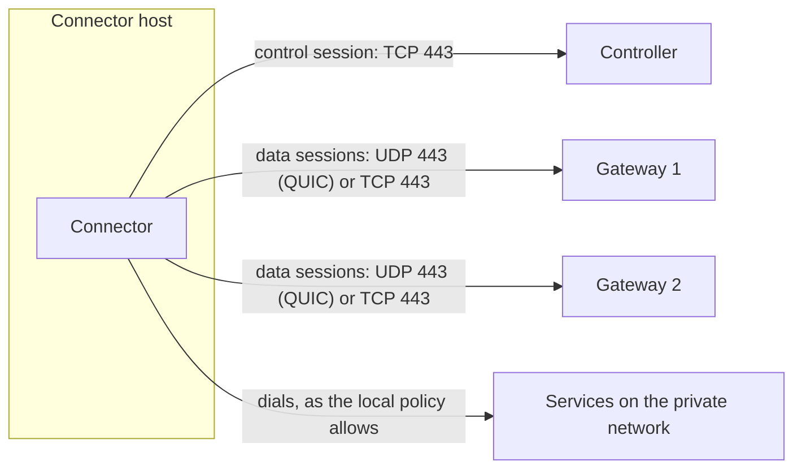

# Connector networking

A connector only ever dials out: to the controller for its configuration, and to the gateways for
its traffic. This page is for whoever runs connectors on networks with firewalls, proxies or
blocked UDP. It explains the connections a connector opens, the two transports and how to choose
between them, proxies, and what a connector does when it cannot reach the controller directly.

## The connections a connector opens



| Connection | To | Carries |
|---|---|---|
| Control session | The controller's endpoints: its public URL, or those the instance lists instead | The connector's configuration, its certificate renewals, its status reports |
| Data sessions | Each gateway of the gateway groups of the connector's routes, at the gateway's tunnel endpoints | The traffic of the routes: one stream per user connection |
| Targets | The services of its routes | What users send, as the local policy allows ([The local policy](local-policy.md)) |

- A connector opens **no inbound port**. Outbound, it needs TCP 443 to the controller, and TCP 443
  and UDP 443 to the gateways' tunnel endpoints, or whatever ports those name
  ([10](../../10-operations.md#ports)).
- Every session is TLS 1.3 with mutual authentication: the connector shows its certificate, and
  checks the controller's and each gateway's against the root it pinned at enrollment. No proxy or
  middlebox can read or change the traffic between them
  ([03](../../03-connections.md#properties-common-to-all-rpmgr-internal-sessions)).
- A connector keeps a data session to **every** gateway of a group whose routes it serves, so that
  each gateway can reach it ([03](../../03-connections.md#multiple-gateways)).

## Transports: QUIC, TLS with HTTP/2, and WSS

A data session runs over one of three transports:

| Transport | Web UI | Network | Good for |
|---|---|---|---|
| `quic` | **QUIC** | UDP 443 | The default first choice: no head-of-line blocking between connections, a fast handshake, and UDP routes as datagrams |
| `h2` | **TLS and HTTP/2** | TCP 443, directly or through a proxy | Networks that block UDP or allow only a proxy; bulk transfers over long-distance paths |
| `wss` | **WSS** | TCP 443 to the gateway's WSS hostname, directly or through a proxy | Networks whose proxy intercepts TLS: the connector's own TLS runs inside a WebSocket, which such a proxy lets through |

The setting `auto` (**QUIC, falling back to TLS and HTTP/2**) tries both: the connector starts
QUIC, and TCP a moment later or as soon as QUIC fails, and keeps whichever session is up first. It
remembers the winner for each gateway and network, tries QUIC again from time to time while it uses
TCP, and moves to TCP when UDP stops working in the middle of a session. When TLS over TCP fails
in its handshake, as a proxy that intercepts TLS makes it fail, and the gateway has a WSS hostname,
`auto` moves to WSS, and from there tries QUIC and TCP again from time to time. The timings are in
[03](../../03-connections.md#transports-and-fallback).

WSS needs a **WSS hostname** on the gateway ([Gateways](../gateways.md#wss-hostnames)) and a
connector of a release that knows WSS. Through an intercepting proxy, the proxy sees which gateway
the connector reaches, as with TLS over TCP, but none of the traffic; the connector still checks
the gateway against the root it pinned at enrollment.

The connector uses TCP, `h2`, when:

- the transport is set to `h2` for the connector, or for a route it serves;
- the transport is `auto` and UDP to the gateway is blocked, or QUIC lost the race;
- it can reach the gateway only through a proxy, since QUIC never goes through one;
- it is the all-in-one's built-in connector and the gateway is not the all-in-one's own
  ([The all-in-one's connector](#the-all-in-ones-connector)).

UDP routes work over TCP too, but loss on the TCP connection then delays every UDP flow on it. The
route's page marks such a target: **served over TLS and HTTP/2, the fallback for QUIC**.

## Choose a transport

The transport is set on three levels; the most specific one that is set applies:

1. **The route**: for one route on every connector.
2. **The connector**: for every route of that connector without its own setting.
3. **The instance**: the default of every connector without its own setting, `auto` unless the
   Instance Admin changed it.

A connector keeps the sessions its routes need: on `auto` with one route pinned to `h2`, it keeps
its QUIC session and a TCP session next to it. A **pinned** transport, `quic`, `h2` or `wss`, never falls
back: if it cannot be established, the routes that need it are not ready on that connector, with
the reason **no data session over the route's transport**
([Troubleshooting](../operations/troubleshooting.md#a-route-is-not-ready)). A change takes effect
for new connections at once; open connections finish on their session.

### With the web UI

- **A connector**: open it under **Connectors**; in **Settings**, choose the **Transport**:
  **The instance's default**, **QUIC, falling back to TLS and HTTP/2**, **QUIC only** or **TLS
  and HTTP/2 only**, and select **Save**.
- **A route**: in the route's form, choose the **Transport**; **The connector's or the instance's
  default** leaves it to the connector ([HTTP routes](../routes/http.md)).
- **The instance**: the Instance Admin sets **Default transport** under **Settings**, in **Agents
  and transport** ([Settings](../operations/settings.md)).

### With the command line

```sh
rpmgr update connector --transport h2 nas           # pin a connector to TCP
rpmgr update connector --transport '' nas           # back to the instance's default
rpmgr update route --transport quic game-server     # pin one route
rpmgr update connector --transport wss office-nas   # behind a proxy that intercepts TLS
rpmgr update settings --instance --set default_transport=h2
```

Pin `h2` where UDP is known to be unreliable, and on connectors or routes that carry bulk transfers
over paths with a long round trip, where TCP carried single streams faster in the measurements of
[ADR-0004](../../adr/0004-quic-default-transport-policy.md#phase-1-measurements).

## Proxies

Where the only way out is an HTTP or SOCKS proxy, give the connector the proxy in its service's
environment. The variables, and which connection reads which, are in
[Environment variables](../reference/environment.md#proxies). In short:

- **Data sessions over TCP** go through `HTTPS_PROXY`, else `ALL_PROXY`: an `http://` proxy with
  HTTP CONNECT, or a `socks5://` or `socks5h://` one, with optional `user:password@`. `NO_PROXY`
  names gateways to dial directly; loopback addresses are always dialled directly.
- **QUIC never goes through a proxy.** It is still tried directly over UDP. To send every data
  session through the proxy, set the connector's transport to `h2`.
- **The control session and `rpmgr enroll`** go through `HTTPS_PROXY` as an HTTP CONNECT proxy.
  If the control session cannot get through, the connector carries it through a data session
  ([below](#when-the-controller-is-out-of-reach)).
- The proxy sees only the gateway's or controller's name and port: the TLS inside it is end to end,
  and the proxy resolves the name.
- A proxy URL the connector cannot use stops it at start, with a message that names the variable,
  not its value.

`rpmgr setup --role connector --proxy http://proxy.lan:3128` enrolls through the proxy and gives
it to the service from `/etc/rpmgr/connector-proxy.env`, a file only root reads, named by a systemd
drop-in; a proxy URL with a password goes in a file for `--proxy-file`
([Set up a host with rpmgr setup](../install/setup.md#connector)). To set a proxy without a
password by hand:

```sh
sudo systemctl edit rpmgr-connector.service
```

```ini
[Service]
Environment="HTTPS_PROXY=http://proxy.lan:3128"
Environment="NO_PROXY=gw1.example.com"
```

```sh
sudo systemctl restart rpmgr-connector.service
```

A TLS-intercepting proxy, which presents certificates of its own, breaks the sessions, because the
connector accepts only rpmgr's own certificates. Exempt the gateways and the controller from
interception. A transport through such proxies is planned for Phase 2
([05](../../05-features.md#fleet-management)).

## When the controller is out of reach

A connector tries its controller endpoints in order: those the Instance Admin lists under
**Controller endpoints for agents**, or the public URL if the list is empty
([Settings](../operations/settings.md#web-ui-and-controller-endpoints)). It gets the list when it
enrolls and with every configuration, and keeps the last one across restarts. When none of them
answers, for example on a network that lets it reach its gateways only over UDP, the connector
**carries its control session through a data session**
([03](../../03-connections.md#control-sessions-through-a-data-session)):

- It is the last resort of every round: the connector tries it only after every endpoint failed,
  and starts the next round with the list again.
- It uses an established data session, QUIC ones first, so the connector must reach at least one
  gateway.
- The gateway only passes the bytes on, to its own controller. Inside, the connector runs the same
  TLS to the controller as on a direct path, so the gateway can neither read nor change the
  session.
- A gateway carries only a few such sessions per connector at a time
  ([03](../../03-connections.md#control-sessions-through-a-data-session)).
- A connector whose certificate expired cannot use it: it has no data session either, and must
  reach the controller directly to re-authenticate.

Gateways have no data session of their own, so a gateway always needs a direct path to the
controller. For a controller that has no public address at all, a gateway can publish it
([Topologies](../install/topologies.md);
[03](../../03-connections.md#reaching-a-private-controller)).

## The all-in-one's connector

An all-in-one runs a built-in connector, `local`, next to its gateway
([ADR-0019](../../adr/0019-all-in-one-runs-a-connector.md)):

- It reaches the gateway of its own process in memory, with the same TLS handshake as over TCP,
  whatever a route's transport says. Its page shows that data session as **TLS and HTTP/2**, and
  its control session as coming from `in-process`.
- It opens no UDP socket, so it reaches any other gateway of its group over TLS and HTTP/2 only: a
  route pinned to `quic` is not ready on it there.
- It never dials rpmgr's own ports on the host: the admin port, 80, 443 (TCP and UDP), the tunnel
  UDP port and the ports of routes.

## Check the network

On the connector's host, `sudo rpmgr diag transport` opens a QUIC and a TCP session to each tunnel
endpoint of the connector's gateways and reports each handshake, the round trip, the UDP socket's
buffers and the MTU towards the gateway
([Status and diagnostics](status-and-diagnostics.md#rpmgr-diag-transport)).

The installer raises the host's UDP buffers to what QUIC asks for, in `/etc/sysctl.d/60-rpmgr.conf`
([03](../../03-connections.md#host-tuning-applied-by-the-installer)). On a host installed another
way, `rpmgr diag transport` says when they are too small.
