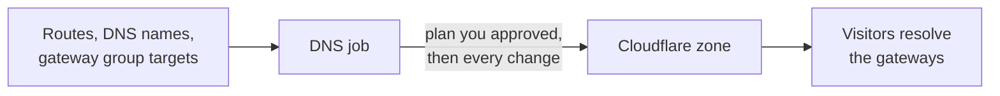

# DNS automation

rpmgr can write the DNS records of the names it serves. You connect a Cloudflare account, import
the zones you want rpmgr to manage, and read and approve the first plan. From then on every
hostname of an HTTP or TLS-passthrough route in such a zone gets a record that points at the
route's gateway group, and the record goes when the route does. This page is for whoever runs the
DNS of the services rpmgr publishes: it shows each step in the web UI and on the command line. How
it works inside, and every timer and limit, is in [15](../15-dns.md); this page links there and
states no value.

## When to use it

Use it when the names of your routes lie in a zone that Cloudflare serves, and you would rather not
create and update their records by hand: a gateway that moves, or a route that comes and goes,
then needs no visit to the DNS provider. It also lets rpmgr obtain wildcard certificates, which
need DNS ([Domains and certificates](domains-and-certificates.md#certificates)).

Do without it when your DNS is served somewhere else, or you want to keep every record under your
own hand: nothing here is required. Routes work the same with records you make yourself.



rpmgr writes only records it created or that you adopted. It never changes or deletes any other
record of the zone, such as your mail records, and it never writes the names of the controller or
of a gateway ([15](../15-dns.md#publication-rules)).

## Before you start

- A Cloudflare zone that is **active** and of type **full**; rpmgr lists other zones and says why
  it cannot import them ([15](../15-dns.md#connecting-importing-and-disconnecting)).
- A Cloudflare **API token**, not the Global API Key. Give it the permissions to read zones and
  to edit DNS, restrict it to the zones rpmgr should manage, and give it an expiry
  ([15](../15-dns.md#connecting-importing-and-disconnecting),
  [10](../10-operations.md#hardening-checklist)). rpmgr refuses a Global API Key without
  sending it anywhere.
- The role Owner or Admin ([Members and roles](accounts/members-and-roles.md)); the Instance Admin
  for the system organisation. Connecting a provider, approving a plan and the other changes ask
  for a [step-up](web-ui/README.md#the-step-up-dialog).
- A gateway group with a **DNS target**, which says where the records point: a name (a CNAME) or
  addresses ([Gateways](gateways.md)).

## Connect Cloudflare

A provider is an account at Cloudflare and its token. The token is checked at Cloudflare before
rpmgr stores it, kept encrypted, and never shown again, in the web UI, the API, an export or the
audit log ([04](../04-security.md#secrets-at-rest-and-in-logs)).

### With the web UI

1. Open **DNS** and choose **Connect a provider**.
2. Enter a **Name**. For a token that belongs to an account, not to your user, enter the
   **Cloudflare account ID**.
3. Paste the **API token** and choose **Connect it**; confirm with your password or second factor.

The provider shows `token valid`, when its token expires, and when rpmgr last checked it. rpmgr
checks every token regularly and flags one that is about to expire or that Cloudflare no longer
accepts ([15](../15-dns.md#timers-and-limits)).

### With the command line

```sh
rpmgr connect dns-provider --kind cloudflare --name cf --token-file ./cf-token
```

The token comes from a file, or from standard input with `--token-file -`, never from an argument.
Replace it before it expires with `rpmgr rotate dns-provider-token cf --token-file ./new-token`:
the zones and records stay.

## Import a zone

1. On **DNS**, under the provider, **Zones** lists what Cloudflare offers, with the reason for each
   zone that cannot be imported. Choose **Import** on the one you want.
2. rpmgr makes the zone **held** and, unless your organisation already has a verified domain that
   covers it, a [domain claim](domains-and-certificates.md) for the zone's name. **Prove the claim**
   as for any domain: a zone at Cloudflare is no proof that the zone is yours, and no route uses a
   name that is not verified.

```sh
rpmgr import zone --provider cf example.com
```

### Point the domain at Cloudflare

Cloudflare serves a zone only if the domain's nameservers, which you set at your registrar, are the
ones Cloudflare assigned to the zone. A domain that still points elsewhere, at a parking page of the
registrar for example, publishes nothing of what rpmgr writes, and the claim cannot be proved. The
zone page shows the nameservers Cloudflare assigned. If the domain is delegated to others, the
page, `rpmgr get zone` and `rpmgr plan zone` warn, before you approve the plan, and name both: set
the nameservers at your registrar to the assigned ones. rpmgr checks again every hour
([15](../15-dns.md#delegation)). The warning does not stop you from approving the plan.

## Approve the first plan

A zone starts **held**: nothing is written to Cloudflare until you have read what rpmgr would do and
approved exactly that ([15](../15-dns.md#held-zones-and-plan-approval)).

1. Open the zone from the **DNS** page. The **Plan** lists what rpmgr would create, change and
   delete, the records at the zone's names that someone else owns (conflicts) and the records that
   look like rpmgr's but are not in its books (orphans).
2. For a **conflict**, either **Adopt** the record, which rpmgr then keeps as its own, or remove it
   at Cloudflare. Until then the name publishes nothing.
   **Adopt** applies only to a record at a name that a route or DNS name of your organisation
   publishes, and only to address, `CNAME` and `TXT` records. The zone's record list shows
   **Adopt** on those records; on any other foreign record it says why not. For a name nothing
   publishes, create a route or DNS name for it first, then adopt the record.
3. Choose **Approve plan** and confirm. The approval is bound to the plan you read: if anything
   changed since, the new plan replaces it and you approve again.

```sh
rpmgr plan zone example.com
rpmgr approve zone example.com --plan-hash <hash>
```

The zone then shows **publishing**. If a later change would delete many records at once, or a
restore brought the instance back, the zone is held again until you approve a plan; that is on
purpose ([15](../15-dns.md#held-zones-and-plan-approval)). **Sync now** asks for a full pass at
once.

## The records of a route

Every hostname of an HTTP or TLS-passthrough route that lies in an enabled zone gets a record that
points at the DNS target of the route's gateway group; a TCP or UDP route has no hostname to
publish. The route's page shows one **DNS** line per hostname:

| Status | Means | What to do |
|---|---|---|
| `published` | Cloudflare holds the records | Nothing |
| `pending` | The change is committed; the next pass writes it | Wait |
| `held` | The zone, or a gate of it, holds the name | Approve the zone's plan |
| `conflict` | A record rpmgr does not own occupies the name | Adopt it, or remove it at Cloudflare |
| `ambiguous` | Two gateway groups claim the name | Create a [DNS name](#dns-names) for it |
| `error` | Cloudflare refused the change; the reason is shown | Fix the cause, such as the token's permission for the zone |
| `rate limited` | Cloudflare limits requests; rpmgr tries again by itself | Wait |
| `not managed` | The name is outside every managed zone, the zone does not publish route hostnames, or the group has no DNS target | Set the target, or ignore it |

The DNS line never changes the route's own state: a route serves whether or not its record is
published. A gateway group's DNS target is set in its form, or with
`rpmgr update gateway-group <group> --dns-target gw.example.net`
([Gateways](gateways.md)).

## DNS names

A **DNS name** points a name, or a wildcard, at a gateway group without any route: for the TCP and
UDP services that have no hostname of their own, or for a wildcard. It lies under a verified domain
of your organisation.

1. Open **DNS**, then **DNS names**, and choose **Add a name**.
2. Enter the **Name**, choose the **Gateway group** and, if you want one, a **TTL**.

```sh
rpmgr create dns-name --name ssh.example.com --group edge
```

A wildcard needs a zone that allows wildcards and a domain claim that covers them. Switch on
**Allow wildcard names** in the **Settings** of the zone's page, or run
`rpmgr update zone example.com --allow-wildcards=true`.

## Proxied routes

An HTTP route can have its names **proxied by Cloudflare**: visitors reach Cloudflare, which passes
the request on to your gateways. Switch it on in the route's form, or with `--dns-proxied`; the zone
must allow it first: switch on **Allow Cloudflare-proxied records** in the **Settings** of the
zone's page, or run `rpmgr update zone example.com --allow-proxied=true`. Set the zone's SSL/TLS
mode at Cloudflare to Full (strict). The gateway takes the client's address from Cloudflare's
header, and only for a request that really comes from Cloudflare's published addresses
([15](../15-dns.md#proxied-http-routes)). The route form and
[HTTP routes](routes/http.md) say more.

## Certificates by DNS-01

For a hostname in a managed zone of the route's organisation, rpmgr obtains the ACME certificate
by writing the CA's challenge into the zone, marking it, and deleting it afterwards. That is what
lets a route have a wildcard hostname. A zone that is disabled gives no certificate, a zone that
is only held still does, and nothing of another organisation's zone is ever used
([15](../15-dns.md#acme-dns-01), [Domains and certificates](domains-and-certificates.md)).

## Stop managing a zone

**Remove** on the zone (or `rpmgr remove zone example.com`) stops rpmgr from managing it and keeps
every record at Cloudflare as it is. To have rpmgr delete the records it owns as well, choose the
second option, read its plan, and approve it
([15](../15-dns.md#connecting-importing-and-disconnecting)). Deleting a provider is refused while
zones are imported from it.

## When something is wrong

rpmgr raises an alert, which the **Overview** shows, for a name in conflict, a zone that is held,
a provider that does not answer well, a record that changed again after rpmgr corrected it, and a
token that is invalid or about to expire; the alerts are also sent to your
[webhooks](operations/webhooks.md) and by e-mail
([10](../10-operations.md#suggested-alerts)). While Cloudflare is unreachable nothing that works
stops working: published records stay, and nothing is deleted
([15](../15-dns.md#fail-static)). The steps for a conflict, a rate limit, a held zone and a token to
rotate are in the runbooks of [10](../10-operations.md#runbooks), and the metrics to watch in
[Monitoring](operations/monitoring.md).

See also: [Web UI: DNS](web-ui/dns.md), [Command line](reference/cli.md), [API](reference/api.md).
