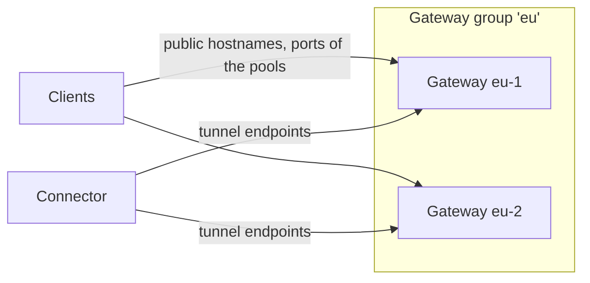

# Gateways

Gateways take public traffic and pass it to connectors. They are organised in **gateway groups**,
and every route is published on one group. This page is for the Owners and Admins who run the
gateways: it covers gateway groups, their public hostnames and trusted proxies, adding, draining
and decommissioning gateways, port pools and port quotas, and the all-in-one's built-in gateway.

## How gateways are organised



- A **gateway group** is a set of gateways that serve the same routes. Every gateway of the group
  serves every route of the group, and every connector of those routes keeps a data session to
  every gateway of the group. A group holds a limited number of gateways, each in its own **slot**
  ([03](../03-connections.md#multiple-gateways)); larger installations use several groups.
- Its **public hostnames** are the names, or addresses, by which clients reach its gateways.
- Each **gateway** has its own **tunnel endpoints**, the `host:port` addresses where connectors
  reach it, over QUIC on UDP and over TCP. They can be private addresses.
- Its **port pools** are the public ports its TCP and UDP routes take theirs from, and **port
  quotas** limit how many of them the organisation's routes hold.

Changing gateways, groups, pools and quotas needs the permission `infrastructure.write`, which
Owners and Admins have ([Members and roles](accounts/members-and-roles.md)). In the web UI they are
under **Gateways**; each group has a page with its gateways, settings, port pools and quotas.

## Create a gateway group

### With the web UI

1. Open **Gateways** and select **New gateway group**.
2. Fill in **Name** (lower-case letters, digits and hyphens), **Region** (optional, for people),
   **Public hostnames** and **Trusted proxies**, one per line.
3. Select **Create the group**.

### With the command line

```sh
rpmgr create gateway-group --name eu --region Frankfurt \
  --public-hostname eu.example.com --trusted-proxy 203.0.113.0/24
```

`rpmgr update gateway-group` changes a group: the flags it gets replace those fields, and an empty
value, as in `--trusted-proxy ''`, clears a list. The organisation's setting **Gateway group
preselected for new routes** chooses the group the route form offers first
([Settings](operations/settings.md#organisation-settings)).

## Public hostnames

A group's public hostnames are DNS names or IP addresses, such as `eu.example.com` or
`203.0.113.10`, that lead to its gateways: through DNS records you create, a load balancer or an
anycast address ([D79](../14-open-decisions.md#engineering)).

- The web UI shows a TCP or UDP route's address as its port at each public hostname, such as
  `eu.example.com:20046`. A group without one shows only the port, with a hint
  ([TCP and UDP routes](routes/tcp-and-udp.md#the-address-clients-use)).
- They are not the tunnel endpoints: those face connectors, and can be private.
- An HTTP route's hostnames must resolve to the group's gateways too; that is your DNS
  ([Domains and certificates](domains-and-certificates.md)).
- `rpmgr all-in-one init` gives the group `default` the host of the public URL, if it is a name or
  address a group accepts.

## Trusted proxies

If your gateways sit behind another proxy or load balancer that adds `X-Forwarded-For`, list its
addresses as **Trusted proxies**, as CIDRs ([03](../03-connections.md#http-routes)):

- From a trusted proxy, the gateways keep the forwarding headers it sent and add to them; from
  anyone else, they replace them.
- For HTTP routes, the client's address, which access policies check, is then the last address in
  `X-Forwarded-For` that is not a trusted proxy ([Access policies](access-policies.md)).
- Leave the list empty if clients reach the gateways directly. A CIDR there lets those addresses
  claim any client address.

## Add a gateway

A gateway is created in the web UI or with the command line first, then installed and enrolled on
its host with a token bound to it.

### Before you start

- A Linux host whose ports 443 (TCP and UDP) and 80 the clients can reach, and the ranges of the
  group's port pools ([10](../10-operations.md#ports)).
- The address at which connectors reach it, for its tunnel endpoint: usually its public name or
  address and port 443.

### With the web UI

1. Open the group's page under **Gateways**.
2. Select **Add a gateway**, fill in **Name** and **Tunnel endpoints** (one `host:port` per line,
   the gateway's own address, not the group's), and select **Add the gateway**. It shows as
   **not enrolled**.
3. In the gateway's row, select **Enrollment token…**, then **Create the token**, and confirm it is
   you. The token is valid for the default lifetime ([04](../04-security.md#tokens)).
4. Copy the **Install command** and the **Enrollment token**, which is shown only now.
5. Run the command on the gateway's host and paste the token when it asks.

### With the command line

```sh
rpmgr create gateway --group eu --name eu-2 --tunnel-endpoint eu-2.example.com:443
rpmgr create gateway-token --gateway eu-2
rpmgr get --role gateway install-command
```

```text
Enrollment token enr_01M4ZEKTZ0EZ09W2Z75JSM2ESJ for gateway gw_01M4ZEJPH7EHCT1XTFPV3MFHPH; it is shown only now:
rpmgr_enr_…
curl -fsSLO 'https://panel.example.com/install.sh' && sudo sh install.sh \
  --controller 'https://panel.example.com' --ca-pin 'sha256:XOCDT8EkqMT2J5JWgt+BH8H82MFTr37JH+8l70Fe2vk=' \
  --role gateway
```

On the host, the install command installs rpmgr, enrolls the gateway with the token and starts
`rpmgr-gateway.service` ([Install script](install/install-script.md)); `rpmgr setup --role
gateway` does the same in forms ([rpmgr setup](install/setup.md)). Once it is up, the gateway shows
as **connected**, and connectors open data sessions to it.

A gateway token enrolls that gateway and nothing else, once. For a gateway that has enrolled
before, such as one whose host you rebuilt, `rpmgr create gateway-token` makes a new one; on the
host, enroll with `rpmgr enroll --replace`, as for a connector
([Enrolling connectors](connectors/enroll.md#re-enroll-a-connector)). The web UI offers
**Enrollment token…** only for a gateway that has not enrolled yet.

To change a gateway's name or tunnel endpoints: **Edit…** in its row, or
`rpmgr update gateway --tunnel-endpoint eu-2.example.com:443 eu-2`.

## WSS hostnames

Connectors behind a proxy that intercepts TLS cannot use the usual transports: the proxy replaces
the gateway's certificate, which the connector refuses. They reach a gateway over **WSS** instead,
at a hostname of the gateway's own that has an ordinary public certificate, which the proxy
accepts like any website's
([Connector networking](connectors/network.md#transports-quic-tls-with-http2-and-wss)).

Give a gateway its WSS hostname under **Gateways**: **Edit…** in its row, **WSS hostname**,
**Save**. Or with the command line:

```sh
rpmgr update gateway --wss-hostname tunnel-eu-1.example.com eu-1
rpmgr update gateway --wss-hostname '' eu-1     # remove it
```

- The name lies under a verified domain of the organisation that owns the group
  ([Domains and certificates](domains-and-certificates.md)), is no wildcard, and is not a hostname
  of a route of the group, nor one a wildcard route hostname covers. Each gateway needs its own.
- Point the name's DNS at that gateway, port 443. An uploaded certificate that covers it is used;
  otherwise rpmgr obtains one from the ACME CA, as for http routes.
- Connectors on `auto` use WSS by themselves when they need it; pin `wss` on a connector or route
  to use only WSS. A connector of an earlier release cannot: its routes on `wss` show **no data
  session over the route's transport** for it.

## Drain and resume a gateway

Draining switches a gateway off: it takes no new data sessions or connections, its routes leave
it, connectors move their traffic to the group's other gateways, and the connections still open
end after the gateway drain period ([03](../03-connections.md#multiple-gateways)). The gateway
keeps its identity and its control session. Resuming lets it take connections again.

Drain a gateway before maintenance of its host, or before you replace it. Update your DNS or load
balancer too, so that clients stop going to it.

- **Web UI**: in the gateway's row on the group page, **Drain**; the gateway shows **drained**,
  and **Resume** switches it on again.
- **Command line**:

  ```sh
  rpmgr drain gateway --wait 10s eu-2
  rpmgr enable gateway eu-2
  ```

  ```text
  Drained gateway gw_01M4ZEJPH7EHCT1XTFPV3MFHPH in revision 13, APPLIED on 2 of 2 online agents.
  ```

The Overview leaves drained gateways out of its summary and **Needs attention**.

## Decommission a gateway

Decommissioning takes a gateway out of service for good: its identity is revoked, its sessions end,
its tunnel endpoints stop serving, and its slot in the group is free for another gateway. It stays
as a tombstone, listed with `rpmgr list --all gateway`.

- **Web UI**: **Decommission…** in the gateway's row; the warning names it; confirm with
  **Decommission <name>**.
- **Command line**: `rpmgr decommission gateway eu-2`.

The gateway's service stops when it learns of the revocation; disable its unit on the host, or run
`sudo rpmgr leave` there instead, which decommissions it and removes its identity
([Status and diagnostics](connectors/status-and-diagnostics.md#rpmgr-leave)). To replace a gateway
without an outage, add the new one, wait until connectors show sessions to it, move DNS, drain the
old one, then decommission it ([Replace a gateway](../10-operations.md#replace-a-gateway)).

A group can be deleted, with `rpmgr delete gateway-group <group>`, once it has no gateway, route or
port pool left; its decommissioned gateways go with it.

## Port pools

TCP, UDP and TCP-and-UDP routes get their public port from the pools of their group: a TCP route
from a TCP pool, a UDP route from a UDP pool, and a TCP-and-UDP route one port number free in both
([TCP and UDP routes](routes/tcp-and-udp.md)). A group without pools has no public ports for such
routes.

### With the web UI

On the group's page, under **Port pools**, select **Add a port pool**, choose the **Protocol**, and
fill in **First port** and **Last port**. **Edit…** changes a pool's range; **Remove…** deletes it.

### With the command line

```sh
rpmgr create port-pool --group eu --protocol tcp --from 20000 --to 20999
rpmgr update port-pool --to 21999 <pool ID>
rpmgr list port-pool
rpmgr delete port-pool <pool ID>
```

- Pools of one group and protocol never overlap.
- A pool can shrink only while every port taken from it stays inside, and be deleted only when no
  route holds a port of it.
- A gateway host's firewall must let the pools' ports in, for the protocol of each pool: let rpmgr
  do it on a host with `ufw` ([The host's firewall](#the-hosts-firewall)), or open them yourself.
- A route that asks for a port outside the pools is refused (`PORT_NOT_IN_POOL`); one that asks for
  any port when none is free, too (`POOL_EXHAUSTED`).

## The host's firewall

A gateway host's firewall must let the public in: 80/tcp, 443/tcp and 443/udp, which the gateway
listens on, and the ports of the port pools. On a host that uses `ufw` you can hand this to rpmgr.
It is off unless you switch it on, per host, and it changes nothing on a host where you do not.

### Switch it on

Add `--firewall ufw` when you set the gateway up ([Setup](install/setup.md)), and with it the
largest range of pools rpmgr may open:

```sh
sudo rpmgr setup --role gateway --controller https://rpmgr.example.com --ca-pin <pin> \
  --firewall ufw --firewall-max-range 20000-29999
```

Without `--firewall-max-range` rpmgr opens only the gateway's listeners and no pool. A pool that
reaches outside the range is opened only inside it, and the gateway reports the rest as refused.

### What it does

- The gateway stays unprivileged. It writes the ranges of its group's pools to a file; a separate
  helper that runs as root opens only ports inside the listeners and the range you set, so that a
  gateway that someone has taken over cannot open SSH or any other port.
- When a pool is created, resized or deleted, its range is opened or closed in `ufw` for its
  protocol. A TCP or UDP route changes nothing: its port is in a pool already.
- rpmgr adds only rules that carry the comment `rpmgr` and removes only those. Rules you added
  yourself stay as they are, also one for the same port without the comment: it stays when
  rpmgr's own is removed.
- With `ufw` missing or inactive, rpmgr changes nothing and says so.
- The provider's firewall in front of the host, such as a cloud security group, stays your task:
  rpmgr does not touch it, so open the same ports there.

The gateway shows the state of the helper in its status: **off**, **applied**, or **failed** with
the reason, such as `ufw` being inactive or a range outside the bounds.

### Switch it off

Remove `/etc/rpmgr/firewall.json`, then run `sudo systemctl start rpmgr-firewall.service`: the
helper removes the rules it added. Remove the `firewall` section from the boot file as well, and
restart the gateway.

## Port quotas

A port quota limits how many ports of a group's pools the organisation's routes may hold, per
protocol. Without one, only the pools limit them. Ports already held stay when you lower a quota;
new routes are refused once it is reached (`QUOTA_REACHED`), and a TCP-and-UDP route counts against
both quotas.

- **Web UI**: on the group's page, under **Port quotas**, fill in **TCP ports at most** or **UDP
  ports at most** and select **Save**; empty means no quota. A quota that is set shows how many
  ports are in use.
- **Command line**:

  ```sh
  rpmgr set port-quota --group eu --protocol tcp --max 10
  rpmgr list port-quota
  rpmgr delete port-quota <quota ID>
  ```

  ```text
  Port quota pq_01M4ZF08GYEPFR3XND9F2HATSJ: at most 10 tcp ports, 0 held.
  ```

## Restart a gateway without refusing connections

From v0.3.0 on, a gateway restarts with a hand-off. As root on its host:

```sh
sudo systemctl reload rpmgr-gateway
```

The new process takes over the listening sockets, so no visitor connection is refused, the old
process serves until the new one is ready, and open connections end or get the drain period. The
command fails with the reason when the new process does not become ready, and the old one keeps
serving. `systemctl restart` restarts as before, and so do the install script, with `--upgrade
--restart`, and the updater when the host cannot hand over ([Upgrades](install/upgrades.md),
[Updates](operations/updates.md)). A host set up before v0.3.0 needs the unit's drop-in
`handoff.conf` first: the install script writes it, and the reload then refuses and says to restart once.
An all-in-one reloads the same way, but its controller answers `503` for a few seconds. QUIC and
`udp` routes move after the old process exits. Containers restart without a hand-off.

## The all-in-one's built-in gateway

An all-in-one runs a gateway in the controller's process. `rpmgr all-in-one init` creates the
group `default` with the gateway `local`, whose tunnel endpoint is the public URL's host, and marks
it **built in** ([Topologies](install/topologies.md)). It can be drained and resumed, and its group
can get further gateways on other hosts, but it cannot be decommissioned or enrolled anew: the API
refuses both, and the web UI offers neither.

## Reaching a private controller through a gateway

A controller without a public address can be published by a gateway: the gateway's boot file names
the controller's address under `controller.passthrough`, and the gateway forwards the controller's
TLS connections to it unread ([Boot files](reference/boot-files.md#gateway);
[03](../03-connections.md#reaching-a-private-controller)). Agents reach the controller there when
the public URL's name leads to the gateway
([Topologies](install/topologies.md#a-private-controller-behind-a-gateway)), or when the
gateway's address is among the **Controller endpoints for agents** in the instance settings,
which replace the public URL for agents
([Settings](operations/settings.md#web-ui-and-controller-endpoints)).
