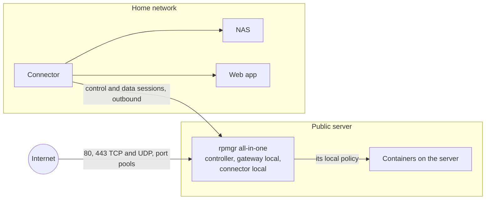
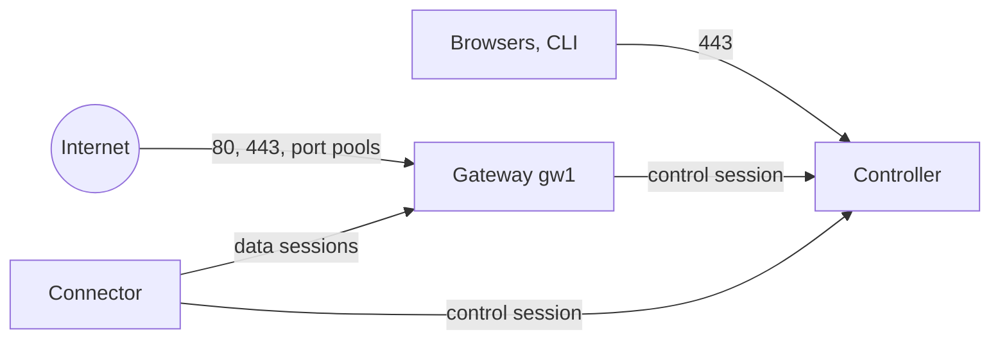
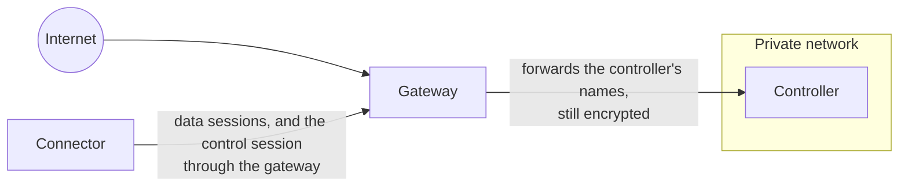
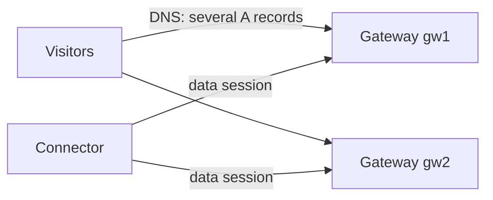
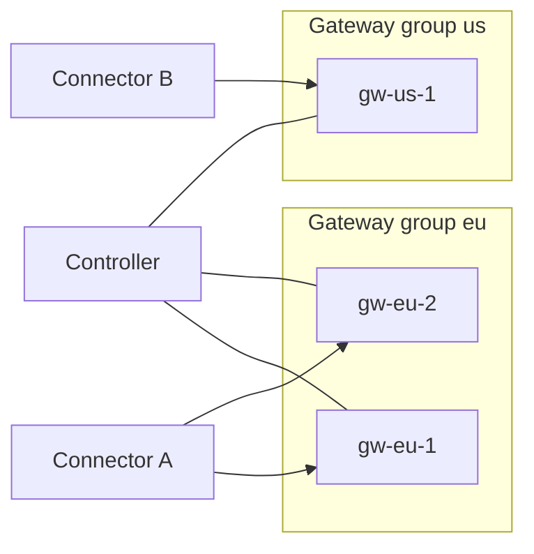

# Topologies

rpmgr's parts can share one server or spread over several. This page describes the layouts rpmgr
supports, what each needs and how to set it up: the all-in-one, a controller on its own host, a
private controller reached through a gateway, several gateways in a group, and gateway groups in
several regions. Read it before you install, to choose a layout, and when you outgrow the one you
have. The parts themselves are explained in [Concepts](../concepts.md).

| Layout | Hosts | Choose it when |
|---|---|---|
| [All-in-one](#all-in-one) | One public server, plus connectors | You start, or a homelab or small team is served by one public server |
| [Controller on its own host](#a-controller-on-its-own-host) | A controller, one or more gateways, connectors | The web UI and the CA should not share a host with the public traffic |
| [Private controller](#a-private-controller-behind-a-gateway) | A controller in a private network, gateways, connectors | The controller should have no public address at all |
| [Several gateways in a group](#several-gateways-in-a-group) | Two or more gateways for the same routes | The routes must survive the loss or the maintenance of one gateway |
| [Regions](#gateway-groups-in-several-regions) | One gateway group per region | Visitors or services are spread over regions |

The layouts combine: a controller on its own host can serve several groups of several gateways
each. Whatever the layout, connectors only dial out, and visitor traffic never passes through the
controller ([02](../../02-architecture.md#planes)).

**One instance per role per host.** Paths, unit names and admin ports are fixed per role, so a
host runs at most one controller or all-in-one, one gateway and one connector
([10](../../10-operations.md#supported-platforms)). Several controllers sharing one database
(high availability) are not available yet; they are planned for Phase 2 with PostgreSQL
([13](../../13-roadmap.md#phase-2--production)).

## All-in-one



One process on one public server runs the controller, a gateway and a connector, with SQLite. The
web UI shares port 443 with the routes: the gateway hands the controller's name to the controller
in the same process ([02](../../02-architecture.md#all-in-one-homelab-default)).

- **Built-in agents.** Setup creates the gateway group `default` with the gateway `local`, and the
  connector `local`, and enrolls both. They cannot be decommissioned, and the web UI offers no
  enrollment token for them; you can switch them off and drain the gateway like any other
  ([ADR-0019](../../adr/0019-all-in-one-runs-a-connector.md)).
- **Services on the server.** The built-in connector `local` reaches services on the server itself,
  such as containers next to rpmgr, without DNS or hairpin NAT. It reaches only the targets its
  local policy `/etc/rpmgr/policy.yaml` allows, nothing by default, and never one of rpmgr's own
  ports ([The local policy](../connectors/local-policy.md)).
- **Services elsewhere** go through connectors on their own hosts, which dial the all-in-one.
- **Ports:** 80/tcp, 443/tcp, 443/udp and the port pools of `tcp` and `udp` routes are public; the
  admin listener 127.0.0.1:7381 reports all three roles.
- **The public hostname** of the group `default` is the public URL's host, so `tcp` and `udp`
  routes are reached at `panel.example.com:<port>`.

Set it up with `sudo rpmgr setup --role all-in-one` ([Quick start](../quick-start.md)). On an
all-in-one the local policy does not protect against a compromised controller, which shares the
connector's process. Keep its allowed targets narrow.

## A controller on its own host



The controller runs alone on a host that browsers and agents reach on port 443; the gateways run
on other hosts with their own public addresses. The routes' hostnames point at the gateways, the
public URL at the controller.

1. **The controller.** On its host, install rpmgr and run
   `sudo rpmgr setup --role controller --public-url https://panel.example.com`
   ([Set up a host with rpmgr setup](setup.md#controller)). The controller's certificate comes from
   ACME through its own ports 80 and 443, or from files.
2. **A gateway group.** A controller alone has no gateway group. In the web UI, under
   **Network → Gateways**, choose **New gateway group**, give it a name and its public hostnames,
   the names visitors reach its gateways by, and **Create the group** ([Gateways](../gateways.md)).
3. **A gateway.** In the group, **Add a gateway** with its name and its **Tunnel endpoints**, the
   `host:port` where connectors reach this gateway, such as `gw1.example.com:443`. Then choose
   **Enrollment token…** on the gateway and **Create the token**.
4. **The gateway host.** Run the install command the dialog shows, with `--role gateway`, and paste
   the token. Or install the binary with the global script and run
   `sudo rpmgr setup --role gateway --controller https://panel.example.com --ca-pin 'sha256:…'`
   ([The install scripts](install-script.md)).
5. **DNS.** Point the tunnel endpoint's name and the routes' hostnames at the gateway's address.

On the command line, steps 2 and 3 are:

```sh
rpmgr create gateway-group --name edge --public-hostname gw1.example.com
rpmgr create gateway --group edge --name gw1 --tunnel-endpoint gw1.example.com:443
rpmgr create gateway-token --gateway gw1
rpmgr get --role gateway install-command
```

## A private controller behind a gateway



The controller has no public port. A gateway in the same private network, or connected to it by a
VPN, forwards every connection for the controller's names to it at the TCP level: the agents' own
controller names always, and the web UI's names you list. TLS ends at the controller, so the
gateway passes on bytes it can neither read nor change, and agents still check the controller
against the pinned root ([03](../../03-connections.md#reaching-a-private-controller)).

1. **The controller.** Set it up as above. Its public URL is a name that the internet resolves to
   the gateway, such as `https://panel.example.com`.
2. **The gateway** is created and enrolled as above. It needs a direct path to the controller:
   on the gateway host, the public URL's name must lead to the controller's private address, for
   example through an entry in `/etc/hosts` or a private DNS zone, because every agent reaches the
   controller at the public URL.
3. **Enrollment.** `rpmgr enroll` downloads the trust bundle over HTTPS and needs a controller
   certificate the gateway host trusts. Until the controller has one, enroll the gateway by hand
   with `--trust-bundle`
   ([Manual installation and containers](manual.md#a-gateway-or-connector-by-hand)).
4. **The forwarding.** In the gateway's boot file, name the controller's address and the web UI's
   hostnames, then restart the gateway:

   ```yaml
   # /etc/rpmgr/gateway.yaml
   controller:
     endpoints: ['https://panel.example.com']
     passthrough:
       address: "10.0.0.5:443"        # the controller's port 443, as the gateway reaches it
       hostnames: [panel.example.com]
   ```

   ```sh
   sudo systemctl restart rpmgr-gateway
   ```

5. **DNS.** Point the public URL's name at the gateway's public address. Browsers, connectors and
   their enrollment then reach the controller through the gateway.

A connector that reaches no controller endpoint at all, for example on a network that lets only UDP
out, carries its control session through one of its data sessions as a last resort
([Connector networking](../connectors/network.md)).

## Several gateways in a group



A route is published on one gateway group, and every gateway of the group serves it. Each connector
that serves the route keeps a data session to every gateway of the group, so a visitor can arrive
at any of them. A group holds a limited number of gateways
([03](../../03-connections.md#multiple-gateways)); larger deployments use more groups.

1. **Add the gateways** to the group, each with its own tunnel endpoints, and enroll each on its
   own host, as for the first gateway.
2. **DNS.** Give the routes' hostnames an A or AAAA record for each gateway, or put the gateways
   behind anycast or a load balancer of your choice. The tunnel endpoints stay per gateway: a
   connector dials each gateway at its own address, never at the group's name.
3. **Maintenance.** Before you restart or replace a gateway, **Drain** it: it takes no new
   connections and keeps the open ones for its drain period, while the other gateways carry the
   routes. **Resume** it afterwards ([Gateways](../gateways.md)).

If a gateway fails, new connections go to the other gateways of the group; connections that were
open on the failed gateway are lost ([03](../../03-connections.md#failure-modes)).

## Gateway groups in several regions



Each group serves its own routes, so you place a route near its visitors or its services by the
group you publish it on. A connector keeps data sessions only to the gateways of the groups whose
routes it serves. One controller manages every group. The group's **Region** field is a label for
you; rpmgr does not route by it ([02](../../02-architecture.md#multi-region-gateway-groups)).

## Changing layouts

- **From an all-in-one to more gateways:** add gateways to the group `default`, or new groups, as
  above. The built-in gateway stays.
- **Moving the controller to another host** is a restore of a backup on the new host, with the
  same public URL ([Backup and restore](../operations/backup-and-restore.md#on-a-new-host)).
