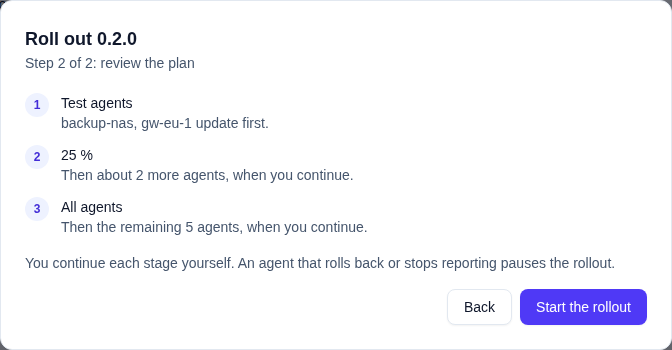
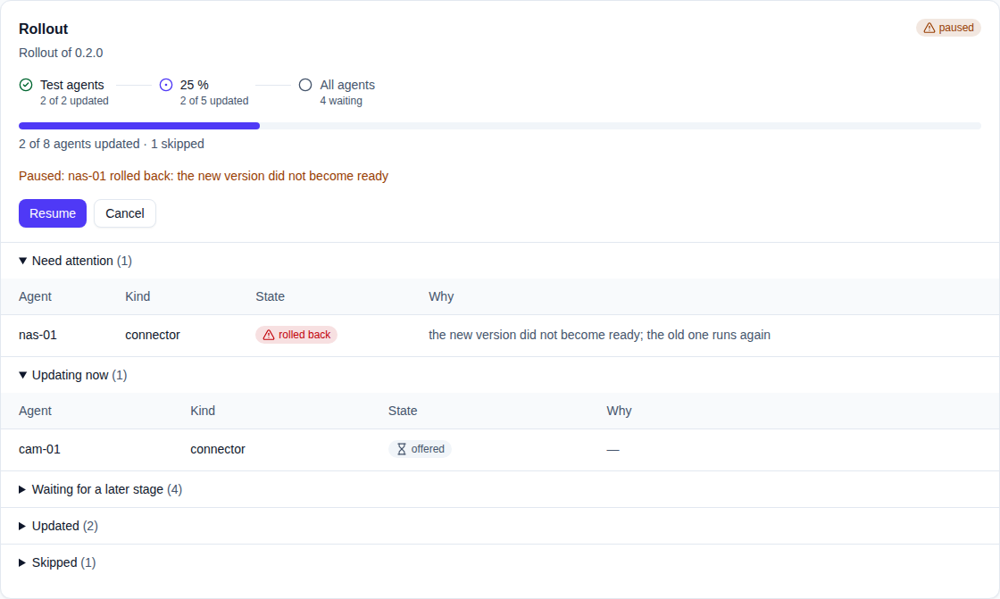
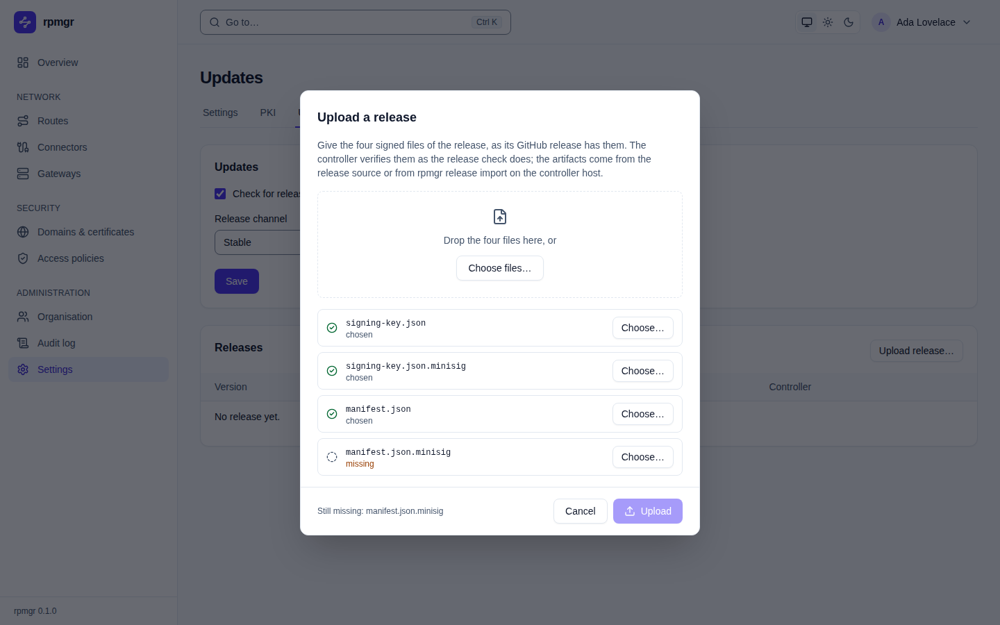

# Updates

rpmgr updates **connectors and gateways** itself, in a staged rollout you approve. Controllers and
all-in-ones are upgraded by hand ([Upgrades](../install/upgrades.md)). This page shows how to run a
rollout and what it tells you. The rules behind it are in
[04](../../04-security.md#over-the-air-updates),
[10](../../10-operations.md#upgrades-and-version-skew) and
[D121](../../14-open-decisions.md#engineering).

## What a rollout does

- **The target is the controller's version**, or an older release you uploaded on purpose. No agent
  runs ahead of its controller.
- **Three stages:** the test agents you choose (the canary agents), then a percentage of the
  others, 25 % unless you choose another, then all agents. You continue every stage yourself; the
  other agents wait until you do. An agent's place in the percentages is fixed by its ID, so a
  later stage includes every agent of an earlier one.
- **Gateways go one at a time per group.** Each drains first, so that its connectors move to the
  other gateways, and is enabled again after the update.
- **A rollback or a silent agent pauses the rollout.** You then resume it, or cancel it. Agents
  that are offline, or whose policy says `auto_update: notify` or `off`, are listed and skipped;
  they never block a stage.
- Only one rollout runs or is paused at a time.

Hosts need the root updater and a policy that allows updates
([Install](../install/install-script.md)). A host in the container image, or on Windows or macOS,
is not updated over the air.

## Run a rollout

1. Open **Settings → Updates**. **Releases** lists what the controller verified, with its channel,
   where it came from and whether the mirror holds it. Every release that is no newer than the
   controller has a **Roll out…** button. A rollout of a release the mirror does not hold yet
   starts at once; the controller fetches the release and offers it once the mirror holds it.
2. Choose **Roll out…**. The first step asks for the **test agents**, which update first; the
   connectors and gateways of your org are listed with their version and whether they are online,
   and one online connector and one online gateway are already ticked. Change the choice if you
   like, then choose **Next**. An offline test agent is skipped, so it tests nothing.

   

3. The second step shows the plan: the test agents, then about a quarter of the other agents, then
   the rest. Choose **Start the rollout** and confirm your identity.

   

4. Watch the rollout. The stages show which are done, the current one and the ones to come, each
   with its agents; a bar shows how many agents updated. The agents are grouped: **Need attention**
   (rolled back, refused or stalled, with the reason), **Updating now**, **Waiting for a later
   stage**, **Updated** and **Skipped**.

   

5. Once the agents of the current stage are done, choose **Continue to 25 %**, and later
   **Continue to all agents**, and confirm. The button says how many more agents the next stage
   takes. **Choose another stage** offers other percentages, or all agents at once.
6. At the end the rollout is **completed**. A rollback or a stalled agent shows **paused** with the
   agent and its reason; fix it, then **Resume**, or **Cancel** to end the rollout for good.

   

**Pause** needs no confirmation; **Resume**, **Continue** and **Cancel** ask for a step-up
([The step-up dialog](../web-ui/README.md#the-step-up-dialog)).

## Upload a release

On an air-gapped installation, or to offer a signed downgrade, choose **Upload release…** and give
the four signed files of a GitHub release: `signing-key.json`, `manifest.json` and their
`.minisig` files. **Choose files…**, or dropping them on the dialog, takes all four at once and
sorts them by name; other files are left out. A file your browser saved under another name, such
as `manifest (1).json`, goes in with the **Choose…** button of its row. **Upload** waits until all
four are there and lists the ones still missing. The controller verifies them as the release check
does. The artifacts then come from the release source, or from `rpmgr release import <dir>` on the
controller host.



## From the command line

```
rpmgr list release
rpmgr create rollout --release 1.5.0 --canary db-host-1
rpmgr get rollout rol_…
rpmgr list rollout-target rol_…
rpmgr advance rollout --percent 25 rol_…
rpmgr advance rollout --all rol_…
rpmgr pause rollout rol_…
rpmgr resume rollout rol_…
rpmgr cancel rollout rol_…
```

Each change but a pause is audited and asks for the step-up
([04](../../04-security.md#over-the-air-updates)).

## Choose what a host takes

Each connector and gateway host decides for itself, in its local policy, whether it takes updates
and which releases. Change it on the host, as root:

```
sudo rpmgr policy set-update-channel prerelease   # betas and release candidates too
sudo rpmgr policy set-update-channel stable       # stable releases only, the default
sudo rpmgr policy set-auto-update notify          # only report an update as available
sudo rpmgr policy set-auto-update off             # never update this host over the air
sudo rpmgr policy set-auto-update auto            # take updates again, the default
```

Each command prints both settings afterwards:

```text
/etc/rpmgr/policy.yaml: updated; running agents and the updater take it up without a restart
auto_update: auto
update_channel: prerelease
```

Nothing needs restarting: the agent checks its policy again by itself
([03](../../03-connections.md#timeouts-keepalive-and-backoff)), and the updater reads it before
every install. A host only gets a pre-release if the controller lists pre-releases too: set
**Release channel** to **Pre-releases too** in **Settings → Updates**
([Settings](settings.md)). The commands refuse a policy file the updater would not trust, such as
one that other users may write; fix its owner or mode first
([Local policy file](../reference/policy-file.md)).

## When something goes wrong

- **A connector or gateway is skipped.** Its policy says `auto_update: off` or `notify`, it is
  offline, or its channel does not take the release. Update it by hand, or change its policy
  ([Choose what a host takes](#choose-what-a-host-takes)).
- **An agent rolled back.** Its updater installed the release, the role did not become ready, and
  the previous binary is back. The rollout is paused; read the agent's log, then resume or cancel.
- **An agent is stalled.** It reported nothing for long enough that the rollout stopped waiting.
  Check that it is connected and that its updater runs, then resume.
- **The rollout's agents stay pending.** The mirror does not hold the release yet: the controller
  could not fetch it from the release source. Import the release on the controller host, or cancel
  the rollout.
