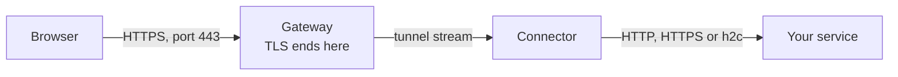

# HTTP routes

An HTTP route publishes a website or an HTTP API under one or more hostnames, with HTTPS. The
gateway ends TLS with a certificate from ACME or one you upload, and passes each request to the
route's targets through a connector. This page is for anyone who publishes web services: it shows
how to create such a route in the web UI and on the command line, and what every setting does.

## When to use it

Use an HTTP route for anything a browser or an HTTP client reaches by name: web applications,
dashboards, REST and gRPC APIs, WebSocket services. The gateway sees the requests, so it can
redirect port 80, send HSTS, set headers, limit request bodies, ask for basic auth and show its
own pages when the service is down.

Use [TLS passthrough](tls-passthrough.md) instead when the service must keep its own certificate
and the gateway must not see the traffic, and a [TCP route](tcp-and-udp.md) for anything that is
not HTTP.



## Before you start

- A gateway group with at least one enrolled gateway ([Gateways](../gateways.md)). Clients reach
  the route at the group's gateways, so the hostnames' DNS records must point at them.
- A verified domain of your organisation that covers every hostname of the route
  ([Domains and certificates](../domains-and-certificates.md)).
- A connector that can reach the service, whose [local policy](../connectors/local-policy.md)
  allows the service's address ([Enrolling connectors](../connectors/enroll.md)).
- The role Owner, Admin or Operator, which may change routes
  ([Members and roles](../accounts/members-and-roles.md)). For the command line, a stored API token
  ([API tokens and the command line](../accounts/api-tokens-and-cli.md)).

## Create an HTTP route

### With the web UI

1. Open **Routes** and choose **Create a route**.
2. Under **Type**, choose **HTTP**.
3. Choose the **Gateway group**. Your organisation's default group is chosen already, if it has
   one.
4. Enter a **Name**: lower-case letters, digits and hyphens, unique in the organisation.
5. Enter the **Hostnames**, one per line.
6. Change any other setting you need ([Settings](#settings)). The defaults are a certificate
   **From ACME** and **Redirect to HTTPS** on port 80.
7. Optionally choose **Preview** to see where the route would be reached and which gateways would
   serve it, without saving anything ([Preview and apply](preview-and-apply.md)).
8. Choose **Create the route**. The page follows the change to the gateways and then offers
   **Open \<name\> to add its targets**.
9. On the route's page, in the **Targets** card, choose **Add a target**. Choose the **Connector**,
   enter the service's **Host** and **Port** as the connector reaches it, and choose the
   **Protocol to the target**: **HTTP**, one of the HTTPS choices, or **HTTP/2 without TLS (h2c)**
   ([Targets](targets.md)). Choose **Add the target**.

### With the command line

Create the route, then add its target:

```sh
rpmgr create route --http --name wiki --group default \
  --hostname wiki.example.com --wait 30s
rpmgr create route-target --route wiki --connector home \
  --address 192.168.10.20:8080 --wait 30s
```

`--wait` lets each command wait, at most 30 s, until the gateways and connectors have applied the
change, and print how far they got ([Preview and apply](preview-and-apply.md)). `--group`,
`--route`, `--connector` and `--policy` take a name or an ID. A flag of another route type, and a
value the API's rules refuse, are refused before anything is sent.

A fuller example, with two hostnames, a path prefix, a header for the upstream, a body limit, HSTS
and an access policy:

```sh
rpmgr create route --http --name shop-api --group default \
  --hostname api.example.com --hostname api.example.net \
  --path-prefix /v2 \
  --set-request-header X-Env=prod \
  --max-body 10485760 \
  --hsts 8760h \
  --policy office-only
```

To change a route later, name only the flags you change; the others keep their values:

```sh
rpmgr update route --port80 off --hsts 0 shop-api
```

### What happens next

- The route is enabled at once. Its state is `pending` until every online agent has applied it,
  then `ready`, `degraded` or `unavailable` ([Preview and apply](preview-and-apply.md)).
- With **From ACME**, the controller orders a certificate for each hostname. It appears under
  **Domains & certificates** as **being obtained**, then **active**. Until then the gateway answers
  with its self-signed default certificate, which browsers warn about
  ([Domains and certificates](../domains-and-certificates.md)).
- A route without a ready target answers with the "Service unavailable" page
  ([Maintenance and error pages](maintenance-and-pages.md)).

## Settings

Every setting can be changed later: in the web UI with **Edit** on the route's page, on the
command line with `rpmgr update route <flags> <name>`, the flags before the name. A route's type
and its gateway group never change.

| Setting | Web UI | Command line | Default |
|---|---|---|---|
| Name, unique in the organisation | **Name** | `--name` | required |
| Description for people | **Description** | `--description` | empty |
| Labels | **Labels**, `key=value` per line | `--label key=value`, repeated | none |
| Data-session transport | **Transport** | `--transport auto\|quic\|h2` | the connector's |
| Hostnames, 1 to 100 | **Hostnames**, one per line | `--hostname`, repeated | required |
| Path prefix | **Path prefix** | `--path-prefix` | every path |
| Certificate source | **TLS certificate**: **From ACME** or **Uploaded** | `--tls-mode acme\|certificate` | ACME |
| Uploaded certificate | **Uploaded certificate**, one that covers every hostname | `--certificate <id>` | none |
| Port 80 | **Port 80**: **Redirect to HTTPS**, **Serve the route**, **Closed** | `--port80 redirect\|serve\|off` | redirect |
| HSTS max-age | **HSTS max-age (seconds)** | `--hsts <duration>`, such as `8760h` | 0, no HSTS |
| Host header to the upstream | **Host header to the target** | `--host-header` | the client's |
| Request headers to set | **Request headers to set**, `Name: value` per line | `--set-request-header Name=value`, repeated | none |
| Response headers to set | **Response headers to set**, `Name: value` per line | `--set-response-header Name=value`, repeated | none |
| WebSocket upgrades | **WebSocket**: **Default**, **On**, **Off** | `--websocket=false` | on |
| Largest request body | **Largest request body (bytes, 0 for no limit)** | `--max-body <bytes>` | 0, no limit |
| Maintenance | **Maintenance** | `--maintenance`, `--maintenance=false` | off |
| Maintenance message | **Maintenance message** | `--maintenance-message` | empty |
| Access policies | **Access policies** card on the route's page | `--policy`, repeated | none |
| Served or not | **Enabled** switch on the route's page | `rpmgr enable route`, `rpmgr disable route` | enabled |

On the command line, `--label`, `--hostname`, `--policy` and the header flags replace the whole
list in an update; given once with an empty value, such as `--policy ""`, they empty it. A boolean
flag takes its value after `=`: `--websocket=false`, `--maintenance=false`.

The transport decides how the route's streams travel between gateways and connectors; see
[Connector networking](../connectors/network.md). Maintenance is described in
[Maintenance and error pages](maintenance-and-pages.md), access policies in
[Access policies](../access-policies.md).

### Hostnames and path prefixes

- Every hostname must be covered by a verified domain claim of your organisation. An exact claim
  covers its own name only; a claim with every name below it covers those names too
  ([Domains and certificates](../domains-and-certificates.md#what-a-claim-covers)). Otherwise the
  save is refused with the reason `DOMAIN_NOT_VERIFIED`.
- A hostname is a DNS name of at least two labels; an IP address is not one. Upper-case letters
  and internationalised names are stored in their lower-case ASCII form.
- A hostname `*.example.com` serves every name one label below `example.com` that no route names
  exactly. Its certificate must be uploaded: ACME gives no wildcard certificates yet, so a wildcard
  hostname with **From ACME** is refused with `WILDCARD_NEEDS_CERTIFICATE` (DNS-01, which they
  need, is planned for Phase 2, [05](../../05-features.md#tls-and-domains)).
- Several HTTP routes of one gateway group may share a hostname if their path prefixes differ.
  A request goes to the route with the longest prefix that matches at a segment boundary: `/api`
  matches `/api` and `/api/users`, not `/apix`. A prefix starts with `/`; empty serves every path.
- The path goes to the upstream unchanged: the prefix is not removed.
- A hostname that a [TLS passthrough](tls-passthrough.md) route of the group uses cannot be an
  HTTP route's, and the reverse; the refusal names the other route. A hostname with a prefix that
  another HTTP route of the group holds already is refused as taken.

### Certificates

- **From ACME** (`--tls-mode acme`): the controller obtains and renews a certificate of its own for
  each hostname from the instance's ACME CA. The name must resolve to the group's gateways, and
  port 80 or 443 of the gateways must be reachable from the CA.
- **Uploaded** (`--tls-mode certificate --certificate <id>`): the route uses a certificate you
  uploaded, which must cover every hostname of the route; otherwise the save is refused with
  `CERTIFICATE_NOT_COVERING`. You renew it yourself.

Both, and what can block an ACME certificate, are in
[Domains and certificates](../domains-and-certificates.md).

### Port 80

Port 80 always answers ACME HTTP-01 challenges, for every name, whatever the route says. For
everything else the route's hostname and path decide:

- **Redirect to HTTPS** (`redirect`) sends the client to the same path and query over HTTPS: 301
  for GET and HEAD, 308 for other methods, which keeps the method and the body.
- **Serve the route** (`serve`) serves the route over plain HTTP as well, with
  `X-Forwarded-Proto: http` towards the upstream.
- **Closed** (`off`) closes the connection without an answer.

A name no route serves gets the "Site not available" page on port 80 too.

### HSTS

With an HSTS max-age above 0, every HTTPS response of the route carries
`Strict-Transport-Security: max-age=<seconds>`: the upstream's responses, whose own header it
replaces, and the gateway's error pages alike. It is never sent over plain HTTP. The largest
max-age is 63 072 000 seconds, two years. Browsers remember the header for that long, so start
with a short value. With 0, the gateway sends none and the upstream's own header passes unchanged.

### Headers

- **What the gateway adds.** The gateway sets `Forwarded` and `X-Forwarded-For`,
  `X-Forwarded-Proto` and `X-Forwarded-Host` on every request. It removes the values a client sent,
  unless the client is one of the gateway group's trusted proxies, such as a load balancer in front
  of the gateways; then it extends that proxy's chain ([Gateways](../gateways.md)).
- **Host header.** By default the upstream gets the `Host` the client sent. Enter another value,
  such as `wiki.internal`, for an upstream that expects its own name; `preserve` or an empty value
  keeps the client's.
- **Headers to set.** Request headers are set on the way to the upstream, response headers on the
  upstream's responses on the way to the client. A header with an empty value is removed: in the
  web UI a line `Server:`, on the command line `--set-response-header Server=`. The gateway's own
  headers (`Forwarded`, `X-Forwarded-*`, `Host`) and the connection's (`Connection`,
  `Content-Length`, `Transfer-Encoding`, `Upgrade` and the other hop-by-hop headers) cannot be
  set, and a value with a line break is refused.
- **Basic auth.** On a route with a basic-auth rule, the gateway removes the client's
  `Authorization` header before the request goes upstream
  ([Access policies](../access-policies.md)).

### WebSockets, gRPC and request bodies

- WebSocket and other upgrades pass through unless you turn them off; the gateway then answers an
  upgrade request with 403.
- gRPC passes through when the target speaks HTTP/2: **HTTP/2 without TLS (h2c)**, or HTTPS whose
  server offers HTTP/2. Responses stream as they come, so server-sent events work too.
- With a request body limit, a larger body gets 413, whether its `Content-Length` announces it or
  it is streamed.

The gateway's HTTP timeouts, such as for reading a request's headers and for the upstream's
response headers, are fixed
([03](../../03-connections.md#timeouts-keepalive-and-backoff)).

## What clients see

| Situation | Status | Body |
|---|---|---|
| No route serves the hostname or path, or the route is disabled | 404 | "Site not available" page |
| The request names another host than the TLS connection, which no route serves | 421 | text |
| An access policy refuses the client, or upgrades are off | 403 | text |
| Basic auth missing or wrong | 401 | text, with `WWW-Authenticate` |
| Too many basic-auth attempts from the client's address | 429 | text, with `Retry-After` |
| The request body is above the limit | 413 | text |
| No connector with a ready target, or the gateway is overloaded | 503, with `Retry-After` | "Service unavailable" page |
| The target refused or reset the connection, or its HTTPS certificate failed the check | 502 | "Service unavailable" page |
| The target did not answer in time | 504 | "Service unavailable" page |
| The route is in maintenance | 503, with `Retry-After` | "Down for maintenance" page |
| Anything the upstream answers, its own errors included | as sent | as sent |

Only a client whose `Accept` header names `text/html`, a browser, gets a page; curl and API
clients get plain text. The pages and their rules are in
[Maintenance and error pages](maintenance-and-pages.md). The `Retry-After` values are fixed
([03](../../03-connections.md#http-routes)).

## Limits and what is not there yet

- The sizes and timeouts that apply to every route are fixed
  ([03](../../03-connections.md#timeouts-keepalive-and-backoff)). A route has at most 100
  hostnames, and 32 request and 32 response headers to set.
- Routing on request headers, OIDC sign-in in front of a route, per-route rate and connection
  limits and custom error pages are planned for Phase 2, public HTTP/3 for Phase 3
  ([05](../../05-features.md#http-features)).
