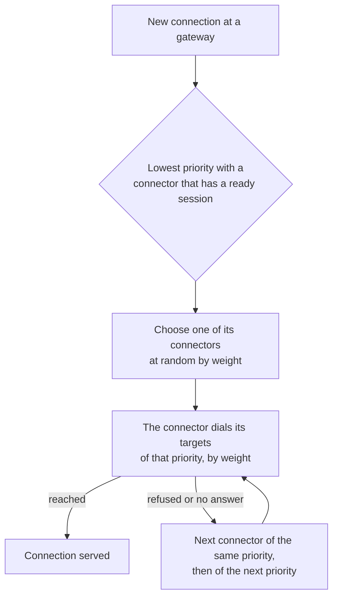

# Targets

A target is where a route's traffic goes: a connector of your organisation and an address that
connector dials, with how it speaks to it. This page is for anyone who publishes services. It
covers addresses and Unix sockets, the protocol to the target, how an HTTPS target's certificate is
checked, the PROXY protocol, how weights and priorities spread connections over targets on one or
several connectors, with failover and failback, and health checks.

## What a target is

- A target names one **connector**, set when the target is created, and an **address** as that
  connector reaches it: a host and port, or a Unix socket on the connector's host. A target always
  keeps its connector; to move a service to another connector, add a target there and remove the
  old one.
- A route may have several targets, on one connector or on several. Their **priority** and
  **weight** decide which one a new connection uses
  ([Weight, priority and failover](#weight-priority-and-failover)).
- A target is **enabled** or not. A disabled target gets no connections and keeps its settings.
- The connector dials a target only if its host's [local policy](../connectors/local-policy.md)
  allows the address, whatever the controller says.

## Before you start

- The route exists ([HTTP routes](http.md), [TCP and UDP routes](tcp-and-udp.md),
  [TLS passthrough](tls-passthrough.md)).
- The connector is enrolled in your organisation and not decommissioned
  ([Enrolling connectors](../connectors/enroll.md)).
- The connector's local policy allows the target's address and port, or its socket. If it allows
  none of the route's targets on that connector, they show as blocked, with the command that allows
  the first one ([The local policy and targets](#the-local-policy-and-targets)).

## Add a target

### With the web UI

1. Open the route's page. In the **Targets** card, choose **Add a target**.
2. Choose the **Connector**.
3. Under **Address**, keep **Host and port** and enter the **Host** and **Port**, or choose
   **Unix socket** and enter the **Socket path**.
4. For an HTTP route, choose the **Protocol to the target** and, for HTTPS, how its certificate is
   checked ([HTTPS targets](#https-targets)).
5. For a TCP, "TCP and UDP" or TLS passthrough route, choose the **PROXY protocol**
   ([PROXY protocol](#proxy-protocol)).
6. Enter the **Weight** and the **Priority**, or keep the suggested values.
7. Choose **Add the target**. A new target is always enabled: the form's **Enabled** box takes
   effect only in **Edit…**. The page follows the change to the agents.

In the targets table, **Edit…** changes a target and **Remove…** removes it after a question that
names its address.

### With the command line

```sh
rpmgr create route-target --route wiki --connector home \
  --address 192.168.10.20:8080 --wait 30s
```

| Flag | Meaning |
|---|---|
| `--route`, `--connector` | The route and the connector, by name or ID; only when the target is created |
| `--address <host:port>` | The host, a name or an IP address, and the port; IPv6 in brackets, `[fd00::7]:8080` |
| `--unix <path>` | A Unix socket on the connector's host, instead of `--address` |
| `--upstream tcp\|http\|https\|h2c` | The protocol to the target; `http` for HTTP routes and `tcp` for the others if not given |
| `--server-name`, `--ca-bundle`, `--spki`, `--verification` | How an HTTPS target's certificate is checked ([HTTPS targets](#https-targets)) |
| `--proxy-protocol none\|v1\|v2` | The PROXY protocol header ([PROXY protocol](#proxy-protocol)) |
| `--weight`, `--priority` | Its share and its rank ([Weight, priority and failover](#weight-priority-and-failover)) |
| `--disabled` | With `rpmgr update route-target` only: the target gets no connections; `--disabled=false` enables it again. A new target is always enabled |
| `--wait <duration>`, `-o table\|yaml\|json` | Wait for the agents, at most 30 s; the output format |

To change a target, give its ID and only the flags you change. The IDs are in the route's JSON:

```sh
rpmgr get -o json route wiki
rpmgr update route-target --weight 3 --wait 30s tg_01JA3B5C7D9E1F2G3H4J5K6M7N
rpmgr delete --wait 30s route-target tg_01JA3B5C7D9E1F2G3H4J5K6M7N
```

## Addresses and Unix sockets

- **Host and port.** The host is a name or an IP address as the connector's host resolves and
  reaches it, such as `127.0.0.1`, `192.168.10.20` or `nas.lan`. The connector checks its local
  policy against the address a name resolves to, at every dial.
- **Unix socket.** An absolute path on the connector's host, such as `/run/app/app.sock`, written
  in its clean form: no `.` or `..` parts, no doubled or trailing slash. The local policy must name
  the socket. A UDP or "TCP and UDP" route's targets are always a host and port.

## Protocol to the target

Only an HTTP route chooses a protocol; every other route passes the bytes as they come, or for UDP
the datagrams.

| Web UI | Command line | The connection from gateway to target |
|---|---|---|
| **HTTP** | `--upstream http` | HTTP/1.1, plain |
| **HTTPS, verified** | `--upstream https` | TLS, the certificate checked against a CA |
| **HTTPS, pinned key** | `--upstream https --verification pinned-key` | TLS, only the key checked against a pin |
| **HTTPS, unverified** | `--upstream https --verification unverified` | TLS, nothing checked |
| **HTTP/2 without TLS (h2c)** | `--upstream h2c` | HTTP/2, plain; for gRPC services |

All enabled targets of one HTTP route speak the same protocol; a target with another one is
refused ("the route's other targets speak another protocol"). For HTTPS, the gateway speaks TLS
with the target end to end through the tunnel: the connector forwards the encrypted bytes, and the
gateway checks the certificate.

## HTTPS targets

Choose how the gateway checks an HTTPS target's certificate. Verified is the default; the other two
are for certificates that no CA you have can verify, such as a self-signed one
([ADR-0017](../../adr/0017-upstream-tls-verification-modes.md),
[ADR-0018](../../adr/0018-pin-the-key-a-target-presents.md)).

### HTTPS, verified

The certificate must chain to a CA you trust and name the server name.

- **TLS server name** (`--server-name`): the name the certificate must carry, which is also sent to
  the target as SNI. Empty means the target's host. A target on a Unix socket has no host, so it
  needs one.
- **CA bundle** (`--ca-bundle`, by name or ID): the CAs its certificate must chain to, chosen
  among the organisation's bundles by name; with **None: the system's roots**, the trust store of
  the gateway's host. Each certificate of a bundle counts as a trust anchor, so a bundle may also
  hold a self-signed certificate. You manage bundles under **Domains & certificates**
  ([Domains and certificates](../domains-and-certificates.md#ca-bundles)), which shows each
  bundle's ID.
- **Public key pin, SHA-256 in hex (optional)** (`--spki`): a pin of the certificate's public key,
  checked in addition.

```sh
rpmgr create route-target --route nas --connector home \
  --address 192.168.10.30:5001 --upstream https \
  --server-name nas.internal --ca-bundle home-ca
```

### HTTPS, pinned key

The gateway accepts exactly the public key you pinned and checks neither the chain nor the name.
When the target gets a certificate with a new key, its requests fail with 502 until you pin the new
key.

In the web UI the pin is filled in for you:

1. Choose **HTTPS, pinned key**, the connector and the target's address. Enter a **TLS server name**
   if the target needs one.
2. Choose **Trust the certificate it shows now**. The target's connector dials the target under its
   local policy, sends nothing but a TLS handshake, and reports the certificate.
3. Check the **Subject**, **Names**, **Issuer** (or **Self-signed**), **Valid until** and
   **Key fingerprint (SHA-256)**. If they are the target's, choose **Trust this key**.
4. Save the target.

Reading a certificate needs the role Owner, Admin or Operator, and is limited per connector
([03](../../03-connections.md#timeouts-keepalive-and-backoff)).

On the command line, give the pin yourself: the SHA-256 of the certificate's public key
(SubjectPublicKeyInfo), 64 lower-case hexadecimal digits. On a host that reaches the target, such
as the connector's, OpenSSL computes it:

```sh
openssl s_client -connect 192.168.10.40:8443 -servername printer.lan </dev/null 2>/dev/null \
  | openssl x509 -pubkey -noout | openssl pkey -pubin -outform DER | sha256sum
```

The first field it prints is the pin. Then, wherever you use `rpmgr`:

```sh
rpmgr create route-target --route printer --connector home \
  --address 192.168.10.40:8443 --upstream https --verification pinned-key \
  --server-name printer.lan --spki <the 64 hexadecimal digits>
```

A pinned-key target takes no CA bundle.

### HTTPS, unverified

The gateway checks nothing. The web UI warns: "The gateway will not check the target's certificate.
The traffic stays encrypted, but anyone on the network between the connector and the target can
read and change it." Choose it only for a target whose certificate nothing can verify, and prefer a
pinned key where you can. Such a target shows an **unverified** badge next to its address. It takes
neither a CA bundle nor a pin; its server name is still sent.

```sh
rpmgr create route-target --route router-ui --connector home \
  --address 192.168.10.1:443 --upstream https --verification unverified
```

### Changing how a target is checked

The gateway applies a target's TLS settings only to the streams of that target's own connector. When
you change them, the target's open connections end at once. Only a change to **HTTPS, unverified**,
on the same connector, leaves them open ([04](../../04-security.md#controller-certificates)).

## PROXY protocol

A target may get a PROXY protocol header before the client's bytes, so that it learns the client's
address and the address and port of the gateway's listener that the client connected to. That is
the address the gateway's host has: behind NAT, the private one, not the public one. Choose
**Version 1** (text, `v1`) or **Version 2** (binary, `v2`), whichever the service reads; **None**
is the default.

| Route type | PROXY protocol |
|---|---|
| TCP | on every connection |
| TLS passthrough | on every connection, before the client's TLS handshake |
| TCP and UDP | on TCP connections only; UDP flows never get one, so on UDP the service sees the connector's address |
| HTTP | none: the gateway sends the client's address in `X-Forwarded-For` and `Forwarded` |
| UDP | none: the service sees the connector's address |

Turn it on only for a service that expects it; any other reads the header as garbage. When the
gateway does not know the addresses, a version 2 header is `LOCAL` and a version 1 header `UNKNOWN`.

## Weight, priority and failover

Every target has a **priority**, 0 to 1000, and a **weight**, 1 to 1000. A lower priority is
preferred; a higher one is a failover. Among the targets of one priority, connections are shared
by weight. On the command line both default to the lowest values, priority 0 and weight 1 (a weight
of 0 counts as 1); the web UI suggests a weight of 100.



How a new connection finds its target ([D90](../../14-open-decisions.md#engineering)):

1. The gateway knows, for each route, every connector with enabled targets and their priorities,
   with the summed weight of each connector's targets at each priority.
2. It takes the lowest priority at which a connector has a ready session: online, with a data
   session to this gateway, and reporting the route ready. Among that priority's connectors it
   chooses one at random by weight.
3. That connector dials only its targets of that priority, in a random order weighted by their
   weights.
4. If none of them can be reached, the gateway tries the next connector of the same priority, then
   one of the next priority, which may be the same connector at a worse priority. The number of
   attempts is bounded ([03](../../03-connections.md#framing)). After the last, a TCP client gets a
   reset and an HTTP client a 502 or 504.

So another connector's priority 0 comes before a connector's own priority 5: priorities hold across
connectors.

**Example.** Targets at priority 0 with weight 3 on connector `site-a` and weight 1 on connector
`site-b` share new connections three to one. A target at priority 10 on connector `cloud` gets new
connections only while neither `site-a` nor `site-b` has a ready session, or while their targets
refuse.

```sh
rpmgr create route-target --route app --connector site-a --address 10.1.0.5:8080 --weight 3
rpmgr create route-target --route app --connector site-b --address 10.2.0.5:8080 --weight 1
rpmgr create route-target --route app --connector cloud --address 10.9.0.5:8080 --priority 10
```

### Failback

New connections go back to a better priority as soon as one of its connectors has a ready session
again. Open TCP connections stay where they are until they end. An HTTP route's upstream
connections, which the gateway keeps open for later requests, move too: once a better priority than
the best one ready when the connection was opened is ready, or the connection's connector no longer
serves the route at that priority, the connection closes as soon as it has no request in progress.
An HTTP/1.1 upstream moves at the next request, an HTTP/2 upstream once it has no request in
progress.

### Passing over failing targets

Each gateway also learns from the connections it opens. When a connector's targets at one priority
refuse or time out several new connections in a row, the gateway passes over that connector at
that priority for a while, so new connections go straight to the next one instead of waiting for
the failure each time. After the pause one connection tries it again: if it gets through, the
connector at that priority is used again; if not, the pause grows, up to a limit
([03](../../03-connections.md#target-health-phase-2)).

- Only refused and timed-out connections count. An HTTP error status, such as 500 or 503, from the
  service is its answer and never counts.
- When every connector of the route is passed over, the gateway still tries one rather than
  refusing the connection.
- Each gateway decides alone: one gateway may still try a connector that another passes over.
- UDP flows are not counted and not moved ([Limits](#limits)).

### Limits

- **Without a health check**, rpmgr knows whether a connector is ready, not whether a target
  works. A target that is down is still tried until it has refused or timed out
  several connections in a row ([Passing over failing targets](#passing-over-failing-targets)),
  and each of those waits for its dial to fail or time out before the next one is tried
  ([03](../../03-connections.md#timeouts-keepalive-and-backoff)). Meanwhile the fallback's HTTP
  connections stay alive, and move back only when idle or when a better priority returns.
- **UDP flows are not retried.** A UDP flow sends its first datagrams before it knows whether the
  target answers, so it is never moved to another connector.
- **Release candidates.** A gateway or connector of a release candidate (v0.1.0-rc.1 to rc.7)
  ignores priorities across connectors; upgrade every agent ([Upgrades](../install/upgrades.md)).

## Health checks

A route can have one health check. Each connector of the route runs it against each of its own
targets of the route, and new connections pass over a target that fails it
([03](../../03-connections.md#target-health-phase-2)).

- A **TCP** check passes when the target accepts the connection. An **HTTP** check sends a `GET`
  of a path and passes on the statuses you expect, any success or redirect unless you name a
  range. It asks for the route's host header override, if it has one, else its first hostname
  that is not a wildcard, and checks an HTTPS target's certificate as traffic does
  ([HTTPS targets](#https-targets)). A TLS passthrough route, whose targets expect TLS, and a route
  with an h2c target have TCP checks only.
- The check uses each target's address and port, or another **port** on the same host, for a
  service that answers its health checks there. A UDP route has only a TCP check, of a port you
  name; a route with a Unix socket target has no check port.
- A target turns **unhealthy** after a number of failed checks in a row and **healthy** again after
  a number of passed ones, so a target that fails now and then keeps its state. You can set both
  numbers, the interval and the timeout, within their bounds
  ([03](../../03-connections.md#timeouts-keepalive-and-backoff)).
- The connector's [local policy](../connectors/local-policy.md) applies to checks as to traffic: a
  target or check port it does not allow is never checked, and shows as **blocked by the
  connector's local policy**, not as unhealthy.

What the route then does:

- New connections pass over unhealthy targets. A connector whose targets of a priority are all
  unhealthy gets none of that priority's connections, so they go to the next priority, and come back
  once a target is healthy again ([Failback](#failback)).
- A target that is new on the route, or was removed and added again, is **unknown** until its first
  check: it gets connections only when no other target of its priority is healthy, and the route's
  status shows it as `unknown`. A change of the route, such as another weight or a new target, keeps
  what the checks found of the other targets; a changed check keeps their state until its own
  results change it, and runs at once.
- While some targets are unhealthy, the route is **degraded** and its status lists each of them,
  `TARGETS_UNHEALTHY` with the last check's failure. When every target on every connector is
  unhealthy, the route is **unavailable**: an HTTP client gets a 503, a TCP client a reset.
- A connector of an earlier release runs no checks. Its targets count as healthy, and the route's
  status lists them under `healthNotChecked`; [upgrade](../install/upgrades.md) the connector.
- A Viewer sees the check and the targets' health, and cannot change them.

### With the command line

```sh
rpmgr update route wiki --health-check http --health-path /healthz --wait 30s
rpmgr get -o yaml route wiki
```

| Flag | Meaning |
|---|---|
| `--health-check tcp\|http\|none` | The kind of check; `none` removes it. A route without a check needs this flag before the others |
| `--health-port <port>` | The port to check instead of each target's; required on a UDP route |
| `--health-path <path>` | An HTTP check's path and query, starting with `/`; `/` if not given |
| `--health-status <from-to>` | The statuses an HTTP check passes on, as `200-204` |
| `--health-interval`, `--health-timeout` | How often a target is checked and how long one check may take, in whole seconds such as `30s`; 0 keeps the default |
| `--health-unhealthy`, `--health-healthy` | The failed and the passed checks in a row that change a target's health; 0 keeps the default |

On `rpmgr update route`, a `--health-*` flag changes only its part of the check. `rpmgr create
route` takes the same flags. In the route's YAML, the check is `healthCheck`, and the status lists
the unhealthy targets under `notServing`.

## Targets on several connectors

Put targets of one route on connectors at different sites for redundancy: each connector keeps a
data session to every gateway of the route's group, so a gateway can use any of them. Give them one
priority to share the load, or different priorities for a primary site and a failover.

When a connector is decommissioned, its targets are deleted, and so is every route left without a
target ([Connector lifecycle](../connectors/lifecycle.md)).

## The local policy and targets

The connector's local policy decides which targets it may dial
([The local policy](../connectors/local-policy.md)):

- A target the policy does not allow is never dialled. Without a health check, a connector reports
  one readiness per route, not per target; a health check reports each target
  ([Health checks](#health-checks)).
- When none of a route's targets on a connector is allowed, the route's page shows each of them as
  **blocked by the connector's local policy**. Each shows the command for the first blocked target,
  to run on that connector's host, with a **Copy** button: `sudo rpmgr policy allow-target
  <target>` for a target nothing allows, or `sudo rpmgr policy remove-deny-target <entry>` for one
  a deny entry refuses.
- A blocked target blocks only itself. While another target of the route on the same connector is
  allowed, the route stays ready there and its connections go to the allowed target. The route's
  page then shows the blocked target as **ready** too, with no command; `rpmgr policy show` on the
  connector's host shows what its policy allows.
- A target given as a name counts as allowed until a dial of its resolved address is refused. It
  then counts as blocked until a dial of it is allowed, the policy is reloaded, or the connector
  gets a new configuration snapshot.
- On an all-in-one, the built-in connector never dials one of rpmgr's own ports on its host, such
  as 443 or the admin port, whatever the policy allows. The route's page says "is one of rpmgr's own
  ports" and offers no command: point the target at the service itself
  ([04](../../04-security.md#connector-local-policy)).
- A policy file that does not load blocks every target, which shows as **the connector's local
  policy does not load**.
