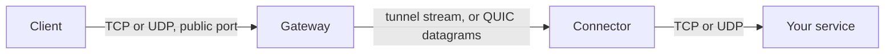
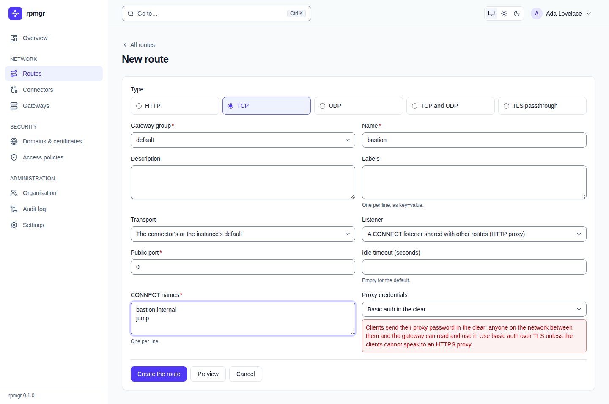

# TCP and UDP routes

A TCP, UDP, or "TCP and UDP" route publishes a service on a public port of a gateway group: a
database, SSH, MQTT, DNS, a game server, a VPN endpoint. This page is for anyone who publishes such
services. It shows how to create the three types in the web UI and on the command line, which
address clients use, and what each setting does.

## Which type to choose

| Type | Web UI | Command line | Use it for |
|---|---|---|---|
| `tcp` | **TCP** | `--tcp` | A TCP service: databases, SSH, MQTT, SMTP, anything that is not HTTP |
| `udp` | **UDP** | `--udp` | A UDP service: DNS, WireGuard, syslog, game servers |
| `tcp_udp` | **TCP and UDP** | `--tcp-udp` | A service that listens on one port number with both, such as DNS |

A `tcp_udp` route is one route with one name, one public port number for both protocols and one
list of targets: TCP connections and UDP flows on the port go to the same target addresses. Use it
instead of a TCP and a UDP route that you would have to keep in step by hand.

For HTTP services use an [HTTP route](http.md), and for TLS services that should be reached by
name on port 443 use [TLS passthrough](tls-passthrough.md). Many TCP services behind one port, each
chosen by name through an HTTP proxy, are [CONNECT routes](#connect-routes).

## How it works

Each gateway of the group listens on the route's public port. A TCP connection becomes a stream
to a connector of the route, which dials a target and relays the bytes in both directions,
half-close included. A UDP route works with **flows**: all datagrams of one client address and port
on the route's port form one flow, which the connector relays through a UDP socket of its own, so
the replies reach the right client.



- UDP datagrams travel between gateway and connector as QUIC datagrams, which must fit into one
  packet. A larger payload goes over the flow's stream instead: delivered reliably, but a late
  packet then holds up those after it. The route's page shows the sizes
  ([03](../../03-connections.md#udp-routes)).
- A connector that reaches the gateways only over TLS and HTTP/2, the fallback for networks that
  block UDP, carries every UDP payload over the flow's stream. This works, but loss on that
  connection delays every flow on it. The route's page marks such targets as "served over TLS and
  HTTP/2, the fallback for QUIC" ([Connector networking](../connectors/network.md)).

## Before you start

- A gateway group with at least one enrolled gateway ([Gateways](../gateways.md)).
- A **port pool** of the group for the route's protocol: a TCP pool for `tcp`, a UDP pool for
  `udp`, both for `tcp_udp`. Pools belong to your organisation and are set up by an Owner or Admin
  on the gateway group's page under **Port pools**, or with `rpmgr create port-pool`
  ([Gateways](../gateways.md)). Without one, the group has no public ports for routes.
- The pool's ports open in the gateways' firewalls ([10](../../10-operations.md#ports)).
- Public hostnames of the gateway group, the names clients reach the gateways by, so that rpmgr can
  show the route's address ([The address clients use](#the-address-clients-use)).
- A connector that reaches the service, whose [local policy](../connectors/local-policy.md) allows
  the service's address and port.
- The role Owner, Admin or Operator ([Members and roles](../accounts/members-and-roles.md)).

## Create a route

### With the web UI

1. Open **Routes** and choose **Create a route**.
2. Under **Type**, choose **TCP**, **UDP** or **TCP and UDP**.
3. Choose the **Gateway group** and enter a **Name**.
4. Leave **Public port** at `0` for a free port of the group's pools, or enter the port you want.
5. Leave the idle timeouts empty for their defaults, or enter seconds ([Settings](#settings)).
6. Optionally choose **Preview**: it shows the address the route would be reached at, before
   anything is saved ([Preview and apply](preview-and-apply.md)).
7. Choose **Create the route**, then **Open \<name\> to add its targets**.
8. In the **Targets** card, choose **Add a target**, choose the **Connector** and enter the
   service's **Host** and **Port** as the connector reaches it. For a TCP or "TCP and UDP" route,
   choose a **PROXY protocol** if the service reads one ([Targets](targets.md)). Choose
   **Add the target**.

### With the command line

A TCP route on a free port of the pools, with its target:

```sh
rpmgr create route --tcp --name postgres --group default --port 0 --wait 30s
rpmgr create route-target --route postgres --connector db-host \
  --address 10.0.0.5:5432 --wait 30s
```

A UDP route on a chosen port, whose flows end after 30 seconds without datagrams:

```sh
rpmgr create route --udp --name wireguard --group default \
  --port 51820 --idle-timeout 30s --wait 30s
rpmgr create route-target --route wireguard --connector home \
  --address 192.168.10.1:51820 --wait 30s
```

A DNS server on one port number for TCP and UDP, with a PROXY protocol header on its TCP
connections:

```sh
rpmgr create route --tcp-udp --name dns --group default --port 0 \
  --idle-timeout 10m --flow-idle-timeout 30s --wait 30s
rpmgr create route-target --route dns --connector home \
  --address 192.168.10.53:53 --proxy-protocol v2 --wait 30s
```

`--idle-timeout` and `--flow-idle-timeout` take durations such as `30s`, `10m` or `2h`. The port a
route got is in its manifest:

```sh
rpmgr get -o yaml route postgres
```

### What happens next

- The gateways start to listen on the port once the route has an enabled target on an enabled
  connector that is not decommissioned; a TCP or UDP route without one holds its port but no
  gateway listens on it.
- The route's state shows whether its targets are ready and its gateways serve it
  ([Preview and apply](preview-and-apply.md)).

## The address clients use

Clients connect to the route's public port at one of the gateway group's **public hostnames**. The
web UI shows the route's address that way, in the routes list, on the route's page and in the
preview, for example `gw.example.net:20417`, an IPv6 address in brackets. While the group has no
public hostname, the UI shows only `:20417`, says so, and links to the group, where an Admin sets
them ([Gateways](../gateways.md)). On an all-in-one, `rpmgr all-in-one init` gives the group
`default` the host of the public URL as its public hostname, when the group accepts it as one.

The hostnames' DNS records must point at the group's gateways; rpmgr does not publish them yet
(planned for Phase 2, [15](../../15-dns.md)).

## Settings

| Setting | Web UI | Command line | Default |
|---|---|---|---|
| Name, unique in the organisation | **Name** | `--name` | required |
| Description, labels | **Description**, **Labels** | `--description`, `--label key=value` | empty |
| Data-session transport | **Transport** | `--transport auto\|quic\|h2` | the connector's |
| Public port | **Public port** | `--port` | `0`: a free port of the pools |
| TCP: idle timeout of a connection | **Idle timeout (seconds)** | `--idle-timeout` | see below |
| UDP: idle timeout of a flow | **Flow idle timeout (seconds)** | `--idle-timeout` | see below |
| TCP and UDP: both timeouts | **TCP idle timeout (seconds)**, **UDP flow idle timeout (seconds)** | `--idle-timeout`, `--flow-idle-timeout` | see below |
| Access policies, IP rules only | **Access policies** card on the route's page | `--policy`, repeated | none |
| Served or not | **Enabled** switch on the route's page | `rpmgr enable route`, `rpmgr disable route` | enabled |

### Public port

- The port comes from the group's port pools of the route's protocol. Port `0` takes a random free
  one; a port you name must lie in a pool and be free. A `tcp_udp` route takes one port number
  that lies in a TCP and a UDP pool and is free in both.
- Each port counts against your organisation's port quota for the group and protocol, if it has
  one; a `tcp_udp` route counts against both quotas.
- A port that is not in a pool is refused with `PORT_NOT_IN_POOL`, a group without a free port with
  `POOL_EXHAUSTED`, a full quota with `QUOTA_REACHED`, and a port that is taken names the route
  that holds it.
- You may change the port later. The new port is taken first and the old one freed in the same
  change; clients must then use the new port. Deleting the route frees its port.

### Idle timeouts

- A **TCP** connection without traffic for the idle timeout is closed. `0` never closes it, for
  long-lived quiet connections. The largest value is 604 800 seconds, seven days.
- A **UDP** flow without datagrams for the flow idle timeout is forgotten; the next datagram of the
  client starts a new flow. The value is 1 to 86 400 seconds, one day.
- Left empty in the web UI, or not set when the route is created, a timeout takes its default
  ([03](../../03-connections.md#timeouts-keepalive-and-backoff)).

### Access policies

TCP, UDP and "TCP and UDP" routes apply the IP rules of their access policies. A refused TCP
connection is reset before it reaches a connector, and a refused UDP datagram is dropped. A policy
with a basic-auth rule cannot be attached, as a TCP or UDP client cannot answer it, except to a
CONNECT route whose listener asks for basic auth ([Access policies](../access-policies.md)).

## CONNECT routes

A `tcp` route in `http_connect` mode takes no port of its own: the organisation's CONNECT routes
on a gateway group share a **CONNECT listener**, one port, and a client picks the route by name
through the listener as through an HTTP proxy, with `CONNECT <name>:<port>`. That serves many TCP
services, such as SSH hosts or databases, behind one public port, for clients that can use an HTTP
proxy.

```sh
rpmgr create route --tcp --http-connect --name bastion --group eu \
  --authority bastion.internal --authority jump
ssh -o ProxyCommand='nc -X connect -x edge.example.com:20001 %h %p' bastion.internal
```

In the web UI, **Create a route** with **TCP**, then **Listener**: **A CONNECT listener shared with
other routes (HTTP proxy)**, the **CONNECT names**, one per line, and **Proxy credentials**:



- **Authorities** are the names clients ask for, compared in lower case; the port of the CONNECT is
  ignored. Each name is one route's on its listener.
- **Authentication mode**, the same for every route of a listener:
  - `none` (the default): plain CONNECT, IP and rate-limit rules only.
  - `tls-basic`: the listener speaks TLS, an HTTPS proxy, with the listener's hostname under a
    verified domain and an uploaded certificate that covers it (`--connect-hostname`,
    `--connect-certificate`), and asks for the users of a basic-auth access policy. Naming a
    renewed certificate on one route of the listener replaces it for all its routes and keeps the
    port.
  - `plain-basic`: plain CONNECT that asks for a basic-auth user. **The password crosses the
    network in the clear**: anyone on the path between client and gateway can read and use it.
    The command line, the API and the web UI warn every time. Use it only for clients that cannot
    speak to an HTTPS proxy.
  - In both basic modes, a route without an access policy that has a basic-auth rule admits no
    one; the command line, the API and the web UI warn about it.
- **The port:** `--port` names a listener of the organisation with the same mode, or a free port
  of the pools, which becomes a new listener; without it, the route joins the organisation's
  listener of its mode in the group, or opens one. A listener counts once against the port quota
  and closes with its last route. A port of another mode is refused with `CONNECT_MODE_MISMATCH`.
- A route's listener mode cannot change; changing its authentication mode or listener hostname
  moves it to another listener, and its port changes. Gateways of earlier releases do not serve CONNECT routes
  until they are upgraded.

The rules a client meets, and its answers, are in
[03](../../03-connections.md#http-connect-routes-phase-2).

## What clients see

| Situation | TCP | UDP |
|---|---|---|
| The route is disabled, deleted, or has no enabled target on an enabled, not decommissioned connector | Nothing listens: the connection is refused | Nothing listens on the port |
| An access policy refuses the client | Reset at once | Datagrams dropped |
| No target can be reached | Reset, after the gateway tried the route's other connectors | Datagrams go nowhere; a flow is never retried elsewhere |
| A target is reached | The bytes in both directions | The datagrams in both directions |

A removed route's open connections close after the route drain period
([03](../../03-connections.md#timeouts-keepalive-and-backoff)); a tightened access policy resets
the connections and ends the flows of the clients it now refuses at once.

## Troubleshooting

- **"the port is in use on the gateway".** Another program on the gateway's host holds the port.
  The gateway tries to bind it again on its own, so freeing the port is enough
  ([03](../../03-connections.md#timeouts-keepalive-and-backoff)). On a `tcp_udp` route, the other
  protocol serves meanwhile.
- **"blocked by the connector's local policy".** The target's address is not allowed on the
  connector's host. The route's page shows the command that allows it
  ([The local policy](../connectors/local-policy.md)).
- **"no data session over the route's transport".** The route pins a transport that the connector
  cannot use, such as QUIC on a network that blocks UDP
  ([Connector networking](../connectors/network.md)).
- **UDP works only partly.** Large datagrams may not fit one QUIC packet, and over the TCP fallback
  every flow waits for lost packets. The route's page has a note on the sizes
  ([03](../../03-connections.md#udp-routes)).

TCP routes behind an HTTP CONNECT multiplexer on one port are planned for Phase 2
([05](../../05-features.md#publishing-services-routes)).
