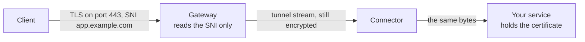

# TLS passthrough

A TLS passthrough route publishes a TLS service on port 443 by its hostname, without ending TLS at
the gateway. The gateway reads only the name the client asks for (the SNI of its TLS ClientHello)
and passes the encrypted connection through a connector to the target, which holds the
certificate. This page is for anyone who publishes a service that must keep its own certificate.

## When to use it

- The service must keep its own certificate and key, and the gateway must never see the plain
  traffic, for example a reverse proxy or Kubernetes ingress of its own.
- The service authenticates clients with client certificates, which only work end to end.
- You want to reach several such services on port 443 alone, told apart by hostname.

The service must speak TLS itself. A service that does not uses a [TCP route](tcp-and-udp.md); a
web service whose TLS rpmgr may end uses an [HTTP route](http.md), which adds certificates from
ACME, redirects, headers, basic auth and error pages.



## How it works

- The gateway reads the ClientHello on port 443 and looks up its SNI. It matches a route's
  hostname exactly, or a hostname `*.<name>` that serves every name one label below `<name>`; an
  exact hostname wins over a wildcard.
- The connection goes over a stream to a connector of the route. The ClientHello the gateway read
  is sent on first, so the target sees the client's TLS handshake unchanged.
- Neither the gateway nor the connector ends TLS. They see who connects, when and how much, but not
  what.

## Before you start

- A gateway group with at least one enrolled gateway, reachable on port 443
  ([Gateways](../gateways.md)). The hostnames' DNS records must point at its gateways.
- A verified domain of your organisation that covers every hostname, a wildcard claim for a
  wildcard hostname ([Domains and certificates](../domains-and-certificates.md)).
- A connector that reaches the service, whose [local policy](../connectors/local-policy.md) allows
  its address.
- The role Owner, Admin or Operator ([Members and roles](../accounts/members-and-roles.md)).

## Create a route

### With the web UI

1. Open **Routes** and choose **Create a route**.
2. Under **Type**, choose **TLS passthrough**.
3. Choose the **Gateway group**, enter a **Name**, and enter the **Hostnames**, one per line.
4. Optionally choose **Preview** ([Preview and apply](preview-and-apply.md)).
5. Choose **Create the route**, then **Open \<name\> to add its targets**.
6. In the **Targets** card, choose **Add a target**. Choose the **Connector**, and enter the
   service's **Host** and **Port**, or choose **Unix socket** and its **Socket path**. Choose a
   **PROXY protocol** if the service reads one, so that it learns the client's address
   ([Targets](targets.md)). Choose **Add the target**.

### With the command line

```sh
rpmgr create route --tls-passthrough --name ingress --group default \
  --hostname app.example.com --hostname '*.apps.example.com' --wait 30s
rpmgr create route-target --route ingress --connector cluster \
  --address 10.0.0.20:443 --proxy-protocol v2 --wait 30s
```

Quote a wildcard hostname, as above, so that the shell does not expand it.

## Settings

| Setting | Web UI | Command line |
|---|---|---|
| Name, unique in the organisation | **Name** | `--name` |
| Description, labels | **Description**, **Labels** | `--description`, `--label key=value` |
| Data-session transport | **Transport** | `--transport auto\|quic\|h2\|wss` |
| Hostnames, 1 to 100 | **Hostnames**, one per line | `--hostname`, repeated |
| Access policies, IP rules only | **Access policies** card on the route's page | `--policy`, repeated |
| Served or not | **Enabled** switch on the route's page | `rpmgr enable route`, `rpmgr disable route` |

- Within a gateway group, a hostname belongs to one TLS passthrough route and to no HTTP route; a
  hostname another route of the group uses is refused, naming that route.
- Every hostname must be covered by a verified domain claim of your organisation
  (`DOMAIN_NOT_VERIFIED` otherwise). An exact claim covers its own name only; a claim with every
  name below it covers those names too
  ([Domains and certificates](../domains-and-certificates.md#what-a-claim-covers)).
- The targets speak the bytes as they come; there is no protocol to choose. A target may be a host
  and port or a Unix socket on the connector's host, and may get a PROXY protocol header
  ([Targets](targets.md)).
- Access policies apply their IP rules: a refused client's connection is reset before it reaches a
  connector. A policy with a basic-auth rule cannot be attached
  ([Access policies](../access-policies.md)).

## Certificates

The target presents its own certificate, and rpmgr obtains none for these hostnames. Port 80 of the
gateways serves only HTTP routes, so a target cannot answer ACME HTTP-01 challenges through rpmgr.
It can use TLS-ALPN-01, whose validation arrives on port 443 with the hostname as SNI and reaches
the target like any other connection, or DNS-01.

## What clients see

- **A ready target:** the target's own TLS handshake and service.
- **No target can be reached:** the connection is reset, after the gateway tried the route's other
  connectors.
- **Refused by an access policy:** the connection is reset at once.
- **A name no route serves, or a disabled route:** the gateway completes the handshake itself, with
  a certificate it holds that covers the name, or else its self-signed default certificate, which
  clients do not trust. A browser then gets the "Site not available" page
  ([Maintenance and error pages](maintenance-and-pages.md)).
- **A removed route:** its open connections are reset after the route drain period
  ([03](../../03-connections.md#timeouts-keepalive-and-backoff)).

## Limits

- A client must send SNI. Without it, the gateway cannot tell which route is meant.
- With Encrypted Client Hello (ECH), the gateway sees only the outer SNI and cannot route on the
  inner name ([03](../../03-connections.md#tls-passthrough-routes)).
- Only port 443 is used. For TLS on another port, use a [TCP route](tcp-and-udp.md).
- The ClientHello must arrive within a limited size and time
  ([03](../../03-connections.md#port-443-multiplexing)).
