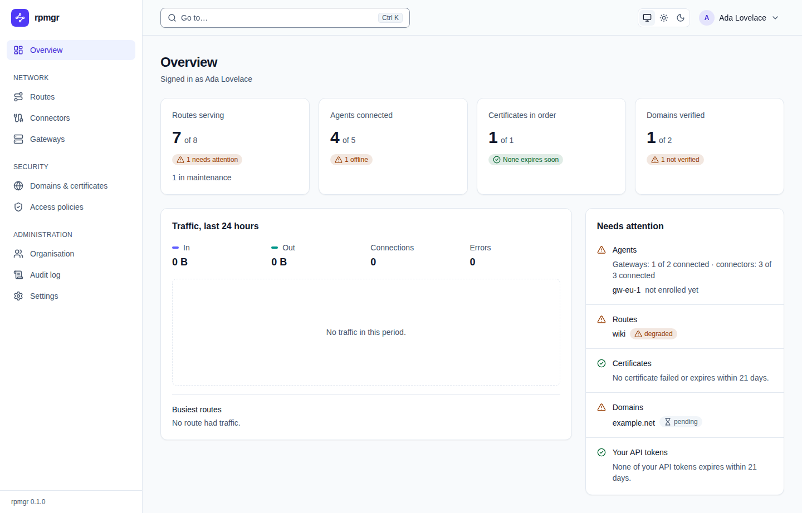
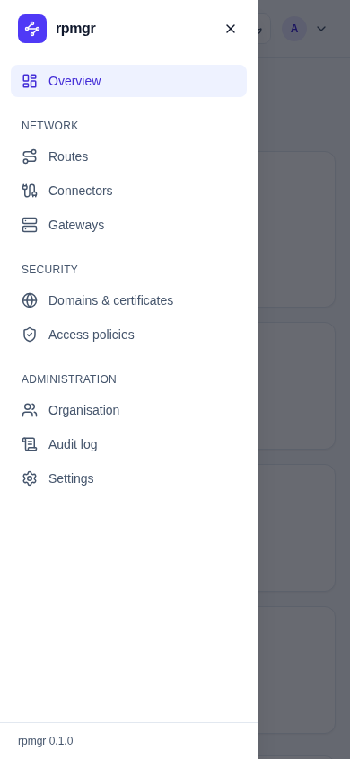
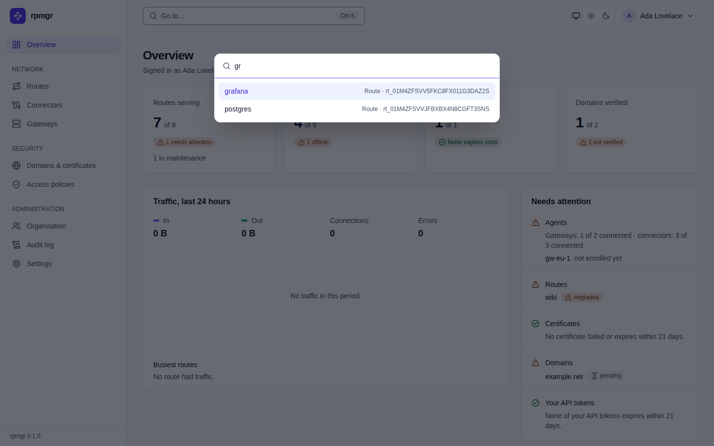
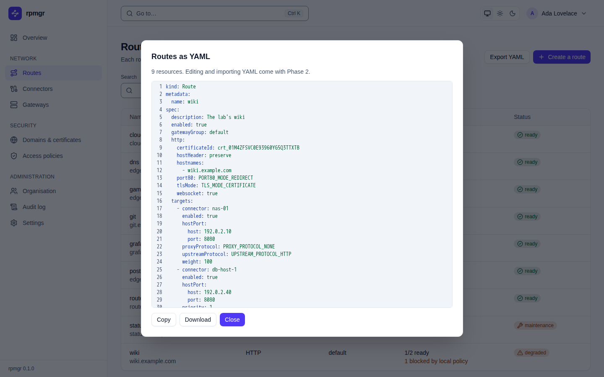
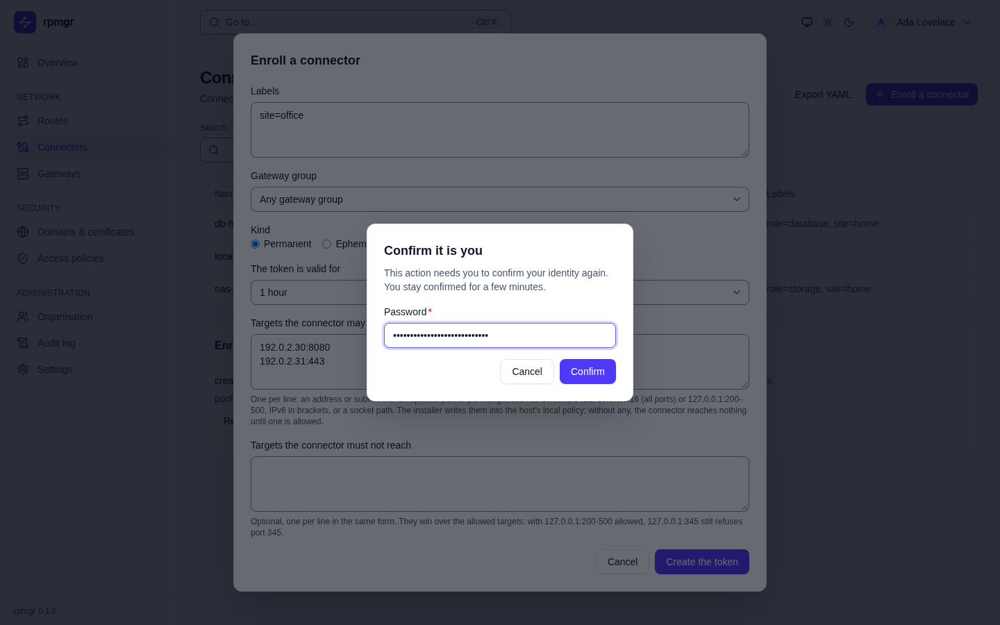
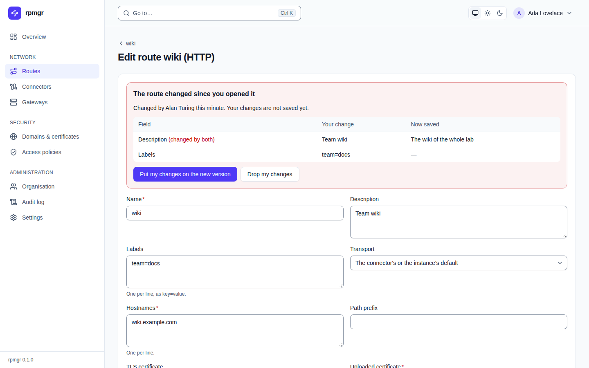

# The web UI

The web UI is where you manage rpmgr in a browser: routes, connectors, gateways, domains, access
policies, members and settings. This page explains what every page shares: the navigation, the
command palette, the themes, the YAML view, the step-up dialog and how the UI handles a change
that meets a newer version. Read it first; then use the page reference below for each area. The
design behind the UI is in the design documents ([09](../../09-web-ui.md)).

The controller serves the web UI at its public URL, the address you chose when you installed it
([Install script](../install/install-script.md)). The screenshots in this reference show a made-up
organisation, "Example Lab"; they are taken with the tool that
[docs/guide/images](../images/README.md) describes.

## The pages

| Page | What you do there | Who may change things |
|---|---|---|
| [Sign-in and other public pages](public-pages.md) | Sign in, create the first account, reset a password, accept an invitation | Anyone with the link |
| [Overview](overview.md) | See what needs attention, and the last day's traffic | Nothing to change |
| [Routes](routes.md) | Publish services, add their targets, attach access policies | Owner, Admin, Operator |
| [Connectors](connectors.md) | Enroll connectors, switch them off, decommission them | Owner, Admin; Operators if the organisation allows it |
| [Gateways](gateways.md) | Manage gateway groups, gateways, port pools and quotas | Owner, Admin |
| [Domains & certificates](domains.md) | Prove domains, upload certificates, keep CA bundles | Owner, Admin |
| [Access policies](policies.md) | Allow or deny clients by address, require basic auth | Owner, Admin, Operator |
| [Organisation](organisation.md) | Rename the organisation, manage members and invitations | Owner, Admin; renaming: Owner |
| [Webhooks](webhooks.md) | Send the organisation's events to your own endpoints | Owner, Admin (`webhooks.write`) |
| [Audit log](audit.md) | Read and verify who changed what | Owner, Admin can read it |
| [Settings](settings.md) | The organisation's settings, and the instance's settings, PKI and updates | Owner; Instance Admin |
| [Account](account.md) | Your profile, password, authenticator, sessions and API tokens | Every user, for themselves |

Every member of an organisation sees every page of it. Most pages show the same buttons to every
role; a change your role does not allow fails with an error that names the missing permission,
such as `the permission routes.write is missing`. A few parts depend on the role: the
organisation's settings can be changed only by its Owner, and only the Owner sees the restore
review ([Organisation](organisation.md)); the Instance Admin also sees the instance's settings,
PKI and updates, the instance's audit log and **Mark as trusted** on domain claims. The roles and
what each may do are in [Members and roles](../accounts/members-and-roles.md).

## Layout and navigation

- **The sidebar** on the left lists the pages in groups, each with an icon: **Overview**; under
  **Network**, **Routes**, **Connectors** and **Gateways**; under **Security**, **Domains &
  certificates** and **Access policies**; under **Administration**, **Organisation**, **Webhooks**,
  **Audit log** and **Settings**. The page you are on is highlighted. The product's mark and name at the
  top lead to the overview.
- **The version** of rpmgr that the controller runs stands at the foot of the sidebar, such as
  `rpmgr 0.2.0`. Only signed-in users see it; the sign-in page shows no version
  ([D80](../../14-open-decisions.md#engineering)).
- **The top bar** holds **Go to…**, which opens the [command palette](#command-palette), the
  [theme switch](#themes) and the user menu. It stays at the top while the page scrolls.
- **The user menu** is the button with your name. It shows your name and e-mail address, and
  leads to **Your account** and to **Sign out**. Escape or a click elsewhere closes it.
- **Skip to content** is the first thing the Tab key reaches on every page: it moves the focus
  past the navigation to the page's content.

### On small screens

On a screen narrower than 1024 pixels, the sidebar is a menu behind the **Open the menu** button
at the left of the top bar. It opens from the left. Choosing a page, the **Close the menu**
button, Escape or a click beside the menu close it again.

## Command palette

Press **Ctrl K**, or **⌘ K** on a Mac, on any signed-in page, or click **Go to…** in the top bar.
The palette jumps to a page or a resource, or starts a common action.

- **Without a query** it lists the actions **Create a route** and **Enroll a connector**, every
  page of the sidebar, and **Your account**.
- **Type** a part of a name to find pages, actions, routes, connectors, gateway groups and
  gateways. Matches whose name starts with what you typed come first; a resource is also found by
  the start of its ID, such as `rt_01…`. Each match names its kind, and for a resource its ID.
  The palette shows at most 50 matches.
- **The arrow keys** move through the matches, **Enter** opens the highlighted one, and **Escape**
  or a click beside the palette closes it.

**Enroll a connector** opens the connectors page with its enroll dialog. The dialog's state is in
the page's address (`/connectors?enroll=true`), so you can also bookmark or share that link.

## Themes

The theme switch in the top bar has three buttons: **Like the system** (the screen icon),
**Light** (the sun) and **Dark** (the moon). **Like the system** follows your operating system's
light or dark setting, and is the default.

The choice applies at once and is saved in your profile on the controller, so it follows you to
every browser you sign in with. If the controller cannot save it, the switch goes back to the
saved theme and says why below it. The arrow keys move between the three buttons, as in any group
of radio buttons.

## Lists and filters

The lists of routes, connectors and the audit log keep their filters in the page's address. A
link to a filtered list, or the browser's back button, shows the same filtered list again. When
the filters of the routes or the connectors match nothing, the page says so and offers **Clear the
filters**. A list that is still empty offers to create the first item instead.

## Forms

- **Required fields** have a red asterisk after their label, while they are required: some are
  required only in some cases, such as an uploaded certificate's ID when a route uses an uploaded
  certificate. Screen readers announce such fields as required
  ([D77](../../14-open-decisions.md#engineering)).
- **Checks before sending:** the forms check the same rules as the API before they send anything.
  What the controller still refuses is shown at the field it concerns, or with the form.
- **Hints** under a field say what it takes, such as "One per line."
- **Dangerous actions ask first.** Deleting, removing, revoking and decommissioning show a question
  that names what goes, with a red button that does it and **Cancel**. The question takes the
  place of the buttons until you answer it.

## After a change: the apply status

A saved change is not yet applied: the gateways and connectors that the change concerns still
have to take it over. After each change that reaches them, the page shows a panel that follows the
change live, in words such as:

- `Revision 1042: applied by 2 of 3 agents so far.`
- `Revision 1042: applied by all 3 agents.`
- `Revision 1042: rejected.`, with each agent that rejected it and its reasons;
- `Revision 1042: an agent did not answer in time.`

Agents that are offline are listed as `Offline, they get it when they connect:` with when each was
last seen. [Preview and apply](../routes/preview-and-apply.md) explains revisions, apply states and
what to do about a rejection.

## The YAML view

Every list of routes, connectors, gateway groups, access policies, domains and CA bundles has an
**Export YAML** button; the page of a single route, connector or gateway group has a **YAML**
button. Both open a dialog with the resources as YAML manifests, read-only, with line numbers and
highlighting, and how many resources it holds.

- **Copy** copies the whole text; **Download** saves it as a `.yaml` file named after the list or
  the resource; **Close** closes the dialog. You can also select the text with the keyboard.
- The dialog says that editing and importing YAML come with Phase 2: in this version the YAML is
  for reading, keeping and comparing ([05](../../05-features.md#configuration-management)).
- On the command line, `rpmgr get -o yaml` and `rpmgr list -o yaml` print the same manifests
  ([Command line](../reference/cli.md)).

## The step-up dialog

Some actions need you to confirm your identity again, even though you are signed in: making an
enrollment token, making an API token, setting up or removing an authenticator, granting the Admin
or Owner role, changing whether the organisation requires a second factor, marking a domain as
trusted and rotating the CA's intermediate. The full list is in the design documents
([04](../../04-security.md#human-authentication-and-sessions)).

When such an action needs it, the **Confirm it is you** dialog opens over the page:

- It asks for your **Password**, or, if you have an authenticator, for an **Authenticator code
  or recovery code** instead.
- **Confirm** checks it and then carries out the action you started, so you keep your place.
  **Cancel** drops the action.
- You stay confirmed for a few minutes, so the next such action does not ask again
  ([04](../../04-security.md#human-authentication-and-sessions)).
- A wrong password or code says so; too many attempts make you wait, and the dialog says how many
  seconds.

[Sign-in and two-factor authentication](../accounts/sign-in-and-mfa.md#step-up-confirming-it-is-you)
covers the step-up for the command line too.

## When someone else changed it first

Every form sends the version of the resource it started from. If someone saved a change in the
meantime, the controller refuses to overwrite it, so no change is lost.

The route form then shows the panel **The route changed since you opened it**:

- It says who changed the route and how long ago, and that your changes are not saved yet.
- The table lists each field that you or the other change touched: **Your change** next to **Now
  saved**. A field both changed differently is marked **(changed by both)**.
- **Put my changes on the new version** fills the form with the saved version and your changes
  on top; check it and save again.
- **Drop my changes** fills the form with the saved version.

Elsewhere the case is handled more simply. The switches on a route's or a connector's page, a
connector's settings and the settings pages say that the resource changed since the page loaded
it, show it as it is now, and ask you to try again; other forms show the controller's refusal.

## Restore review

After a restore that could not prove that every revocation since the backup was applied again,
each page shows a banner at the top: **The instance is in restore review**. Each organisation is
read-only until its Owner confirms its members and roles on the
[Organisation](organisation.md#restore-review) page; only the Instance Admin ends the review, on
the controller host, with `rpmgr restore confirm`. A change that the review refuses shows a
message in the banner, which **Dismiss** hides. [Backup and
restore](../operations/backup-and-restore.md) explains the review.

## Other states

- **Page not found:** a link to a page that does not exist shows **Page not found** with **Go to
  the overview**.
- **A resource you cannot see:** a link to a route, connector or gateway group that does not exist,
  or that belongs to an organisation you are no member of, says that it does not exist or that you
  cannot see it.
- **Your session ended:** when your session expires or is ended elsewhere, the next action takes
  you to the sign-in page, and back to where you were after you sign in.
- **Second factor required:** if an organisation you belong to requires two-factor authentication
  and you have none, the UI takes you to your account page to set one up ([Sign-in and two-factor
  authentication](../accounts/sign-in-and-mfa.md#when-your-organisation-requires-it)).

## One organisation

In this version an installation has one organisation, and the web UI works in it. More
organisations, and an organisation switcher, come with Phase 2
([05](../../05-features.md#identity-and-access)).
