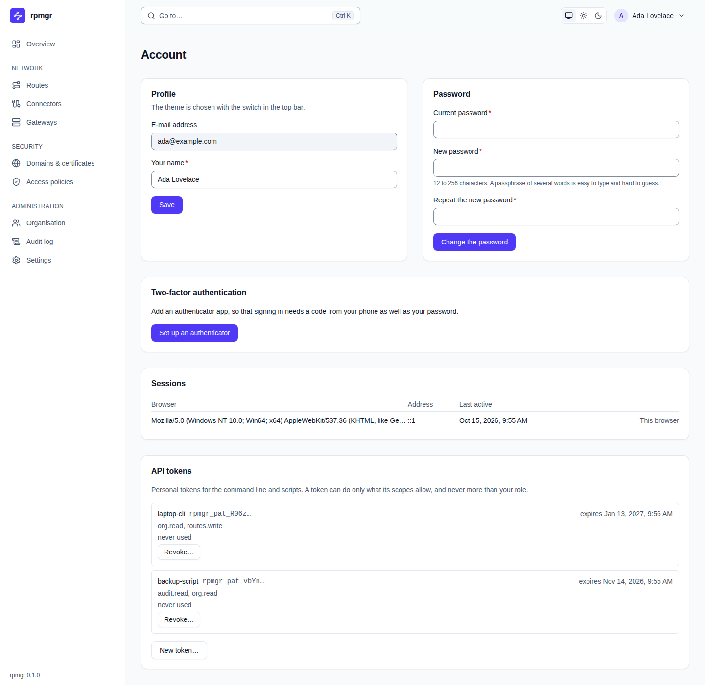
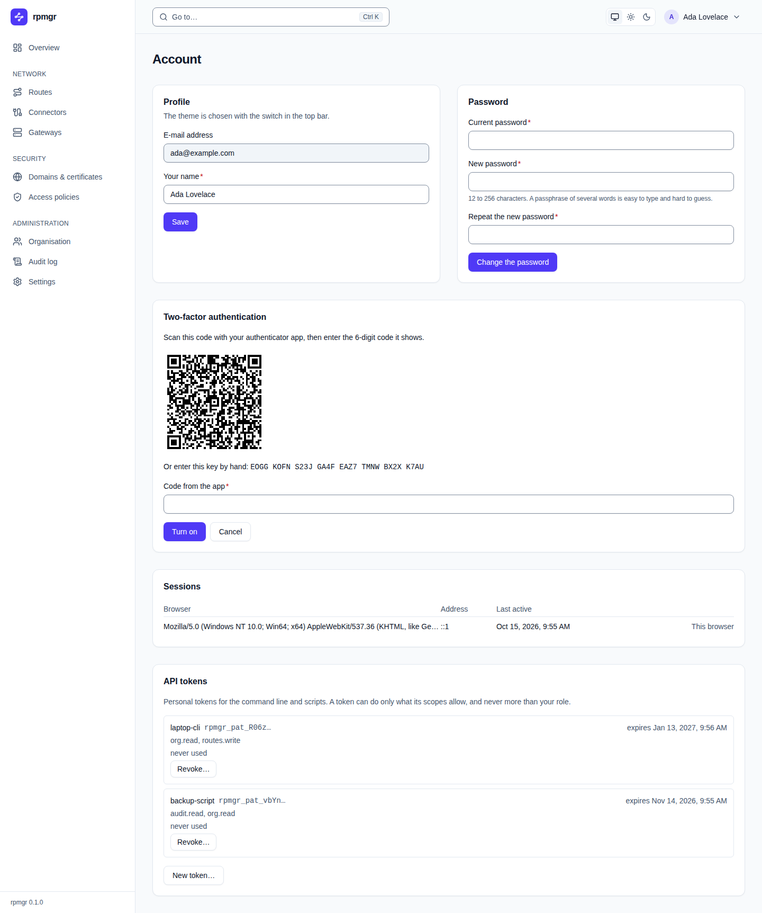

# Account

The **Account** page is your own: your profile, password, authenticator, sessions and personal API
tokens. Every user has it and changes only their own. Open it from the user menu in the top bar,
with **Your account**, or from the command palette.

## Profile

**E-mail address** shows the address you sign in with; it cannot be changed here. **Your name** is
the name the UI shows, and **Save** saves it. The theme is chosen with the switch in the top bar
([Themes](README.md#themes)).

## Password

Enter your **Current password**, the **New password** and **Repeat the new password**, then press
**Change the password**. The new password must have the length the design documents give
([04](../../04-security.md#human-authentication-and-sessions)); a passphrase of several words is
easy to type and hard to guess. After the change, your other sessions have ended; this browser
stays signed in.

## Two-factor authentication

The card shows one of three states:

- **No authenticator:** **Set up an authenticator** starts the setup.
- **During the setup**, as in the screenshot below: scan the QR code with your authenticator app,
  or enter the key shown under it by hand, then type the code the app shows into **Code from the
  app** and press **Turn on**. **Cancel** stops the setup.
- **An authenticator is set up.** **New recovery codes** replaces your recovery codes;
  **Remove the authenticator…** warns that your password alone then signs you in and that your
  other sessions end, and **Remove it** removes it.

After **Turn on** and after **New recovery codes**, the card shows your **Recovery codes** once.
Keep them somewhere safe; each works once in place of a code from the app. **Copy** copies them,
and **I have saved them** closes the list.

Every change here needs a [step-up](README.md#the-step-up-dialog). Turning an authenticator on,
new recovery codes and removing it each end your other sessions; this browser stays signed in.
Your [API tokens](#api-tokens) keep working.
[Sign-in and two-factor authentication](../accounts/sign-in-and-mfa.md) explains it step by step.

## Sessions

The **Sessions** card lists where you are signed in: the **Browser** (its user agent), its
**Address**, and when it was **Last active**. The browser you are using says
`This browser`. **End…** on another session asks `End the session from …?`; **End it** signs that
browser out.

## API tokens

Personal tokens for the command line and scripts. A token can do only what its scopes allow, and
never more than your role in the organisation.

Each token shows its name, the start of the token (its prefix), when it expires, its scopes, and
when and from which address it was last used, or `never used`. **Revoke…** asks `Revoke the token
…?`; **Revoke it** revokes it at once.

To make a token:

1. Press **New token…**.
2. Enter a **Name**, how many days it is **Valid for (days)**, and tick its **Scopes**. `org.read`
   is ticked to start with; every command needs it. The Instance Admin also sees `instance.admin`.
3. Press **Create the token**. Making a token needs a [step-up](README.md#the-step-up-dialog).
4. The card shows the token: `Copy the token now. It is shown only once.` Under it is the
   `rpmgr login` command for this controller and organisation, which asks for the token. **Copy**
   copies the token; **I have copied it** hides it.

[API tokens and the command line](../accounts/api-tokens-and-cli.md) explains the scopes and how
to use a token.
