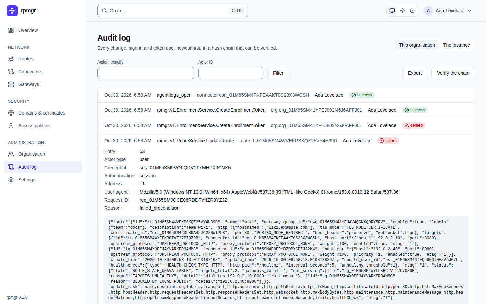

# Audit log

The audit log records every change, sign-in and token use, newest first, in a hash chain that can
be verified. This page describes the web UI's **Audit log** page. Reading the organisation's log
needs the Owner or Admin role (`audit.read`); the instance's log is for the Instance Admin. The
how-to page, with what each entry means and how the chain and its checkpoints work, is
[Audit log](../operations/audit-log.md).

## Which log

The page shows the organisation's log. The Instance Admin also sees two buttons beside the title,
**This organisation** and **The instance**; **The instance** switches to the **Instance audit
log**, the log of changes to the instance itself, such as its settings and its CA.

## The entries

Each entry is one line, 100 at a time; **Older entries** at the end loads the next 100.

- **The line:** when it happened, the action (such as `member.invite` or
  `rpmgr.v1.RouteService.UpdateRoute`), the kind and ID of what it acted on, who did it (a
  member's name, or `a user`, `an agent`, `the system` or `anonymous`), and the result:
  `success`, `failure` or `denied`.
- **Opened**, by a click on the line, an entry shows its details: **Entry** (its number in the
  chain), **Actor type**, **Credential** (the session or token used), **Authentication**,
  **Address**, **User agent**, **Request ID** and **Reason**, as far as the entry has them, and the
  request it recorded, with secrets removed.

`No entry matches.` says that the filters found nothing.

## Filters

- **Action, exactly** shows only entries of that action, such as `member.add`.
- **Actor ID** shows only entries of one actor, such as a user's `usr_…` ID.

**Filter** applies both. The filters stay in the page's address.

## Verify the chain

**Verify the chain** checks the log's whole hash chain: from its first entry, or, once old entries
were removed, from the signed checkpoint just before the oldest entry left, to the newest entry.
It also checks every signed checkpoint's signature, and that each checkpoint matches its entry
while that entry is kept. It says either `The chain is intact up to entry …`, with the last
checkpoint and when it was made, or `The chain is broken at entry …` with the problem. A broken
chain is a sign that entries were changed or removed outside rpmgr
([Audit log](../operations/audit-log.md)).

## On the command line

The command line has no audit command in this version. The API's `AuditService` lists and
verifies the logs ([API](../reference/api.md)); exporting the log is not available yet
([09](../../09-web-ui.md#audit-log)).
