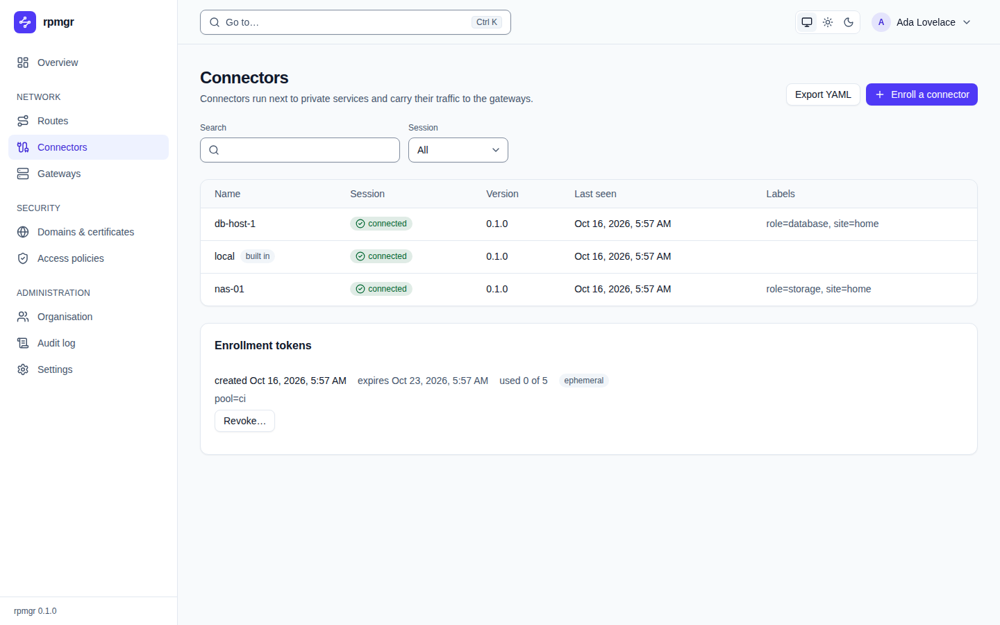
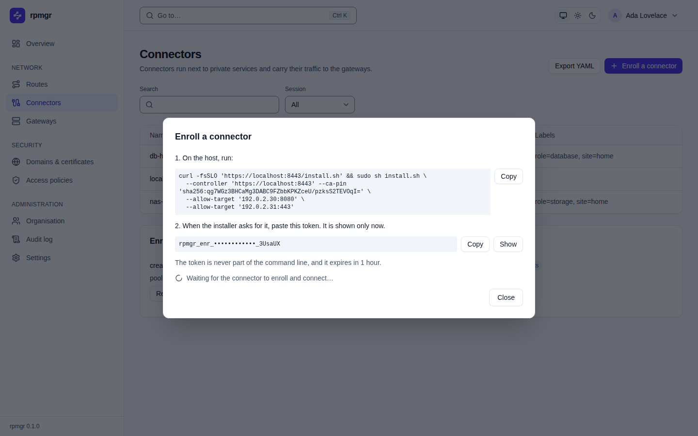
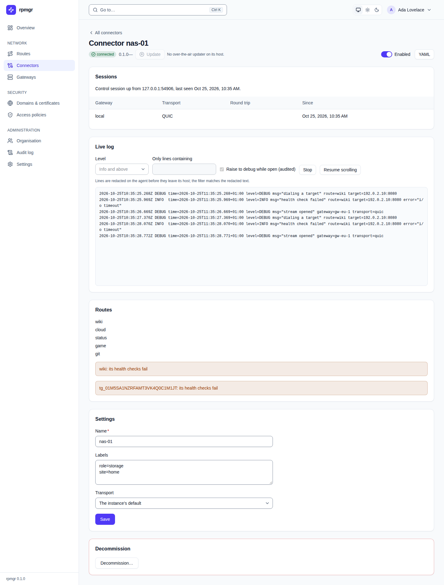

# Connectors

Connectors run next to private services and carry their traffic to the gateways. This page
describes the web UI's connector pages: the list with its enrollment tokens, the enroll dialog, and
a connector's own page. Every member sees them. Enrolling, revoking enrollment tokens, changing a
connector, switching it off and decommissioning it need the `connectors.write` permission: the
Owner and Admin roles have it, and the Operator role too when the organisation's setting
**Operators may enroll and revoke connectors** is on
([Settings](settings.md#organisation-settings)).

The how-to pages are [Enrolling connectors](../connectors/enroll.md),
[The local policy](../connectors/local-policy.md),
[Connector networking](../connectors/network.md) and
[Connector lifecycle](../connectors/lifecycle.md).

## The list

**Connectors** in the sidebar lists the organisation's connectors in service, sorted by name.

- **Export YAML** shows every connector as YAML ([The YAML view](README.md#the-yaml-view)).
- **Enroll a connector** opens the [enroll dialog](#enroll-a-connector).
- **Search** finds connectors by name or by a label written as `key=value`. **Session** shows
  only the connectors that are `connected`, `offline` or `disabled`. Both stay in the page's
  address.

| Column | Shows |
|---|---|
| **Name** | The connector's name, a link to its page; `ephemeral` for an ephemeral connector, and `built in` for the all-in-one's own connector `local` |
| **Session** | `disabled` for a connector that is switched off, else `connected` while it holds a control session to the controller, or `offline` |
| **Version** | The rpmgr version the connector runs |
| **Last seen** | When the controller last heard from it |
| **Labels** | Its labels, as `key=value` |

A connector takes its host's name when it enrolls; rename it on its page.

### Enrollment tokens

The **Enrollment tokens** card below the list shows each token that can still enroll a connector:
when it was created, when it expires, how often it was used (`used 0 of 5`, or `used 3 times` for a
token without a limit), whether it enrolls ephemeral connectors, its labels, and when and from
which address it was last used. **Revoke…** asks `Revoke the token created …?`; **Revoke it**
revokes it, so that it enrolls nothing more.

Tokens that are used up, expired or revoked are not listed, nor tokens that re-enroll one
particular connector or enroll a gateway. `rpmgr list --all enrollment-token` lists every token.

## Enroll a connector

**Enroll a connector** opens a dialog that makes an enrollment token and shows the command that
installs a connector with it.

1. Fill in the form:

   | Field | Takes |
   |---|---|
   | **Labels** | One per line, as `key=value`; each connector the token enrolls gets them |
   | **Gateway group** | **Any gateway group**, or the one group the token is scoped to |
   | **Kind** | **Permanent**, or **Ephemeral**: an ephemeral connector is removed some time after it last disconnects ([04](../../04-security.md#lifecycle)) |
   | **The token is valid for** | How long the token can be used ([lifetimes](../../04-security.md#tokens)) |
   | **Connectors it may enroll** | Ephemeral tokens only: how many connectors it may enroll, 0 for any number. A permanent token enrolls one |
   | **Targets the connector may reach** | One per line: an address or subnet with an optional port or port range, IPv6 in brackets, or a socket path |
   | **Targets the connector must not reach** | Optional, one per line in the same form; they win over the allowed targets |

   The targets go into the install command as `--allow-target` and `--deny-target`, and the
   installer writes them into the host's local policy. Without any, the connector reaches nothing
   until its local policy allows a target ([The local policy](../connectors/local-policy.md)).
2. Press **Create the token**. Making a token needs a [step-up](README.md#the-step-up-dialog): if
   you have not confirmed your identity in the last few minutes, the **Confirm it is you** dialog
   asks for your password or code first.
3. The dialog now shows the two steps for the host:

   

   - **1. On the host, run:** the install command, with **Copy**. It downloads the install script
     from the controller and runs it with `sudo`, with the controller's address, the CA pin and
     the targets ([Install script](../install/install-script.md)).
   - **2. When the installer asks for it, paste this token.** The token is masked; **Show** shows
     it, **Copy** copies it. It is shown only now. The token is never part of the command, so it
     stays out of the shell's history and the host's process list.
   - If the browser does not copy, the dialog says so and shows the text, to copy by hand.
4. Run the command on the host and paste the token when the installer asks for it. The dialog
   says `Waiting for the connector to enroll and connect…`; when the new connector connects, the
   page switches to the connector's page. **Close** closes the dialog at any time; the token
   stays valid until it expires, is used up or is revoked.

[Enrolling connectors](../connectors/enroll.md) covers unattended installs with `--token-file`,
re-enrollment and the same steps on the command line.

## Connector detail

A connector's name opens its page:

**All connectors** above the title returns to the list. Under the title: the connector's session
state, its version, and `built in` for the all-in-one's own connector. Beside the title:

- **Enabled** switches the connector on or off. A switched-off connector keeps its identity and
  its targets, but serves nothing; the list and the overview show it as `disabled`, not offline
  ([D81](../../14-open-decisions.md#engineering)). The page then follows the change to the agents
  ([apply status](README.md#after-a-change-the-apply-status)).
- **YAML** shows the connector as YAML.

### Sessions

The **Sessions** card says whether the control session is up, from which address, and when the
connector was last seen; or that there is none, and when it was last seen (`never` if it never
connected). Below, one row per data session: the **Gateway** it goes to, its **Transport** (`QUIC`
or `TLS and HTTP/2`), the **Round trip** time and **Since** when it is up
([Connector networking](../connectors/network.md)).

### Routes

The **Routes** card lists every route with a target on this connector, each a link to its page.
A route the connector reports as not ready follows in a highlighted box with the reason, such as
`blocked by the connector's local policy`, and for a blocked target the command that allows it on
the connector's host, with **Copy** ([The local policy](../connectors/local-policy.md)).

### Settings

The **Settings** card changes the connector's **Name**, its **Labels** (one per line, as
`key=value`) and its **Transport**: **The instance's default**, **QUIC, falling back to TLS and
HTTP/2**, **QUIC only** or **TLS and HTTP/2 only**. **Save** saves them; a route's own transport
overrides the connector's ([Connector networking](../connectors/network.md)).

### Decommission

**Decommission…** takes the connector out of service for good. It first shows what that does:
the connector's identity is revoked and its sessions end; it cannot enroll again with that
identity; its route targets are deleted; and it names each route that has no other target, which
is deleted with it, freeing its port or hostnames ([D78](../../14-open-decisions.md#engineering)).
**Decommission …** with the connector's name does it, and the page returns to the list; **Cancel**
keeps the connector. The button waits until the page has read the routes; if it cannot read them,
it says so.

The all-in-one's built-in connector cannot be decommissioned; its page says so instead, and its
**Enabled** switch still turns it off ([ADR-0019](../../adr/0019-all-in-one-runs-a-connector.md)).
[Connector lifecycle](../connectors/lifecycle.md) compares switching off, decommissioning and
`rpmgr leave` on the host.

## On the command line

`rpmgr list connector`, `rpmgr get connector`, `rpmgr update connector`,
`rpmgr decommission connector`, `rpmgr create enrollment-token`, `rpmgr list enrollment-token`,
`rpmgr revoke enrollment-token` and `rpmgr get install-command` do the same as these pages
([Command line](../reference/cli.md)). On the connector's host, `rpmgr status` and `rpmgr diag`
show the connector's own view ([Status and diagnostics](../connectors/status-and-diagnostics.md)).
