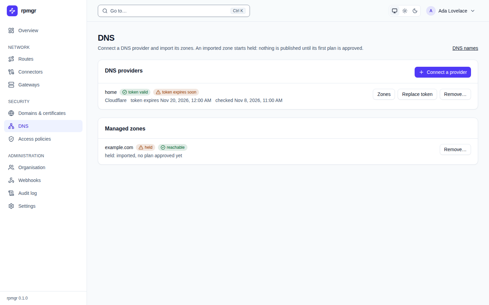
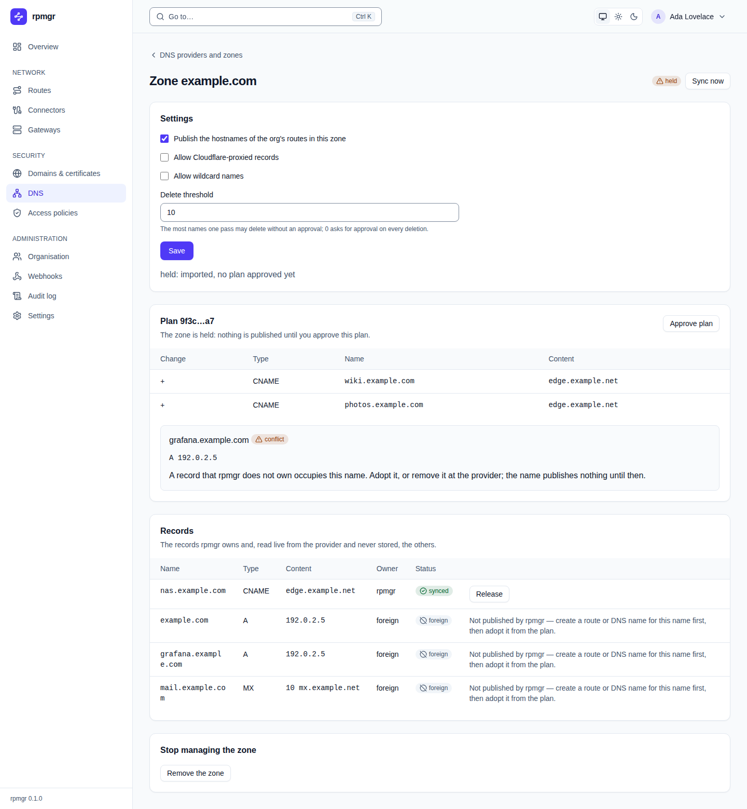
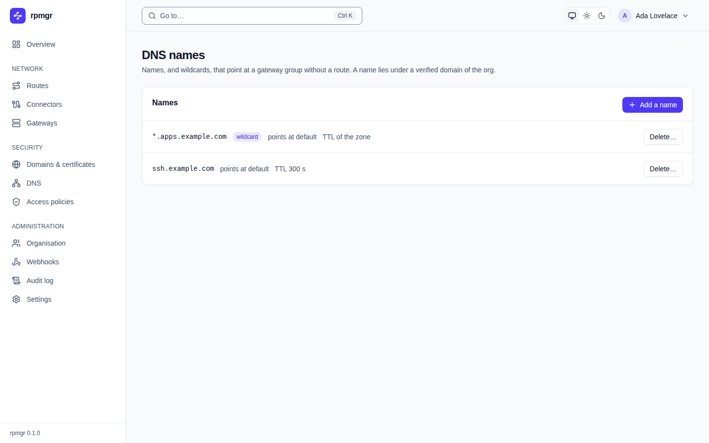

# DNS

The **DNS** page is where an organisation connects its DNS provider and chooses which of the
provider's zones rpmgr manages. Every member sees it; connecting a provider, importing, approving
plans and changing a zone need the Owner or Admin role (`infrastructure.write`), the Instance Admin
for the system organisation. The how-to page is [DNS automation](../dns.md).

## Providers

The **DNS providers** card lists the organisation's providers.

- **Each provider** shows its name, `Cloudflare`, whether its token is `token valid` or `token
  invalid`, when it expires (`token expires soon` when it is about to) and when rpmgr last checked
  it. A provider whose check failed shows the reason.
- **Zones** lists what the provider offers. A zone that cannot be imported says why: `already
  imported`, `not importable: its status is pending` or `not importable: its type is partial, only
  full zones can be imported`. **Import** imports a zone; it is then **held** until its first plan
  is approved.
- **Replace token** asks for the new token and, after a [step-up](README.md#the-step-up-dialog),
  replaces the old one. The field starts empty, is never filled from the server and is cleared
  once sent.
- **Delete…** asks `Delete the provider …?` and needs a step-up. It is refused while zones are
  imported from the provider.

**Connect a provider** opens a form:

| Field | Takes |
|---|---|
| **Name** | The provider's name, unique in the organisation |
| **Cloudflare account ID** | Only for a token that belongs to an account |
| **API token** | The token, which is checked at the provider, sealed and never shown again. Use a scoped API token, not the Global API Key |

**Connect it** checks the token and, after a step-up, stores it.

## Managed zones

The **Managed zones** card lists the imported zones, each a link to its page: its state (`held`,
`publishing` or `disabled`), what the provider answered last (`reachable`, `permission denied`,
`unreachable` or `rate limited`) and when it last synced. A zone whose token lacks permission says
what to do. **Remove** stops managing a zone and keeps its records at the provider.

**DNS names** at the top leads to the [DNS names](#dns-names) page.

## A zone

The zone's page shows:

- **The heading** with the zone's name, its state and **Sync now**, which asks for a full pass; a
  disabled zone has **Enable zone**, which makes it held.
- **Gates:** whether the zone publishes route hostnames, allows proxied names and wildcards, and
  its delete threshold. The gates are changed with `rpmgr update zone`.
- **Plan:** what the next pass would create (`+`), update (`~`) and delete (`−`), the orphans, after a
  restore the adopted records that changed since, the shadowed wildcards and the conflicts, each conflict with what to do and, for a foreign address
  record, **Adopt**. **Approve plan** is bound to the hash shown; it asks for a confirmation that
  names the plan and then a step-up. If the plan changed meanwhile, the page says so and shows the
  new one.
- **Records:** the records rpmgr owns and, for Owners and Admins only, the others, read live from
  the provider and never stored. **Adopt** is offered on a foreign record only when the API marks
  it adoptable, that is, a route or DNS name of the organisation publishes its name; the others
  show a hint. **Release** gives a record back, keeping it as it is or restoring
  the content it had when it was adopted.
- **Remove the zone** keeps the records at the provider, or deletes the ones rpmgr owns after
  listing them under the plan's hash.

An Operator or Viewer sees the owned records and nothing else: no plan, no foreign records and no
buttons.

## DNS names

**DNS names** lists the organisation's explicit names with their gateway group and TTL, and marks
wildcards. **Add a name** takes:

| Field | Takes |
|---|---|
| **Name** | A host name, or a wildcard such as `*.example.com`, which needs a verified domain with the wildcard |
| **Gateway group** | The group the name points at |
| **TTL in seconds** | Empty uses the zone's TTL |

**Delete…** asks `Delete …? The records published for it go with it.`

## On other pages

- **A route's page** shows one **DNS** line per hostname with its status, the records published
  and, for an HTTP route, the proxy switch ([Routes](routes.md)).
- **The Overview** lists under **Needs attention** the hostnames in conflict or with an error,
  and for Owners and Admins held zones, providers that rate-limit or refuse the token, and
  records that drifted ([Overview](overview.md)). The DNS alerts are listed under **Alerts**.
- **The gateway group's settings** have the **DNS target** ([Gateways](gateways.md)).
