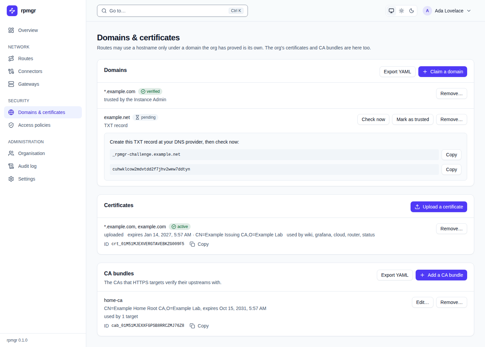

# Domains & certificates

A route may use a hostname only under a domain the organisation has proved is its own. This page
describes the web UI's **Domains & certificates** page: the organisation's domain claims, its
certificates and its CA bundles. Every member sees it; claiming domains, uploading and removing
certificates and managing CA bundles need the Owner or Admin role (`infrastructure.write`), and
marking a domain as trusted the Instance Admin. The how-to page is
[Domains and certificates](../domains-and-certificates.md).

## Domains

The **Domains** card lists the organisation's claims by name. A claim that covers every name below
it shows as `*.example.com`.

- **Status:** `pending` while it waits for its proof, `verified` or `failed`.
- **Method:** `TXT record`, `HTTP token` or `trusted by the Instance Admin`, and when it was last
  checked.
- **The proof a claim waits for:** a pending claim shows what to publish, each value with
  **Copy**:
  - for a TXT record: `Create this TXT record at your DNS provider, then check now:` with the
    record's name, such as `_rpmgr-challenge.example.net`, and its value;
  - for an HTTP token: the URL at which the organisation's gateways serve the token, and the
    token. Point the name at one of the organisation's gateways first.
- **Check now** checks a pending or failed claim at once; the controller also checks pending
  claims by itself ([15](../../15-dns.md)). A failed claim no longer shows its proof. A failed TXT
  claim can still pass with the record you published. The gateways serve an HTTP token only while
  its claim is pending, so remove a failed HTTP claim and claim the domain again.
- **Mark as trusted**, shown only to the Instance Admin, marks a claim verified without a proof,
  after a [step-up](README.md#the-step-up-dialog).
- **Remove…** asks `Remove the claim for …?`; **Remove it** removes the claim.
- A claim's last error, if any, is shown under it.

**Claim a domain** opens a form:

| Field | Takes |
|---|---|
| **Domain** | The domain, such as `example.com`; it is stored in lower case, without a trailing dot |
| **Also every name below it** | Cover every name below the domain too, at any depth, and `*.` names. Without it, the claim covers the domain's own name only |
| **How to prove it is yours** | **A DNS TXT record** or **An HTTP token, served by your gateways** |

**Claim it** makes the claim, which then shows the proof it waits for. **Export YAML** shows every
claim as YAML ([The YAML view](README.md#the-yaml-view)).

## Certificates

The **Certificates** card lists the organisation's certificates: HTTP routes get theirs from ACME
by themselves, or use one you upload.

- **Each certificate** shows its names, its status (`being obtained`, `active`, `failed`), its
  source (`from ACME` or `uploaded`), its expiry and issuer, for an uploaded one the routes that use
  it, and its **ID**, such as `crt_01…`, with **Copy**. An expiry within 21 days shows as
  `expires soon: …`. A certificate's last error, if any, is shown under it.
- **Renew now**, on an ACME certificate, starts a renewal: `Renewal started.`, or `A renewal is
  under way already.`
- **Remove…**, on an uploaded certificate, asks `Remove the certificate for …?`; **Remove it**
  removes it. The controller refuses to remove an uploaded certificate that routes use, and says
  how many routes use it. A certificate from ACME has no **Remove…** and says `ACME manages it; it
  cannot be removed.`: the controller's ACME job manages those certificates.

**Upload a certificate** opens a form:

- **Certificate chain (PEM, the certificate first)**: paste the chain, or choose a file under `Or
  read it from a file:`.
- **Private key (PEM)**: paste the key, or choose a file. The file is read in the browser and stays
  in the page until you send it.
- **Upload** sends both; the page then forgets the key. **Cancel** closes the form.

An HTTP route's **Uploaded certificate** offers the uploaded certificates that cover its hostnames
([Routes](routes.md#the-fields)). The command line names a certificate by the ID this page shows.

## CA bundles

The **CA bundles** card lists the CAs that HTTPS targets verify their upstreams with: each bundle
with the subject and expiry of each certificate in it, how many targets use it, and its **ID** with
**Copy**. Without a bundle, HTTPS targets are verified with the system's roots.

- **Add a CA bundle** opens a form with **Name** and **CA certificates (PEM)**, pasted or read from
  a file. **Add the bundle** adds it.
- **Edit…** changes a bundle's name and certificates; **Save** saves them.
- **Remove…** asks `Remove the CA bundle …?`; **Remove it** removes it. The controller refuses to
  remove a bundle that targets use, and says how many.
- **Export YAML** shows every bundle as YAML.

A target's **CA bundle** offers the bundles by name and ID ([Routes](routes.md#targets);
[Targets](../routes/targets.md)).

## On the command line

`rpmgr create domain`, `rpmgr verify domain`, `rpmgr trust domain`, `rpmgr upload certificate`,
`rpmgr renew certificate`, `rpmgr create ca-bundle`, `rpmgr list domain` and their siblings do the
same ([Command line](../reference/cli.md)).
