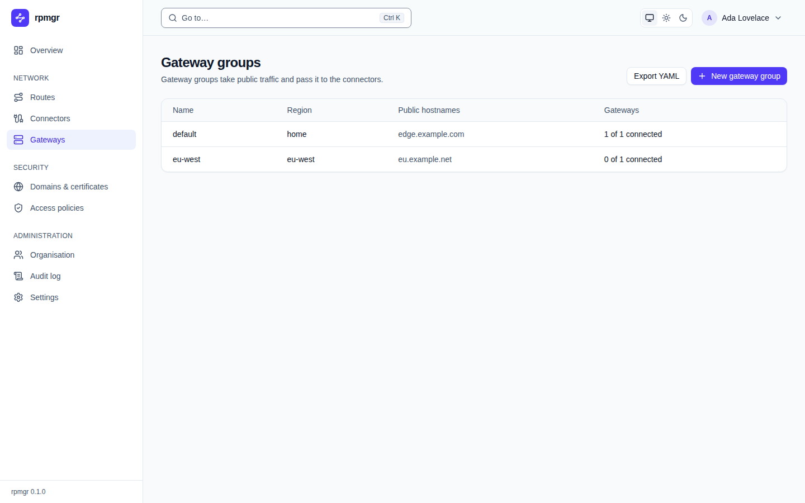
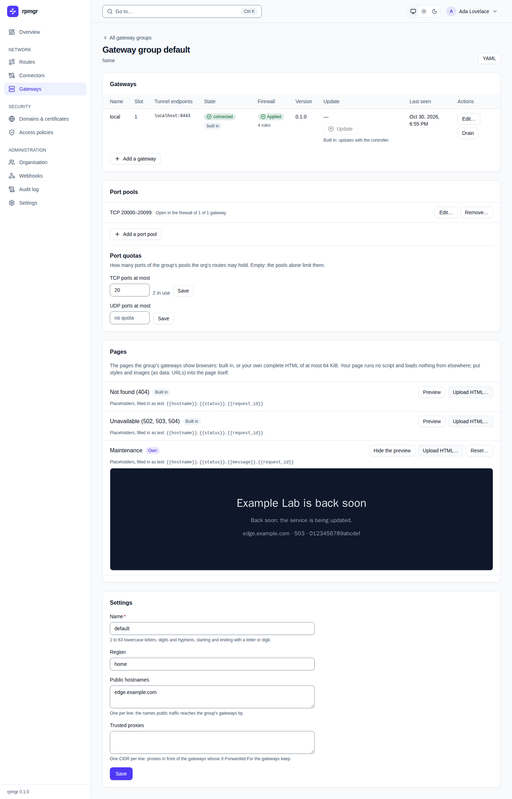

# Gateways

Gateway groups take public traffic and pass it to the connectors; each group has its gateways, its
port pools and the organisation's port quotas. This page describes the web UI's gateway pages.
Every member sees them; creating and changing groups, gateways, port pools and quotas needs the
Owner or Admin role (`infrastructure.write`). The how-to page is [Gateways](../gateways.md).

## Gateway groups

**Gateways** in the sidebar opens **Gateway groups**:

| Column | Shows |
|---|---|
| **Name** | The group's name, a link to its page |
| **Region** | Free text that says where the group's gateways run |
| **Public hostnames** | The names public traffic reaches the group's gateways by |
| **Gateways** | How many of its gateways are connected, such as `1 of 1 connected` |

- **Export YAML** shows every group with its gateways and port pools as YAML
  ([The YAML view](README.md#the-yaml-view)).
- **New gateway group** opens a form with **Name**, **Region**, **Public hostnames** and
  **Trusted proxies** (described [below](#settings)). **Create the group** creates it and opens its
  page; **Cancel** closes the form.

An all-in-one installation starts with the group `default` and its built-in gateway `local`; the
group gets the public URL's host as its public hostname when it accepts that host as one
([Topologies](../install/topologies.md)).

## A gateway group's page

A group's name opens its page, with the group's region under the title:

**All gateway groups** above the title returns to the list; **YAML** shows the group and its
gateways as YAML.

### Gateways

The **Gateways** card lists the group's gateways by slot:

| Column | Shows |
|---|---|
| **Name** | The gateway's name |
| **Slot** | Its number within the group |
| **Tunnel endpoints** | The `host:port` addresses where connectors reach this gateway, and below them `WSS:` and its WSS hostname if it has one ([Gateways](../gateways.md#wss-hostnames)) |
| **State** | `not enrolled`, `connected` or `offline`; also `drained` for a drained gateway and `built in` for the all-in-one's own gateway |
| **Firewall** | Whether rpmgr manages the host's `ufw` for this gateway and how that stands: `Off` (not switched on, or the helper says it is off; a gateway that reports nothing is `Off` while it is connected, and an offline one shows a dash), `Applied` with the number of rules, or `Failed` with the reason and the ports the helper refused as outside its bounds ([Gateways](../gateways.md#the-hosts-firewall)). Hover over the number of rules to read them |
| **Version** | The rpmgr version the gateway runs |
| **Update** | Its state in the running rollout, or that it is below the oldest version the controller accepts; for an Instance Admin also **Update to …**, or why it cannot be updated now ([Updates](../operations/updates.md#update-one-agent)) |
| **Last seen** | When the controller last heard from it |
| **Actions** | The buttons below, and for an Owner or Admin **Live log…**, which follows the gateway's log in a dialog as the connector page's **Live log** card does ([Connectors](connectors.md#live-log)); not for a built-in gateway |

While a gateway's old process drains after a restart without a cut, a **Restarting** line under
the table shows what it still holds, with **End now**
([Updates](../operations/updates.md#watch-and-end-a-draining-old-process)).

- **Edit…** opens a form for the gateway's **Name**, **Tunnel endpoints** and **WSS hostname**
  (empty offers no WSS); **Save** saves them, or says why the controller refuses the name.
- **Drain** stops the gateway taking new public connections and ends the open ones after the
  gateway's drain period ([03](../../03-connections.md#multiple-gateways)). **Resume** lets a
  drained gateway take connections again. The overview does not expect a drained gateway to be
  connected.
- **Enrollment token…**, for a gateway that has not enrolled, makes the token that enrolls this
  gateway and nothing else, after a [step-up](README.md#the-step-up-dialog). The panel explains it;
  **Create the token** shows the install command for the gateway's host and the token, masked, as
  the [enroll dialog](connectors.md#enroll-a-connector) does. **Close** closes the panel.
- **Decommission…** says that decommissioning revokes the gateway's identity and ends its sessions
  for good, and that its tunnel endpoints stop serving; **Decommission …** with its name does it.

**Add a gateway** opens **New gateway**: its **Name**, its **Tunnel endpoints**, one
`host:port` per line, the gateway's own address rather than the group's, and optionally its **WSS
hostname**. **Add the gateway** adds
it; the controller refuses a gateway beyond the group's limit and says so
([Gateways](../gateways.md)). After each change the card follows it to the agents
([apply status](README.md#after-a-change-the-apply-status)).

The all-in-one's built-in gateway can be drained and resumed, but neither decommissioned nor
enrolled anew ([ADR-0019](../../adr/0019-all-in-one-runs-a-connector.md)).

### Port pools

The **Port pools** card lists the group's pools, such as `TCP 30000–30099`, from which TCP, UDP and
TCP and UDP routes get their public ports. Without a pool, such routes get no public port.

- **Add a port pool** opens a form: **Protocol** (TCP or UDP), **First port** and **Last port**.
  **Add the pool** adds it. Ports are 1 to 65535, the first no larger than the last.
- **Edit…** changes a pool's range; its protocol stays.
- **Remove…** asks `Remove the pool …?`; **Remove it** removes it.
- Beside each pool, `Open in the firewall of 1 of 2 gateways` says in how many of the group's
  gateways that hand their `ufw` to rpmgr the pool's range is open now. It is left out while no
  gateway of the group does, and a pool that is open in fewer than all of them points at the
  gateway whose **Firewall** column says why.

### Port quotas

Under **Port quotas**: how many ports of the group's pools the organisation's routes may hold, per
protocol. **TCP ports at most** and **UDP ports at most** each take a number from 0 to 65535, or
nothing, shown as `no quota`, so that the pools alone limit the organisation. A quota shows how
many ports are in use, such as `2 in use`. **Save** saves it; saving an empty field removes the
quota.

### Pages

The **Pages** card shows the group's not-found, unavailable and maintenance pages, each `Built in`
or `Own` ([Maintenance and error pages](../routes/maintenance-and-pages.md#your-own-pages)). Under
each, the placeholders it may use, such as `{{hostname}}`.

- **Upload HTML…** chooses an HTML file and makes it the group's own page of that kind. A file above
  the size limit is refused before it is sent, with its size.
- **Preview** shows the page, your own or the built-in one, as visitors will see it: with its
  styles, and with sample values such as `www.example.com` for its placeholders. The preview runs
  no script, as the gateways' page does not either. **Hide the preview** closes it; after an
  upload or a reset, open it again.
- **Reset…** asks `Go back to the built-in page …?`; **Use the built-in page** does.

Changing the pages needs the role Owner or Admin of the group's organisation; for a shared group,
the Instance Admin.

### Settings

The **Settings** card changes the group:

| Field | Takes |
|---|---|
| **Name** | The group's name |
| **Region** | Free text, such as a data centre |
| **Public hostnames** | One per line: the names public traffic reaches the group's gateways by. The routes list shows a port route's address at each of them |
| **Trusted proxies** | One CIDR per line: proxies in front of the gateways whose `X-Forwarded-For` header the gateways keep |

**Save** saves them and says `Saved.` If the group changed since the page loaded it, the card says
`The gateway group changed since this page loaded it.`: reload the page and make the change again.

## On the command line

`rpmgr list gateway-group`, `rpmgr create gateway-group`, `rpmgr update gateway-group`,
`rpmgr create gateway`, `rpmgr update gateway` (also `--end-drain`), `rpmgr drain gateway`, `rpmgr enable gateway`,
`rpmgr decommission gateway`, `rpmgr create gateway-token`, `rpmgr create port-pool`,
`rpmgr set port-quota`, `rpmgr upload gateway-page`, `rpmgr remove gateway-page` and their
siblings do the same ([Command line](../reference/cli.md)).
