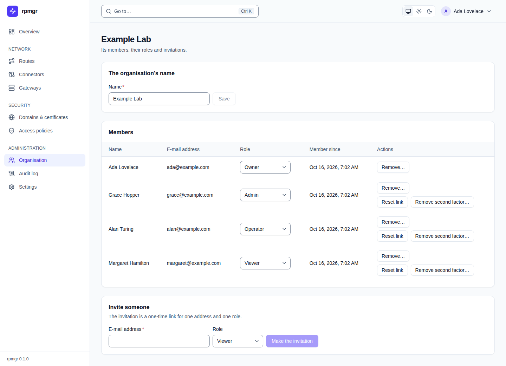

# Organisation

The **Organisation** page holds the organisation's name, its members and their roles, and the
invitations that add members. Every member sees it. Renaming the organisation needs the Owner
role (`org.write`); changing roles, removing members and inviting people need the Owner or Admin
role (`members.write`). What each role may do, and who may grant which role, is in
[Members and roles](../accounts/members-and-roles.md).

The page's title is the organisation's name.

## The organisation's name

**Name** and **Save** rename the organisation; **Save** is active once the name differs.
`Saved.` confirms it.

## Members

The **Members** table lists every member:

| Column | Shows |
|---|---|
| **Name** | The member's display name |
| **E-mail address** | The address they sign in with |
| **Role** | A list to change their role: **Owner**, **Admin**, **Operator** or **Viewer** |
| **Member since** | When they joined |
| **Actions** | **Remove…** |

- **Changing a role** takes effect as soon as you choose it in the list. Granting **Admin** or
  **Owner** needs a [step-up](README.md#the-step-up-dialog). Only an Owner makes, changes or
  removes an Owner, and the organisation keeps at least one Owner; the controller refuses anything
  else and the row shows why ([D66](../../14-open-decisions.md#security-defaults)).
- **Remove…** asks `Remove … from the organisation?`; **Remove it** ends the membership. The
  person's API tokens lose their access to the organisation.
- A lower role or a removal applies from the member's next request.

## Invite someone

The **Invite someone** card makes an invitation: a one-time link for one address and one role.

1. Enter the **E-mail address** and choose the **Role**; **Viewer** is preselected.
2. Press **Make the invitation**. Inviting someone as Admin or Owner needs a
   [step-up](README.md#the-step-up-dialog).
3. The card shows the **Invitation link** with **Copy**, and says until when it works:
   - `The invitation is e-mailed.` when the controller has a mail relay
     ([Settings](settings.md#instance-settings));
   - `This controller cannot send e-mail. Send this one-time link yourself` when it has none.

The link opens the [invitation page](public-pages.md#accept-an-invitation), where the person joins
with an existing account or creates one. How long it works is in the design documents
([04](../../04-security.md#roles)).

## Restore review

After a restore that could not prove that every revocation since the backup was applied again, the
organisation is read-only until its members and roles are confirmed
([Backup and restore](../operations/backup-and-restore.md)).

- **An Owner** sees the card **Review this organisation after the restore** above the members.
  Check the members and roles below it, and remove or downgrade anyone who should not have access.
  **Suspended API tokens** lists the tokens the restore suspended, in the columns **Token**,
  **Owner**, **Permissions**, **Suspended** and **Actions**. **Resume**, in **Actions**, resumes
  one token after a step-up. Resume only the tokens you trust. **Confirm members and roles**,
  after a step-up, ends the organisation's review.
- **Other members** see a note that the organisation is read-only until its Owner confirms it, or
  until the Instance Admin runs `rpmgr restore confirm --org <org>` on the controller host.

## On the command line

`rpmgr list member`, `rpmgr update member --role <role> <user>`, `rpmgr remove member <user>` and
`rpmgr create invitation --email <address> --role <role>` do the same; renaming the organisation
has no command ([Members and roles](../accounts/members-and-roles.md)).
