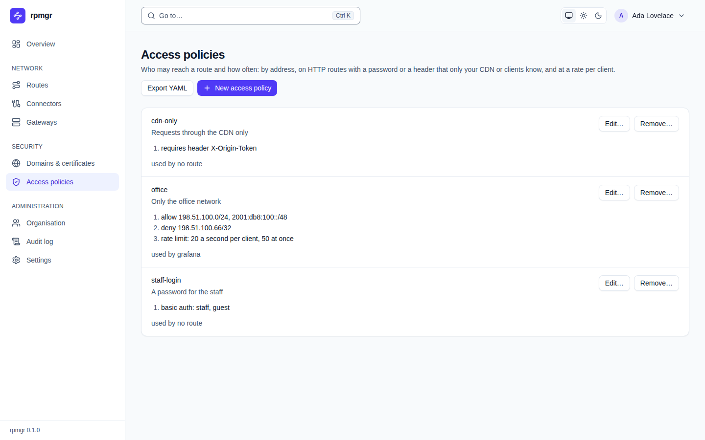

# Access policies

An access policy says who may reach a route and how often: by client address, on HTTP routes with
a password or a required header, and at a rate per client. This page describes the web UI's
**Access policies** page, where the organisation's
policies are made and changed; they are attached to routes on each route's page. Every member sees
the page; creating, changing and removing policies needs the Owner, Admin or Operator role
(`routes.write`). The how-to page is [Access policies](../access-policies.md).

## The list

Each policy shows its name, its description, its rules, numbered, and the routes that use it, or
`used by no route`. A rule reads as `allow …` or `deny …` with its addresses, `basic auth: …`
with its users' names, `requires header …` with the header's name, or `rate limit: … a second per
client, … at once`.

- **Export YAML** shows every policy as YAML ([The YAML view](README.md#the-yaml-view)).
- **New access policy** opens the [form](#the-form) above the list.
- **Edit…** opens the form for that policy.
- **Remove…** asks `Remove the access policy …?`; **Remove it** removes it. The controller refuses
  to remove a policy that routes use, and says how many.

After a change, the page follows it to the gateways
([apply status](README.md#after-a-change-the-apply-status)).

## The form

**New access policy** or **Edit access policy** has:

- **Name**, required, and **Description**.
- **Rules**, each numbered, with a list that chooses its kind. A new policy starts with one
  **Allow addresses** rule.
  - **Allow addresses** and **Deny addresses** take **Addresses (CIDRs, one per line)**, IPv4 or
    IPv6, such as `198.51.100.0/24`.
  - **Basic auth (HTTP routes)** takes users: each a **User** and a **Password**. The rule starts
    with no user: **Add a user** adds each one, the first too, and **Remove the user** removes one.
  - **Require a header (HTTP routes)** takes a **Header** and one **Value** to start with. **Add a
    value** adds another, up to four; **Remove the value** removes one; **Generate a value** fills
    the first empty value with a random one, or adds it. The form says how long a value must be,
    and to copy it before saving.
  - **Rate limit per client** takes **Requests or new connections a second**, required, and **At
    once (burst)**, which is a second's worth when empty. A note under them says what counts and
    what a client over it gets ([Access policies](../access-policies.md#rate-limits)).
- **Remove the rule** removes a rule; **Add a rule** adds one, an **Allow addresses** rule to start
  with.
- **Create the policy** or **Save** saves the policy; **Cancel** closes the form.

The rules have no order. The form says it: `A deny rule wins: an address it matches is refused,
whatever allows it.` The same holds across all the policies a route applies
([D85](../../14-open-decisions.md#engineering)).

Passwords are write-only: the page never shows them. When you edit a policy, a user it already has
shows `unchanged` in the password field and keeps the password unless you type a new one; a new
user needs a password. The gateway asks for these users' names and passwords on HTTP routes only, so
the controller refuses a basic-auth rule wherever a route of another type would apply it: in a
policy such a route uses, and when you attach a policy with one to such a route
([03](../../03-connections.md#access-policies)).

Header values are write-only too. When you edit a policy, a header it already requires shows
`unchanged` in its empty value field and keeps its values unless you type new ones, which replace
them all; a header it does not require yet needs a value. As with basic auth, the controller
refuses a required header wherever a route that is not an HTTP route would apply it.

## Attach a policy to a route

Open the route's page, then use its **Access policies** card: choose the policy, **Attach**, and
**Save** ([Routes](routes.md#access-policies)).

## On the command line

`rpmgr list access-policy`, `rpmgr get access-policy`, `rpmgr create access-policy`,
`rpmgr update access-policy` and `rpmgr delete access-policy` do the same; `rpmgr create route`
and `rpmgr update route` attach policies with `--policy` ([Command line](../reference/cli.md)).
