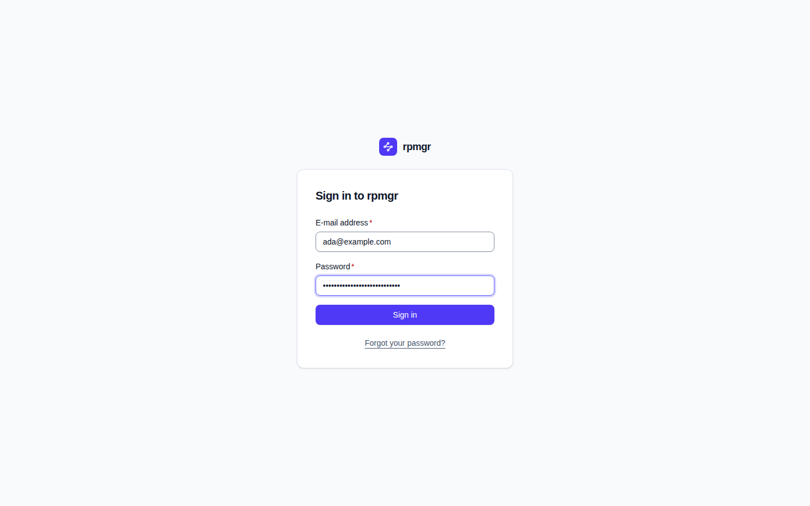
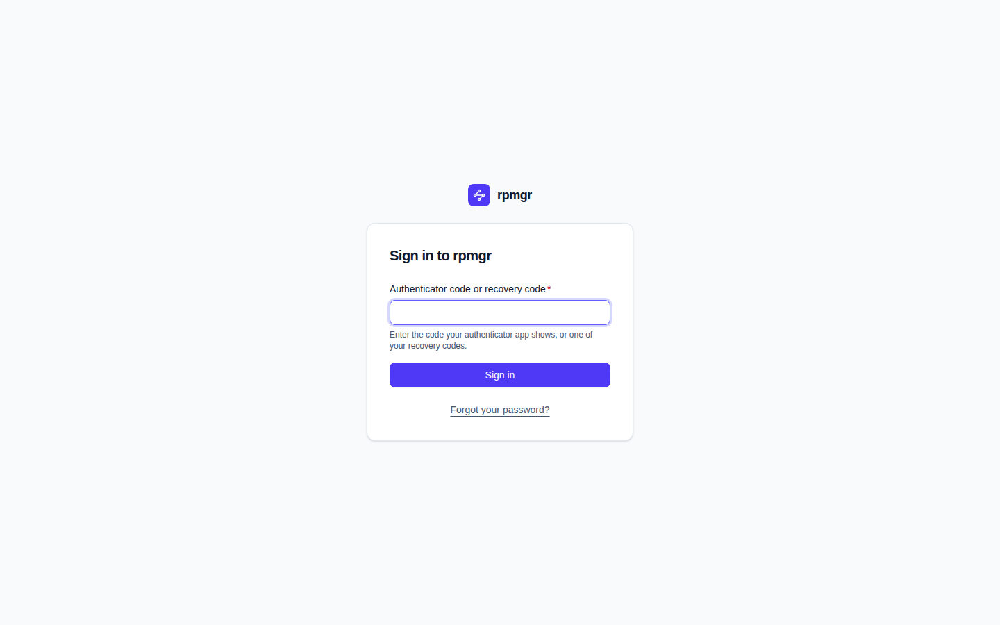
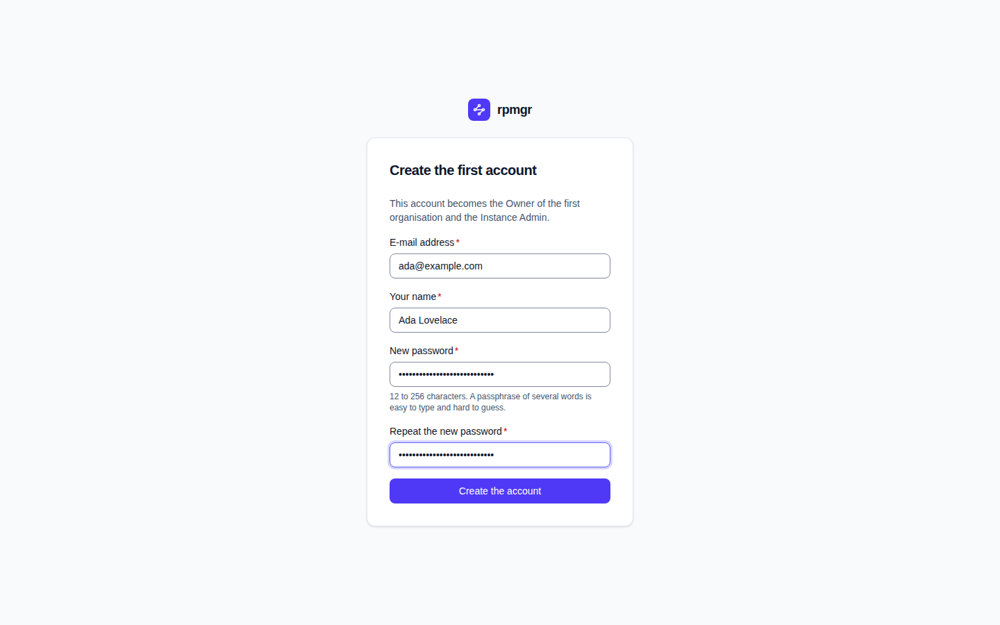
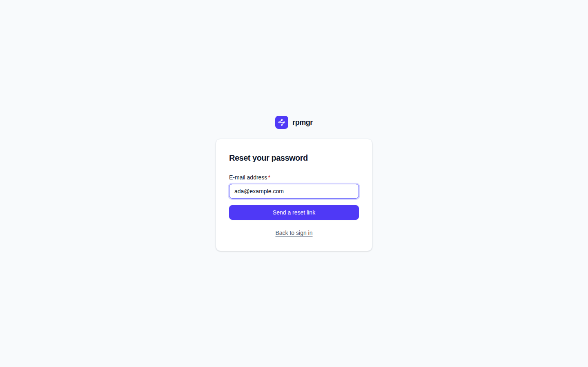
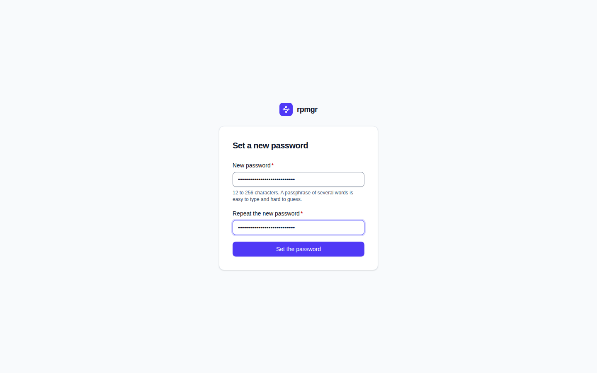
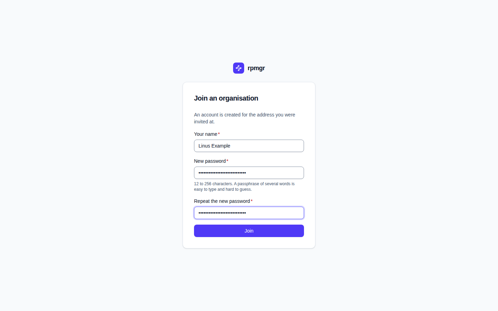

# Sign-in and other public pages

These pages need no session: the sign-in page with its second step, the page that creates the
first account, the pages that reset a password, and the page that accepts an invitation. Each is a
card in the middle of the page under the product's mark, and none shows rpmgr's version. Anyone
who has the page's address, or the one-time link, may open them.

The tasks behind them are explained in
[Sign-in and two-factor authentication](../accounts/sign-in-and-mfa.md) and
[Members and roles](../accounts/members-and-roles.md).

## Sign in

**Sign in to rpmgr**, at `<public URL>/login`, is where every page that needs a session sends you.

1. Enter your **E-mail address** and **Password**, then press **Sign in**.
2. If you have an authenticator, the card now asks for an **Authenticator code or recovery code**:
   enter the code your authenticator app shows, or one of your recovery codes, and press **Sign
   in** again.

   

3. You land on the page you came from, or on the overview.

What the page says when it refuses:

- `The e-mail address or the password is wrong.` The page does not say which, so it reveals no
  accounts.
- `The code is wrong or was used already. Try the next code.`
- `Too many attempts. Try again in … seconds.` Repeated failures make each further attempt wait
  ([04](../../04-security.md#human-authentication-and-sessions)).

**Forgot your password?** below the card opens [Reset your password](#reset-your-password).

## Create the first account

The one-time link that `rpmgr controller init`, `rpmgr all-in-one init` or `rpmgr setup` prints
opens **Create the first account**, at `<public URL>/setup#…`. The token after `#` never reaches
a server log; the page removes it from the address bar once it has read it.

`This account becomes the Owner of the first organisation and the Instance Admin.`

1. Enter your **E-mail address** and **Your name**.
2. Enter a **New password** and **Repeat the new password**. The hint gives the allowed length; a
   passphrase of several words is easy to type and hard to guess.
3. Press **Create the account**. You are signed in and land on the overview.

If the first account exists already, the page says so and offers **Sign in**. A link opened
without its token says `This link is incomplete.` The link works only for a limited time and only
until the first user exists; `rpmgr user reset-password` without `--email` on the controller host
makes a new one
([Sign-in and two-factor authentication](../accounts/sign-in-and-mfa.md#the-first-user)).

## Reset your password

**Reset your password**, at `<public URL>/forgot`, asks the controller to e-mail a reset link.

Enter your **E-mail address** and press **Send a reset link**. The answer is the same whether an
account uses the address or not: `If an account uses this address, a reset link is on its way.`
A controller without a mail relay says `This controller cannot send e-mail. Ask an Owner or the
Instance Admin for a reset link.` **Back to sign in** returns to the sign-in page.

## Set a new password

A reset link, e-mailed or passed on by an administrator, opens **Set a new password**, at
`<public URL>/reset#…`:

Enter the **New password** twice and press **Set the password**. The page then says that your
password is set and that your other sessions have ended, and offers **Sign in**. A reset link works
once ([04](../../04-security.md#human-authentication-and-sessions)).

## Accept an invitation

An invitation link opens **Join an organisation**, at `<public URL>/invite#…`.

- **Without a session**, the page creates an account for the address you were invited at: enter
  **Your name**, a **New password** and **Repeat the new password**, then press **Join**. The page
  then says `Your account is ready.`; sign in with the address you were invited at.
- **Signed in already**, the page says `You join as …`; **Join** adds your account to the
  organisation and opens the overview. Sign in first if the invitation is for an address that
  already has an account.

## Page not found

A link to a page that does not exist shows **Page not found** and **Go to the overview**.
