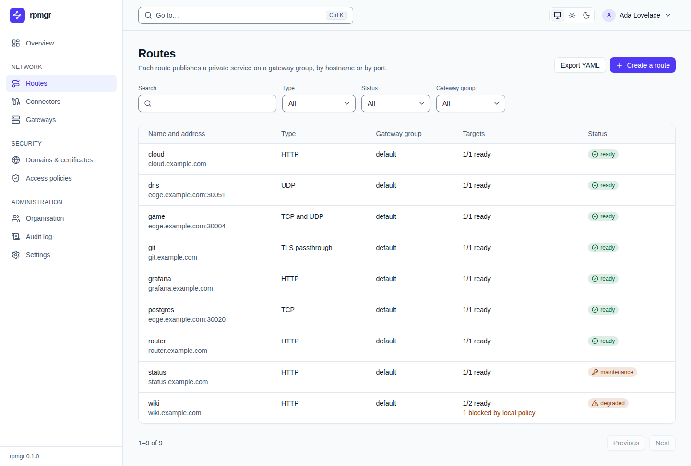
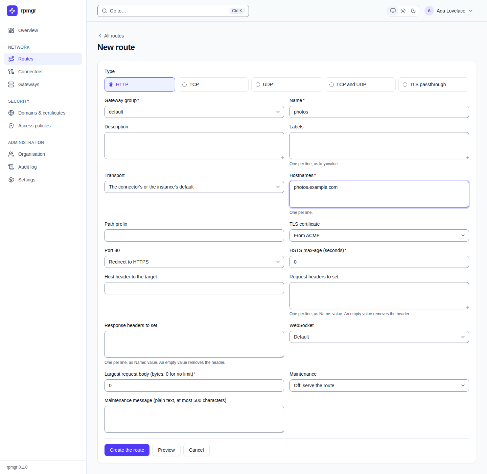
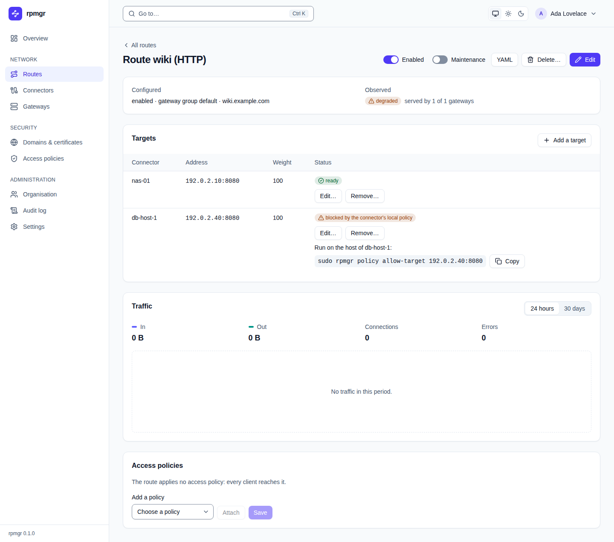
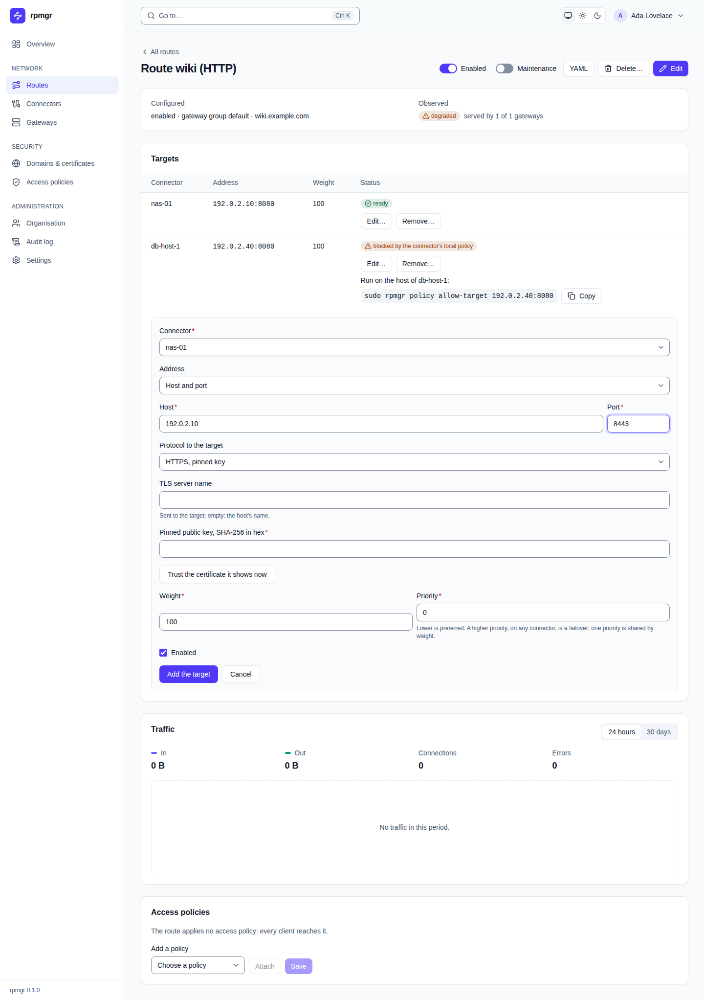
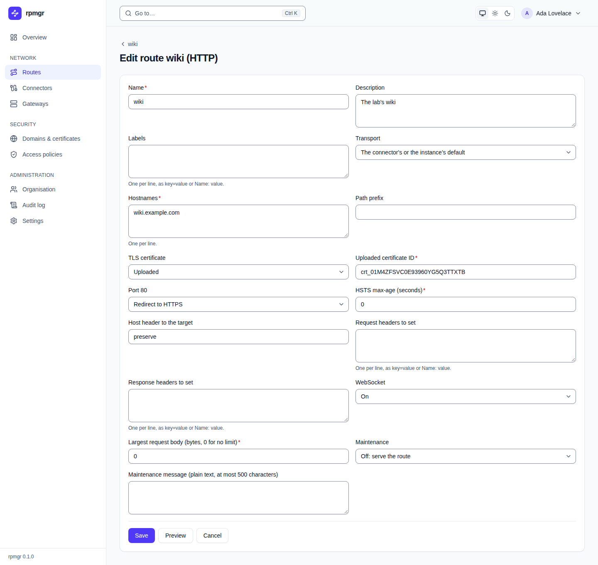

# Routes

A route publishes a private service on a gateway group, by hostname or by port. This page
describes the web UI's route pages: the list, the form that creates a route, a route's own page
with its targets, traffic and access policies, and the edit form. Every member sees them; creating,
changing and deleting routes, targets and their policies needs the Owner, Admin or Operator role
(`routes.write`).

What each route type and setting does is explained in the how-to pages:
[HTTP routes](../routes/http.md), [TCP and UDP routes](../routes/tcp-and-udp.md),
[TLS passthrough](../routes/tls-passthrough.md), [Targets](../routes/targets.md),
[Maintenance and error pages](../routes/maintenance-and-pages.md) and
[Preview and apply](../routes/preview-and-apply.md).

## The list

**Routes** in the sidebar opens the list of the organisation's routes, sorted by name, 25 a page.

- **Export YAML** shows every route as YAML ([The YAML view](README.md#the-yaml-view)).
- **Create a route** opens the [form for a new route](#create-a-route).
- **Search** finds routes by name or address. **Type**, **Status** and **Gateway group** narrow the
  list; **All** lifts a filter. The filters and the page number stay in the page's address.

| Column | Shows |
|---|---|
| **Name and address** | The route's name, a link to its page, and where clients reach it: an HTTP route's hostnames with its path prefix, a TLS passthrough route's hostnames, or a port route's public port at each public hostname of its gateway group, such as `edge.example.com:30006`. While the group has no public hostname, only the port shows, such as `:30006` ([D79](../../14-open-decisions.md#engineering)) |
| **Type** | `HTTP`, `TCP`, `UDP`, `TCP and UDP` or `TLS passthrough` |
| **Gateway group** | The group that serves the route |
| **Targets** | How many of its targets are ready, such as `1/2 ready`, and how many a connector's local policy blocks, such as `1 blocked by local policy` |
| **Status** | The state the agents report: `ready`, `degraded`, `unavailable`, `error`, `pending`, `disabled` or `maintenance`, and how many agents rejected the route, such as `rejected by 1 agent` |

Below the list, `1–9 of 9` says which routes the page shows; **Previous** and **Next** turn the
pages. [Preview and apply](../routes/preview-and-apply.md) explains each state.

## Create a route

**Create a route** opens **New route**:

1. Choose the **Type**: **HTTP**, **TCP**, **UDP**, **TCP and UDP** or **TLS passthrough**. The
   form below shows that type's fields; changing the type starts the form anew.
2. Choose the **Gateway group**. The group the organisation's settings preselect is chosen for you
   ([Settings](settings.md#organisation-settings)).
3. Fill in the fields of the type (see the table below).
4. Optionally press **Preview** to check the route without saving it ([Preview](#preview)).
5. Press **Create the route**. **Cancel** returns to the list.

After the route is created, the form gives way to its
[apply status](README.md#after-a-change-the-apply-status) and **Open … to add its targets**, which
opens the new route's page. A new route has no targets
yet; add them there ([Targets](#targets)). Pressing **Create the route** twice, or again after a
network error, creates one route only.

### The fields

Every route has these fields:

| Field | Takes |
|---|---|
| **Name** | The route's name: lowercase letters, digits and dashes |
| **Description** | Free text for people |
| **Labels** | One per line, as `key=value` |
| **Transport** | How its connectors reach the gateways: **The connector's or the instance's default**, **QUIC, falling back to TLS and HTTP/2**, **QUIC only**, **TLS and HTTP/2 only**, or **WSS only** ([Connector networking](../connectors/network.md)) |

An **HTTP** route adds ([HTTP routes](../routes/http.md)):

| Field | Takes |
|---|---|
| **Hostnames** | One per line. Each must be a verified domain of the organisation, or a name below one claimed with **Also every name below it**, which also allows a `*.` name ([Domains & certificates](domains.md)). A `*.` name needs **Uploaded**: ACME issues no certificate for it |
| **Path prefix** | Serve only paths below it; empty for all |
| **TLS certificate** | **From ACME**, the default, or **Uploaded** |
| **Uploaded certificate** | Shown and required with **Uploaded**: one of the organisation's uploaded certificates that cover every hostname, by its names, ID and expiry ([Domains & certificates](domains.md#certificates)). With none, it says `No uploaded certificate covers these hostnames`. A certificate chosen before stays chosen, marked `(does not cover every hostname)` once it does not |
| **Port 80** | **Redirect to HTTPS**, the default, **Serve the route**, or **Closed** |
| **HSTS max-age (seconds)** | The `Strict-Transport-Security` lifetime the route sends; 0 sends none |
| **Host header to the target** | The `Host` header the target gets; empty or `preserve` passes the client's on |
| **Request headers to set**, **Response headers to set** | Headers set towards the target and towards the client, one per line, as `Name: value` |
| **WebSocket** | Whether WebSocket upgrades pass: **Default** (they do), **On** or **Off** |
| **Largest request body (bytes, 0 for no limit)** | The largest request body the gateway lets through |
| **Maintenance** | **Off: serve the route** or **On: show the maintenance page** ([D88](../../14-open-decisions.md#engineering)) |
| **Maintenance message (plain text, at most 500 characters)** | The text the maintenance page shows |

Before it sends a route, the form checks each line of **Labels**, **Request headers to set** and
**Response headers to set**. It names the first line without `=` or `:`, with a label key or header
name the API refuses, or with a key or name an earlier line has, such as `Line 2: write a label as
key=value.`; a header name is the same whatever its case.

A **TCP** route adds **Public port** and **Idle timeout (seconds)**; a **UDP** route **Public
port** and **Flow idle timeout (seconds)**; a **TCP and UDP** route **Public port**, **TCP idle
timeout (seconds)** and **UDP flow idle timeout (seconds)**
([TCP and UDP routes](../routes/tcp-and-udp.md)). A public port of 0, the default, takes a random
free port from the gateway group's port pools, free for both protocols on a TCP and UDP route,
within the organisation's port quota. An empty timeout keeps the API's default, which the
[route.proto](../../../proto/rpmgr/v1/route.proto) reference states.

A **TLS passthrough** route adds **Hostnames** only
([TLS passthrough](../routes/tls-passthrough.md)).

Every route ends with its **Health check** ([Health checks](../routes/targets.md#health-checks)):

| Field | Takes |
|---|---|
| **Health check** | **None**, the default, **TCP: the target accepts the connection**, or **HTTP: a GET answers with a passing status**. The fields below appear with a check |
| **Port to check** | Another port of each target's host to check; empty for the target's own. A UDP route needs one; a route with a Unix socket target cannot have one |
| **Path to request** | HTTP only: the path, starting with `/`, with a query if needed; empty for `/` |
| **Passing statuses** | HTTP only: the statuses that pass, as `200-399`; empty for any success or redirect. Anything else is refused before the route is sent: `Write the passing statuses as two three-digit codes, such as 200-399.` |
| **Check interval (seconds)**, **Check timeout (seconds)** | How often each target is checked and how long one check may take; empty for the defaults |
| **Failed checks before unhealthy**, **Passed checks before healthy again** | How many checks in a row change a target's health; empty for the defaults |

The bounds of these values are in [03](../../03-connections.md#timeouts-keepalive-and-backoff). A
TLS passthrough route, and a route with an h2c target, take a TCP check only.

### Preview

**Preview**, in the new-route form and the edit form, asks the controller what the route would do,
without saving anything. The **Preview** panel says:

- `Reached at …`: where clients would reach it;
- `Gateways that would serve it: …` and `Connectors its streams would go to: …`;
- what a gateway would refuse, in red, or `No gateway would refuse it.`

[Preview and apply](../routes/preview-and-apply.md) shows the same with `rpmgr preview route`.

## Route detail

A route's name in the list opens its page:

**All routes** above the title returns to the list. The title names the route and its type. Beside
it:

- **Enabled** switches the route on or off. It is the route's only on/off switch: a disabled route
  keeps its configuration, and its gateways stop serving it.
- **Maintenance**, on HTTP routes only, puts the route in maintenance or takes it out: its
  gateways then answer every request that the route's access policies admit with the maintenance
  page and its message ([Maintenance and error pages](../routes/maintenance-and-pages.md)).
- **YAML** shows the route as YAML ([The YAML view](README.md#the-yaml-view)).
- **Delete…** asks `Delete the route … with its hostnames, targets and port? This cannot be
  undone.` **Delete it** deletes it; **Cancel** keeps it.
- **Edit** opens the [edit form](#edit-a-route).

After the switches and after a deletion, the page follows the change to the agents
([apply status](README.md#after-a-change-the-apply-status)). A deleted route's page then says
`Route … deleted` and that its gateways stop serving it once they apply the change. If the route
changed since the page loaded it, a switch or a deletion is refused, and the page shows the route
as it is now.

### Configured and observed

The first card sets what you configured next to what the agents report:

- **Configured**: `enabled` or `disabled`, `in maintenance`, the gateway group and the route's
  address. A route in maintenance also shows `The maintenance page says: …` with its message.
  Below, the health check: `no health check`, `TCP health check` or `HTTP health check of …`,
  with `every … s` when its interval is set.
- **Observed**: the route's state and how many of the group's gateways serve it, such as
  `served by 1 of 1 gateways`.

Below the card:

- A TCP, UDP or TCP and UDP route whose gateway group has no public hostname says that only its
  port is shown, with a link, **Set the names clients reach it by**, to the group's page.
- A UDP or TCP and UDP route notes how large a UDP datagram travels best
  ([03](../../03-connections.md#udp-routes)).
- **Gateways not serving** lists each gateway of the group that does not serve the route, with its
  reason, such as `the port is in use on the gateway` or `offline`.
- **Rejected by** lists each agent that rejected the route, with the reasons it gave.

### Targets

The **Targets** card lists the route's targets:

| Column | Shows |
|---|---|
| **Connector** | The connector that reaches the target |
| **Address** | Host and port, or the socket path; an HTTPS target that the gateway does not verify has the badge `unverified` |
| **Weight** | Its share of new connections among the targets of the same priority |
| **Health** | With a health check: `healthy`, or `unhealthy` with `Last check: …` and why the last check failed; `not checked` when its connector's release runs no checks, so the target counts as healthy until the connector is upgraded. `—` without a check, for a disabled target, and while the target does not serve for another reason, which **Status** names |
| **Status** | `ready`, `disabled`, or why it does not serve, such as `blocked by the connector's local policy` or `its health checks fail`; a target whose connector reaches the gateways only over TLS and HTTP/2 adds `served over TLS and HTTP/2, the fallback for QUIC` |

**A target blocked by a local policy** shows the command that allows it, to run on the
connector's host, with **Copy**: `sudo rpmgr policy allow-target …` for a target nothing allows,
or `sudo rpmgr policy remove-deny-target …` for one a deny entry refuses
([The local policy](../connectors/local-policy.md)). The all-in-one's built-in connector never
reaches rpmgr's own ports; such a target says so and gets no command.

Each target has **Edit…** and **Remove…**; **Remove…** asks `Remove the target …?` and **Remove
it** removes it. **Add a target** opens the target form in the card, one form at a time:

| Field | Takes |
|---|---|
| **Connector** | The connector that reaches the target; fixed once the target exists |
| **Address** | **Host and port**, then **Host** and **Port**; or **Unix socket**, then **Socket path** |
| **Protocol to the target** | HTTP routes only: **HTTP**, **HTTPS, verified**, **HTTPS, pinned key**, **HTTPS, unverified** or **HTTP/2 without TLS (h2c)**. Other route types pass the bytes, or the datagrams, as they come |
| **TLS server name** | HTTPS: the name the target's certificate is checked against and sent to it; empty for the host's name. Required on a Unix socket |
| **CA bundle** | HTTPS, verified: **None: the system's roots**, or one of the organisation's CA bundles, by name and ID, that the certificate is verified with ([CA bundles](domains.md#ca-bundles)) |
| **Public key pin, SHA-256 in hex (optional)** | HTTPS, verified: also require this key |
| **Pinned public key, SHA-256 in hex** | HTTPS, pinned key: the one key the target may present |
| **PROXY protocol** | TCP, TCP and UDP, and TLS passthrough routes: **None**, **Version 1** or **Version 2**. On a TCP and UDP route it goes on the TCP connections only, which the form notes ([D86](../../14-open-decisions.md#engineering)) |
| **Weight** | Its share among the targets of the same priority |
| **Priority** | Lower is preferred; a higher priority, on any connector, is a failover ([D90](../../14-open-decisions.md#engineering)) |
| **Enabled** | Whether the target serves. Only **Edit…** can switch it off: a new target always serves, even with the box cleared |

- **HTTPS, unverified** shows a warning: the gateway does not check the target's certificate, so
  anyone on the network between the connector and the target can read and change the traffic.
  Choose it only for a target whose certificate nothing can verify.
- **HTTPS, pinned key** offers **Trust the certificate it shows now**: the connector reads the
  certificate the target in the form presents, saved or not. The form shows its **Subject**,
  **Names**, **Issuer** (or **Self-signed**), **Valid until** and **Key fingerprint (SHA-256)**;
  **Trust this key** fills in the pin. Choose the connector and enter the address first.
- **Add the target** or **Save** sends the target; the card then follows the change to the agents.

[Targets](../routes/targets.md) explains the protocols, the verification modes, PROXY protocol and
how weight and priority choose a target.

### Traffic

The **Traffic** card shows the route's bytes **In** and **Out**, its **Connections** and
**Errors**, over **24 hours**, per hour, or **30 days**, per day. **Show the values as a table**
lists the same values ([Overview](overview.md#traffic-last-24-hours)).

### Access policies

The **Access policies** card lists the policies the route applies. Without any, it says that every
client reaches the route.

- **Detach** takes a policy off the list.
- **Add a policy**: choose one in **Choose a policy**, then **Attach**.
- **Save** saves the list as one change.

The order does not matter: a deny rule of any attached policy wins over every allow rule, which the
card says once two policies apply ([D85](../../14-open-decisions.md#engineering);
[Access policies](../access-policies.md)).

## Edit a route

**Edit** opens **Edit route …**, with the fields of the route's type as in the
[new-route form](#the-fields), filled in. The type and the gateway group cannot change.

**Save** saves the route, **Preview** previews the change, and **Cancel** or the route's name
above the title returns to its page. After a save, the page follows the change to the agents and
offers **Back to the route**. The form sends the whole route as it read it, with your changes: a
field it does not show keeps its value. If someone saved the route meanwhile, the form shows what
changed and lets you put your changes on top
([When someone else changed it first](README.md#when-someone-else-changed-it-first)).

## On the command line

Every action of these pages has a command: `rpmgr list route`, `rpmgr get route`,
`rpmgr create route`, `rpmgr update route`, `rpmgr enable route`, `rpmgr disable route`,
`rpmgr preview route`, `rpmgr delete route`, and `rpmgr create route-target` and its siblings
([Command line](../reference/cli.md)). The how-to pages show them next to the web UI.
