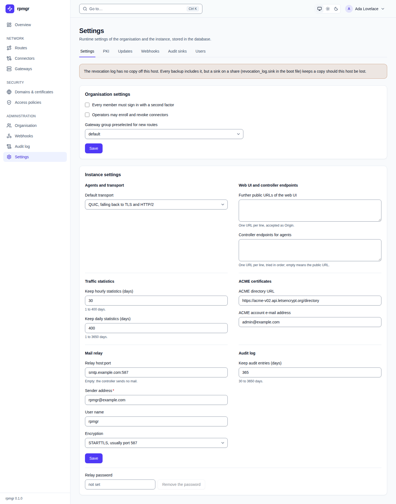
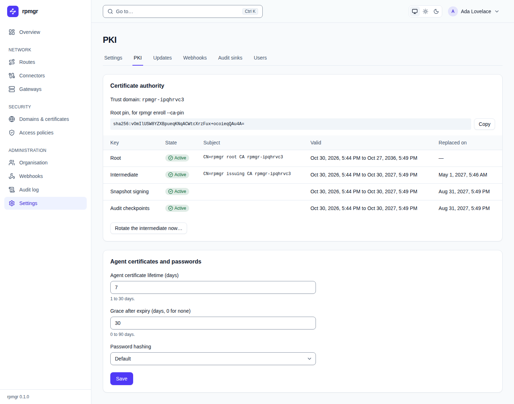
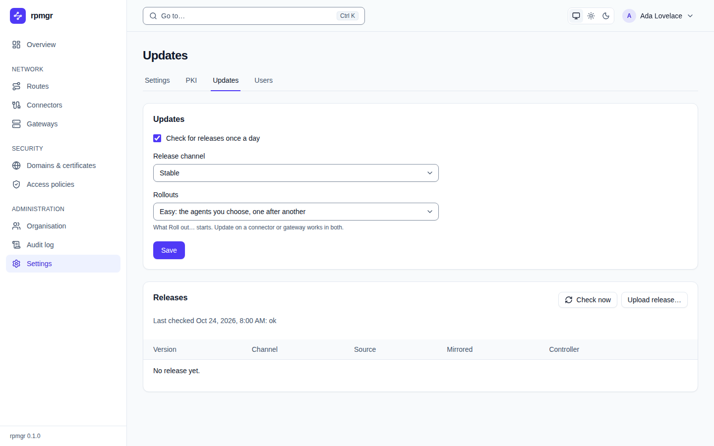
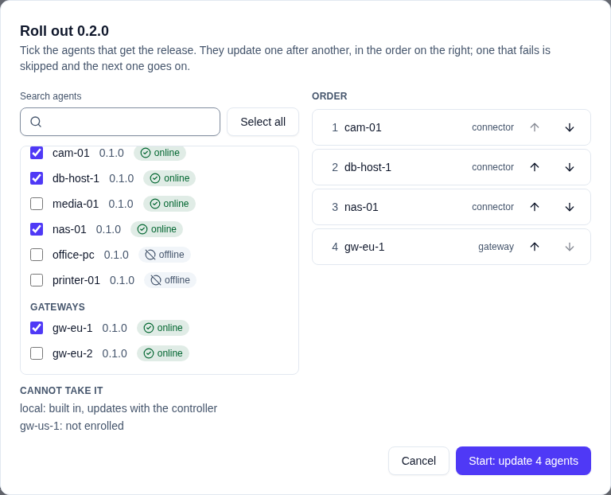
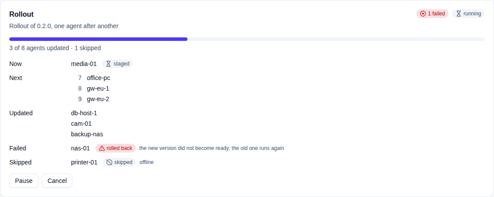
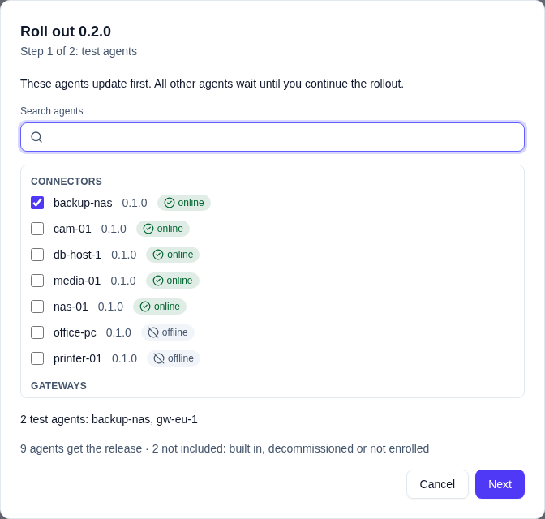
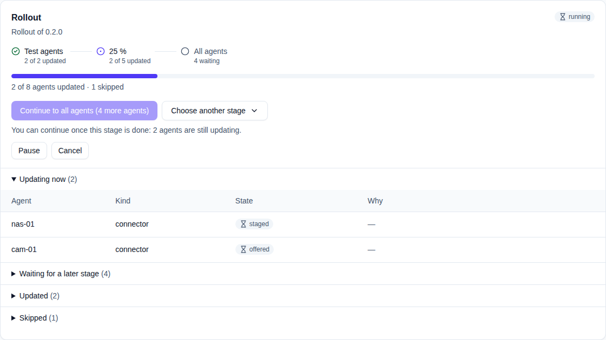
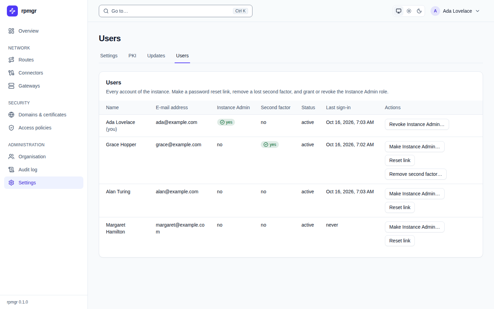

# Settings

The **Settings** pages hold the runtime settings, which the controller keeps in its database: the
organisation's settings, which every member sees and its Owner changes, and the instance's
settings, PKI, updates and users, which only the Instance Admin sees and changes. Settings a host
reads at start, such as listen addresses, are in its boot file instead
([Boot files](../reference/boot-files.md)). The how-to page, with what each setting does and its
default, is [Settings](../operations/settings.md).

The Instance Admin moves between four pages with the tabs under the title: **Settings**, **PKI**,
**Updates** and **Users**. Other members see no tabs; **PKI**, **Updates** and **Users** tell them
that only the Instance Admin sees and changes these.

Each page saves only its own fields, with **Save**, and says `Saved.` If the settings changed since
the page loaded them, it says so, shows them as they are now and asks you to try again.

## Revocation log notice

Above the settings, the Instance Admin may see a notice about the revocation log
([Backup and restore](../operations/backup-and-restore.md)):

- **No sink:** the revocation log has no copy off this host. Every backup includes it, but a sink
  on a share, `revocation_log.sink` in the boot file, keeps a copy should the host be lost.
- **Not yet off-host:** entries have waited too long to reach the sink, with how many and since
  when. Revocations are still enforced.

## Organisation settings

| Setting | What it does |
|---|---|
| **Every member must sign in with a second factor** | Members without a second factor are refused in the organisation until they set one up ([Sign-in and two-factor authentication](../accounts/sign-in-and-mfa.md#when-your-organisation-requires-it)). Changing it needs a [step-up](README.md#the-step-up-dialog) |
| **Operators may enroll and revoke connectors** | Gives the Operator role the `connectors.write` permission ([Members and roles](../accounts/members-and-roles.md)) |
| **Gateway group preselected for new routes** | The group the new-route form chooses for you, or **None** |

Members other than the Owner see the settings greyed out, with `Only the organisation's Owner
changes these.`

## Instance settings

Shown to the Instance Admin only, in sections:

| Section | Settings |
|---|---|
| **Agents and transport** | **Default transport**: **QUIC, falling back to TLS and HTTP/2**, **QUIC only** or **TLS and HTTP/2 only** ([Connector networking](../connectors/network.md)) |
| **Web UI and controller endpoints** | **Further public URLs of the web UI**, one URL per line, each accepted as the browser's origin; **Controller endpoints for agents**, one URL per line, tried in order, empty for the public URL |
| **Traffic statistics** | **Keep hourly statistics (days)** and **Keep daily statistics (days)** |
| **ACME certificates** | **ACME directory URL** and **ACME account e-mail address** ([Domains and certificates](../domains-and-certificates.md)) |
| **Mail relay** | **Relay host:port**, empty for no mail; **Sender address**, required with a relay; **User name**; **Encryption**: **STARTTLS, usually port 587** or **TLS, usually port 465** |
| **Audit log** | **Keep audit entries (days)** |

The hint under each number states its range. Emptying **Relay host:port** removes the mail relay:
the controller then sends no mail, so invitations and reset links are passed on by hand.

**Relay password**, below the sections, is write-only: the field says `set; type to replace` or
`not set`. Type a password and **Save** to set it, or press **Remove the password** with the field
empty to remove it.

## PKI

The **Certificate authority** card shows:

- the **Trust domain** of the instance;
- the **Root pin, for rpmgr enroll --ca-pin**, with **Copy**: the value install commands pass as
  `--ca-pin`;
- each key whose certificate has not expired: its **Key** (**Root**, **Intermediate**, **Snapshot
  signing** or **Audit checkpoints**), its **State** (**Next**, **Active** or **Retired**), its
  **Subject**, when it is **Valid**, and when the schedule **Replaced on** it.

**Rotate the intermediate now…** asks first, then needs a [step-up](README.md#the-step-up-dialog):
a new intermediate becomes active, and the old one keeps verifying the certificates it issued until
they expire. `A new intermediate is active.` confirms it.

The **Agent certificates and passwords** card holds **Agent certificate lifetime (days)**, **Grace
after expiry (days, 0 for none)** and **Password hashing** (**Default**, or **Low memory (below 1
GiB)**). Their ranges and defaults are in the design documents
([04](../../04-security.md#leaf-certificates),
[04](../../04-security.md#human-authentication-and-sessions)).
[PKI](../operations/pki.md) explains the CA, the pin and rotation.

## Updates

- **Check for releases once a day**: the controller fetches its own release, verified, into its
  mirror for agents ([Upgrades](../install/upgrades.md)).
- **Release channel**: **Stable**, or **Pre-releases too**.
- **Rollouts**: what **Roll out…** starts. **Easy** (the default) updates the agents you choose one
  after another; **Advanced** runs staged rollouts. **Update** on a connector or gateway works in
  both.
- **Releases**: every release the controller verified, with its **Version**, **Channel**,
  **Source** (**release check**, **upload** or **import**), whether it is **Mirrored**, and whether
  it is **this controller**. **Upload release…** takes the four signed files of a release for an
  air-gapped installation, after a step-up. **Roll out…** starts a rollout of a release that is no
  newer than the controller, easy or staged as **Rollouts** says. The release need not be mirrored yet: the controller fetches it
  and offers it to agents once the mirror holds it.
- Under **Releases**, **Last checked …** says when the release check last ended and how: **ok**,
  **failed** with its error, or that the release check is off. **Check now** checks for releases
  at once instead of waiting for the next day; while the check runs the line reads **Checking for
  releases…**, and the releases it finds appear without reloading the page. A check shortly after
  the last one is refused with the time to wait. A development build says it checks for no
  releases and has no **Check now**.
- **Roll out…**, easy: one dialog lists the agents that can take the release, connectors first and
  then gateways, with a search box and **Select all**, and those that cannot with the reason;
  **Order** shows the queue with **Move up** and **Move down**; **Start: update … agents** starts it
  after a step-up.
- **Rollout**, easy: **Now**, the agent whose turn it is; **Next**, the queue to come; **Updated**,
  **Failed** and **Skipped**, each with its reason, and the count of failures next to the state.
  After failures in a row the rollout pauses and says why; **Resume** goes on with the next agent.
- **Roll out…**, advanced, opens two steps: **Test agents**, the agents that update first, grouped into
  connectors and gateways with their version and whether they are online, with a search box and
  one online connector and one online gateway ticked; then the plan, which **Start the rollout**
  starts after a step-up.
- **Rollout**, staged: the running or paused rollout. Its **stages** show the test agents, the percentage
  and all agents, each done, current or to come, with its agents; a bar shows how many agents
  updated. **Continue to …** names the next stage and how many more agents it takes, once the
  agents of the current stage are done; **Choose another stage** offers other percentages or all
  agents. **Pause**, **Resume** and **Cancel** stop, continue or end it. The agents are grouped into
  **Need attention**, **Updating now**, **Waiting for a later stage**, **Updated** and **Skipped**,
  each with its state and reason. A rollback or a stalled agent pauses the rollout and the page
  says which agent and why.

[Updates](../operations/updates.md) shows how to run a rollout.

## Users

**Users** lists every account of the installation: **Name**, **E-mail address**, **Instance
Admin**, **Second factor**, **Status** and **Last sign-in**. Each row's **Actions**, after a
[step-up](README.md#the-step-up-dialog):

- **Make Instance Admin…** or **Revoke Instance Admin…**, after a confirmation. The installation
  keeps at least one active Instance Admin: revoking the last one is refused, and the row says so.
- **Reset link** and, for a user with an authenticator, **Remove second factor…**, as on the
  **Organisation** page, but for any user except yourself
  ([Members and roles](../accounts/members-and-roles.md#recover-a-members-account)).

## On the command line

`rpmgr get settings` and `rpmgr update settings --set <setting>=<value>` show and change the
organisation's settings, with `--instance` the instance's; `rpmgr set smtp-password` sets the relay
password ([Settings](../operations/settings.md)). `rpmgr update user --instance-admin <user>`, with
`=false` to revoke, `rpmgr create reset-link <user>` and `rpmgr remove second-factor <user>` act on
users.
