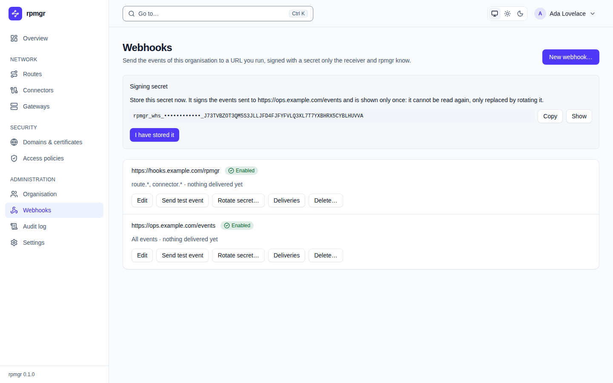

# Webhooks

A webhook sends the events of the organisation to a URL you run. This page describes the web UI's
**Webhooks** page, under **Administration**. It needs the permission `webhooks.write`, which the
Owner and the Admin hold; every other role sees a note that says so, since a URL may carry a token
of the receiver's and the API therefore lets no other role read it. The how-to page, with the
format of the events, how to check a signature and what happens when an endpoint fails, is
[Webhooks](../operations/webhooks.md).

## The endpoints

Each endpoint is a row with its URL, its **state**, its event types and when it last delivered:

- **Enabled:** events are sent to it.
- **Failing since …:** the latest deliveries failed; rpmgr keeps retrying.
- **Disabled:** a person switched it off.
- **Disabled: failing since …:** rpmgr switched it off after the endpoint failed for the period
  in [03](../../03-connections.md#timeouts-keepalive-and-backoff). **Enable again** starts it
  again; events count from then on.

`No webhook yet` says that the organisation has none.

## Create and edit

**New webhook…** opens a form; **Edit** in a row opens it with the endpoint's values.

- **URL** is an `https://` address without a user name, a password or a fragment. The page checks
  this before it sends anything; the server checks the rest, such as the length and the receivers
  it may not reach, and its reason is shown above the buttons.
- **Event types** are names or prefixes such as `route.*`, separated by commas. Empty means all
  events.
- **Enabled** switches the endpoint on or off.

**Create the webhook** or **Save** applies the form.

## The signing secret

Creating an endpoint, and **Rotate secret…**, show the **Signing secret** above the list. It is
shown once: no page, command or API call reads it back. **Copy** puts it on the clipboard; **Show**
reveals it where the browser cannot copy. Store it where the receiver can check signatures with it,
then choose **I have stored it**, which removes it from the page. A secret you did not store is
replaced by rotating it.

**Rotate secret…** asks first. After a rotation both the old and the new secret sign for the period
in [03](../../03-connections.md#timeouts-keepalive-and-backoff), so that the receiver can switch
without a gap; the row says until when the old one still signs.

## Test, deliveries and delete

- **Send test event** sends a `webhook.test` event to the endpoint at once and says what the
  receiver answered, or why it did not.
- **Deliveries** lists the attempts of the endpoint, newest first, 50 at a time: when, the event,
  the attempt, the HTTP status or the error, and when the next retry is due. **Show older
  deliveries** loads the next page.
- **Delete…** asks first, names the endpoint, and removes it with its deliveries.

## Instance webhooks

The Instance Admin's endpoints, which receive the instance's events, are on **Settings →
Webhooks**, a tab beside **PKI**, **Updates** and **Users** ([Settings](settings.md#webhooks)). The
**Instance webhooks** card works like this page: the same rows, form, secret, test and deliveries.
It differs in two ways: an instance endpoint may name a receiver on a private network, and an
organisation's Owner neither sees nor changes it.

## On the command line

`rpmgr create webhook --url <URL>` makes an endpoint and prints its signing secret once;
`rpmgr update webhook --rotate-secret <id>` rotates it. `get`, `list`, `update`, `enable`,
`disable`, `test` and `delete` cover the rest, and `--instance` addresses the instance's endpoints
([Webhooks](../operations/webhooks.md#on-the-command-line)). The API's `WebhookService` does the
same ([API](../reference/api.md#manage-a-webhook-endpoint)).
